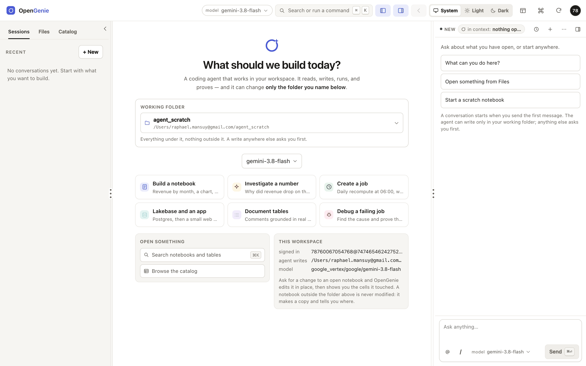

# OpenGenie

**A Databricks App that hosts a coding agent: the model you choose, writes fenced to the folder you name,
and proof before it says done.**

Genie Code is good and it gives you one model, on a meter, with the choice made for you. This repository
measures what that costs you, and then ships the alternative: an Apache-2.0 Databricks App where the model
is a control with sixteen options, the agent can only write inside a folder you named, and a requirement
counts as done only when a tool call proves it.

[](https://raphaelmansuy.github.io/opengenie/)
[](LICENSE)
[](apps/coding-agent/tests)
[](exams/results)



*The three-pane shell. The assistant is a zone beside the notebook rather than a tab, so opening a file
does not close the conversation that is about it.*

---

## Three things you cannot get from the default

| | Claim | Where it is implemented |
|---|---|---|
| **1** | **The model is yours.** Sixteen models across four providers (Databricks AI Gateway, OpenAI, Anthropic, Google Vertex), plus live discovery, plus your own key held encrypted in Lakebase. | [`seed/llm_models.yaml`](apps/coding-agent/seed/llm_models.yaml), [`api/adapters/llm/`](apps/coding-agent/api/adapters/llm) |
| **2** | **The fence is real.** Every write target is classified `allow` / `ask` / `deny` before it leaves the server, against the folder and schema you named at the start of the session. | [`api/domain/scope.py`](apps/coding-agent/api/domain/scope.py) |
| **3** | **Proof, not promises.** A requirement counts as done only when a tool call proves it. A citation to a call that never happened is an explicit verdict, not a warning. | [`api/domain/evidence.py`](apps/coding-agent/api/domain/evidence.py) |

## Why the model is the first claim

Because it is the largest lever we could measure, and it is the one a workspace does not control. Same
agent, same stock tools, same rules, two models:

| Setup | gpt-oss-120b | Gemini 3.8 Flash |
|---|---|---|
| Stock tools and rules, 8 development tasks | **39%** (60/152) | **86%** (130/152) |

One run each. The second task has the widest natural spread of the eight, and a repeatability check on a
different setup spread about three points. Every figure on the site is computed from
[`exams/results/`](exams/results) by [`site/claims.py`](site/claims.py), and the build fails if a number
and its source ever disagree.

## What it does

- **Answers by running SQL.** Not by describing a query. It runs it, sees the error, corrects itself.
- **Builds notebooks that run.** Writes the cells, runs them in order, stops at the first failure, quotes
  the engine's own words when one fails.
- **Finds the table.** Searches the catalogue, reads columns and comments, and says which table it used.
- **Documents what exists.** Comments grounded in real queries rather than in the model's imagination.
- **Debugs a failing job.** Reads the run history, finds the cause, fixes it, and re-runs it.
- **Says when it cannot.** Refuses Python on a cluster it does not have, a cluster picker it cannot
  honour, and any write outside the fence — with the reason.

## Start

The site is the front door; this README is its text version.

| If you want to | Go to |
|---|---|
| See what it looks like | [**The tour**](https://raphaelmansuy.github.io/opengenie/tour/) — 17 real screenshots, four widths, both themes |
| Set it up, with no local shell | [**The tutorial**](docs/tutorial.md) — about 30 minutes, from a notebook in Databricks |
| Check the numbers | [**The evidence**](https://raphaelmansuy.github.io/opengenie/evidence/) — every score with its denominator and its caveat |
| Deploy it as an App | [**Install**](https://raphaelmansuy.github.io/opengenie/install/) — three paths, what each needs |
| Read the reasoning | [001](specs/001-databricks-coding-agents/README.md) (the app) · [005](specs/005-llm-models/README.md) (models) · [006](specs/006-databricks/README.md) (parity) · [007](specs/007-ux-ui-improve/README.md) (the shell) · [008](specs/008-github-page/README.md) (this site) |

Build the site locally, with nothing but Python:

```bash
python3 -m pip install -r requirements-site.txt   # pygments
python3 site/build.py && python3 site/check.py    # build, then verify every link and claim
bash site/verify.sh                               # the above, plus every screenshot and audit
```

## What is in this repository

```
apps/coding-agent/       the application: FastAPI + React 19 + ACP agent over stdio
  api/                   domain (pure), ports, adapters, routers — 12,974 lines
  web/src/               React 19, CodeMirror 6, 105 files, 509 tests
  tests/                 466 Python tests
  tools/                 the MCP tool server: 28 tools, 20 in the core profile
mcp/                     the original standalone tool server and its conformance tests
exams/                   the exam harness: 11 graded missions, 7 setups, 174 saved runs
docs/                    the documentation: tutorial, big picture, setup, safety, results
specs/                   five specifications, each a cross-referenced set
site/                    this site: build.py, claims.py, check.py, content/, static/
notebooks/               the whole tutorial as one notebook, for a workspace with no shell
templates/               the original shell-only kit (setup, fence, supervisor, ask)
```

## Durable coding sessions

[Specification and implementation](specs/010-long-running/README.md): server-owned work, Lakebase/Postgres or SQLite journals, explicit recovery, and a return-oriented UI. [Browser evidence](specs/010-long-running/e2e/README.md) includes disconnect, page close, restart, permissions and responsive screenshots.

## The study behind the app

The application is the second half of this repository. The first half is the measurement that justified
it: eleven graded tasks run in a live workspace, seven setups, and every result saved. Nothing below is
summary — the tables are generated from the saved run files.

## The six findings that matter most

1. **It works, entirely inside Databricks.** An open-source coding agent installs in the Databricks sandbox and drives the
   workspace. No shell or install on your laptop. → [Tutorial](docs/tutorial.md), [Setup](docs/02-setup-in-the-databricks-shell.md)
2. **The model matters more than the tooling.** The *same* tools and rules scored **39%** with the gateway model and **86%**
   with Gemini. → [Results](docs/06-results-and-lessons.md)
3. **Engineering rescues a weak model.** Scoped tools, a supervisor loop and written rules took that model from **19% to 94%**.
   The single biggest jump came from making the agent finish and prove its work, not from Databricks knowledge.
4. **A strong model needs far less of that machinery.** On the held-out tasks, our very first setup scored 100% with Gemini.
   Choose how much to engineer based on the model you can afford. → [Decision guide](docs/07-decision-guide.md)
5. **The official Databricks skills are good but not neutral.** One of them routes data questions to Genie, the very product
   you may be replacing, and the plain command-line path has **no write fence**. → [Toolbox](docs/03-toolbox-cli-skills-mcp.md#the-genie-trap), [Safety](docs/04-safety-and-governance.md#the-hole-the-plain-cli-path-has-no-fence)
6. **Never trust a self-reported "done".** Our most dangerous failures were confident, well-written and wrong. Every claim is
   checked against live workspace state. → [Exam suite](docs/05-exam-suite.md)

### Quick start (shell-only path)

Three commands, from a copy of this repository inside the Databricks sandbox:

```bash
bash templates/setup_agent.sh                                                    # agent + config + rules + skills
bash templates/start_mcp.sh workspace.agent_scratch /Workspace/Users/you/agent_scratch   # start, with the write fence
bash templates/ask.sh "How many trips are in samples.nyctaxi.trips, and over what date range?"
```

You need `DATABRICKS_HOST` set and your token in `/tmp/dbx_token.txt`. Full walkthrough with screenshots:
[the tutorial](docs/tutorial.md). To get the sandbox itself without a local shell, run
[`notebooks/launch_agent_from_notebook.py`](notebooks/launch_agent_from_notebook.py) in a notebook.

## How the exams work, in three lines

Each task **seeds real state** (tables with traps, a broken job, a poisoned ticket), hands the agent a plain-language
request, then **grades the live workspace afterwards**: does the table match the golden answer both ways, did the notebook
actually run, does the job's latest run succeed, is the injection ignored. A grader is only trusted once the reference
solution scores 100% and a do-nothing agent fails. → [Exam suite](docs/05-exam-suite.md)

### Safety in the shell-only path

- The token in `.env` is a live personal access token. It is git-ignored; never print it, and rotate it if it leaks. The exam
  harness fails any run whose transcript contains it.
- Writes are limited server-side to one schema, one folder and a name prefix. Keep `NBMCP_ALLOW_WRITES` off outside dev.
- **The plain `databricks` command-line path inside the sandbox is *not* fenced:** the real boundary is the token you give it.

### Reproducing the tables

```bash
python3 exams/make_tables.py          # print every table
python3 exams/inject_tables.py        # refresh the tables inside README.md and docs/*.md
python3 exams/run_exam.py --variant V4 --model gpt-oss-120b --missions all --parallel 2 --batch my_run
```

Requirements for the harness: Python 3.12 with `requests`, the `databricks` CLI, a `.env` with `TOKEN=`, and access to
`system.ai.sandbox`. The agent under test never sees the grader.

---

## What this is not

- **Not a replacement for Genie's business-term understanding.** Our exams named the tables. Finding the
  right table in a catalogue of ten thousand is where an ontology earns its keep, and it is untested here.
- **Not a cost comparison.** We measured tokens, not money, and we hold no Genie Code usage history. Any
  saving you read elsewhere, including here, would be invented.
- **Not a hosted demo.** The app needs a token for *your* workspace, so there is nothing to click.
- **Not a guarantee.** One run per setup on most configurations, small clean data, well-specified tasks.
  Only one configuration was run three times (spread about 2.6 points), so a one- or two-point gap between
  two setups is not a difference.
- **The tutorial's step images are renderings of real notebook output,** not photographs of the Databricks
  web UI: single sign-on blocked automated capture, and the click-only steps are described in words.

## Safety

- **The token is the boundary.** Locally there is no single sign-on, so the app acts as the token's owner.
  Use a service principal with rights on one scratch schema. The fence limits what the agent *asks for*;
  the token limits what it *may do*.
- **A write outside the fence is refused before it happens,** and the refusal names the folder that would
  have been allowed.
- **Agents can be prompt-injected by data.** Exam M8 plants an instruction inside a support ticket. Read
  the "anything odd or suspicious" section of every report.
- **Never run an agent with auto-approve against production.**

See [Safety and governance](docs/04-safety-and-governance.md) before running anything that can write.

## Licence

[Apache-2.0](LICENSE). Use it, fork it, ship it inside a company; keep the attribution.

## Author

**Raphael Mansuy** — data engineering and AI strategist. Twenty years of global technology leadership,
a startup studio in Hong Kong, co-author of *The Definitive Guide to Data Integration* (Packt, 2024).

[LinkedIn](https://www.linkedin.com/in/raphaelmansuy/) · [GitHub](https://github.com/raphaelmansuy) ·
[The book](https://www.oreilly.com/library/view/the-definitive-guide/9781837631919/) ·
[EdgePii](https://raphaelmansuy.github.io/edgepii/) · [EdgeQuake](https://edgequake.com/)

<p align="center"><sub>Every figure here is generated from <code>exams/results/</code>. The caveats behind each one are in
<a href="docs/06-results-and-lessons.md">Results and lessons</a>.</sub></p>
