# Replacing Databricks Genie Code with a general coding agent

**One sentence:** you can get most of what Genie Code does by running an ordinary coding agent
(**OpenCode** or **GitHub Copilot CLI**) *inside* the Databricks shell, pointing it at the AI Gateway, and giving it
Databricks' command-line tool, a small tool server with a **write fence**, and a few written rules. We tested that claim
with **11 graded tasks** against a live workspace, and this repository holds the setup scripts, the agent, the exam harness
and every saved result.

Everything here was run for real against `dbc-cb61f1e1-bd8e.cloud.databricks.com`. Nothing is simulated. Numbers in the
documents are generated from the saved result files, so they cannot drift from the data.

[](docs/tutorial.md)
[](exams/results)
[](docs/03-toolbox-cli-skills-mcp.md)
[](docs/02-setup-in-the-databricks-shell.md)

## Start here

| If you want to... | Go to |
|---|---|
| **Set it up and use it**, with screenshots of every step | [**Tutorial**](docs/tutorial.md) — about 30 minutes, no local shell |
| Run the exams on your own tasks | [Exam suite](docs/05-exam-suite.md) |
| Understand the idea in 10 minutes | [Big picture](docs/01-big-picture.md) |
| See the evidence | [Results and lessons](docs/06-results-and-lessons.md) |
| Know what is safe | [Safety and governance](docs/04-safety-and-governance.md) |
| Decide what to deploy | [Decision guide](docs/07-decision-guide.md) |
| Look up a term | [Glossary](docs/glossary.md) |
| Go deep: the first, longer study | [Original specification](docs/genie-code-replacement-spec.md) (1,060 lines) |
| **Build the product**: a Databricks App that hosts coding agents (React + FastAPI + ACP) | [Spec 001: Databricks Coding Agents](specs/001-databricks-coding-agents/README.md) |

## Headline results

Each number is a score over 8 development tasks (M1–M8), or 3 held-out tasks (X1–X3) that were never used while tuning.

<!-- BEGIN:summary_dev -->
**Development set (M1-M8), total score**

| Variant | copilot / gpt-oss-120b | opencode / gemini-3.8-flash | opencode / gpt-oss-120b |
|---|---|---|---|
| V0 | - | - | 19% |
| V1 | - | - | 20% |
| V2 | - | - | 82% |
| V3 | - | - | 94% |
| V4 | 70% | 100% | 94% |
| V5 | - | 86% | 39% |
| V6 | 71% | 99% | 88% |

(`*` = not every task was run)
<!-- END:summary_dev -->

<!-- BEGIN:summary_held -->
**Held-out set (X1-X3), total score**

| Variant | copilot / gpt-oss-120b | opencode / gemini-3.8-flash | opencode / gpt-oss-120b |
|---|---|---|---|
| V1 | - | 100% | 43% |
| V4 | 92% | 100% | 86% |
| V5 | - | 95% | 76% |
| V6 | - | 100% | 95% |

(`*` = not every task was run)
<!-- END:summary_held -->



```mermaid
%%{init: {'theme':'base','themeVariables':{'primaryColor':'#E8F0FE','primaryTextColor':'#1F2937','primaryBorderColor':'#A8C0E8','lineColor':'#94A3B8','xyChart':{'plotColorPalette':'#F5C29C, #A8D5B5'}}}}%%
xychart-beta
    title "Development set: Gemini 3.8 Flash by setup"
    x-axis ["V4 custom tools", "V5 stock CLI", "V6 hybrid"]
    y-axis "Total score (%)" 0 --> 100
    bar [100, 86, 99]
    bar [94, 39, 88]
```

(first bar in each pair: Gemini 3.8 Flash; second: gpt-oss-120b. Setups are described in
[Results](docs/06-results-and-lessons.md#the-variant-ladder). Only these three setups were run with both models.)

(first series: gpt-oss-120b, the model reachable through the Databricks AI Gateway; second: Gemini 3.8 Flash through Vertex.
The setup names are explained in [Results](docs/06-results-and-lessons.md#the-variant-ladder).)

## The six findings that matter most

1. **It works, entirely inside Databricks.** An open-source coding agent installs in the Databricks sandbox and drives the
   workspace. No shell or install on your laptop. → [Tutorial](docs/tutorial.md), [Setup](docs/02-setup-in-the-databricks-shell.md)
2. **The model matters more than the tooling.** The *same* tools and rules scored **39%** with the gateway model and **86%**
   with Gemini. → [Results](docs/06-results-and-lessons.md)
3. **Engineering rescues a weak model.** Scoped tools, a supervisor loop and written rules took that model from **19% to 94%**.
   The single biggest jump came from making the agent finish and prove its work, not from Databricks knowledge.
4. **A strong model needs far less of that machinery.** On the held-out tasks, our very first setup scored 100% with Gemini.
   Choose how much to engineer based on the model you can afford. → [Decision guide](docs/07-decision-guide.md)
5. **The official Databricks skills are good but not neutral.** One of them routes data questions to Genie, the very product
   you may be replacing, and the plain command-line path has **no write fence**. → [Toolbox](docs/03-toolbox-cli-skills-mcp.md#the-genie-trap), [Safety](docs/04-safety-and-governance.md#the-hole-the-plain-cli-path-has-no-fence)
6. **Never trust a self-reported "done".** Our most dangerous failures were confident, well-written and wrong. Every claim is
   checked against live workspace state. → [Exam suite](docs/05-exam-suite.md)

## Quick start

Three commands, from a copy of this repository inside the Databricks sandbox:

```bash
bash templates/setup_agent.sh                                                    # agent + config + rules + skills
bash templates/start_mcp.sh workspace.agent_scratch /Workspace/Users/you/agent_scratch   # start, with the write fence
bash templates/ask.sh "How many trips are in samples.nyctaxi.trips, and over what date range?"
```

You need `DATABRICKS_HOST` set and your token in `/tmp/dbx_token.txt`. Full walkthrough with screenshots:
[**the tutorial**](docs/tutorial.md). To get the sandbox itself without a local shell, run
[`notebooks/launch_agent_from_notebook.py`](notebooks/launch_agent_from_notebook.py) in a notebook.

## What is in this repository

```
docs/                          the documentation (read docs/tutorial.md first)
  tutorial.md                  step-by-step, with screenshots of real output
  01..07                       big picture, setup, toolbox, safety, exams, results, decision guide
  glossary.md                  plain-words definitions
  genie-code-replacement-spec.md   the original, deeper study
  e2e/                         evidence: transcripts, conformance results, screenshots
templates/                     the kit you copy into the sandbox
  setup_agent.sh               install the agent, write its config, copy rules and skills
  start_mcp.sh                 start the tool server with a one-schema, one-folder write fence
  ask.sh / run_agent.sh        ask a question; a supervisor keeps the agent working until it has proof
  AGENTS.rules.md              the working agreement given to the agent
notebooks/
  launch_agent_from_notebook.py    the whole tutorial as one notebook (no local shell needed)
specs/                         product specifications
  001-databricks-coding-agents/  the Databricks App that hosts ACP agents (React + FastAPI)
mcp/
  databricks_notebook_mcp.py   the tool server: 26 tools, 19 in the default profile, scoped writes
  skills/                      four short how-to skills the agent can read on demand
  test_mcp_v2.py               conformance tests
exams/                         the exam harness
  missions/                    11 graded tasks (M1-M8 development, X1-X3 held out)
  variants.py                  the 7 setups (V0-V6) and their exact differences
  run_exam.py                  seed state, run an agent, grade the live workspace
  run_notebook_locally.py ...  (experiments/) capture and render the tutorial screenshots
  results/                     every saved run: JSON summary + raw agent event log
experiments/                   the experiments behind the findings, plus the screenshot tooling
```

## How the exams work, in three lines

Each task **seeds real state** (tables with traps, a broken job, a poisoned ticket), hands the agent a plain-language
request, then **grades the live workspace afterwards**: does the table match the golden answer both ways, did the notebook
actually run, does the job's latest run succeed, is the injection ignored. A grader is only trusted once the reference
solution scores 100% and a do-nothing agent fails. → [Exam suite](docs/05-exam-suite.md)

## What this study does not claim

- **No cost comparison.** We measured tokens, not money, and had no Genie Code usage history. Do not quote a saving from
  this repository. → [Cost in plain words](docs/07-decision-guide.md#cost-in-plain-words)
- **Small, clean data.** Production lakehouses are messier and larger.
- **Well-specified tasks.** Our exams name the tables. We did not test finding the right table in a large catalogue, which is
  where Genie's ontology helps most.
- **One run per setup, except V4.** Only V4 with the gateway model was repeated (three runs, spread about 2.6 points).
- **Real screenshots of the web UI.** Single sign-on blocked automated capture; the tutorial renders real *output* as images
  and describes click-only steps in words.

## Safety

- The token in `.env` is a live personal access token. It is git-ignored; never print it, and rotate it if it leaks. The exam
  harness fails any run whose transcript contains it.
- Writes are limited server-side to one schema, one folder and a name prefix. Keep `NBMCP_ALLOW_WRITES` off outside dev.
- **Never run an agent with auto-approve against production.** The plain `databricks` command-line path inside the sandbox is
  *not* fenced: the real boundary is the token you give it. Use a scoped service principal.
- Agents can be **prompt-injected** by text inside data. Our exam M8 plants an instruction in a support ticket. Read the
  "Anything odd or suspicious" section of every report.

See [Safety and governance](docs/04-safety-and-governance.md) before running anything that can write.

## Reproducing the tables

```bash
python3 exams/make_tables.py          # print every table
python3 exams/inject_tables.py        # refresh the tables inside README.md and docs/*.md
python3 exams/run_exam.py --variant V4 --model gpt-oss-120b --missions all --parallel 2 --batch my_run
```

Requirements for the harness: Python 3.12 with `requests`, the `databricks` CLI, a `.env` with `TOKEN=`, and access to
`system.ai.sandbox`. The agent under test never sees the grader.

---

*Last updated: 6 November 2026. Every figure is generated from `exams/results/`; see
[Results and lessons](docs/06-results-and-lessons.md) for the caveats behind each number.*
