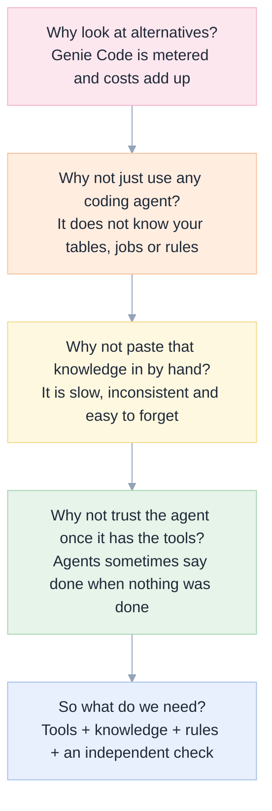
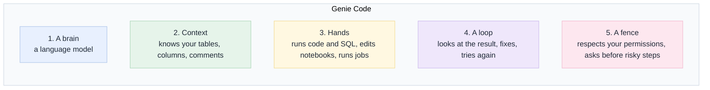
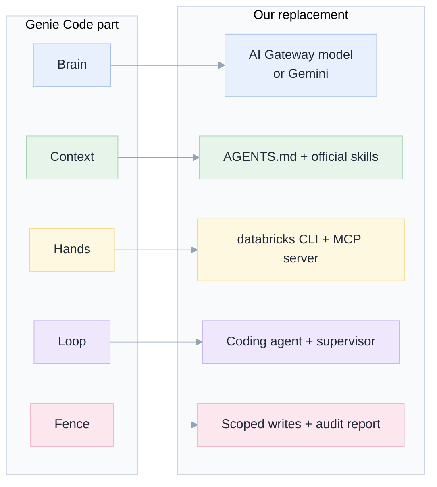
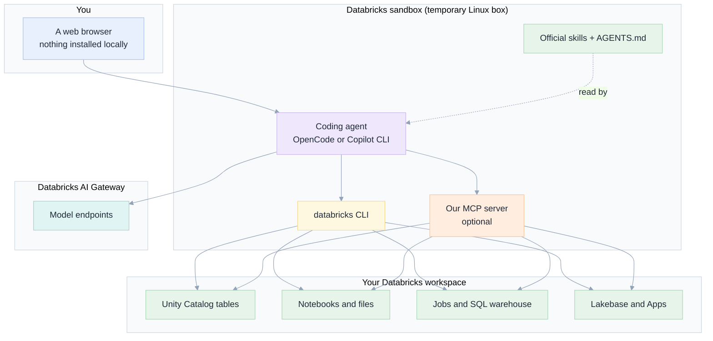

[Index](README.md) · **01 Big picture** · [02 Setup](02-setup-in-the-databricks-shell.md) · [03 Toolbox](03-toolbox-cli-skills-mcp.md) · [04 Safety](04-safety-and-governance.md) · [05 Exams](05-exam-suite.md) · [06 Results](06-results-and-lessons.md) · [07 Decide](07-decision-guide.md)

# 01 · The big picture

## The problem in plain words

Databricks Genie Code is an AI helper built into Databricks. You ask it, in the notebook or
the SQL editor, to "write a query", "fix this error" or "build this pipeline", and it does so.
It is useful, and it is metered: heavy use costs money.

Meanwhile ordinary **coding agents** exist, such as OpenCode and GitHub Copilot CLI. They are
good at reading code, running commands and fixing mistakes in a loop. They know nothing about
your Databricks workspace out of the box.

**The question:** can we give an ordinary coding agent the missing Databricks knowledge and
tools, run it where Databricks users already are, and get results close to Genie Code?

**A constraint we respect:** nothing may be installed on the user's PC and there is no local
shell. Everything runs in the Databricks shell (the *sandbox*).

## The five whys (short version)

The long version, with sources, is in [the original specification §1](genie-code-replacement-spec.md#1-the-5-whys).

## What Genie Code is made of

Genie Code looks like one product, but it is five jobs done together:

## What we use for each of the five jobs

| Genie Code part | Our replacement | Where to read more |
|---|---|---|
| 1. Brain | A model reached through the **Databricks AI Gateway** (for example `gpt-oss-120b`), or an external model such as Gemini 3.8 Flash | [02](02-setup-in-the-databricks-shell.md#step-4--point-the-agent-at-a-model) |
| 2. Context | A **rules file** (`AGENTS.md`), the **official Databricks skills**, and table-description commands | [03](03-toolbox-cli-skills-mcp.md) |
| 3. Hands | The **`databricks` command-line tool** and, optionally, a small **MCP server** we wrote | [03](03-toolbox-cli-skills-mcp.md) |
| 4. Loop | The coding agent itself, plus a **supervisor script** that makes it keep going until it can prove the work | [02](02-setup-in-the-databricks-shell.md#step-7--run-the-agent-with-a-supervisor) |
| 5. Fence | **Scoped write permission** inside our MCP server, deny-rules, and a final report that lists evidence | [04](04-safety-and-governance.md) |

## Where everything runs

The sandbox is temporary. If an agent misbehaves, its disk disappears with it. This is a real
safety benefit that a laptop install does not have.

## What we did to find out if it works

We did not rely on demos. We wrote **eleven exam tasks** that look like real Databricks work:
a hard SQL ranking, a data investigation, creating and fixing notebooks, an ETL job, a Lakebase
database with a web app, documenting tables, and a prompt-injection safety test. Each task is
graded by a program that looks at the **real workspace afterwards**. Eight tasks were used while
improving the setup. Three were kept secret until the end to check we had not just memorised
the exam. Details are in [05](05-exam-suite.md); numbers are in [06](06-results-and-lessons.md).

```mermaid
%%{init: {'theme':'base','themeVariables':{'primaryColor':'#E8F0FE','primaryTextColor':'#1F2937','primaryBorderColor':'#A8C0E8','lineColor':'#94A3B8'}}}%%
flowchart LR
    A["Define exam tasks"]:::blue --> B["Check each grader<br/>reference passes, empty answer fails"]:::green
    B --> C["Run approach V0<br/>bare agent"]:::yellow
    C --> D["Read the failures"]:::pink
    D --> E["Improve the approach<br/>V1, V2, V3 ..."]:::purple
    E --> C
    E --> F["Final check on secret tasks"]:::orange
    classDef blue fill:#E8F0FE,stroke:#A8C0E8,color:#1F2937
    classDef green fill:#E6F4EA,stroke:#A8D5B5,color:#1F2937
    classDef yellow fill:#FFF8E1,stroke:#F2D98D,color:#1F2937
    classDef pink fill:#FDE7EF,stroke:#F2B5CB,color:#1F2937
    classDef purple fill:#EFE7FB,stroke:#C9B6EC,color:#1F2937
    classDef orange fill:#FFEDE0,stroke:#F5C29C,color:#1F2937
```

## What this study does not claim

- It does **not** replace the Genie Code *screen*: chat panes inside notebooks, inline
  suggestions, one-click "Fix error" buttons. The agent works from a terminal.
- It does **not** match Genie's knowledge of your business terms (the Genie Ontology). We
  deliberately avoid calling Genie at all, because that would defeat the cost goal.
- It does **not** prove the same scores on your data. Our workspace is small and our exams are
  small. Treat the numbers as a strong signal, not a guarantee.

Next: [02 Setup in the Databricks shell](02-setup-in-the-databricks-shell.md).

If you are reading this to understand the *application* rather than the study, the shape of it is in
[08 Architecture](08-architecture.md): one container, two child processes per conversation, a journal
that outlives a restart. The study came first; the app is what it justified.
