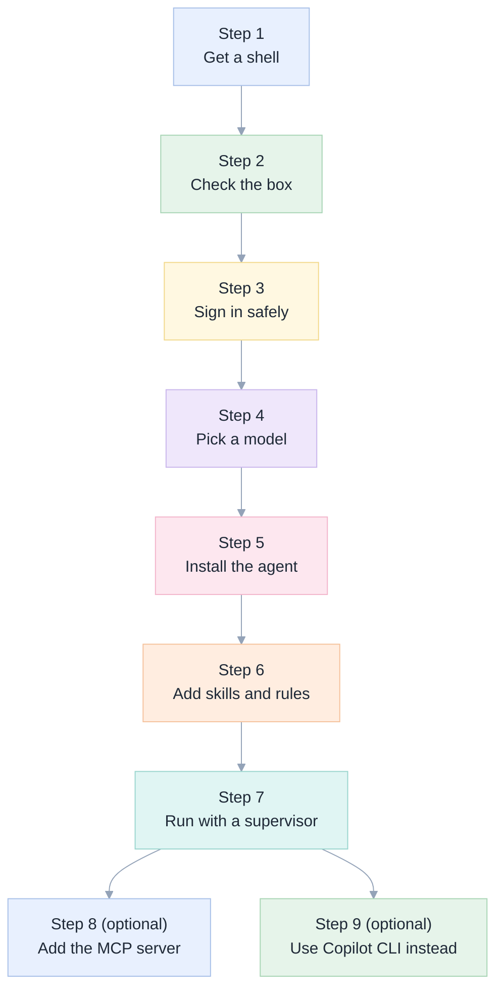
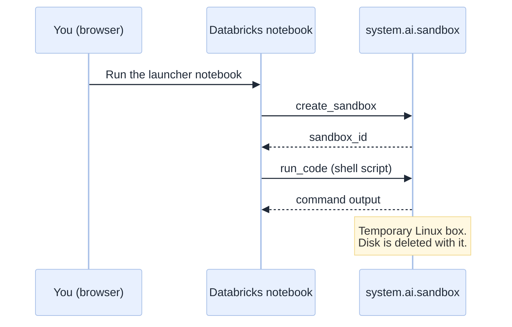
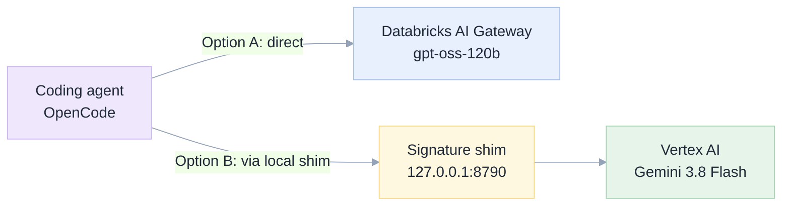
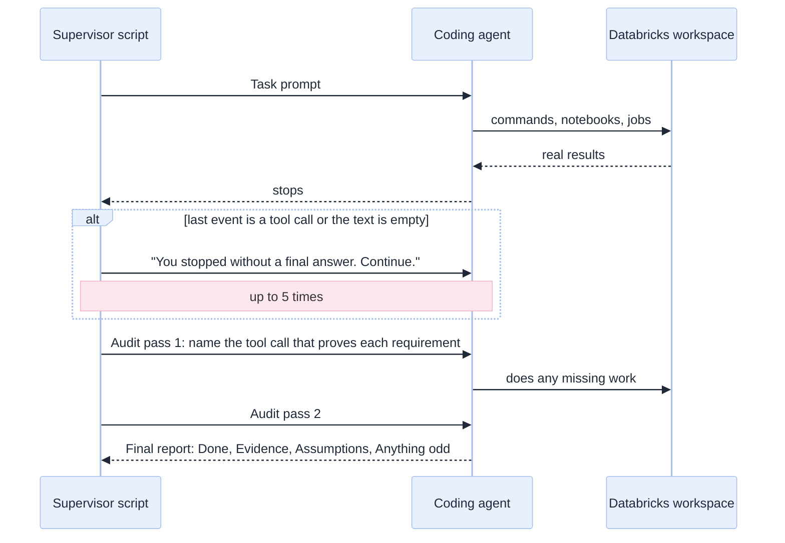

[Index](README.md) · [01 Big picture](01-big-picture.md) · **02 Setup** · [03 Toolbox](03-toolbox-cli-skills-mcp.md) · [04 Safety](04-safety-and-governance.md) · [05 Exams](05-exam-suite.md) · [06 Results](06-results-and-lessons.md) · [07 Decide](07-decision-guide.md)

# 02 · Setup in the Databricks shell

> **New here?** The [step-by-step tutorial](tutorial.md) does all of this from one notebook, with screenshots. It is the
> shortest verified path: `git clone` of this repository plus three commands. This page is the reference version with the reasons behind each step.

This is a hands-on runbook. It takes you from an empty sandbox to a coding agent that can do
Databricks work. Every step was run for real; the table below says where.



## What was verified, and where

| Step | Verified? | How |
|---|---|---|
| 1 Get a shell from a notebook | Yes | [`docs/e2e/17_notebook_launcher.txt`](e2e/17_notebook_launcher.txt) |
| 1 Get a shell from the *web terminal* | **No** | Not tested. Treat as likely but unproven |
| 2 to 7 inside the sandbox | Yes | Every exam run in [06](06-results-and-lessons.md) did exactly this |
| 8 MCP server | Yes | [`mcp/test_mcp_v2.py`](../mcp/test_mcp_v2.py) (a conformance suite kept from the study; the server it tests now lives at `apps/coding-agent/tools/`) and all V2 to V4 runs |
| 9 Copilot CLI | See [06](06-results-and-lessons.md#github-copilot-cli) | Run through the same harness |

## What you need before you start

- A Databricks workspace with the **AI Gateway** (for models) and the **`system.ai.sandbox`**
  service (for the shell). Ours is a Free-Edition-style workspace: serverless compute only.
- A **personal access token (PAT)** *or* a notebook that can use its own session token.
- A SQL warehouse (the serverless starter warehouse is enough).

## Step 1 · Get a shell

The sandbox is a small, temporary Linux machine that Databricks gives you through an API.
You do not need a terminal on your own computer: a notebook can ask for it.



Import [`notebooks/launch_agent_from_notebook.py`](../notebooks/launch_agent_from_notebook.py)
into your workspace and run it. It uses only the Python standard library, so serverless
compute is fine. Its helper `sh(sandbox_id, script)` runs any shell script in the sandbox.

Three limits to remember:

1. **One call is cut after about 180 seconds.** For long work, start the job in the background
   (`nohup ... &`), write a marker file when done, and poll for it.
2. **The disk is temporary.** Keep anything valuable in the workspace, not the sandbox.
3. **No root.** Install into your home folder.

## Step 2 · Check the box

```bash
uname -sm; databricks --version; node --version; uv --version
```

What we found in the sandbox: the **`databricks` CLI v1.23.0** and **`ug`** (Databricks' own
launcher for coding agents), Node, and `uv` were already there. OpenCode and Copilot were not.

> **Gotcha: the CLI says "no DEFAULT profile configured".** The sandbox sets
> `DATABRICKS_CONFIG_FILE=/run/lakebox/databrickscfg`, which has no profile in it. Fix:
> ```bash
> unset DATABRICKS_CONFIG_FILE DATABRICKS_CONFIG_PROFILE
> export DATABRICKS_HOST="https://YOUR-WORKSPACE.cloud.databricks.com"
> export DATABRICKS_TOKEN="$(cat /tmp/dbx_token.txt)"
> databricks current-user me      # should print you
> ```

## Step 3 · Sign in safely

- Put the token in a file readable only by you, never inside a prompt, a script or a command line:
  ```bash
  umask 077; printf '%s' "$TOKEN" > /tmp/dbx_token.txt
  ```
- Load it into an environment variable when you start the agent, as shown above.
- The agent is told never to print it (see [04](04-safety-and-governance.md)), and our exam
  harness fails any run whose transcript contains it.

> **`ug configure` does not work here.** It insists on a browser login (OAuth), even when you
> hand it a PAT profile, and a headless sandbox has no browser. We configure the agent by hand
> instead (next steps). `ug` is still useful on a laptop that has a browser.

## Step 4 · Point the agent at a model

You have two proven options.



**Option A: a model on the Databricks AI Gateway** (simplest, stays inside Databricks).
Copy [`templates/opencode.gpt-oss.json`](../templates/opencode.gpt-oss.json) to your working
folder as `opencode.json` and put your workspace address in `baseURL`.

> **The one line everyone misses:** `"limit": { "output": 24000 }`. Agents ask for up to 32,000
> output tokens by default; this model allows 25,000. Without the line the call is rejected and
> the agent's screen just shows a spinner. Each model has a different cap
> ([original spec §3.2](genie-code-replacement-spec.md#32-the-two-hard-constraints-we-measured)).

**Option B: an external model such as Gemini 3.8 Flash** on Vertex AI. Gemini 3.x attaches a
hidden "thought signature" to each tool call that must be sent back unchanged. Generic
OpenAI-compatible adapters drop it, and the model then fails. [`experiments/gemini_sig_shim.py`](../experiments/gemini_sig_shim.py)
is a tiny local proxy that keeps the signature. Run it in the sandbox, give it a short-lived
Google access token, and use [`templates/opencode.gemini.json`](../templates/opencode.gemini.json):

```bash
export VX_TOKEN="$(cat /tmp/vx_token.txt)"      # from `gcloud auth print-access-token` (lasts 1 hour)
nohup python3 /tmp/gemini_sig_shim.py > /tmp/shim.log 2>&1 &
curl -s -o /dev/null -w '%{http_code}\n' http://127.0.0.1:8790/v1/models    # expect 200
```

## Step 5 · Install the agent

No root needed: install into your home folder.

```bash
mkdir -p ~/.npm-global && npm config set prefix ~/.npm-global
export PATH="$HOME/.npm-global/bin:$PATH"
npm install -g opencode-ai            # the coding agent
opencode --version
# Optional Python helpers (for the MCP server in step 8):
uv venv --system-site-packages ~/pyenv -q
uv pip install -q --python ~/pyenv/bin/python "mcp<2" httpx requests psycopg2-binary
```

> `mcp<2` matters: version 2 of the Python MCP package renamed its server class and our server
> then silently fails to start. We lost one whole exam batch to this; the harness now aborts
> loudly if the server does not answer.

## Step 6 · Add the skills and the rules

**Skills** are short how-to documents the agent opens when a task needs them. Databricks
publishes 34 official ones. One command fetches them all:

```bash
databricks aitools install --path /tmp/dbx_skills_all --scope global
mkdir -p .claude && cp -r /tmp/dbx_skills_all .claude/skills     # OpenCode reads .claude/skills (verified); Copilot: see doc 06
```

> `--skills a,b` only works together with `--skills-only` or `--path`. Without them the command
> installs a plugin for agents that support one (Copilot, Claude Code, Codex) and refuses a partial list.

**Rules** go in a file named `AGENTS.md` in the working folder; both agents read it automatically.
Start from [`exams/agents_v6.md`](../exams/agents_v6.md) (tools + CLI + skills) or
[`exams/agents_v5.md`](../exams/agents_v5.md) (CLI + skills only). What those files say, and why,
is in [03](03-toolbox-cli-skills-mcp.md#layer-d--the-rules-file) and [04](04-safety-and-governance.md).

**Switch off the Genie shortcut.** One official skill tells the agent to ask Genie. Both rules
files contain a "Do not use Genie" section. Keep it. See [the Genie trap](03-toolbox-cli-skills-mcp.md#the-genie-trap).

## Step 7 · Run the agent with a supervisor

A bare agent often **stops early** or **says "done" without proof**. We saw both on the very
first runs. The fix is a small shell wrapper, [`templates/run_agent.sh`](../templates/run_agent.sh),
that checks the end of the transcript and, if needed, pushes the agent on:



```bash
cp templates/opencode.gpt-oss.json opencode.json     # edit baseURL
cp templates/AGENTS.rules.md AGENTS.md
echo "Create a table workspace.demo.top_zips with the 10 pickup zips by revenue..." > task.txt
bash templates/run_agent.sh task.txt
```

What the supervisor changed, measured on the same model and tasks: see
[the variant ladder in 06](06-results-and-lessons.md#the-variant-ladder).

## One-command alternative

Steps 2 to 7 are automated for you. In the sandbox, from a copy of this repository:

```bash
bash templates/setup_agent.sh                                                   # installs agent, config, rules, skills
bash start_mcp.sh workspace.agent_scratch /Workspace/Users/you/agent_scratch     # starts the fence
bash ask.sh "How many trips are in samples.nyctaxi.trips, and over what date range?"
```

This is the path the [tutorial](tutorial.md) uses, with screenshots and real output from each command.

## Step 8 (optional) · Add the MCP server

An **MCP server** is a small program that gives the agent extra tools. Ours,
[`apps/coding-agent/tools/databricks_notebook_mcp.py`](../apps/coding-agent/tools/databricks_notebook_mcp.py), adds Databricks-aware tools
such as "write this notebook from a list of cells", "run it and return the real error", and
"create a job with dependencies". Its most important property is **a fence on writes**: it
only lets the agent write to one scratch schema, one workspace folder and names with a given
prefix. See [03](03-toolbox-cli-skills-mcp.md#layer-c--our-mcp-server) and [04](04-safety-and-governance.md).

```bash
NBMCP_TRANSPORT=http NBMCP_PORT=8801 NBMCP_HOST=127.0.0.1 NBMCP_ALLOW_WRITES=1 \
NBMCP_WRITE_SCHEMAS="workspace.my_scratch" NBMCP_WRITE_PATHS="/Users/me/agent_work/" \
NBMCP_WRITE_JOB_PREFIX="agent_" NBMCP_WRITE_INSTANCE_PREFIX="agent-" NBMCP_PROFILE=core \
NBMCP_SKILLS_DIR=/tmp/skills nohup ~/pyenv/bin/python apps/coding-agent/tools/databricks_notebook_mcp.py > nbmcp.log 2>&1 &
```

Then add to `opencode.json`:

```json
"mcp": { "dbxnb": { "type": "remote", "url": "http://127.0.0.1:8801/mcp", "oauth": false } }
```

Pick a **free port** for each run. Two runs sharing a port once let one agent write through
another run's fence; the harness now picks a free port inside the sandbox.

## Step 9 (optional) · Use GitHub Copilot CLI instead of OpenCode

Copilot CLI can run without a GitHub login if you give it your own model endpoint ("bring your own key").

> **Needed with the Databricks gateway: a small field-stripping proxy.** Copilot CLI 1.0.106 tags some
> messages with a private field, `__copilotMessageSource`. The Databricks gateway validates requests
> strictly and answers `400 Bad request: json: unknown field "__copilotMessageSource"`. Copilot then works
> for its first model call and dies on the next one, right after its first tool call. We lost a whole
> batch to this ([06](06-results-and-lessons.md#github-copilot-cli)). [`experiments/copilot_field_shim.py`](../experiments/copilot_field_shim.py)
> removes every key starting with `__copilot` and forwards everything else unchanged.

```bash
UPSTREAM_BASE="https://YOUR-WORKSPACE.cloud.databricks.com/ai-gateway/openai/v1" \
  nohup python3 experiments/copilot_field_shim.py > /tmp/cshim.log 2>&1 &      # listens on 127.0.0.1:8791

npm install -g @github/copilot
export COPILOT_PROVIDER_BASE_URL="http://127.0.0.1:8791/v1"                    # the shim, not the gateway
export COPILOT_PROVIDER_API_KEY="$DATABRICKS_TOKEN"                            # passed through to the gateway
export COPILOT_MODEL="system.ai.gpt-oss-120b"
export COPILOT_PROVIDER_WIRE_MODEL="system.ai.gpt-oss-120b"
export COPILOT_PROVIDER_MAX_OUTPUT_TOKENS="16000"
export COPILOT_OFFLINE="true"
copilot -p "$(cat task.txt)" --allow-all-tools --allow-all-paths --output-format json
```

MCP servers for Copilot go in `$HOME/.copilot/mcp-config.json`. Use a separate `HOME` per run
because Copilot keeps session state there.

## Troubleshooting: the things that actually bit us

| Symptom | Cause | Fix |
|---|---|---|
| Agent shows a spinner, nothing happens | Model output cap lower than the agent's default | Set `limit.output` for that model |
| CLI: "no DEFAULT profile configured" | Sandbox sets an empty config file | `unset DATABRICKS_CONFIG_FILE DATABRICKS_CONFIG_PROFILE` |
| `504 Gateway Timeout` on a long step | One sandbox call is cut near 180 s | Run in background, poll for a marker file |
| MCP server never starts | Python MCP package version 2 | `pip install "mcp<2"` |
| Agent edits a "workspace file" that does not exist | Built-in file tools act on the sandbox disk, not the workspace | Deny built-in read/edit tools, or tell it to use `databricks workspace import/export` |
| `jobs create` says only serverless is supported | The workspace has no classic compute | Leave out any cluster settings |
| `CAST_INVALID_INPUT ... 'N/A'` | Serverless runs with ANSI SQL on | Use `try_cast`, `try_to_timestamp`, `try_divide` |
| Gemini fails with a "thought signature" error | The adapter dropped the signature | Use the shim in step 4 |
| `429 Too Many Requests` | Gateway rate limit when running many agents at once | Run 2 at a time, or retry |
| Copilot CLI: `400 ... unknown field "__copilotMessageSource"` | Copilot adds a private field the gateway rejects | Put `copilot_field_shim.py` in front of the gateway (step 9) |
| Agent returns an empty answer after a few tool calls | "Post-tool stall", worst with `gpt-oss-120b` | Use the supervisor from step 7 and, if possible, a stronger model |

Next: [03 The toolbox](03-toolbox-cli-skills-mcp.md).
