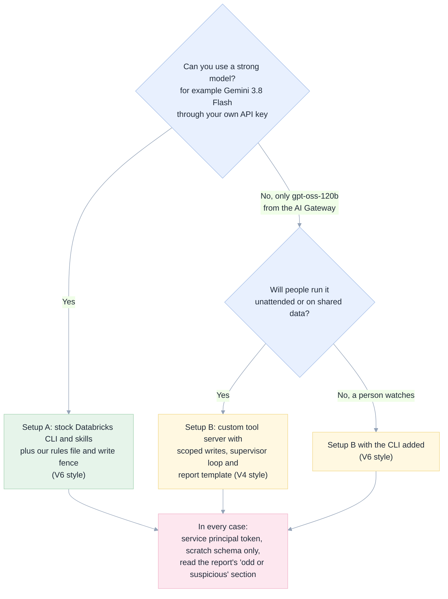
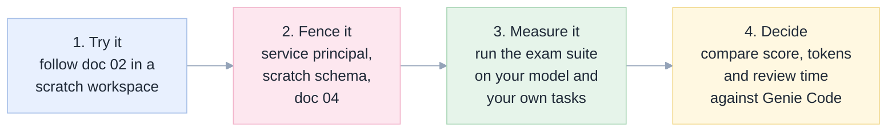

[Index](README.md) · [01 Big picture](01-big-picture.md) · [02 Setup](02-setup-in-the-databricks-shell.md) · [03 Toolbox](03-toolbox-cli-skills-mcp.md) · [04 Safety](04-safety-and-governance.md) · [05 Exams](05-exam-suite.md) · [06 Results](06-results-and-lessons.md) · **07 Decide**

# 07 · Decision guide: should we, and how?

This page turns the evidence in [06](06-results-and-lessons.md) into a choice. It uses plain words and says where the evidence stops.

## Short answer

**For code work in Databricks (SQL, notebooks, jobs, pipelines, debugging), yes: a coding agent in the Databricks shell is a credible replacement for Genie Code,
provided you pick the model and the guard rails on purpose.** For ambient, in-product help, it is not a replacement ([what is not replaced](#what-a-coding-agent-does-not-replace)).

## Pick a setup

| Setup | Best when | Score in our exams | Cost to build | Main risk |
|---|---|---|---|---|
| **A** strong model + stock CLI and skills + rules | You can reach a strong model | Gemini V6: 99% dev, 100% held-out | Low: install, copy rules file | The plain CLI has **no write fence**; limit by token, not by words |
| **B** weaker model + our tool server | Only the gateway model is allowed | gpt-oss V4: 94% dev, 86% held-out | Medium: run the MCP server | Still fails some tasks (see failure catalogue in 06) |
| **Stock only** (V5) | You want zero custom code | gpt-oss 39% dev; Gemini 86% dev | Lowest | With a weak model it often returns nothing; hidden Genie shortcut ([03](03-toolbox-cli-skills-mcp.md#the-genie-trap)) |

Do not choose by these numbers alone: each is a single run on small, clean data ([06](06-results-and-lessons.md#how-much-is-chance)).

## What a coding agent does not replace

| Genie Code feature | Replaced? | Why |
|---|---|---|
| Help inside the notebook, SQL editor and Catalog screens | No | It lives in the product's own screens |
| Business-term understanding from the Genie ontology | Only by calling Genie from the agent | The agent has no copy of your business definitions |
| Automatic table context | Partly | Our exams **named the tables**. We did not test an agent that must discover the right table in a large catalogue |
| Analytical questions that depend on that context | Not shown by our exams | Keep Genie for these ([spec §5](genie-code-replacement-spec.md#5-capability-by-capability-gap-analysis)) |

Our exams show strong results for **well-specified tasks on known tables**. They do not show the same for
open-ended "figure out what we should look at" work on a large, messy catalogue.

## Cost in plain words

We did **not** measure money, and we did not have Genie Code usage data to compare against
([spec §9.3](genie-code-replacement-spec.md#93-honest-accounting)). What we can say:

- Genie Code is metered in DBUs after a monthly allowance. An external agent is metered in model tokens, plus the sandbox compute.
- **Strong models read and write about three times as many tokens**: 5 to 9 million per eight tasks, against 2 to 3 million for gpt-oss
  ([06](06-results-and-lessons.md#full-tables)). A better score is not free.
- Tool descriptions are sent on **every** turn, so a lean tool list saves money on every task, forever.
- A lower price per token does not help if the agent fails and you rerun it: **the setup with the most points per run is often the cheaper one**.

Run a two-week pilot and measure before telling anyone a saving.

## A rollout in four steps

1. **Try it.** [02 Setup](02-setup-in-the-databricks-shell.md) takes about an hour. The launcher notebook means no local shell is needed.
2. **Fence it.** Create a service principal with rights on one scratch schema and folder; give *its* token to the sandbox ([04](04-safety-and-governance.md)).
3. **Measure it.** Copy a mission file from `exams/missions/`, write two or three tasks from your own work, and run them ([05](05-exam-suite.md#how-to-run-it-yourself)).
4. **Decide.** Compare score, tokens and the time a person spends reviewing the output.

## Questions people ask

**Can we use GitHub Copilot instead of OpenCode?** Yes in principle, and it ran our exams. See
[06](06-results-and-lessons.md#github-copilot-cli) for scores and the proxy it needs in front of the Databricks gateway.

**Do we need the custom tool server?** With a strong model, no: Setup A uses the stock CLI. With the gateway's weaker model it was worth
about 55 points in our exams (V4 94% against V5 39%).

**Can the agent harm production?** Yes, if it holds a powerful token. Words in a rules file do not stop a CLI command. Use a restricted
token ([04](04-safety-and-governance.md#the-hole-the-plain-cli-path-has-no-fence)).

**What if the model changes?** Rerun the exams. That is what they are for.

**Which parts are verified and which are advice?** Every claim about what ran is backed by a file in `exams/results/` or `docs/e2e/`.
Recommendations such as the service principal are marked "not tested".

Back to the [index](README.md).
