[Index](README.md) · [01 Big picture](01-big-picture.md) · [02 Setup](02-setup-in-the-databricks-shell.md) · [03 Toolbox](03-toolbox-cli-skills-mcp.md) · [04 Safety](04-safety-and-governance.md) · **08 Architecture** · [09 Security](09-security.md) · [10 Data model](10-data-model.md)

# 08 · Architecture

This page describes the application as the code actually is: the shape, the pieces, what runs
where, and why each boundary was drawn there. It starts wide (who talks to what) and ends narrow
(the layers you edit). Every diagram is generated from the real module tree, and every count is
one you can re-derive with `make check`.

> **One sentence.** A single Databricks App process serves a React front end, and for each
> conversation it starts two child processes — an ACP coding agent and a fenced MCP tool server —
> while a Postgres journal records every state change so a closed tab, a reloaded page or a
> restarted container never loses work.

---

## 1 · Level 1 — System context

Who uses OpenGenie, and what it depends on. Nothing inside the box is described here yet; this
diagram answers only "what is this thing in the world".

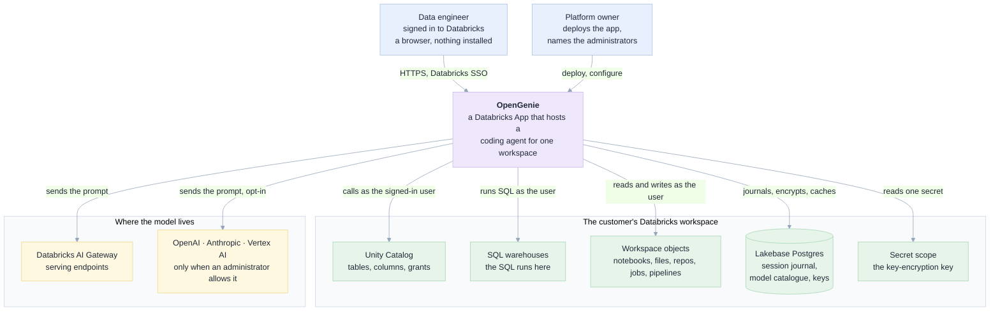

Three things to notice, because they decide most of the design:

1. **There is no separate service to run.** OpenGenie is one app in the workspace it works on. It
   cannot be a SaaS product without breaking the property that the user's own permissions gate
   every read.
2. **Lakebase is not decoration.** It holds the conversation journal (so work survives a restart),
   the model catalogue (so a model is a setting, not a deploy), and encrypted provider keys.
3. **The model is a second exit.** Prompts leave the workspace only through the AI Gateway or, if
   an administrator turns it on, an external provider. That switch has a name:
   `APP_LLM_ALLOW_EXTERNAL`.

---

## 2 · Level 2 — Containers (the logical architecture)

The pieces inside the app, and the protocol on each arrow. This is the diagram to read before
changing anything.

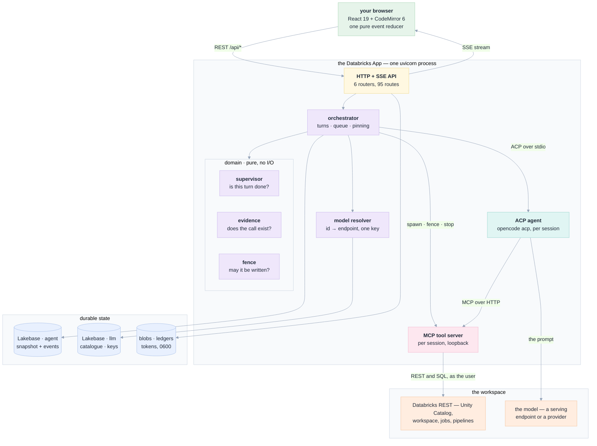

| Container | Technology | One job | Where |
|---|---|---|---|
| Front end | React 19, TypeScript, CodeMirror 6, Vite | render, reduce the event stream, reconnect | `web/src/` |
| API | FastAPI, 6 routers, 95 routes | validate, delegate, map a domain error to a status | `api/routers/` |
| Orchestrator | Python, async | own session and turn lifecycle | `api/services/orchestrator.py` |
| Supervisor | Python, pure | decide whether a turn is finished | `api/domain/supervisor.py` |
| Evidence rules | Python, pure | match a claim to a tool call that happened | `api/domain/evidence.py` |
| Write fence | Python, pure | classify every write target | `api/domain/scope.py` |
| Model resolver | Python | one id → one endpoint, one limit, one key | `api/services/model_resolver.py` |
| Agent | `opencode acp`, Node | think, call tools, write, retry | a child process |
| Tool server | Python + MCP SDK, 41 tools | the only hands the agent has | `tools/databricks_notebook_mcp.py` |

**Two rules the arrows encode, and that the rest of this page keeps returning to.**

- **The agent does not hold a workspace token.** It holds a loopback URL to the tool server. The
  tool server holds the token, in a file it re-reads on every call. So a prompt injection inside
  the agent cannot make a Databricks call the fence has not seen. (The agent's own file tools are
  disabled for the same reason — see [09 §6](09-security.md#6--the-write-fence-in-detail).)
- **The browser never supplies content.** An attachment is `{kind, ref}`; the server re-reads the
  object with the user's own token. The one exception is a pasted blob, which is exactly why
  `domain/blob.py` is a separate, pure, heavily tested module.

---

## 3 · The code is five layers, and the dependency arrows only point one way

The repository is a hexagonal (ports-and-adapters) application. This is not architecture
decoration: the agent is the component most likely to be replaced, so it sits behind a port.

```mermaid
%%{init: {'theme':'base','themeVariables':{'primaryColor':'#E8F0FE','primaryTextColor':'#1F2937','primaryBorderColor':'#A8C0E8','lineColor':'#94A3B8','clusterBkg':'#F8FAFC','clusterBorder':'#CBD5E1'}}}%%
flowchart LR
    subgraph L5["routers/ — the edge"]
        direction TB
        R1["api.py · infra.py · jobs.py"]:::yellow
        R2["llm.py · llm_admin.py · internal.py"]:::yellow
    end
    subgraph L4["services/ — orchestration"]
        direction TB
        S1["orchestrator"]:::purple
        S2["model_registry · model_resolver"]:::purple
        S3["credential_service · blobs · health"]:::purple
    end
    subgraph L3["domain/ — pure rules, no I/O"]
        direction TB
        D1["session · supervisor · evidence"]:::green
        D2["scope · approval · blob · cellrun"]:::green
        D3["llm/ — model, policy, limits, custom"]:::green
    end
    subgraph L2["ports/ — the contracts"]
        P1["AgentRuntime · ToolRegistry<br/>EventStore · CredentialVault<br/>BlobStore · ModelCatalog"]:::teal
    end
    subgraph L1["adapters/ — the implementations"]
        direction TB
        A1["acp/ · mcp/ · fake/"]:::pink
        A2["databricks/ · llm/ · durable/"]:::pink
        A3["blob/ · memory/"]:::pink
    end

    L5 --> L4 --> L3
    L4 --> L2
    L2 -.->|"implemented by"| L1
    L1 -.->|"imports nothing above"| L3
    L3 --> P1

    classDef yellow fill:#FFF8E1,stroke:#F2D98D,color:#1F2937
    classDef purple fill:#EFE7FB,stroke:#C9B6EC,color:#1F2937
    classDef green fill:#E6F4EA,stroke:#A8D5B5,color:#1F2937
    classDef teal fill:#E0F5F3,stroke:#9AD5CE,color:#1F2937
    classDef pink fill:#FDE7EF,stroke:#F2B5CB,color:#1F2937
```

| Layer | Count | May import | Must not contain |
|---|---|---|---|
| `api/routers/` | 6 files, 95 routes | services, domain, ports | a business rule; a vendor name |
| `api/services/` | 17 files | domain, ports | an HTTP status; a `databricks` import that could be an adapter |
| `api/domain/` | 43 files | each other, ports | I/O of any kind — no clock, no network, no file || `api/ports/` | 1 file, 13 protocols | domain | an implementation |
| `api/adapters/` | 47 files | domain, ports | anything from `routers/` or `services/` |

The payoff is measurable. `domain/scope.py` decides where a write may land and has no `import
httpx`; `domain/supervisor.py` decides whether a turn is done and never calls a model. Both are
tested in milliseconds, and both are the kind of rule that quietly destroys data if it is wrong —
which is why neither is allowed to be inside a request handler.

`api/main.py` is the only file that chooses implementations. It is the composition root:
`build()` decides between Postgres, SQLite and memory; between the real ACP agent, the HTTP agent
and the scripted fake; between the subprocess tool server and none.

---

## 4 · Level 3 — The physical deployment

What actually runs, in what, with what limits. This is the diagram to read before sizing a
deployment or debugging "why did the app stop answering".

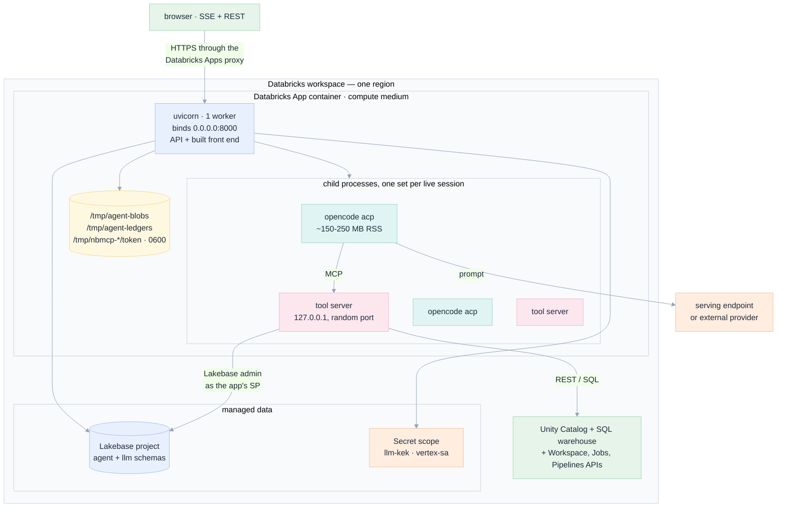

### The runtime contract

`app.yaml` is the platform's contract, and three of its rules shape the code:

| Rule | Consequence in the code |
|---|---|
| `command` is an **array**, not run through a shell | flags live in the array; nothing interpolates a variable into a shell string |
| The process must bind `0.0.0.0` and exit within 15 s of SIGTERM | `--timeout-graceful-shutdown 10`; `lifespan` closes agents, tool servers and the journal |
| Only `$DATABRICKS_APP_PORT` is substituted | the internal bridge URL defaults to loopback on the app's own port |

### The limits that bound it

| Limit | Default | Set by | What happens at the limit |
|---|---|---|---|
| Concurrent **turns** | 4 | `APP_MAX_CONCURRENT_AGENTS` | the next turn waits on a semaphore; it is not rejected |
| Live **sessions** (and therefore processes) | 8 kept, then idle ones reaped | `APP_REAP_KEEP_MINIMUM` | the 9th idle session is archived: its agent and tool server stop, its journal stays |
| Turns per session | 200 | `MAX_TURNS` | the session refuses a new message and says so |
| Wall clock per turn | 6 h, or the token's own expiry minus 15 s | `APP_SESSION_MAX_RUN_SECONDS` | the turn is marked `interrupted`, the session becomes `blocked` and offers resume |
| Tool budget advertised | 28 of 41 | `NBMCP_PROFILE=core` | the other 13 exist in `full`; the `core` set is a tested budget, not a preference |
| Attachment size | 8 MB each, 24 MB per message, 6 files | `domain/blob.py` | refused with a sentence naming the limit and the observed value |

> **A distinction worth knowing.** `APP_MAX_CONCURRENT_AGENTS` limits *turns running at once*, not
> processes. A session keeps its agent process after its turn ends, until the reaper archives it.
> The reaper is why the app does not leak one process per conversation — the code comment records
> 29 live agents after one afternoon of testing, which is what crashed the renderer.

### Two workspaces, two transports

`databricks.yml` declares two targets, and they differ in exactly one way that cannot be papered
over by a flag:

| Target | Workspace | Deployment source | Why |
|---|---|---|---|
| `dev` | `dbc-cb61f1e1-bd8e` | **Git only.** `apps create` refuses without `git_repository` | the platform refuses a workspace path, so the app builds from a *committed* tree — an uncommitted change is not deployed |
| `prod` | `dbc-1e111e44-3334` | **Workspace folder**, synced by `scripts/deploy.sh` | unchanged from how the live app has always shipped |

The host is deliberately absent from `databricks.yml`. A `workspace.host` there silently overrides
`$DATABRICKS_HOST` — measured: with a bogus `DATABRICKS_HOST` and a literal target host, `databricks apps
list` still answered from the target's workspace. An operator who exported the wrong host would
deploy to the right one and never learn. `scripts/env.sh` owns the host and asserts the identity.

---

## 5 · One turn, end to end

The most useful diagram for debugging. It is the path a message takes, including where each
write lands and where the user first sees a byte.

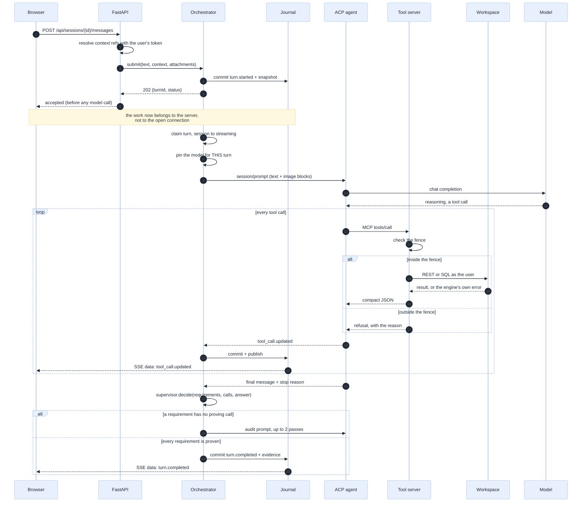

Four properties of this sequence are load-bearing:

1. **The 202 comes before any model call.** The turn is journalled first, so closing the tab
   cannot cancel work the server already accepted.
2. **The journal is written before the stream.** `_emit` commits then publishes. A reconnecting
   browser therefore cannot miss an event that it saw once.
3. **The model is pinned before the prompt and never rewritten.** A switch writes a row for the
   *next* turn; the running turn keeps what it started with. That is what makes "which model
   answered this?" answerable a week later.
4. **The agent never talks to Databricks.** Only the tool server does, and only through the fence.

---

## 6 · The session and turn state machines

Sessions and turns are explicit state machines in `domain/session.py`. Every transition is
validated: an illegal one raises rather than silently producing a session that cannot be described.

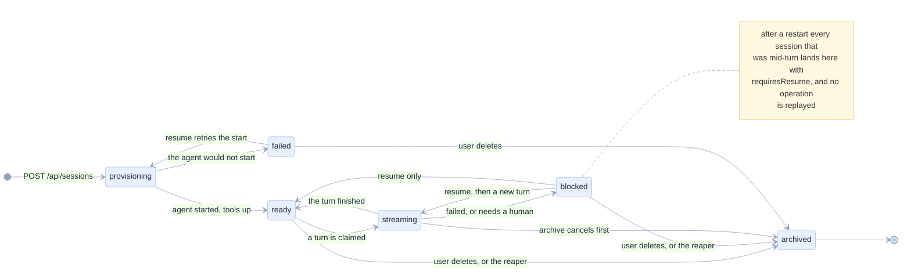

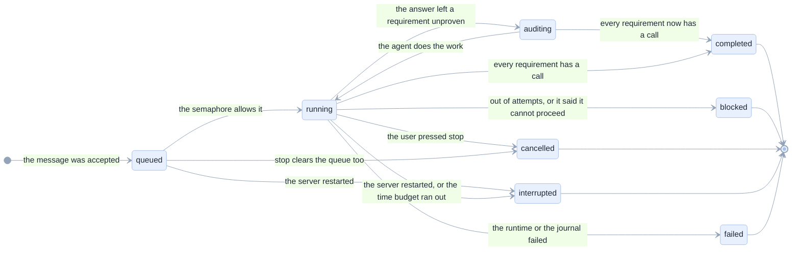

**Why `blocked` is not an error.** A blocked turn means the app knows it does not know something:
three requirements without evidence, or the agent's own words that it cannot proceed. The UI shows
which requirement is unproven and keeps the work that did land. A failed turn means the machinery
broke. Different states, different copy, different recovery.

**Why `interrupted` exists.** A restart must never look like a fresh start. On boot the orchestrator
restores each snapshot, turns every `running`/`auditing`/`queued` turn into `interrupted`, marks the
session `blocked` with `requiresResume`, and emits `session.recovery_required`. Nothing is replayed
automatically, because a tool call is not idempotent.

---

## 7 · The stream: replay is the connection

The browser does not hold a socket to the agent. It holds a cursor into the journal.

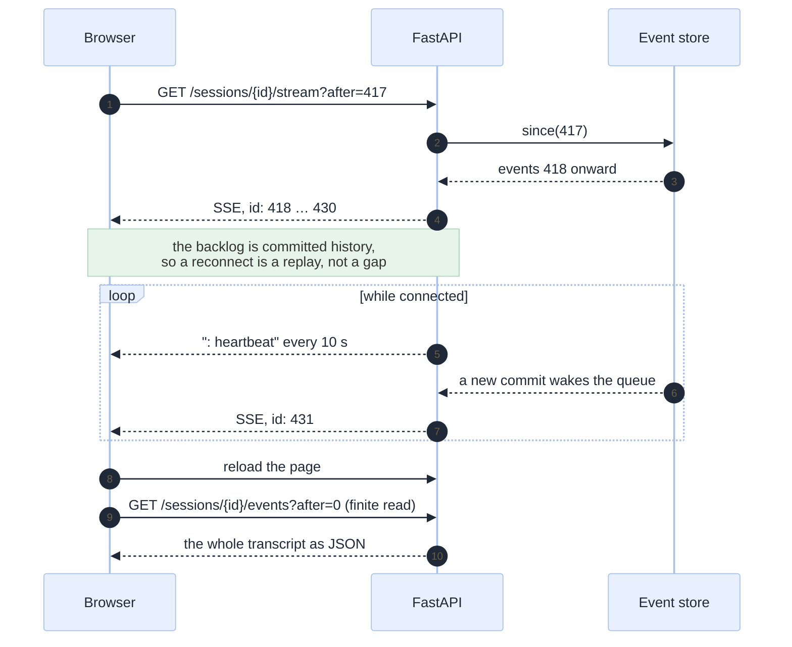

The rule in `routers/api.py` is explicit: **the queue is a wake-up, the committed journal is truth.**
After each wake the handler re-reads `since(seq)`, which closes the subscribe/replay race and heals
a slow viewer that overflowed. A `Last-Event-ID` header covers a browser-initiated reconnect of the
same `EventSource`; `?after=` covers a fresh page load, because `EventSource` cannot set headers.

A second, finite endpoint exists for the same data. `/events` returns a plain JSON list, because
"show me what happened" should not require holding an endless connection open until it times out.

---

## 8 · The model pipeline: one id, seven steps, no vendor branch

Choosing a model is the product's central promise, so it has exactly one implementation.

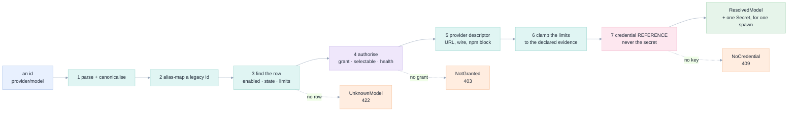

| Rule | Why it is a rule and not a convention |
|---|---|
| An id resolves through a **table**, never through string surgery | the old resolver derived an endpoint from an id, so a typo produced a plausible wrong URL instead of an error |
| `ResolvedModel` carries **no** secret | it is a fact that gets recorded in the turn pin; a fact must not contain a key |
| A wrong limit is worse than no limit | a model is unusable *after* the user waited, so each row records whether its limits were `measured`, `documented` or `default` |
| No vendor name appears in a comparison outside `adapters/llm/` | `ProviderKind` is an enum; the behaviour that differs per provider lives in one directory |
| Exactly one provider key reaches a child | a process that can see two keys can leak two keys |

Thirteen models from four providers ship in `seed/llm_models.yaml`, and the serving endpoints a
workspace exposes are discovered on a schedule (`APP_LLM_DISCOVERY_SECONDS`, default 300) rather
than per request.

---

## 9 · The tool server: 41 tools, 28 advertised

The agent's only hands. One process per session, started with the session's scope in its
environment and reachable only on loopback.

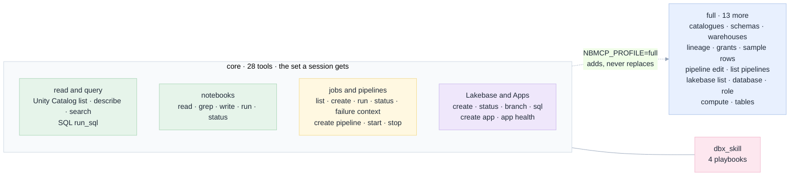

**Why 28 and not 41.** An agent advertises every MCP tool on every request and pays for it in
tokens. The `core` set is a *budget*: `tests/test_tools_fence.py` fails if `_CORE` grows without a
recorded decision, and a second test fails if the number the UI shows (`TOOL_COUNT_CORE`) disagrees
with the server's own set. That second test exists because the label once said 19 while the set had
25 — the app under-reported its own capability in a variable.

**What the server is given at start, and nothing more.**

```
NBMCP_WRITE_SCHEMAS        one schema, or empty
NBMCP_WRITE_PATHS          one workspace folder, with a trailing slash
NBMCP_WRITE_JOB_PREFIX     agent_<first 8 of the session id>_
NBMCP_WRITE_APP_PREFIX     agent-<first 8>-
NBMCP_WRITE_INSTANCE_PREFIX agent-<first 8>-
NBMCP_SESSION_LEDGER       one JSONL file this session appends to
NBMCP_TOKEN_FILE           the user's token, re-read on every call
NBMCP_SP_TOKEN_FILE        the app's own token, for the one API a user token cannot call
NBMCP_RUN_*                the per-session bridge key (see below)
```

The scope is read from the environment **by the app**, not decided by the agent. That is what makes
the fence a boundary rather than an instruction: the model can ask for anything, and the process it
asks was started with one folder and one schema.

**The bridge, and why it is a key and not a flag.** A Databricks App's user authorisation carries no
compute scope, so a tool cannot submit a notebook run as the user. The app *can* run Python on
serverless compute as its own service principal. `services/run_bridge.py` lets the tool ask the app,
on `/internal/`, with `HMAC(secret, session_id)`. The key opens exactly one session's door, and the
endpoint additionally checks that this session's user is an administrator.

---

## 10 · Durable sessions, and the three stores that outlive a request

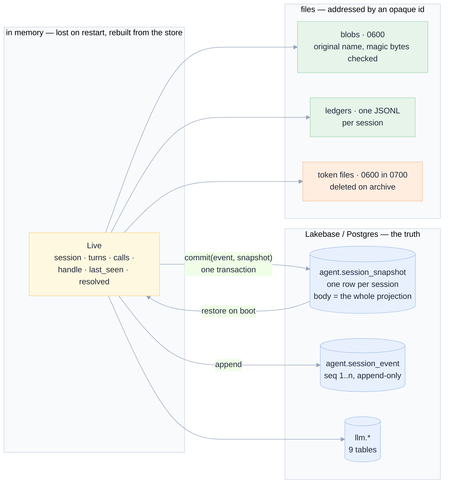

A single Postgres connection holds an **advisory lock** (`pg_try_advisory_lock`) at boot. This is
deliberately a single active server: losing that connection fences commits and fails closed, rather
than letting a stale worker write behind a replacement owner's back. `production` refuses to start
without a durable journal — a conversation in container memory is lost on the next redeploy.

| Store | Holds | Lost if the container restarts | Swept by |
|---|---|---|---|
| `agent.session_snapshot` | the whole projection, one row per session | no | never (archived sessions stay for the audit trail) |
| `agent.session_event` | every event, monotonic per session | no | never |
| `llm.*` | providers, models, grants, encrypted keys, health, turn pins | no | health rows age out of the query, not the table |
| Blob files | attachment bytes, `0600` | **yes** if `/tmp` is not a mounted volume | `sweep()` on refcount 0 |
| Session ledger | what this conversation created | **yes** for the same reason | with the session |
| Token files | one user token, one SP token | yes, by design | `archive()` deletes the directory |

> **A real deployment note.** `app.yaml` points `APP_BLOB_DIR` at `/tmp/agent-blobs`, and `/tmp` in
> an App container is ephemeral. The comment in `app.yaml` says the path is "a mounted volume path
> the platform keeps" — verify that for your workspace before relying on a chip surviving a
> redeploy. If it does not, the transcript keeps the chip and the bytes are gone, which is exactly
> the failure the code is trying to prevent.

---

## 11 · The front end: a reducer, not a chat log

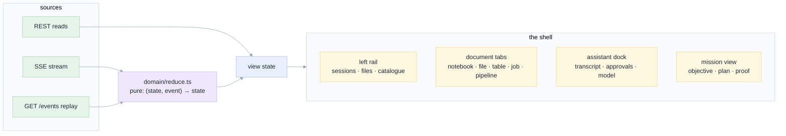

| Fact | Where | Why it matters |
|---|---|---|
| 80 test files, 1193 test cases | `web/src/**/*.test.ts(x)` | the reducer is pure, so replay and reconnection are testable with recorded events |
| `domain/event-parity.json` | `web/src/domain/` | a Python test asserts the front end knows every event type the back end emits |
| Routes are a hash grammar | `domain/route.ts` | the hash never reaches the server, so any host or proxy serves a deep link |
| One shell, many document kinds | `App.tsx` | a notebook, a table, a job and a pipeline are tabs, not pages you navigate away from |

`app/src/domain/` is 26 000 lines against 17 500 in `api/`, and that ratio is deliberate: the
interesting rules — the fence verdict, the run map, the cell prompt, the reconciliation of a
reconnect — are pure functions with names, not behaviour buried in a component.

---

## 12 · Why these choices: the alternatives that were rejected

| Decision | Chosen | Rejected | Why the rejected one lost |
|---|---|---|---|
| Where the agent runs | a child process in the app container | a separate service, a job, a VM per session | fewest moving parts; the container already has the identity. A separate service is the v2 path |
| Streaming | SSE | WebSocket | Databricks' proxy cuts a stream at 300 s and rejects WebSocket upgrades; SSE reconnects natively |
| Agent protocol | ACP over stdio | the vendor's HTTP API; parsing CLI stdout | ACP is an open contract with structured tool calls and permissions, and it outlives one agent |
| Tools | our MCP server, injected into `session/new` | the agent's built-in shell and file tools | the built-ins are unfenced. Two independent tests keep them off |
| Session state | append-only events plus a snapshot, in Postgres | in-memory + Redis; the agent's own store | audit and replay are requirements, not features |
| Front-end state | one pure reducer over the event stream | a state library with effects everywhere | replay, multi-tab and reconnection become free |
| Identity | the user's forwarded token | one service principal for everything | per-user permissions are the product |
| Model choice | a table plus discovery, resolved once | deriving an endpoint from the id | a typo must be an error, not a plausible URL |
| Approval for a human save | a stateless HMAC token bound to path + version | session state | a save can happen with no session open, and a token cannot leak across documents |
| Two tool servers | one, in the app tree | a copy under `mcp/` | the copy drifted by 117 lines and a fix made there reached nobody; a test now fails if a second copy appears |
| Deleting things | three pure rules — `domain/reaper.py`, `domain/retention.py`, `domain/projection.py` — driven by timers | a `while True` loop that sweeps on a size or age check | code that deletes is code that quietly destroys work if its condition is wrong. A pure rule can be asserted in milliseconds, and a mutation that removes a guard makes a test fail |

---

## 12.1 · The three rules about deleting things

Every timer in the app obeys a pure module. This is deliberate and it is the same argument as the
supervisor's: a decision that can destroy something a person was using should be assertable without
a clock, a process or a database.

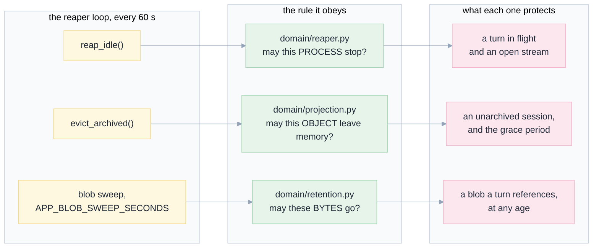

| Rule | Destroys | Never, under any input | Proof |
|---|---|---|---|
| `reaper.py` | an agent subprocess | a session mid-turn, or one with a stream attached | `tests/test_reaper_race.py`, `test_long_running.py` |
| `projection.py` | an object in memory | an unarchived session, one being watched, or one with a running task | `tests/test_projection_eviction.py` |
| `retention.py` | attachment bytes | a blob any turn references | `tests/test_blob_retention.py` |

All three are total: every input gets a named disposition, none raises, and each has a
`Disposition`/`Why` value so a test asserts *why* rather than a boolean.

---

## 13 · Where to read the code

| If you want to understand | Read, in this order |
|---|---|
| how a request becomes work | `api/routers/api.py` → `api/services/orchestrator.py` (`create`, `submit`, `_execute_turn`) |
| what the agent may do | `api/domain/scope.py`, then `tools/databricks_notebook_mcp.py` (`_CORE`, the `_assert_*` helpers) |
| whether a turn is done | `api/domain/supervisor.py`, then `api/domain/evidence.py` |
| how a model becomes a process | `api/services/model_resolver.py` → `api/adapters/acp/agent_config.py` → `api/ports` |
| what is stored | `api/adapters/llm/store/migrations/*.sql`, then [10 Data model](10-data-model.md) |
| what gets deleted, and when | §12.1 above, then `api/domain/reaper.py`, `retention.py`, `projection.py` |
| how identity is proven | `api/services/identity.py`, `api/main.py` (`identity_middleware`), then [09 Security](09-security.md) |
| what the UI does with an event | `web/src/domain/reduce.ts`, `web/src/domain/events.ts` |

Next: [09 Security](09-security.md) — authentication, authorisation, the fence, and what is still
not covered.
