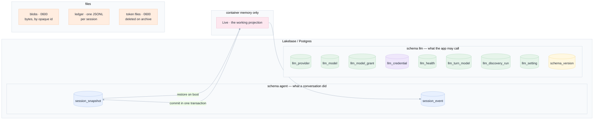
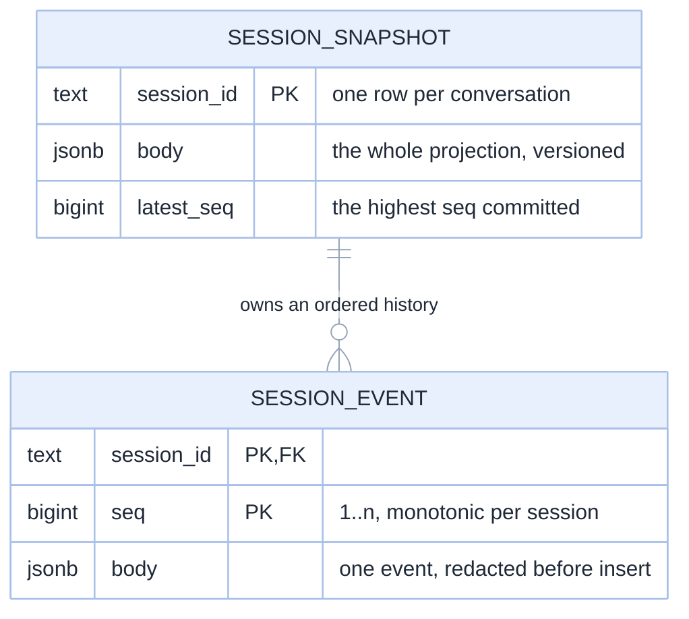
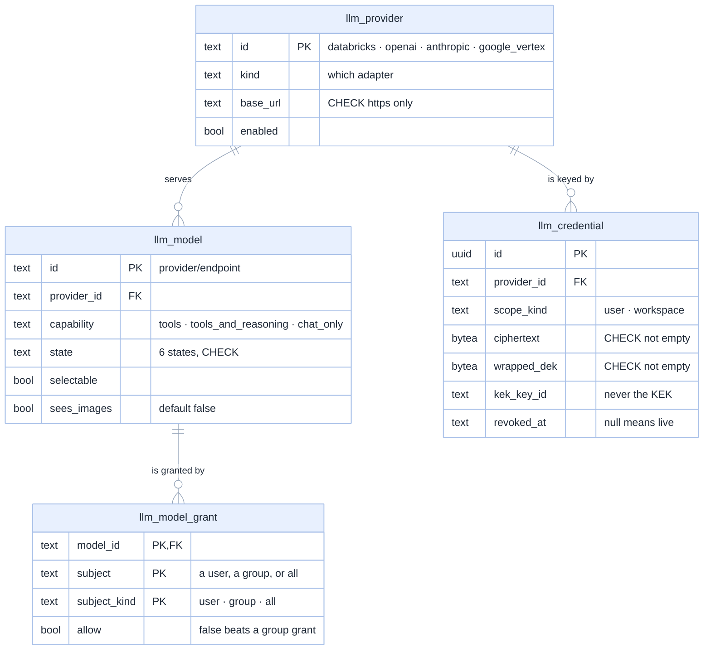
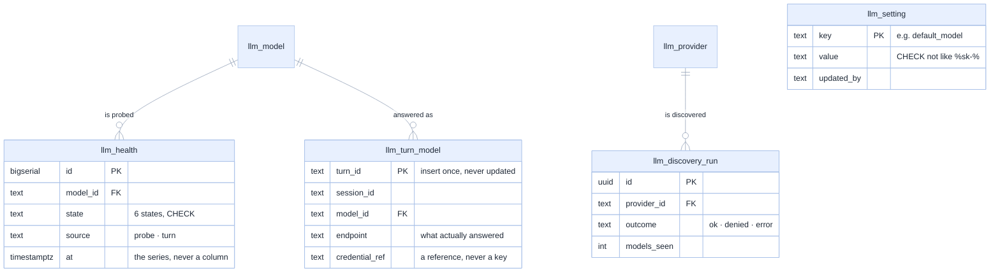
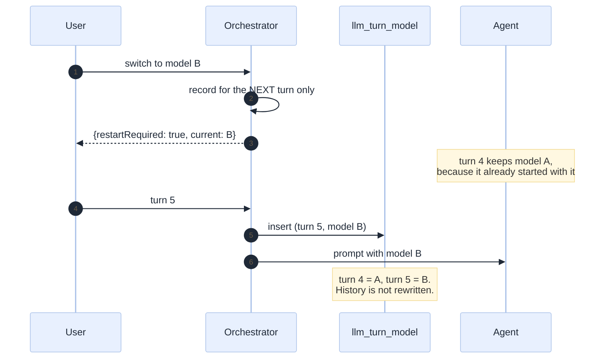
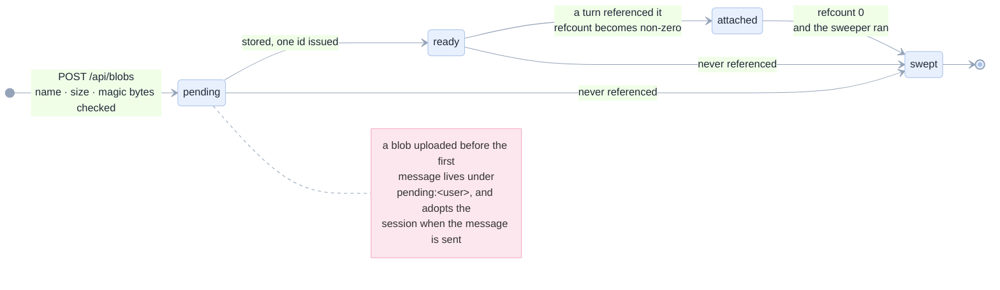

[Index](README.md) · [08 Architecture](08-architecture.md) · [09 Security](09-security.md) · **10 Data model** · [07 Decision guide](07-decision-guide.md)

# 10 · The data model

OpenGenie stores what **happened**, never what was **said about the data**. This page describes the
two schemas it owns, the invariants in the DDL, and why each row exists.

> **In one sentence.** Two Postgres schemas — `agent` for what a conversation did, `llm` for what
> the app may call — plus three kinds of files addressed by opaque ids. Every table is forward-only
> and idempotent, because a Databricks App can restart a container mid-deploy.

---

## 1 · Where the data lives



| Store | Chosen because | Alternative rejected |
|---|---|---|
| **Lakebase** (managed Postgres) | the app already needs Postgres for the registry; a session journal in the same database is one connection, one backup, one permission model | Redis (no audit trail, no SQL), the agent's own store (not ours to trust, not ours to query) |
| **An append-only event table** | replay, multi-tab and reconnection are requirements, not features | storing only the latest state (loses the audit trail) |
| **An opaque id for a blob** | the bytes are bytes; a name is a claim, and a name is what an attacker controls | addressing by filename (path traversal, collisions, unicode tricks) |
| **`jsonb` for an event body** | the vocabulary evolves; a column per event type would be a migration per feature | one table per event type |

---

## 2 · The `agent` schema — the session journal

Two tables. That is the whole durable session model, and it is deliberately tiny.



| Table | Grain | Why it exists |
|---|---|---|
| `agent.session_snapshot` | **one row per session** | the whole `Live` projection — session, turns, calls, approvals, agent cwd — so a restart restores state without replaying a single tool call |
| `agent.session_event` | **one row per event per session** | the transcript, the replay source for `/stream`, and the audit trail |

### The snapshot is a whitelist, not a dump

```python
def _snapshot(self, live: Live) -> dict:
    # A whitelist: never serialize extra, a forwarded token, secret file, or provider key.
    return {
        "version": 1,
        "session":  dataclasses.asdict(live.state.session),
        "turns":    [dataclasses.asdict(t) for t in live.state.turns],
        "calls":    copy.deepcopy(live.state.calls),
        "agentCwd": live.agent_cwd,
        "agentSessionId": ...,
        "lastSeen": live.last_seen,
        "approvals": copy.deepcopy(live.extra.get("approvals", {})),
    }
```

`live.extra` is where the token file path, the secret directory and the user token live. It is
**not** serialized. The snapshot is built by naming fields, so a new field is included only when
someone decides to include it — the opposite of `asdict(live)`, where adding an attribute to `Live`
would silently start writing a credential to disk. `version: 1` is checked on restore, and an
unknown version raises rather than being half-read.

### One transaction per event

```python
async with self._lock, self._conn.transaction(), self._conn.cursor() as cur:
    # 1. bump the snapshot and get the new seq
    INSERT INTO agent.session_snapshot … RETURNING latest_seq
    # 2. append the event at that seq
    INSERT INTO agent.session_event VALUES (session_id, seq, body)
# 3. only now publish to the connected browsers
self.publish(session_id, stored.to_dict())
```

The order is the guarantee. A browser that has seen an event can always re-read it, because the
commit happened first. The in-memory queue is a **wake-up**, never the truth: after each wake the
SSE handler re-reads `since(seq)`.

### The advisory lock

`PostgresSessionStore.open()` runs `SELECT pg_try_advisory_lock(0x4F50454E47454E49)` — the constant
spells `OPENGENI`. A second server cannot take the journal, and losing the connection fences commits
rather than reconnecting a stale worker behind a replacement owner's back. This is a deliberate
single-active-server design, and it is why the app runs one uvicorn worker.

### The event vocabulary: 27 types, in one place

`domain/events.py` defines the whole language. Nothing else may invent an event type, and the front
end must know every one.

| Group | Types |
|---|---|
| session | `session.created`, `session.ready`, `session.degraded`, `session.archived`, `session.recovery_required`, `session.checkpoint`, `session.compacted` |
| turn | `turn.started`, `turn.queued`, `turn.completed`, `turn.blocked`, `turn.cancelled`, `turn.interrupted`, `turn.failed`, `turn.retrying`, `turn.auditing` |
| streaming | `thought.delta`, `message.delta`, `tool_call.started`, `tool_call.updated`, `plan.updated`, `usage.updated` |
| governance | `approval.requested`, `approval.decided`, `evidence.proposed`, `document.saved`, `blob.attached` |

A Python test asserts `EVENT_TYPES` matches `web/src/domain/events.ts`, and the parity file
`web/src/domain/event-parity.json` carries the same list. A new event type that the UI does not know
is a silent hole in a transcript; this is the test that stops it.

---

## 3 · The `llm` schema — the catalogue, the grants and the vault

Nine tables in `llm`: `schema_version` is the migration ledger, and eight hold the feature. They
fall into two groups, so they are drawn as two diagrams: the tables that decide **what may be
called**, and the tables that record **what happened when it was**. The full column list follows in
tables, because a diagram with forty columns in it is a diagram nobody reads.

#### 3.1 · What may be called: the catalogue, the grants and the vault



#### 3.2 · What happened: health and provenance



#### 3.3 · Every column, and the five invariants that live in the DDL

| Table | Grain | Columns |
|---|---|---|
| `llm_provider` | one per provider *kind* | `id`, `display_name`, `kind`, `wire_default`, `base_url`, `npm_package`, `extra_options` (jsonb), `enabled`, `created_at`, `updated_at` |
| `llm_model` | one per model a user can pick | `id`, `provider_id`, `endpoint`, `display_name`, `group_name`, `capability`, `wire`, `context_window`, `max_output`, `limit_evidence`, `limit_source`, `credential_kind`, `enabled`, `selectable`, `state`, `sees_images`, `last_seen_at`, `created_at`, `updated_at` |
| `llm_model_grant` | one per (model, subject) | `model_id`, `subject`, `subject_kind`, `allow`, `granted_by`, `granted_at` |
| `llm_credential` | one live key per (provider, scope) | `id`, `provider_id`, `scope_kind`, `scope_id`, `kind`, `ciphertext`, `iv`, `auth_tag`, `wrapped_dek`, `dek_iv`, `kek_key_id`, `last4`, `fingerprint`, `project_hint`, `created_at`, `last_used_at`, `revoked_at` |
| `llm_health` | one probe or one turn observation | `id`, `model_id`, `state`, `detail` (≤400 chars), `latency_ms`, `source`, `at` |
| `llm_turn_model` | one per turn, insert-once | `turn_id`, `session_id`, `model_id`, `provider_id`, `wire`, `endpoint`, `credential_ref`, `limit_evidence`, `context_window`, `max_output`, `at` |
| `llm_discovery_run` | one per discovery pass | `id`, `provider_id`, `outcome`, `models_seen`, `detail`, `at` |
| `llm_setting` | one per setting | `key`, `value`, `updated_by`, `updated_at` |

| Constraint | What it prevents |
|---|---|
| `provider_https CHECK (base_url LIKE 'https://%')` | a plaintext-http provider is a finding, not a preference |
| `provider_no_key CHECK (extra_options::text NOT LIKE '%sk-%')` | a tripwire against a secret landing in a "templated values only" column |
| `model_limits CHECK (max_output <= context_window)` | a model whose declared limits contradict themselves |
| `credential_encrypted CHECK (ciphertext > 0 AND wrapped_dek > 0)` | a row that is not encrypted cannot be written, so a "temporary plaintext" path cannot exist |
| `llm_credential_one_live` unique index `WHERE revoked_at IS NULL` | two live keys for one provider and scope. Rotation is an insert plus a revoke, never an update, so the history survives and an audit can say which key a turn used |

### Why health is a table and not a column

A model's current health as a column is an opinion with no timestamp, indistinguishable from a
fact. `llm_health` is an append-only series with `source ∈ (probe, turn)`, so the catalogue can
answer both "is it working now?" (the latest row) and "when did it stop?" (the series). A probe costs
a token, so `LLM_PROBE_SECONDS` bounds how often one may run.

### Why the turn pin is insert-once

A turn's model is written **before** the prompt and never updated. So "which model answered turn 7?"
is answerable a month later, even after three switches. It is a primary key on `turn_id`, which
makes an accidental rewrite a database error rather than a silent lie.



### The alias table, and why it is a literal

`domain/llm/model.py` carries `ALIASES`: every id the app has ever stored or sent, mapped to the
canonical form. It exists because the old resolver **derived** an endpoint from an id, so a typo
became a plausible wrong URL instead of an error. Three shapes appear in the table:

| Shape | Example | Why it exists |
|---|---|---|
| canonical | `databricks/databricks-llama-4-maverick` | identity |
| gateway foundation-model name | `databricks/system.ai.gpt-oss-120b` | the AI Gateway advertises a foundation-model name while the agent needs the serving-endpoint name |
| an older internal dialect | `dbx/databricks-gpt-oss-120b` | written into `opencode.json` before this design; links and stored rows still carry it |

"Law 1" in the spec: **an id resolves through a table, never through string surgery.** A test
asserts every entry resolves and that the mapping is injective where it must be.

---

## 4 · The files

Three kinds, and each is addressed differently because each is trusted differently.

| File | Path | Mode | Addressed by | Lifetime |
|---|---|---|---|---|
| Blob bytes | `APP_BLOB_DIR/blb_<12 hex>` | `0600` in a `0700` directory | an opaque id, generated by the server | until its refcount is 0 and the sweeper runs |
| Session ledger | `APP_SESSION_LEDGER_DIR/<session>.jsonl` | app-owned | the session id | with the session |
| User token | `<mkdtemp>/token` | `0600` in a `0700` directory | a path the app passes in `NBMCP_TOKEN_FILE` | deleted on archive |
| SP token | `<mkdtemp>/sp-token` | `0600`, beside the user token | a path in `NBMCP_SP_TOKEN_FILE` | deleted on archive |
| Provider key files | `<mkdtemp>/<var>` | `0600` in a `0700` directory | a path the app passes to the child | rewritten on every switch, deleted on archive |

### A blob's lifecycle



The `pending:` key exists because a session does not exist until the first message, and that is
exactly when a user most wants to attach a screenshot they are about to ask about. `pending:` cannot
collide with a session id, and every read is authorised by `user_id` anyway.

**Refcount 0 is the bug worth remembering.** Until `mark_attached` was called, every attached blob
had refcount 0, so a transcript chip would survive 24 hours and then point at bytes that no longer
existed. The binding now happens **before** the prompt, which is also where a pending blob adopts its
session.

### The ledger: a fence for identifiers the platform assigns

| Object | Has a name the app can prefix? | Fence |
|---|---|---|
| Job | yes | `agent_<id8>_*` |
| App | yes | `agent-<id8>-*` |
| Lakebase instance | yes | `agent-<id8>-*` |
| **Pipeline** | **no — the platform assigns a UUID** | **in this session's ledger** |

A prefix cannot work when the identifier is assigned by the platform, so the tool server appends a
line to `APP_SESSION_LEDGER_DIR/<session>.jsonl` for each object it creates. `GET /api/infra/ledger`
reads every file and tags each row with its owning session. The question it answers is "did *this
conversation* make it?" — a weaker question than authorisation and deliberately not the same one.

---

## 5 · Migrations: forward-only and idempotent

```
001_llm_schema.sql      schema llm: 8 tables (plus schema_version), constraints, indexes
002_llm_setting.sql     one key/value table, with a secret tripwire
003_llm_model_vision.sql  sees_images, default false
004_session_journal.sql   schema agent: snapshot + event
```

| Rule | Why |
|---|---|
| `CREATE … IF NOT EXISTS` everywhere | a Databricks App can restart a container mid-deploy, so running this twice must be a no-op |
| `schema_version` records each applied version | the ledger is queryable, so "which migration is this?" is a `SELECT` |
| no `ALTER … DROP COLUMN` | a rollback is a new forward migration, not a destructive one |
| a migration never invents a catalogue row | `003` sets `sees_images` **only where the row already exists** |

The default for the vision column is `false`, and that is the safe direction: refusing or labelling
an image is recoverable, sending one to a model that cannot take it is not.

---

## 6 · What is deliberately *not* stored

This is the shortest path to understanding the privacy posture.

| Not stored | Where it would have been | Why not |
|---|---|---|
| the user's access token | a session row | it is per-request and short-lived; caching it is a vulnerability. It lives in a `0600` file the tool server re-reads, and that file is deleted on archive |
| a provider key in plaintext, anywhere | a credential column | envelope encryption with a KEK outside the database |
| the KEK | the database | the whole point: a dump must not be a key dump |
| the bytes of an attachment in the journal | an event body | the event carries `{kind, ref, name}`; a replay costs nothing and the bytes live in one place |
| a demo hint in the user's prompt | `turn.prompt` | `DEMO_MARKER` is stripped, so a scripted scenario never becomes the user's words |
| the agent's own session history | our journal | `session/load` replays it, and the adapter consumes that replay so yesterday's tool results are not attributed to today's turn |
| the data in your tables | anywhere | the app reads it, shows a bounded preview, and stores the *reference* |

The last one has a corollary worth stating: **the app stores what happened, not the data.** A
transcript is a record of calls and results, and a result is truncated to a token budget before it
is stored.

---

## 7 · Retention and sweep

| What | Kept | Swept by | Recovery |
|---|---|---|---|
| session snapshot + events | forever | nothing | an archived session stays, which is what makes "deleted" honest |
| archived session's processes | 0 — stopped immediately | `archive()` | `resume` restarts the agent and reloads its own session |
| archived session's **bytes** | 0 — deleted with the archive | `archive()` → `delete_session()` | not recoverable, by design: archiving is the user's delete |
| idle session's processes | 30 min (5 min if never used) | `reap_idle` every 60 s | the journal is intact; `resume` restores |
| an **archived projection in memory** | until its grace period ends | `evict_archived`, in the same loop | `restore()` rebuilds it from `agent.session_snapshot` |
| blob bytes, unreferenced | 24 h if it was uploaded and never sent; 1 h if it never finished uploading | `_blob_sweep_loop` every `APP_BLOB_SWEEP_SECONDS` | not recoverable, by design |
| blob bytes, referenced by a turn | forever — a chip points at them | never | — |
| token files | the session's life | `archive()` deletes the directory | re-minted from the forwarded token |
| health rows | all | nothing (the query reads the latest) | — |
| discovery runs | all | nothing (the query reads the last 20) | — |

The three retention rules are **pure modules**, not code inside a timer, because each of them can
destroy something a person was using:

| Rule | Module | The question it answers |
|---|---|---|
| may these bytes go? | `domain/retention.py` | never a referenced blob; otherwise a TTL per state |
| may this projection leave memory? | `domain/projection.py` | only archived, unwatched, not busy, past a grace period |
| may this process be stopped? | `domain/reaper.py` | never mid-turn, never watched, only above a soft cap |

`tests/test_blob_retention.py` and `tests/test_projection_eviction.py` assert the rules, assert that a
running application **calls** them, and were mutation-tested: removing each guard, or the call, makes
them fail.

The reaper's rules are pure and ordered by how much damage a mistake would do:

1. never a session with a turn in flight;
2. never a session someone is watching (an open stream is a heartbeat);
3. never one already archived;
4. only after a generous idle window, and only above a soft cap.

An **unused** session (zero turns) is a different thing from an idle one: it holds a subprocess and
has nothing worth returning to, so it gets a 5-minute window and no floor. The floor exists to avoid
churn on sessions someone might come back to.

---

## 8 · Two smaller stores, for two smaller problems

| Store | Used by | Why it is not Postgres |
|---|---|---|
| **SQLite** | local development and tests | one file, no service, and the same `EventStore` port |
| **In-memory** | the demo and unit tests | a demo must start without a database; the API reports `persistence: "memory"` so the UI can say the work is volatile |

`MemoryEventStore`, `SqliteSessionStore` and `PostgresSessionStore` implement one port. The contract
is small enough to run the same test against all three, which is what makes the swap a fact rather
than a claim.

---

## 9 · Querying the journal

Two read shapes, one for a human and one for a client.

| Question | Query |
|---|---|
| what is the current state of a session? | `SELECT body FROM agent.session_snapshot WHERE session_id = $1` |
| what happened, from event 400? | `SELECT body FROM agent.session_event WHERE session_id = $1 AND seq > 400 ORDER BY seq LIMIT 2000` |
| how many events has it seen? | `SELECT latest_seq FROM agent.session_snapshot WHERE session_id = $1` |
| which model answered each turn? | `SELECT turn_id, model_id, wire FROM llm.llm_turn_model WHERE session_id = $1 ORDER BY at` |
| when did a model last fail, and how? | `SELECT state, detail, at FROM llm.llm_health WHERE model_id = $1 ORDER BY at DESC LIMIT 1` |
| which sessions did a user own? | the in-memory projection; there is no index on user, because a session is not cross-user data |
| could a user reach another's session? | no: the owner check is a 404 before any handler (see [09 §3.1](09-security.md#31-session-ownership--a-404-not-a-403)) |

One honest note on the last row: **there is no `user_id` index and no user column on
`session_event`.** The projection in memory answers `sessions_for(user)`. A durable per-user listing
would need either a column or a join, and it is not built, because the app restores the projection
from the snapshots it can read. On a deployment with many users this is the first thing to add.

Next: [07 Decision guide](07-decision-guide.md), or back to the [index](README.md).
