# Using a coding agent instead of Databricks Genie Code

> **In one sentence:** you can get most of what Genie Code does by running an ordinary
> coding agent (OpenCode or GitHub Copilot CLI) *inside* the Databricks shell, giving it the
> `databricks` command-line tool, Databricks' official skills, and a few safety rules. We
> tested this with 11 graded "exam" tasks against a real workspace. This folder explains
> what we built, how to repeat it, how well it worked, and where it does not work.

Everything here was run against a live workspace, not simulated. Numbers in these pages are
generated from the saved result files in [`../exams/results/`](../exams/results/).

```mermaid
%%{init: {'theme':'base','themeVariables':{'primaryColor':'#E8F0FE','primaryTextColor':'#1F2937','primaryBorderColor':'#A8C0E8','lineColor':'#94A3B8','clusterBkg':'#F8FAFC','clusterBorder':'#CBD5E1'}}}%%
flowchart LR
    T["Tutorial<br/>try it in 30 min"]:::pink --> A["01 Big picture<br/>what and why"]:::blue
    A --> B["02 Setup<br/>run it yourself"]:::green
    B --> C["03 Toolbox<br/>CLI, skills, MCP"]:::yellow
    C --> D["04 Safety<br/>keep it inside the fence"]:::pink
    D --> E["05 Exam suite<br/>how we measure"]:::purple
    E --> F["06 Results<br/>what the numbers say"]:::orange
    F --> G["07 Decision guide<br/>what to deploy"]:::teal
    classDef blue fill:#E8F0FE,stroke:#A8C0E8,color:#1F2937
    classDef green fill:#E6F4EA,stroke:#A8D5B5,color:#1F2937
    classDef yellow fill:#FFF8E1,stroke:#F2D98D,color:#1F2937
    classDef pink fill:#FDE7EF,stroke:#F2B5CB,color:#1F2937
    classDef purple fill:#EFE7FB,stroke:#C9B6EC,color:#1F2937
    classDef orange fill:#FFEDE0,stroke:#F5C29C,color:#1F2937
    classDef teal fill:#E0F5F3,stroke:#9AD5CE,color:#1F2937
```

## Reading map

| # | Document | Read it when you want to... | Plain-English answer it gives |
|---|---|---|---|
| ★ | [**Tutorial: step by step, with screenshots**](tutorial.md) | **start here if you want to try it** | A 30-minute walk from a notebook to a working, fenced agent, using real captured output |
| 01 | [Big picture](01-big-picture.md) | understand the idea in 10 minutes | What Genie Code is made of, and which part of it we replace with what |
| 02 | [Setup in the Databricks shell](02-setup-in-the-databricks-shell.md) | repeat the work | Copy-paste steps, from an empty sandbox to a working agent |
| 03 | [The toolbox](03-toolbox-cli-skills-mcp.md) | choose tools | What the CLI, the official skills and our MCP server each do best |
| 04 | [Safety and governance](04-safety-and-governance.md) | decide if it is safe | How the agent is kept inside a fence, and where the fence has gaps |
| 05 | [The exam suite](05-exam-suite.md) | trust the measurements | The 11 tasks, how each is graded, and how we checked the graders |
| 06 | [Results and lessons](06-results-and-lessons.md) | see the evidence | Scores per approach and model, what failed, what fixed it |
| 07 | [Decision guide](07-decision-guide.md) | pick a setup | Which setup to deploy for which situation, and what to avoid |
| - | [Glossary](glossary.md) | meet a new word | Every term used here, in plain words |
| - | [Original specification](genie-code-replacement-spec.md) | go deeper | The first, longer study: the 5 Whys, capability register, 16 experiments, cost model |

## The five findings that matter most

1. **It works, inside Databricks.** An open-source coding agent runs entirely in the
   Databricks sandbox. Nothing is installed on your laptop. See [02](02-setup-in-the-databricks-shell.md).
2. **The model matters more than the tooling.** The same tools and skills scored 39% with one
   model and 84% to 100% with another. See [06](06-results-and-lessons.md).
3. **A weaker model can be rescued by engineering.** Adding scoped tools, a checking loop and
   written rules took a 19% baseline to 94% on the same model. See [06](06-results-and-lessons.md).
4. **The official Databricks skills are good, but one of them hands data questions to Genie.**
   For a cost-replacement project you must switch that off. See [03](03-toolbox-cli-skills-mcp.md#the-genie-trap).
5. **Do not trust a self-reported "done".** The most dangerous failures were confident
   wrong answers. Every claim must be checked against the real workspace. See [05](05-exam-suite.md).

## Where the evidence lives

| What | Where |
|---|---|
| Saved result of every exam run (JSON + raw agent event log, token redacted) | [`../exams/results/`](../exams/results/) |
| The exam tasks and their graders | [`../exams/missions/`](../exams/missions/) |
| The harness that runs an agent and grades it | [`../exams/run_exam.py`](../exams/run_exam.py), [`../exams/variants.py`](../exams/variants.py) |
| Our custom MCP server and skills | [`../mcp/`](../mcp/) |
| The rules file given to the agent for each approach | [`../exams/agents_v2.md`](../exams/agents_v2.md) to [`agents_v6.md`](../exams/agents_v6.md) |
| Tables in these docs, regenerated from results | `python3 exams/make_tables.py` |
