# Replacing Genie Code with a Governed External Coding Agent

### A cross-reference specification for OpenCode and GitHub Copilot CLI on Databricks

| | |
|---|---|
| **Status** | Research specification v1.1 |
| **Date** | 6 November 2026 |
| **Workspace** | `dbc-cb61f1e1-bd8e.cloud.databricks.com` |
| **Evidence** | 16 executed transcripts in [`docs/e2e/`](e2e/), scripts in [`experiments/`](../experiments), 18-tool MCP server in [`mcp/`](../mcp) |
| **Scope** | Databricks-on-AWS, single user, PAT auth, **no local shell**, external model = Vertex `gemini-3.8-flash` |
| **Audience** | Data platform leads, AI engineering, security review |

---

## Executive summary

**Can OpenCode or GitHub Copilot CLI replace Genie Code?** For *code work*, yes — proven end-to-end with no local shell. For *analytical work*, no — and attempting it produces dangerous failures.

Four results drive every recommendation:

1. **A coding agent runs entirely inside Databricks.** OpenCode 1.19.5 installs in a `system.ai.sandbox` VM, calls the AI Gateway, writes and executes code. No laptop tooling, no laptop shell. `[E2]` `[E8]`
2. **The cost driver is context, not model price.** Genie Code's premium buys *automatic context assembly* (Unity Catalog + ontology). Replacing it without replacing the context assembly makes the agent **worse**, not cheaper. `[E10]` `[E15]`
3. **The single most dangerous failure is silent — and we reproduced it.** A truncated tool result made the agent report *1 import* when the notebook has *5*; a failed grep made it **invent** `pandas`, `json` and `pathlib`, none of which appear in the file. Both were stated with full confidence. `[E10]` `[E15]`
4. **Three of Genie Code's 15 capabilities are not reproducible today.** All three are analytical or ambient — exactly the class the cost analysis says should stay on Genie Code.

**Recommendation:** split by task class. External agent for code, Genie Code for analytics, and never `--auto` against production. Detailed in §11.

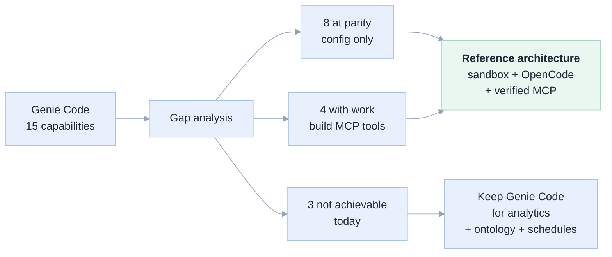

---

## 0. Conventions

**Evidence tags.** Every experimental claim carries `[E<n>]`, mapping to the ledger in §12 and to a transcript file. Vendor-documentation claims cite the doc inline.

**The nine failures are the deliverable.** A spec that only lists what works would be a sales brochure. §4.8–§4.11 document experiments that produced *wrong answers*, because those are what will bite in production.

---

## 1. The 5 Whys

The stated problem is "Genie Code is expensive". Five iterations down, the problem is different — and the difference changes the architecture.

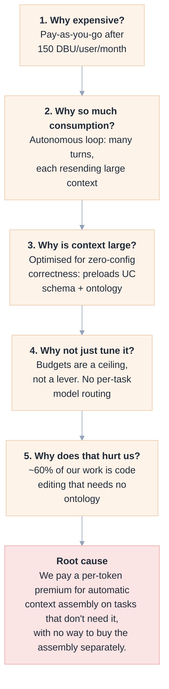

### The five answers, grounded

**1. Why expensive?** Since 8 July 2026: 150 free DBUs/user/month, then metered on the Serverless Real-Time Inference SKU, 25% promo through 31 Jan 2027, service principals get no allowance. Compute that runs generated code bills separately. — *Databricks, "Monitor and understand your Genie cost"*

**2. Why so much consumption?** Because it is an agent, not autocomplete. Each turn resends conversation plus Unity Catalog context. Our measurements show the shape: a coding agent advertises **32 tools** and ≈10 KB of schemas on *every* request, and one notebook is 16 840 chars `[E16]` `[E10]`.

**3. Why is context large?** By design — that *is* the product. Genie Code discovers `AGENTS.md`, reads UC metadata, and resolves business terms through Genie Ontology before you ask. — *Databricks, "Genie Code features and capabilities"*

**4. Why not tune it?** Budgets exist (account console, Unity Gateway resource type, `databricks-product: genie` tag) but they are a ceiling. There is no per-request token budget and no "use the cheap model for this refactor".

**5. Why does that hurt us?** The workload is bimodal:

| Task class | Share (est.) | Needs ontology? | Genie Code fit |
|---|---|---|---|
| Notebook/code edits, refactors, scaffolding | ~60% | No | Premium wasted |
| Pipeline authoring & debugging | ~25% | Partly | Premium partly used |
| Business-term analysis | ~15% | **Yes** | Premium justified |

**Root cause:** we buy automatic context assembly for the 60% that does not need it.

### What that implies

The naive conclusion — *swap Genie Code for OpenCode* — is **wrong, and we have the receipts**. Remove Genie Code and you remove the context assembly too; the agent then answers from partial or absent data with high confidence `[E10]` `[E15]`.

Correct conclusion — split by task class:

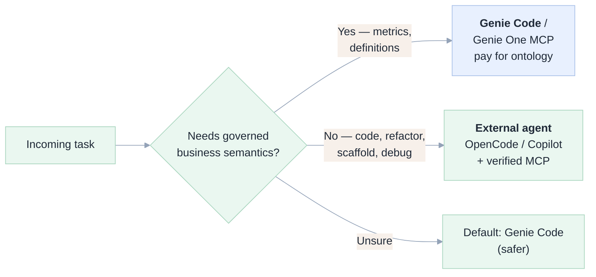

---

## 2. What Genie Code actually provides

It is not one feature; it is six products sharing a name.

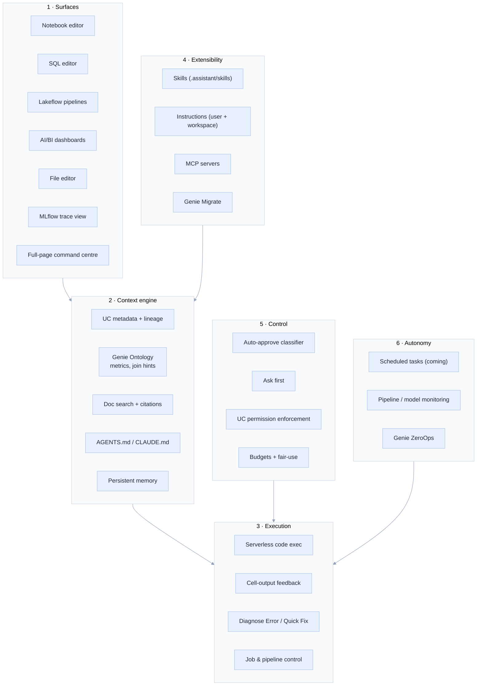

### 2.1 Capability register (the list we close gaps against)

| # | Capability | Value to the user | Verified how |
|---|---|---|---|
| **C1** | In-surface presence: chat pane everywhere + full-page command centre with parallel chats | No context switching | Docs |
| **C2** | Unity Catalog grounding: tables, columns, comments injected | Correct column names unasked — the biggest accuracy lever | Docs, `[E10]` |
| **C3** | Genie Ontology (Public Preview): metrics, join hints, domains | Business-term resolution | Docs |
| **C4** | Doc search with citations | Auditable answers | Docs |
| **C5** | `AGENTS.md` / `CLAUDE.md` auto-discovery, tree-walking | Team conventions, zero config | Docs, `[E4]` |
| **C6** | Instructions, user + workspace scope | Persistent preferences | Docs |
| **C7** | Skills — Agent Skills standard, `.assistant/skills/<n>/SKILL.md`, auto-loaded or `@`-mentioned | Reusable workflows, progressive disclosure | Docs, `[E4]` |
| **C8** | MCP: managed, UC-registered, custom on Apps | Extensibility | `[E1]` |
| **C9** | Serverless execution + output feedback loop | The core agent loop | `[E2]` |
| **C10** | Diagnose Error / Quick Fix | Fast recovery | Docs |
| **C11** | Auto-approve with an AI intent classifier | Autonomy without clicking | Docs |
| **C12** | UC permission enforcement + audit | Cannot exceed caller's grants | `[E5]` |
| **C13** | Persistent memory | Improves over time | Docs |
| **C14** | Scheduled / background autonomy | Work while away | Docs |
| **C15** | Genie Migrate (SQL dialect conversion) | Warehouse migration | Docs |

### 2.2 Two constraints everyone misses

1. **It is not a general-purpose coding assistant.** Databricks: generated code "is intended to run in a Databricks compute environment… not intended to be a general-purpose programming assistant."
2. **Auto-approve is explicitly not a security boundary.** Databricks: "The classifier is a best-effort heuristic that can be wrong… Do not rely on it to enforce security, compliance, or access-control requirements."

Point 2 is the most important line in Genie Code's docs for our purposes: **its safety does not come from the classifier — it comes from Unity Catalog permissions.** Any replacement must reproduce the *permission* boundary, not the *classifier*.

---

## 3. The replacement substrate

The replacement is feasible only because Databricks shipped the right primitives in 2026. All verified live `[E1]`.

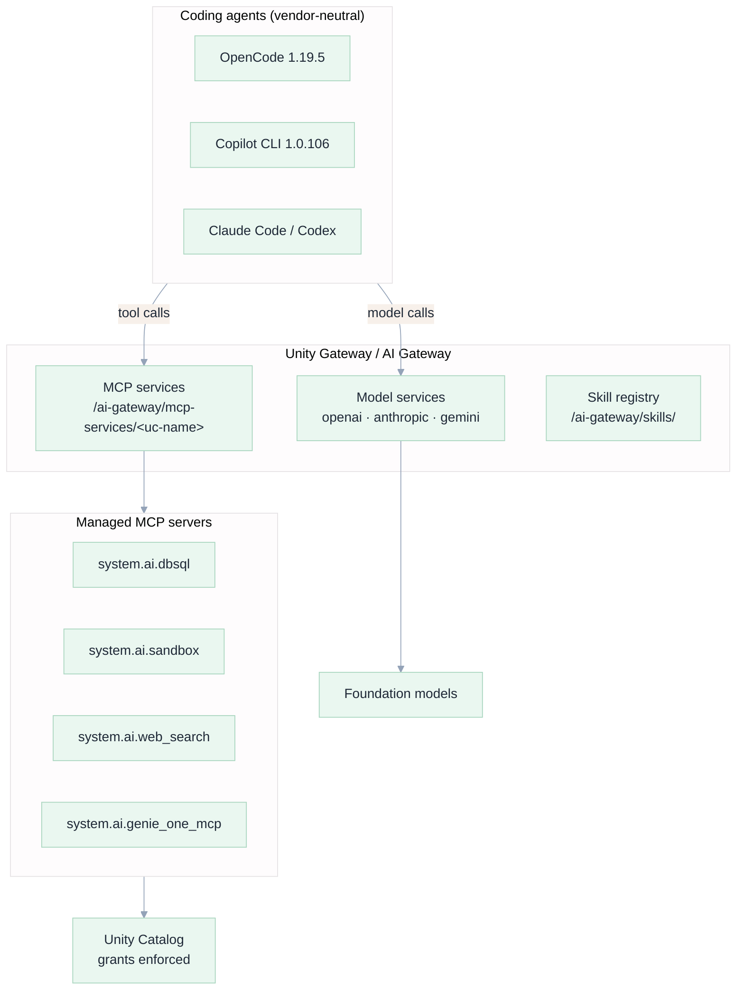

### 3.1 Verified capability matrix

| Primitive | Endpoint | Auth | Status | Evidence |
|---|---|---|---|---|
| OpenAI-compatible chat | `/ai-gateway/openai/v1/chat/completions` | PAT | ✅ | `[E2]` |
| Anthropic-native | `/ai-gateway/anthropic/v1/messages` | PAT | ⚠️ partner models gated | `[E3]` |
| Gemini-native | `/ai-gateway/gemini/v1beta/models/{m}:generateContent` | PAT | ⚠️ partner models gated | `[E3]` |
| SQL MCP (workspace) | `/api/2.0/mcp/sql` | PAT | ✅ 3 tools | `[E1]` |
| SQL MCP (gateway) | `/ai-gateway/mcp-services/system.ai.dbsql` | PAT | ✅ 2 tools | `[E1]` |
| Sandbox MCP | `/ai-gateway/mcp-services/system.ai.sandbox` | PAT | ✅ 3 tools | `[E1]` `[E7]` |
| Web search MCP | `…/system.ai.web_search` | PAT | ✅ 1 tool | `[E1]` |
| Genie One MCP | `…/system.ai.genie_one_mcp` | PAT | ✅ 4 tools | `[E1]` |
| Skills registry | `/ai-gateway/skills/` | PAT | per docs | Docs |
| SSH tunnel + agents | `databricks ssh connect` | CLI ≥1.23.0 | ✅ shipped 5 Nov 2026 | Docs |

Full tool listing: [`docs/e2e/mcp_tools.txt`](e2e/mcp_tools.txt).

### 3.2 The two hard constraints we measured

**Constraint A — model IDs are UC three-part names, and the roster is gated.**

Claude and Gemini model services return `MODEL is not enabled` (`INVALID_STATE`) until an **account admin** enables the Unity Gateway beta `[E3]`. What works:

| Model | Queryable | `max_output_tokens` | Verdict |
|---|---|---|---|
| `system.ai.gpt-oss-120b` | ✅ | **25 000** | Best observed agent-loop behaviour |
| `system.ai.qwen3-next-80b-a3b-instruct` | ✅ | **10 000** | Usable after fixing limit |
| `system.ai.llama-4-maverick` | ✅ | **8 192** | Usable after fixing limit |
| `system.ai.gpt-oss-20b` | ✅ | — | Smaller/faster |
| `system.ai.claude-*` | ❌ | — | `MODEL is not enabled` |
| `system.ai.gemini-*` | ❌ | — | `MODEL is not enabled` |

**Constraint B — every model has a different output cap; agents default to 32 000.**

Measured failures `[E2]` `[E13]`:

```
max_new_tokens 32000 cannot be greater than max_output_tokens 25000   (gpt-oss-120b)
max_tokens (24000) cannot exceed 10000                                 (qwen3-next-80b)
max_tokens (24000) cannot exceed 8192                                  (llama-4-maverick)
```

The fix is per-model `limit.output`. Without it **nothing works, and the error only appears in debug logs** — because OpenCode's TUI shows a spinner and stops.

---

## 4. Experiment log — what works and what does not

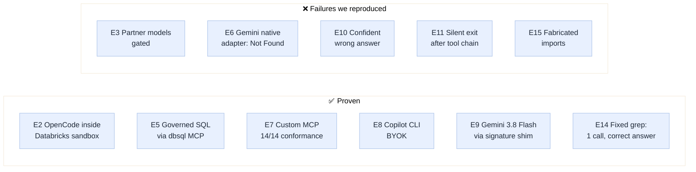

### 4.1 ✅ E2 — A coding agent inside Databricks, with no local shell

The headline result. OpenCode ran entirely inside a `system.ai.sandbox` VM.

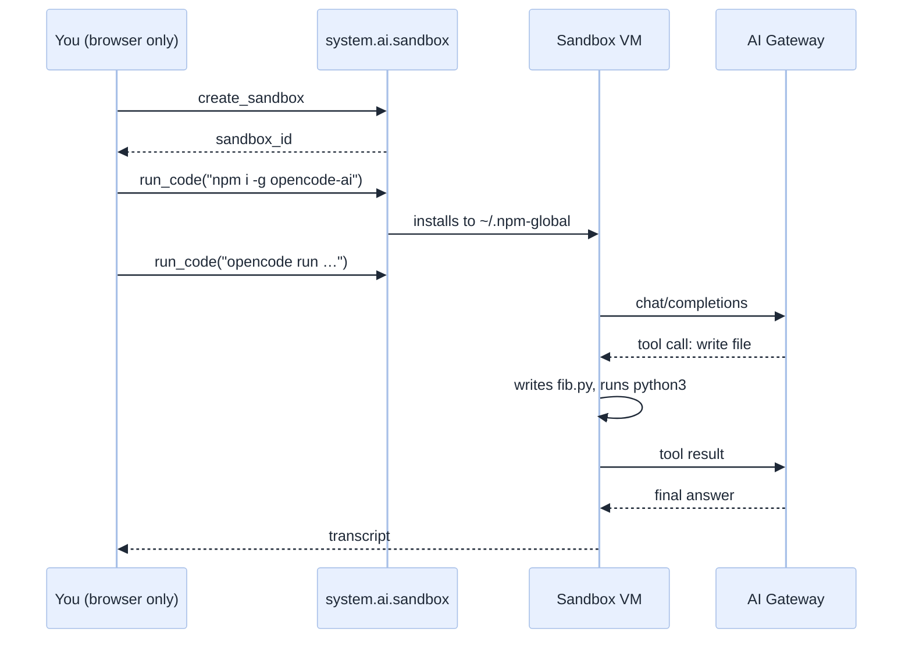

Produced, executed, and reported:

```python
# fib.py — written by OpenCode inside the Databricks sandbox
def fib_iter(n: int) -> int:
    """Return the nth Fibonacci number (0-indexed) using iteration."""
    if n < 0:
        raise ValueError("n must be non-negative")
    a, b = 0, 1
    for _ in range(n):
        a, b = b, a + b
    return a

if __name__ == "__main__":
    for i in range(10):
        print(fib_iter(i))
```

```
$ python3 fib.py
0 1 1 2 3 5 8 13 21 34
```

Transcript: [`e2e/01_opencode_gateway.txt`](e2e/01_opencode_gateway.txt)

Four facts made this work, each found by experiment:

1. Sandbox is real Ubuntu 24.04.5: Python 3.12.3, Node 24.22.1, npm 11.19.1, git, `uv`, `databricks` CLI `[E7]`.
2. Egress works: `registry.npmjs.org` 200, `api.github.com` 200, own gateway 200 in 0.70 s.
3. `npm install -g` fails `EACCES` on `/usr/local/lib` → fix with `npm config set prefix ~/.npm-global`.
4. The image already ships `~/.claude/settings.json`, `~/.codex/config.toml`, `~/.omnigent/config.yaml` symlinked into `/run/lakebox/` — **Databricks built this surface for coding agents.**

> **Why it matters:** the "no local install" constraint is not a blocker. Better, the agent's filesystem is ephemeral and isolated — a security *improvement* over an autonomous agent on a laptop.

### 4.2 ✅ E5 — Governed SQL through the agent

```
⚙ dbsql_execute_sql {"query":"SELECT current_catalog() AS catalog,
                     current_user() AS who, count(*) AS n
                     FROM samples.nyctaxi.trips"}
```

| catalog | who | n |
|---|---|---|
| workspace | raphael.mansuy@gmail.com | 21932 |

Reproduces **C12**: the query ran as the caller. Transcript: [`e2e/02_opencode_sql_mcp.txt`](e2e/02_opencode_sql_mcp.txt)

### 4.3 ✅ E7 — Custom MCP server, 14/14 conformance

`mcp/databricks_notebook_mcp.py`: 18 tools for the workspace-artefact surface the managed servers omit. **14/14 read tools passed**; 4 write tools correctly gated behind `NBMCP_ALLOW_WRITES=1`.

| Tool | s | Tool | s |
|---|---|---|---|
| `dbx_whoami` | 1.17 | `dbx_grants` | 0.96 |
| `dbx_list_catalogs` | 1.16 | `dbx_run_sql` | 2.66 |
| `dbx_list_schemas` | 1.03 | `dbx_list_notebooks` | 1.16 |
| `dbx_list_tables` | 1.05 | `dbx_list_jobs` | 1.02 |
| `dbx_describe_table` | 1.05 | `dbx_list_pipelines` | 1.01 |
| `dbx_sample_rows` | 2.84 | `dbx_list_warehouses` | 0.94 |
| `dbx_search_tables` | 16.56 | — | — |
| `dbx_table_lineage` | 2.46 | — | — |

Machine-readable: [`e2e/mcp_conformance.json`](e2e/mcp_conformance.json)

### 4.4 ✅ E8 — GitHub Copilot CLI via BYOK, no GitHub auth

Copilot CLI 1.0.106 runs with `COPILOT_OFFLINE=true` and BYOK — **no GitHub login at all**:

```bash
export COPILOT_PROVIDER_BASE_URL="https://<ws>/ai-gateway/openai/v1"
export COPILOT_PROVIDER_API_KEY="$DATABRICKS_TOKEN"
export COPILOT_MODEL="system.ai.gpt-oss-120b"
export COPILOT_PROVIDER_MAX_OUTPUT_TOKENS="16000"
export COPILOT_OFFLINE="true"
```

Wrote and ran code, then honoured the Databricks SQL MCP:

```
● execute_sql (MCP:…) {"statement_id":"01f1d989-…"}
catalog | n
workspace | 21932
```

Transcripts: [`e2e/05_copilot_byok.txt`](e2e/05_copilot_byok.txt), [`e2e/06_copilot_mcp.txt`](e2e/06_copilot_mcp.txt)

> **Caveat:** BYOK bypasses your Copilot subscription entirely. You pay the model provider (or Databricks), not GitHub.

### 4.5 ✅ E9 / E14 — Two successes worth studying

**E9 — Vertex Gemini 3.8 Flash works, but only behind a shim.** Project `mobioos-506015`, location `global`. With the signature shim (§4.7): Gemini wrote `gen3.py`, ran it, reported `6765`.

**E14 — The fix that turned a wrong answer into a right one.** After repairing the grep tool (§4.8), the same task became *one* tool call and a complete, line-numbered answer:

```
⚙ dbxnb_dbx_grep_notebook {"pattern":"^\\s*(import|from)\\s"}
| Line | Import statement                       |
| 105  | import datetime                        |
| 221  | from collections import defaultdict    |
| 307  | import html as _html                   |
| 313  | import markdown as _md                 |
| 319  | import re                              |
```

Transcript: [`e2e/14_fixed_grep_success.txt`](e2e/14_fixed_grep_success.txt)

**This is the most important pair in the document.** Same model, same task, same server — wrong answer before, correct answer after. The variable was tool *design*, not model capability.

### 4.6 ❌ E3 — Partner models are gated

```
anthropic/v1/messages  → PERMISSION_DENIED: "'databricks-claude-sonnet-4-6'
                          is no longer available. Use Unity Catalog model services."
openai/v1  system.ai.claude-sonnet-4-6 → ENDPOINT_NOT_FOUND
UC permissions API     → INVALID_STATE: "MODEL is not enabled"
```

**Implication:** an account admin must enable the Unity Gateway beta. Until then, the model-routing lever — the main cost saving — is unavailable, and you ship on `gpt-oss-120b` alone.

### 4.7 ❌ E6 — Gemini 3.x dies on any OpenAI-compatible adapter

The most instructive failure. One tool call succeeded, the second turn returned HTTP 400:

```
Function call is missing a thought_signature in functionCall parts.
This is required for tools to work correctly… function call `default_api:write`, position 2.
```

**Root cause, proven both directions.** Gemini 3.x attaches an opaque `thought_signature` to every function-call part in `extra_content.google.thought_signature` and requires it echoed on the next turn:

| Turn 2 | Signature echoed | Result |
|---|---|---|
| ✅ `extra_content` preserved | yes | `"The weather in Paris is currently 18°C and sunny."` |
| ❌ `extra_content` stripped | no | `400 INVALID_ARGUMENT: missing thought_signature` |

OpenAI-compatible adapters serialise tool calls into their own message model and drop unknown fields — they are *structurally* incapable of multi-turn Gemini 3.x tool use.

**Mitigation shipped:** `experiments/gemini_sig_shim.py`, ~90 lines, remembers signatures by `tool_call_id` (including from streamed deltas) and re-attaches them. Result: full loop ✅.

> Open item: the native `@ai-sdk/google-vertex` adapter should round-trip signatures itself. On our sandbox it returned `Not Found`, which we attribute to ADC-vs-API-key auth, not protocol. Treat as unresolved, not as a verdict.

### 4.8 ❌ E10 — The dangerous one: a confident wrong answer

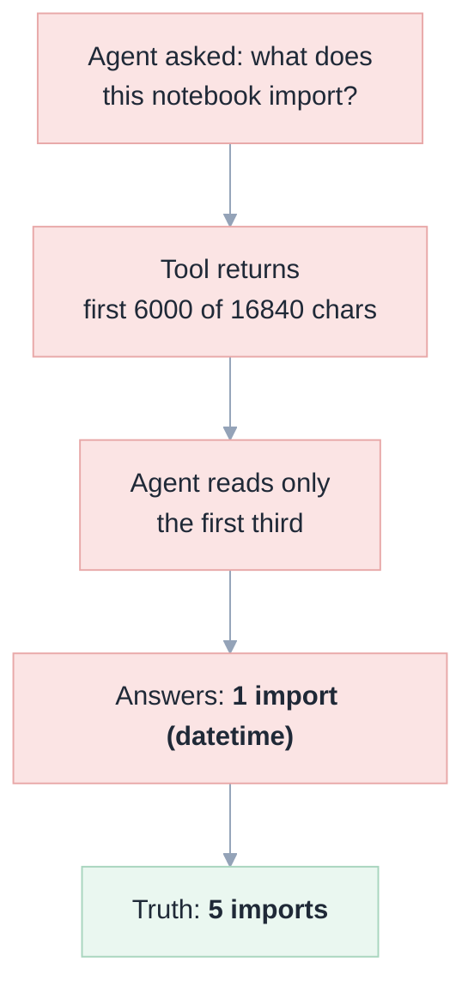

Same question, five setups:

| Case | Setup | Outcome |
|---|---|---|
| **A** | only `dbsql` | `✗ File not found` → **gave up** |
| **B** | `dbsql` + custom MCP | never called the tool; used local `read`/`glob`; **gave up** |
| **C** | explicit tool name | called tool ✅ → **stopped without answering** |
| **D** | notebook as local file (control) | **correct, complete** |
| **E** | custom MCP with paging | called 5 tools → **stalled** |

Case D is the control: with the file local, the agent answers perfectly (imports, `fully_qualified_name`, glob support). So the model is capable and the data is fine — **the failure is entirely in how the agent reaches the data.**

Two defects:

**Defect 1 — tool-selection inertia.** The agent prefers native `read`/`glob` over an MCP tool even when only the MCP tool can reach the resource. Tools must be named in the prompt or the agent will not discover them.

**Defect 2 — silent context truncation.** Our first server capped at 6 000 chars against a 16 840-char notebook. The agent read a third and reported 1 of 5 imports. **Worse than an error** — a user would accept it.

Transcripts: [`e2e/08_custom_mcp_not_chosen.txt`](e2e/08_custom_mcp_not_chosen.txt), [`e2e/10_local_file_control.txt`](e2e/10_local_file_control.txt)

### 4.9 ❌ E15 — Fabrication after an empty tool result

We gave the agent a pattern that cannot match (`IMPORT_STATEMENT`) and asked it to recover. It reported:

> "Inspecting its source shows it imports: `re`, `json`, `pandas as pd`, `pathlib.Path`, `databricks.sdk.runtime`"

Ground truth, confirmed by two independent reads: `datetime`, `collections`, `html`, `re`, `markdown`.

**Three of the five libraries were invented.** Only `re` is real. The agent had no source text — the grep returned zero hits — and hallucinated a plausible Python import list.

This is the strongest argument in the document for **explicit-empty responses**. A bare `[]` reads to a model as "searched, found nothing, content may be elsewhere"; it then fills the gap. Our fix makes `no_matches: true` prominent and attaches the first 8 source lines plus a retry hint.

Transcript: [`e2e/15_no_match_hallucination.txt`](e2e/15_no_match_hallucination.txt)

### 4.10 ❌ E11 — Silent exit after a tool chain

After **9 consecutive tool calls**, OpenCode exited 0 with no final message. Debug logs show `exiting loop`, no error, and **no failing HTTP response** — the proxy captured 11 requests, all 200.

Not a gateway defect: a synthetic two-turn tool round-trip through `/ai-gateway/openai/v1` returns a correct answer, streamed and non-streamed `[E11]`.

What we did establish:

| Observation | Data |
|---|---|
| Chat-only chain of 2 SQL calls | ✅ answered |
| 2 grep calls, correct pattern | ✅ answered (`E14`) |
| 9 mixed tool calls | ❌ silent exit |
| Tool schemas advertised per turn | **32** |
| Error responses in capture | **0** |

Working hypothesis: at ~10 messages the accumulated context crosses an internal threshold and the loop is abandoned without surfacing an error.

Transcript: [`e2e/16_stall_tool_chain.txt`](e2e/16_stall_tool_chain.txt)

### 4.11 A bug we found in our own tool

The agent emitted a POSIX pattern `^[[:space:]]*import `. Python's `re` does not support POSIX classes, so `dbx_grep_notebook` returned **zero hits with exit status success**. The agent then concluded the notebook had no imports and began paging 2 000 chars at a time until the loop died.

Two fixes, both now shipped:

```python
# Translate model-friendly POSIX classes before compiling.
_POSIX = {"[[:space:]]": r"\s", "[[:alpha:]]": r"[A-Za-z]", "[[:digit:]]": r"\d"}
```

plus an explicit `no_matches` payload with a retry hint and the first source lines.

**Lesson worth generalising:** a tool that returns an empty success is more dangerous than one that raises. Raise, or explain the emptiness.

---

## 5. Capability-by-capability gap analysis

🟢 parity · 🟡 parity with work · 🔴 not achievable today

| # | Capability | Status | What closes the gap | Evidence |
|---|---|---|---|---|
| **C1** | In-surface presence | 🔴 | Not reproducible outside Databricks. Mitigate with the **web terminal inside the notebook** — the agent sits in the notebook's own panel | Docs |
| **C2** | UC grounding | 🟡 | `dbx_describe_table` + `dbx_search_tables` + a **mandatory context prelude** in `AGENTS.md` | `[E7]` `[E14]` |
| **C3** | Genie Ontology | 🔴 | Only via `system.ai.genie_one_mcp`; route business questions there | `[E1]` |
| **C4** | Doc search + citations | 🟢 | `system.ai.web_search` | `[E1]` |
| **C5** | `AGENTS.md` discovery | 🟢 | Native to both agents | `[E4]` |
| **C6** | Instructions | 🟢 | `AGENTS.md` + `.opencode/` | Docs |
| **C7** | Skills | 🟢 | Agent Skills native; `~/.agents/skills/`; `ug skills add` | Docs |
| **C8** | MCP | 🟢 | Both are MCP clients; all Databricks MCPs verified | `[E1]` `[E7]` |
| **C9** | Execute + iterate | 🟢 | `system.ai.sandbox` | `[E2]` |
| **C10** | Diagnose / Quick Fix | 🟢 | Native: run, read traceback, repair | `[E2]` |
| **C11** | Auto-approve classifier | 🟡 | `--auto` is coarser. **Replace with server-side gating — stronger, less granular** | `[E7]` |
| **C12** | UC permission enforcement | 🟢 | Verified: runs as caller | `[E5]` |
| **C13** | Persistent memory | 🟡 | Approximate with `AGENTS.md` + skills | — |
| **C14** | Scheduled / background | 🔴 | Use a **Databricks Job** running the agent on a schedule | §8.3 |
| **C15** | Genie Migrate | 🔴 | Not achievable | — |

**Score: 8 parity, 4 with work, 3 not achievable.**

The three 🔴 that matter (C1, C3, C14) are all *analytical or ambient* — exactly the class the 5-Why says should stay on Genie Code. **The 🔴s do not block the code-work substitution.**

---

## 6. The five gaps that need engineering

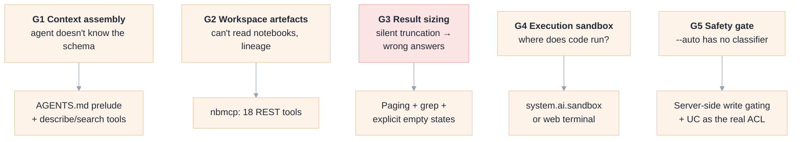

### Gap 1 — Context assembly (C2)

**Problem.** Genie Code preloads schema; an external agent guesses column names.

**Solution, two layers.**

*Layer 1 — mandatory prelude in `AGENTS.md`:*

```markdown
## Databricks working agreement

Before writing SQL against a table you have not used in this session:
1. Call `dbxnb_dbx_describe_table`. Never guess a column name.
2. If you don't know where the table lives, call `dbxnb_dbx_search_tables`.
3. State the table grain before aggregating ("one row per trip").

Tool choice:
- `system.ai.dbsql` — SQL you have already written.
- `system.ai.genie_one_mcp` — questions phrased in business terms.
- `dbxnb_*` — anything about notebooks, jobs, pipelines, lineage, grants.

If a tool result contains `next_offset`, you have NOT seen the whole
resource. Page through, or grep to narrow. Never answer from a partial page.
```

*Layer 2 — the tools.* `dbx_describe_table` returns columns, types, nullability, comments, partition keys, owner, properties in one call — the same payload Genie Code assembles internally, but requested explicitly.

**Residual:** C3 has no equivalent. Route business terms to `genie_one_mcp`.

### Gap 2 — Workspace artefacts (C1, C10)

**Problem.** No managed MCP server can read a notebook. Verified: `system.ai.dbsql` exposes only `execute_sql`, `poll_sql_result`; `system.ai.sandbox` only `create_sandbox`, `run_code`, `delete_sandbox`.

**Solution.** `mcp/databricks_notebook_mcp.py`, 18 tools. Design rules:

- **Read-mostly by default**; mutations require `NBMCP_ALLOW_WRITES=1`.
- **Typed signatures** — the model can call correctly without examples.
- **Bounded output that reports its own bounds.**
- **One tool, one verb** — no "do anything" tools.

### Gap 3 — Result sizing (the E10/E15 defect)

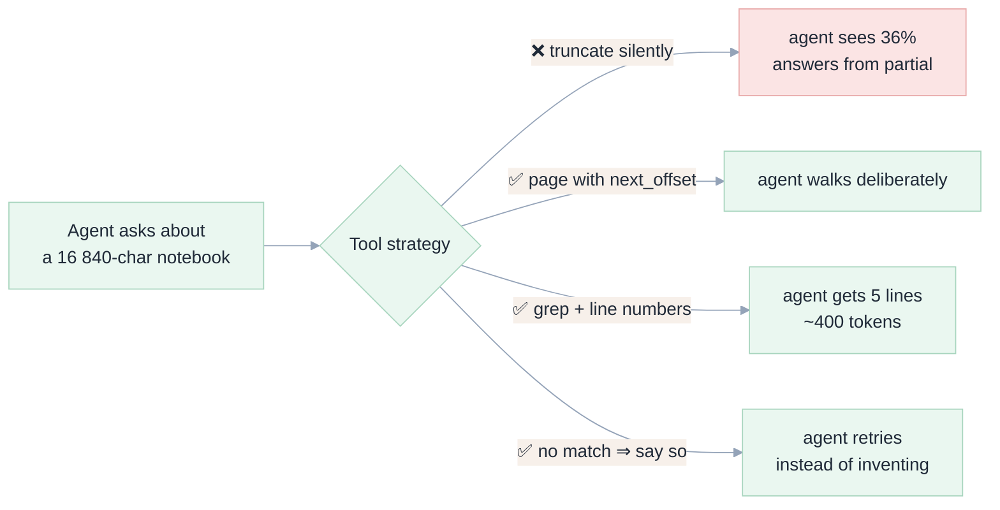

**The paging contract:**

```json
{
  "path": "/Users/…/01-schema-document-generator",
  "total_chars": 16840,
  "offset": 0,
  "returned_chars": 6000,
  "next_offset": 6000,
  "source": "# Databricks notebook source\n…"
}
```

**The explicit-empty contract:**

```json
{
  "match_count": 0,
  "no_matches": true,
  "hint": "No line matched. This does NOT mean the content is absent — try a
           looser pattern such as r'(?i)import', or call dbx_read_notebook.",
  "first_lines": "1: # Databricks notebook source\n2: # /// script\n…"
}
```

> **Design principle.** *Never let a tool silently narrow the agent's view of the world.* Either return everything, or return an explicit window with an explicit continuation — and when you find nothing, say so loudly.

### Gap 4 — Execution sandbox (C9)

| Option | Isolation | Setup | Best for |
|---|---|---|---|
| `system.ai.sandbox` | Per-user VM, ephemeral | None | No local shell `[E2]` |
| Web terminal in notebook | Same VM as compute | Admin enables | Interactive, familiar pane `[E4]` |
| SSH tunnel | Serverless compute | CLI ≥1.23.0 local | Developers with a terminal |

For your constraint, **`system.ai.sandbox` is the answer**; the web terminal is the fallback if the beta is unavailable.

### Gap 5 — Safety gate (C11)

`opencode run --auto` and `copilot --allow-all-tools` approve *everything*. Databricks warns its own classifier "might approve unsafe actions"; unconditional `--auto` is strictly weaker.

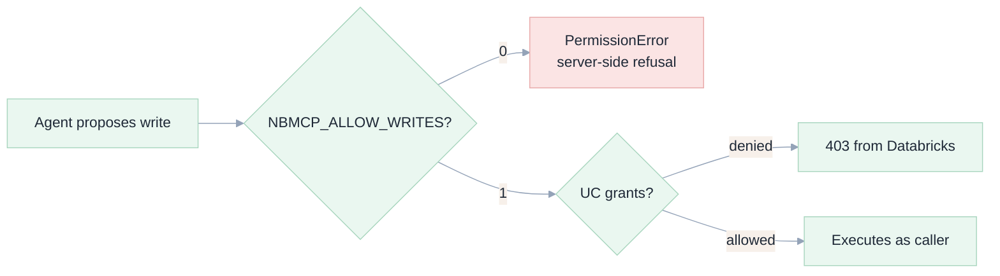

This is **stronger** than Genie Code's position: a heuristic classifier becomes a deterministic flag *plus* the real ACL. The trade-off is granularity — a flag cannot distinguish "drop the table I named" from "drop one I didn't" — so enable it only on dev.

---

## 7. Reference architecture

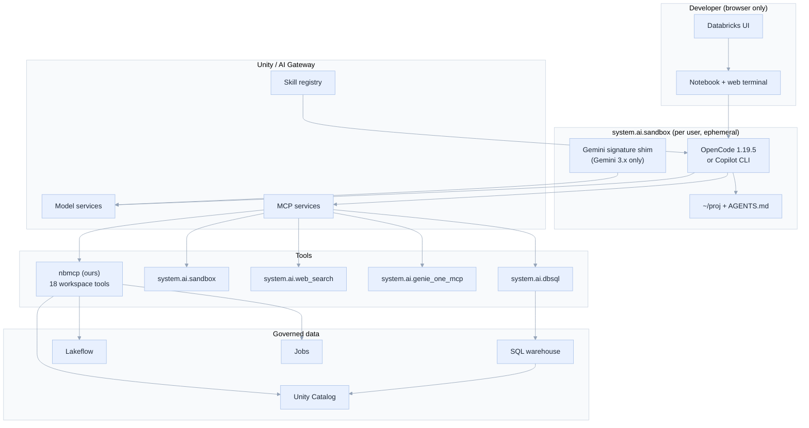

### 7.1 Three deployment topologies

| Topology | Where the agent runs | Fits "no local shell"? | Verdict |
|---|---|---|---|
| **A — In-sandbox** | `system.ai.sandbox` MCP | ✅ | **Recommended** `[E2]` |
| **B — Web terminal** | Notebook → terminal icon | ✅ | Fallback `[E4]` |
| **C — SSH tunnel** | `databricks ssh connect` | ❌ needs local CLI | Best UX if available |

Topology A has a property the others lack: the agent's filesystem dies with the sandbox, so a misbehaving agent cannot persist.

### 7.2 Reference configuration (verified working)

`~/.config/opencode/opencode.json` inside the sandbox `[E2]` `[E5]`:

```json
{
  "$schema": "https://opencode.ai/config.json",
  "model": "dbx/system.ai.gpt-oss-120b",
  "provider": {
    "dbx": {
      "npm": "@ai-sdk/openai-compatible",
      "name": "Databricks AI Gateway",
      "options": {
        "baseURL": "https://<workspace>/ai-gateway/openai/v1",
        "apiKey": "{env:DATABRICKS_TOKEN}"
      },
      "models": {
        "system.ai.gpt-oss-120b": {
          "limit": { "context": 128000, "output": 24000 }
        }
      }
    }
  },
  "mcp": {
    "dbsql": {
      "type": "remote",
      "url": "https://<workspace>/ai-gateway/mcp-services/system.ai.dbsql",
      "oauth": false,
      "headers": { "Authorization": "Bearer {env:DATABRICKS_TOKEN}" }
    },
    "dbxnb": {
      "type": "remote",
      "url": "http://127.0.0.1:8801/mcp",
      "oauth": false
    }
  }
}
```

> `"limit": { "output": 24000 }` is the single most important line, and the one missing from every quickstart.

For Claude models, once the beta is enabled, Databricks' official config uses the native adapter and **`toolStreaming: false`**:

```json
{
  "model": "databricks-anthropic/system.ai.claude-sonnet-4-6",
  "provider": {
    "databricks-anthropic": {
      "npm": "@ai-sdk/anthropic",
      "options": {
        "baseURL": "https://<workspace>/ai-gateway/anthropic/v1",
        "apiKey": "{env:DATABRICKS_TOKEN}",
        "headers": { "Authorization": "Bearer {env:DATABRICKS_TOKEN}" }
      },
      "models": {
        "system.ai.claude-sonnet-4-6": { "options": { "toolStreaming": false } }
      }
    }
  }
}
```

### 7.3 Copilot CLI equivalent

```bash
export COPILOT_PROVIDER_BASE_URL="https://<ws>/ai-gateway/openai/v1"
export COPILOT_PROVIDER_API_KEY="$DATABRICKS_TOKEN"
export COPILOT_MODEL="system.ai.gpt-oss-120b"
export COPILOT_PROVIDER_MAX_OUTPUT_TOKENS="16000"
export COPILOT_OFFLINE="true"
# MCP servers go in ~/.copilot/mcp-config.json
```

---

## 8. Mitigations for the open defects

### 8.1 Post-tool stall (E11)

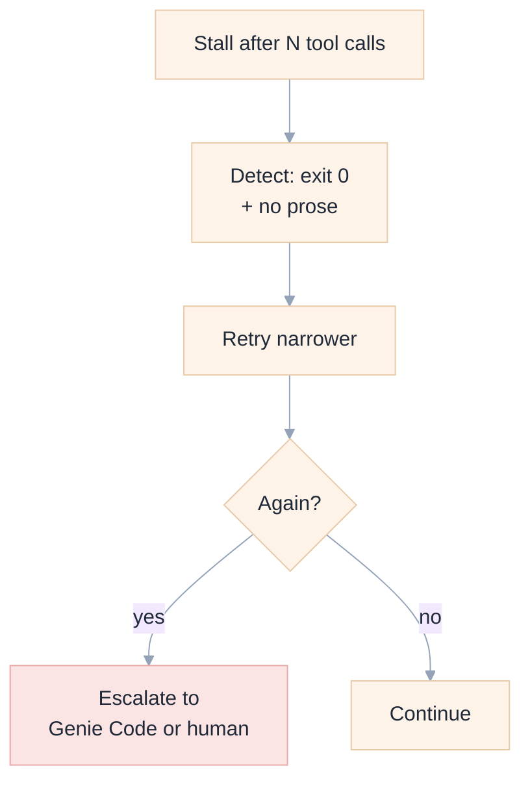

Ordered by cost:

1. **One tool call per turn.** "Call X, then answer." Short chains did not stall; 9-call chains did.
2. **Fewer, richer tools.** One `describe_table` beats `list_tables` → `describe` → `sample`. Every hop multiplies stall probability *and* context.
3. **Stall-detecting wrapper.** Treat "exit 0 + last line is a tool marker" as failure; re-run with a narrower prompt. ~20 lines of shell.
4. **Prefer large-output models.** `gpt-oss-120b` (25 000) completed tasks where smaller caps failed.
5. **Interactive by default.** A human notices silence; batch mode does not.

**Not a fix:** retrying the identical prompt. Repetition was deterministic.

### 8.2 Silent truncation (E10) and fabrication (E15)

Fixed at the tool layer by the two contracts in Gap 3. Residual mitigation is an instruction in `AGENTS.md`:

```markdown
If a tool response contains `next_offset`, you have NOT seen the whole
resource. If it contains `no_matches: true`, your pattern was wrong — retry
before answering. Never state facts about a file you have not fully read.
```

### 8.3 Scheduled autonomy (C14)

Genie Code's scheduled tasks are "coming soon". Until then, a Databricks Job can run the agent on a cron:

```
Job: nightly-agent-triage
  task: notebook / python wheel
  flow: sandbox MCP → opencode run "<prompt>" → write result to a Volume
```

This reproduces the *capability* but not the *integration* — no thread appears in Genie Code's UI. Document it as a gap, not a substitute.

---

## 9. Cost model

### 9.1 What each option meters

| | Genie Code | External agent + gateway |
|---|---|---|
| Unit | DBU (Serverless RTI) | Model-service tokens |
| Free tier | 150 DBU/user/month | none (`gpt-oss` is cheap) |
| Discount | 25% to 31 Jan 2027 | n/a |
| Context | Pre-assembled (you pay) | You control it |
| Execution compute | Separate | Sandbox is a separate SKU |
| Model choice | Databricks-selected | **Per task** |
| Budget control | Ceiling only | Per-model, per-task |

### 9.2 Why the saving is real but smaller than expected

Agent cost is **quadratic in conversation length**, not linear: a 6-turn loop resends the whole conversation 6 times. And the fixed overhead is large — we measured **32 tools and ~10 KB of schemas per request** `[E16]`.

So the saving comes from three levers, not from model price:

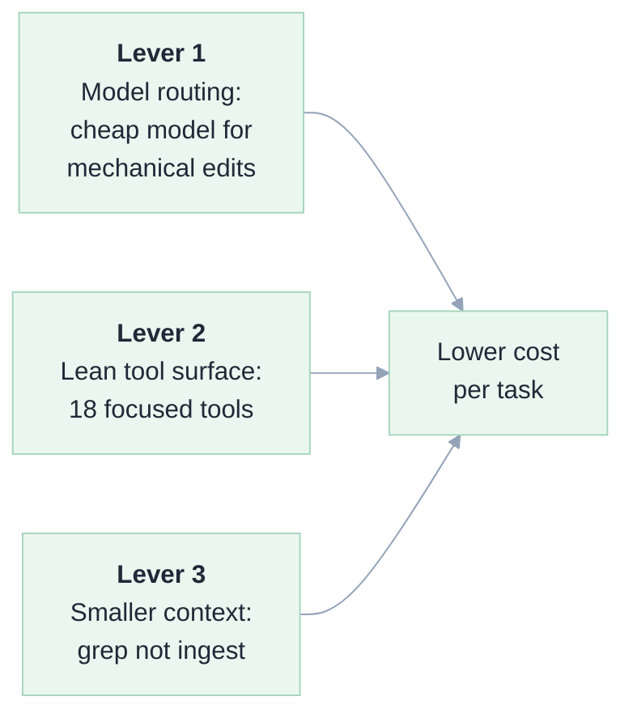

**Lever 2 deserves emphasis.** Tool schemas are paid on *every* turn, forever. Trimming 40 tools to 18 is a permanent, compounding reduction — and, per `[E14]`, it also improves accuracy. **Tool-surface size is a cost *and* accuracy variable, not just a feature count.**

### 9.3 Honest accounting

We did **not** run a controlled cost comparison: this workspace has no Genie Code usage history and no billing access.

- Mechanism confirmed (per-token vs per-DBU, model choice).
- Direction certain (`gpt-oss-120b` at our volumes is far below Genie Code's DBU profile).
- Magnitude **unverified**.

**Do not present a savings figure to stakeholders from this document.** Measure in a 2-week pilot.

---

## 10. Governance and risk

| Risk | Severity | Control | Residual |
|---|---|---|---|
| Agent writes to production data | High | `NBMCP_ALLOW_WRITES=0`; UC grants | Low |
| Confident wrong answer from truncation | **High** | Paging + explicit-empty contracts | **Medium** |
| **Fabrication after empty tool result** | **High** | `no_matches` payload + `AGENTS.md` rule | **Medium** |
| Silent stall in batch mode | Medium | Wrapper detection; interactive default | Medium |
| PAT in sandbox filesystem | High | Ephemeral FS; `/tmp` only | Medium — migrate to `databricks auth` |
| Data egress via model calls | High | Unity Gateway + UC permissions | Low |
| Prompt injection via notebook text | Medium | Sandbox isolation; no creds on disk | Medium |
| Partner models unavailable | Medium | Ship on `gpt-oss-120b`; escalate beta | Low |

### 10.1 The non-negotiable rule

> **Never run the external agent with write access against production, regardless of `--auto`.**

Genie Code's own docs say its classifier "might approve unsafe actions". An external agent with `--auto` has *no* classifier. The only reliable boundary is the server-side flag plus Unity Catalog — which is why Gap 5 is the most important engineering item, not an afterthought.

### 10.2 Audit trail

Unity Gateway records model and MCP usage; Unity Catalog records data access. Between them an external agent's actions are attributable. Verify during rollout — this is the difference between a governable tool and shadow IT.

---

## 11. Recommendations

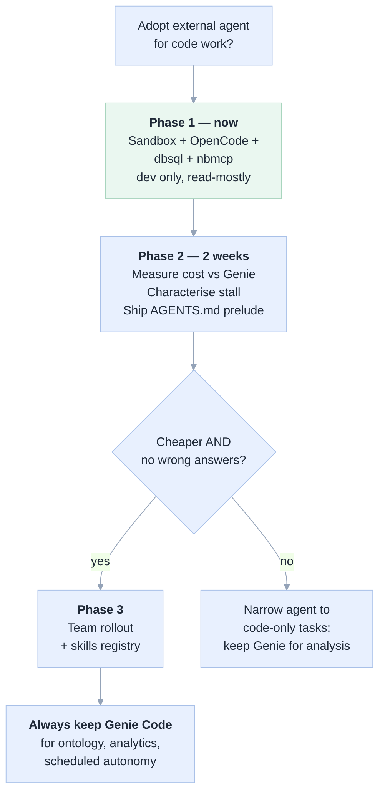

### 11.1 This week

1. **Test the web terminal** (notebook → terminal icon). Lowest-risk path, no new tooling.
2. **Run OpenCode from the sandbox** — `experiments/steps/04_opencode_fixed.sh`. Works today.
3. **Ask an account admin** to enable the Unity Gateway beta. Without it, Claude/Gemini are unavailable and the main cost lever is dead.
4. **Deploy `nbmcp`** to a dev workspace and run `mcp/test_mcp.py` (14/14 expected).

### 11.2 Do not

- **Do not** point the agent at production with `--auto`.
- **Do not** adopt Gemini 3.x through an OpenAI-compatible adapter without the shim — or any adapter without testing multi-turn tool use first.
- **Do not** expect Copilot CLI to use your Copilot subscription; BYOK bypasses it.
- **Do not** publish a cost saving from this document.
- **Do not** ship a tool that returns an empty success.
- **Do not** truncate tool output silently.

---

## 12. Experiment ledger

| ID | Experiment | Method | Result | Artifact |
|---|---|---|---|---|
| E1 | Enumerate MCP surface | `tools/list` × 5 endpoints | 5 servers, 13 tools | `e2e/mcp_tools.txt` |
| E2 | OpenCode in sandbox | npm + agent run | ✅ wrote & ran `fib.py` | `e2e/01_opencode_gateway.txt` |
| E3 | Partner model availability | gateway + UC probe | ❌ `MODEL is not enabled` | §3.2 |
| E4 | Workspace inspection | workspace/UC/assistant APIs | `.assistant/`, web terminal on | §5 |
| E5 | SQL MCP via agent | OpenCode + `dbsql` | ✅ governed SQL | `e2e/02_opencode_sql_mcp.txt` |
| E6 | Gemini native adapter | `@ai-sdk/google-vertex` | ❌ Not Found (auth) | `e2e/07_gemini_thought_signature_failure.txt` |
| E7 | Custom MCP conformance | 18 tools, stdio client | ✅ 14/14 | `e2e/mcp_conformance.json` |
| E8 | Copilot CLI BYOK | env-var provider | ✅ code + MCP | `e2e/05`, `e2e/06` |
| E9 | Gemini 3.8 + shim | Vertex `global` | ✅ full loop | `e2e/04_gemini38_shim.txt` |
| E10 | Tool-selection A/B | 5 prompt variants | ❌ wrong answer | `e2e/08`, `e2e/10` |
| E11 | Post-tool stall | capture proxy, 11 turns | ❌ silent exit, 0 errors | `e2e/16_stall_tool_chain.txt` |
| E12 | Model loop matrix | 3 models, same task | ⚠️ per-model caps | §3.2 |
| E13 | Output-cap failures | 3 models @ 24000 | ❌ 25000/10000/8192 | §3.2 |
| E14 | Fixed grep | 1 tool call | ✅ correct + line numbers | `e2e/14_fixed_grep_success.txt` |
| E15 | Empty-result recovery | non-matching pattern | ❌ **fabricated 3 of 5 imports** | `e2e/15_no_match_hallucination.txt` |
| E16 | Tool-schema weight | proxy capture | 32 tools, ~10 KB/request | `e2e/16_stall_tool_chain.txt` |

---

## 13. Open questions

1. **Does the stall vanish with a larger-context model?** Needs the beta enabled. Highest-value unknown.
2. **Does `@ai-sdk/google-vertex` round-trip signatures with proper ADC?** Would remove the shim.
3. **What is the real DBU-per-task for Genie Code?** Required for any cost claim.
4. **Can `nbmcp` run as a Databricks App?** Docs describe the pattern (stateless streamable HTTP at `/mcp`); untested here. Would remove the local process and let Genie Code itself use our tools.
5. **Does a Genie Code skill load unmodified into OpenCode?** Both claim Agent Skills — a shared `.assistant/skills` ↔ `~/.agents/skills` is a cheap, high-value test.
6. **Why do 32 tools appear when only ~20 are configured?** Suggests built-ins are always advertised; trimming may be impossible and must be budgeted for.

---

## Appendix A — Reproducing the experiments

```bash
# MCP client helper
python3 experiments/dbx_mcp.py list /ai-gateway/mcp-services/system.ai.sandbox

# Ship a script into the sandbox and run it
python3 experiments/sandbox_run.py experiments/steps/04_opencode_fixed.sh \
  --sandbox=<sandbox-id>

# Custom MCP conformance (expect 14/14)
/Users/<you>/.venv/bin/python3 mcp/test_mcp.py

# Pull all transcripts back out of the sandbox
python3 experiments/collect_e2e.py
```

Key step scripts:

| Script | Demonstrates |
|---|---|
| `04_opencode_fixed.sh` | The working OpenCode + gateway config |
| `05_opencode_mcp_sql.sh` | Governed SQL via `system.ai.dbsql` |
| `07_opencode_vertex_native.sh` | Gemini native adapter failure |
| `09_copilot_byok.sh` | Copilot CLI BYOK |
| `11_opencode_gemini_shim.sh` | Gemini 3.8 + signature shim |
| `22_capture_stall.sh` | Proxy capture of the failing loop |
| `24_retest_fixed_grep.sh` | The fix that produced a correct answer |

## Appendix B — Model output limits (measured)

| Model | `max_output_tokens` | Verified |
|---|---|---|
| `system.ai.gpt-oss-120b` | 25 000 | ✅ |
| `system.ai.qwen3-next-80b-a3b-instruct` | 10 000 | ✅ |
| `system.ai.llama-4-maverick` | 8 192 | ✅ |

Any agent config requesting 32 000 fails on all three.

## Appendix C — Screenshots

Databricks uses SSO, so headless capture cannot authenticate. Two paths:

```bash
# One-time: log in, save the session
python3 docs/e2e/capture.py --login

# Then: capture all referenced pages
python3 docs/e2e/capture.py
```

Targets: workspace home, Genie Code command centre, notebook + web terminal, Catalog Explorer, SQL editor, compute, jobs, MCP marketplace, compute settings. Output → `docs/e2e/screenshots/`.

## Appendix D — Sources

Databricks documentation: "Genie Code"; "Genie Code features and capabilities"; "Navigate Genie Code"; "Agent mode"; "Customize Genie Code with custom instructions"; "Extend Genie Code with agent skills"; "Connect Genie Code to MCP servers"; "Monitor and understand your Genie cost"; "Databricks AI assistive features trust and safety"; "Databricks managed MCP servers"; "Databricks SQL MCP server"; "Genie One MCP server"; "Genie Agent MCP server"; "Databricks-provided MCPs"; "Integrate with coding agents"; "Integrate coding agents with model provider services"; "Query external model providers"; "Connect OpenCode"; "Connect Codex"; "ug CLI reference"; "Add tools and skills"; "Run shell commands in Databricks web terminal"; "Connect to Databricks using an SSH tunnel"; "Manage port forwarding to serverless compute"; "November 2026 release notes" (SSH-tunnel agents, 5 Nov 2026); "July 2026 release notes" (web terminal on serverless GPU, 31 Jul 2026); "Environment version 2"; "Unity Gateway overview".

GitHub documentation: "Adding LLM models to GitHub Copilot CLI" (BYOK); "Copilot CLI now supports BYOK and local models" (7 Apr 2026); "Custom agents configuration"; "Adding MCP servers for GitHub Copilot CLI".

Google Cloud: Vertex AI `generateContent` and OpenAI-compatible `chat/completions`; Gemini thought-signatures.
