# Mission submission feedback

The submission lifecycle is separate from execution and from observing the event stream.
The browser can acknowledge a gesture immediately. Only a successful messages response or
the server's turn events establish that work was accepted.

## Statechart

```mermaid
stateDiagram-v2
    [*] --> Draft
    Draft --> Draft: Empty / blocked / uploading / IME composition
    Draft --> Sending: Enter or Send / lock repeat submission
    state Sending {
        [*] --> PreparingContext
        PreparingContext --> OpeningSession: No session exists
        PreparingContext --> AwaitingAcceptance: Existing session
        OpeningSession --> AwaitingAcceptance: Session created
        AwaitingAcceptance --> Slow: 8 seconds without confirmation
        Slow --> AwaitingAcceptance: Continue waiting; never resend automatically
    }
    Sending --> Accepted: HTTP 202 or turn event
    Sending --> Draft: Context / creation / permission refusal; preserve draft
    Sending --> Unconfirmed: Transport failure; preserve draft
    Unconfirmed --> Draft: Review saved conversation before manual resend
    Accepted --> Queued: Server reports queued
    Accepted --> Running: Server reports running
    Queued --> Running: turn.started
    Queued --> Stopped: Cancel accepted queue
    Running --> Waiting: Approval / question / review required
    Waiting --> Running: User decision / answer / resume
    Running --> Auditing: turn.auditing
    Auditing --> Running: Further work
    Running --> Settled: Complete / blocked / failed / interrupted / declined / refused / truncated
    Auditing --> Settled: Server verdict
    Running --> Stopped: turn.cancelled
    Settled --> Draft: New instruction
    Stopped --> Draft: New instruction
```

Connection is an independent state machine: connecting, live, reconnecting, closed.
Losing SSE does not prove that a POST failed or that accepted work stopped. Existing
connection notices and retry controls retain ownership of connection recovery.

## Findings and changes

- `App.message` captures SQL context before calling `send`; the first mission also waits
  for identity/scratch-folder lookup and session creation. The composer now acknowledges
  submission before any of those awaits. The shared dock header carries that state if
  revealing the dock replaces the original composer.
- `POST /sessions/{sid}/messages` resolves attachments before submitting the turn. Slow
  attachment resolution therefore delays both its 202 response and turn events. The UI
  says “Sending”, retains the request, and explains longer waits without inventing progress.
- Previously, an optimistic turn claimed running immediately. Delivery now has its own
  local flag. The 202 response supplies the accepted turn identity/status even without SSE.
- Slow metadata hydration retains pending requests. If SSE arrives first, a later POST
  acknowledgement retains the streamed answer and terminal state. Refused follow-ups do
  not change the existing mission's execution status; old responses cannot mutate another session.
- SQL context capture errors now reject submission, preserving the draft. Explicit context
  attachments clear after acceptance. A sidebar refresh failure after acceptance cannot
  turn a successful submission into a failure inviting a duplicate.
- A running mission shows Send when there is a follow-up draft; the existing Stop control
  remains available in the server status surface and Escape stops work outside submission.

## Edge cases and boundaries

| Case | Behavior |
|---|---|
| Double Enter/click | Synchronous ref guard and disabled sending button |
| Empty, archived, restore required, pending uploads | Existing guards refuse submission |
| IME Enter, Shift+Enter, command/context picker | Composition commits do not send; existing newline/picker behavior remains |
| Slow context, first session, slow acceptance | Immediate sending notice, retained text, eight-second explanation |
| Refusal or failed context capture | Draft and attachments remain; error is announced |
| Network response lost | Acceptance is uncertain; review conversation before resending; no automatic retry |
| Follow-up while running or waiting for approval | Explicit Send; server owns queue order and decisions |
| SSE before POST, POST before SSE, slow hydration | Reconcile accepted identity and preserve server activity |
| Session switched before POST settles | Late response cannot alter the newly opened session |
| Stop during acceptance | Submission is not presented as cancellable; Stop controls operate on accepted server work |
| Reload/tab close before confirmation | Keep-page-open wording; unsent drafts are not persisted across reloads |
| Accessibility/theme/motion | Polite status text, busy textarea, semantic theme colors, static indicator with reduced motion |

This change improves acknowledgement latency. It does not shorten server context resolution,
add durable browser drafts, or guarantee exactly-once delivery after a lost HTTP response.

## Validation

Composer tests cover immediate/delayed feedback, duplicate prevention, refusal recovery,
IME, and visible follow-up Send. Hook tests cover hydration, both acknowledgement/event
orders, terminal state preservation, follow-up refusal, and switching sessions.
`scripts/submission-feedback-e2e.mjs` exercises delayed first-mission acceptance and refused
follow-ups through the real local HTTP/SSE app with a fake agent.
