[Index](README.md) · **Tutorial** · [01 Big picture](01-big-picture.md) · [02 Setup reference](02-setup-in-the-databricks-shell.md) · [04 Safety](04-safety-and-governance.md) · [06 Results](06-results-and-lessons.md) · [07 Decide](07-decision-guide.md)

# Tutorial: set up a coding agent in Databricks and use it

**Time: about 30 minutes the first time. Skills needed: you can run a notebook and paste a token.**
You do not need a terminal on your own computer. Everything runs from a notebook in your browser, and the agent works in a small
temporary Linux machine that Databricks gives you.

By the end you will have:

- a coding agent that answers data questions by **running real SQL**,
- an agent that **builds a notebook, runs it and proves it works**,
- an agent that is **physically unable to write outside one schema and one folder**, which you will test yourself.

> **About the screenshots.** Every picture below is the **real output** of the real notebook code, captured on a live
> workspace (run on 6 November 2026) and drawn as an image. They are renderings of text, **not photos of the Databricks
> web page**: our automation cannot sign in to the web UI (single sign-on), so the few steps that are clicks in the browser are
> described in words. Your workspace address and email are replaced by placeholders.

## The big picture in 60 seconds

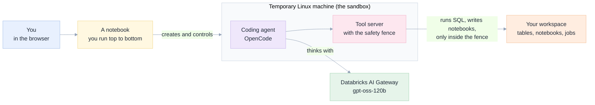

Three ideas to hold on to:

1. **The sandbox is disposable.** It is a temporary machine. When you delete it, its disk goes with it.
2. **The agent never touches your workspace directly.** It asks the tool server, and the tool server enforces the rules. This matters because the agent runs **without asking permission for each step**.
3. **A supervisor makes the agent finish.** The model we use can stop early. A small loop sends it back to work until it shows proof.

## Before you start

| You need | How to check | If not |
|---|---|---|
| A Databricks workspace with **serverless compute** | You can attach a notebook to "Serverless" | Ask your admin |
| Access to the AI Gateway **sandbox service** and the model `gpt-oss-120b` | Step 2 below creates a sandbox without an error | Ask an admin to grant access to `system.ai.sandbox` |
| A **personal access token** | Step 4 explains how to make one | Use a short lifetime (a day is plenty) |
| Somewhere the agent may write | A schema and a folder you do not mind filling with test objects | Step 5b creates nothing for you: pick or create them |

## The steps at a glance

```mermaid
%%{init: {'theme':'base','themeVariables':{'primaryColor':'#E8F0FE','primaryTextColor':'#1F2937','primaryBorderColor':'#A8C0E8','lineColor':'#94A3B8'}}}%%
flowchart LR
    S1["1 Import the<br/>notebook"]:::blue --> S2["2 Get a<br/>sandbox"]:::green --> S3["3 Copy the<br/>kit in"]:::yellow --> S4["4 Give it<br/>your token"]:::purple --> S5["5 Install<br/>the agent"]:::pink --> S5b["5b Start the<br/>fence"]:::orange --> S6["6 Ask a<br/>question"]:::teal --> S7["7 Build a<br/>notebook"]:::blue --> S8["8 Test the<br/>fence"]:::pink --> S9["9 Tidy up"]:::green
    classDef blue fill:#E8F0FE,stroke:#A8C0E8,color:#1F2937
    classDef green fill:#E6F4EA,stroke:#A8D5B5,color:#1F2937
    classDef yellow fill:#FFF8E1,stroke:#F2D98D,color:#1F2937
    classDef purple fill:#EFE7FB,stroke:#C9B6EC,color:#1F2937
    classDef pink fill:#FDE7EF,stroke:#F2B5CB,color:#1F2937
    classDef orange fill:#FFEDE0,stroke:#F5C29C,color:#1F2937
    classDef teal fill:#E0F5F3,stroke:#9AD5CE,color:#1F2937
```

Measured on our run (the two agent steps vary from run to run):

| Step | What happens | Time we measured |
|---|---|---|
| 2 | Sandbox created | 5 s |
| 3 | Kit copied in | 4 s |
| 4 | Token stored | 3 s |
| 5 | Agent installed | 15 s |
| 5b | Tool server started | 3 s |
| 6 | First question | 51 s |
| 7 | Build and run a notebook | 115 s |
| 8 | Fence test | 35 s |
| | **Whole walk-through** | **under 5 minutes of waiting** |

---

## Step 1 · Import the notebook

The notebook is [`notebooks/launch_agent_from_notebook.py`](../notebooks/launch_agent_from_notebook.py). It holds every command in this tutorial.

1. In your workspace, open **Workspace** and go to your own folder.
2. Choose **Import** (the menu on the folder, or the **Add** button). Upload the `.py` file, or paste its web address (the "raw" link on GitHub) if your import dialog offers a URL box.
3. Open the imported notebook and attach it to **Serverless** compute.

The notebook needs only Python's standard library, so serverless is enough. Menu names may differ a little between workspaces.

Then **run the first cell** ("Step 1 · Helpers"). It only defines helper functions and prints nothing. The rest of the tutorial runs the notebook's cells one at a time, top to bottom.

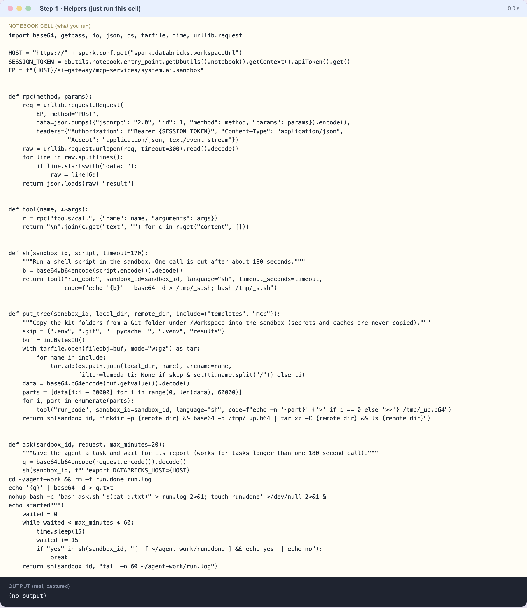

## Step 2 · Get a sandbox

Run the "Step 2" cell. It asks Databricks for a temporary Linux machine and checks what is on it.

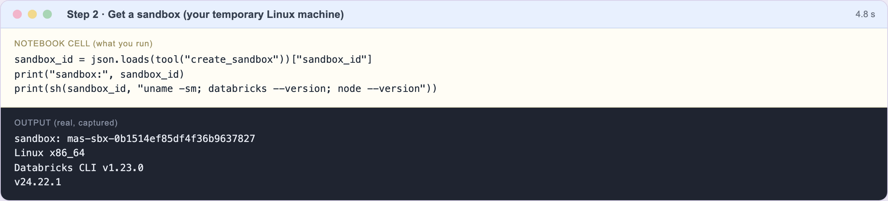

What to look for: a **sandbox id** and the `Databricks CLI` version. The machine already has the Databricks command-line tool and Node. It does not have the coding agent yet.

Three facts about this machine:

- **One command can run about 180 seconds at most.** The notebook's `ask()` helper works around that for long tasks.
- **Its disk is temporary.** Keep nothing valuable only there.
- **You are not an administrator on it.** Everything installs into your own folder.

## Step 3 · Copy the kit into the sandbox

The "kit" is the small set of files from this repository that the agent needs: setup scripts, the rules file, the skills and the tool server. There are two ways to copy it. Use one.

| | Option A: copy from GitHub | Option B: copy from a folder in your workspace |
|---|---|---|
| How | `git clone` inside the sandbox | `put_tree(...)` reads a Git folder under `/Workspace` |
| Good when | The repository is public and already contains the kit | Your copy is private or has your own changes |
| What we verified | `git clone` plus the whole flow below, on 6 Nov 2026 | the screenshots in this page |

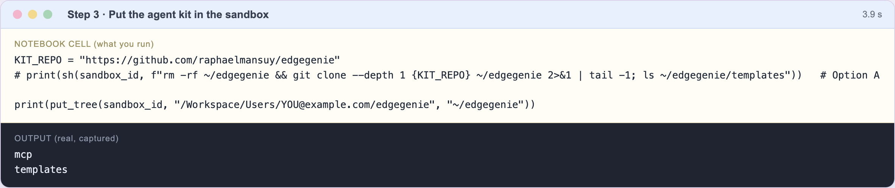

> **Both options work.** The screenshots below show Option B, because the kit was not on GitHub yet when we captured them.
> We then pushed it and re-ran the whole tutorial from a fresh sandbox with a plain `git clone` of Option A: install, fence,
> question, answer, all fine. If your copy is private, use Option B.
> `put_tree` never copies secrets: it skips `.env`, `.git` and caches, and it only takes the `templates` and `mcp` folders.

## Step 4 · Give the agent your token

The agent needs a key to talk to Databricks. Make a **personal access token**:

1. Click your profile picture, then **Settings**.
2. Open **Developer**, then **Access tokens**, then **Manage**.
3. Choose **Generate new token**, give it a short lifetime, and copy it.

Run the "Step 4" cell. A password-style box appears. Paste the token there.

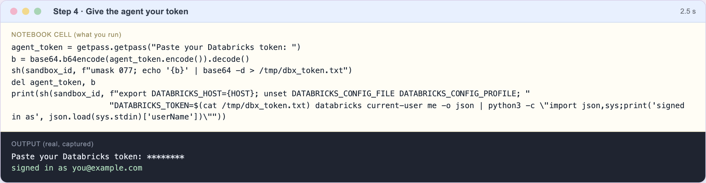

What happens to the token:

- It is written to **one file inside the sandbox**, readable only by you, and then removed from the notebook's memory.
- It is **never printed**. In the screenshot you see only asterisks, then `signed in as ...`, which proves the token works.
- The agent is told never to display it, and our test harness fails any run whose log contains it.

> **Not checked by us:** the password box inside a real Databricks notebook (we ran the same code with the box answered automatically).
> If the box does not appear, store the token in a Databricks secret and read it with `dbutils.secrets.get`.

> **Safer than your own token:** a token for a *service principal* that can only reach your scratch schema. We recommend it, but we
> did not test it. See [04 Safety](04-safety-and-governance.md#what-we-recommend-and-what-we-did-not-test).

## Step 5 · Install the agent

Run the "Step 5" cell. It runs the kit's setup script in the sandbox.

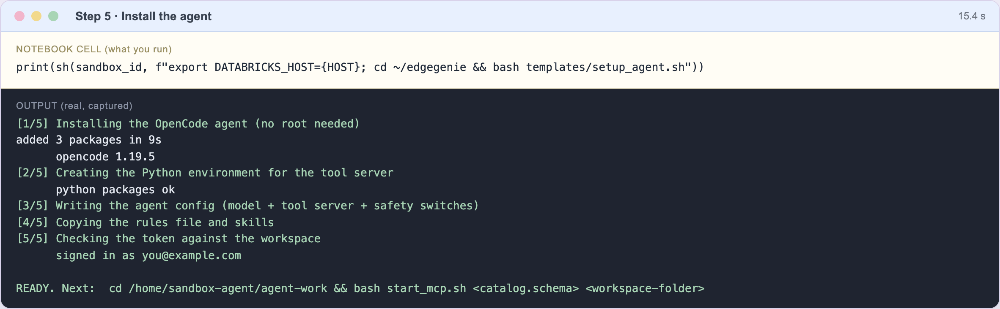

The script does five things, in this order:

| # | What it does | Why it matters |
|---|---|---|
| 1 | Installs **OpenCode**, the coding agent | Needs no root rights |
| 2 | Makes a Python environment for the tool server | The tool server is a small Python program |
| 3 | Writes the agent's **config file** | Points it at the model, adds the tool server, **hides its built-in file tools** |
| 4 | Copies the **rules file** (`AGENTS.md`) and **skills** | The rules are the agent's working agreement |
| 5 | Tests your token | Stops early if the sign-in is wrong |

Two details in the config file are worth knowing about:

- `"output": 24000` limits the answer size. The model allows 25,000, agents ask for more by default, and without this line **the call is rejected and you only see a spinner**.
- The agent's built-in file tools are switched off. They would work on the sandbox's disk, but your notebooks live in the *workspace*; leaving them on made agents edit files that did not matter.

## Step 5b · Start the tool server and set the fence

Edit the two names at the top of the "Step 5b" cell, then run it:

```python
SCRATCH_SCHEMA = "workspace.agent_scratch"                    # the only schema the agent may write to
SCRATCH_FOLDER = "/Workspace/Users/you@example.com/agent_scratch"   # the only folder the agent may write to
```

Create the schema and the folder first if they do not exist (`CREATE SCHEMA workspace.agent_scratch` in a SQL cell; a new folder in the Workspace browser).

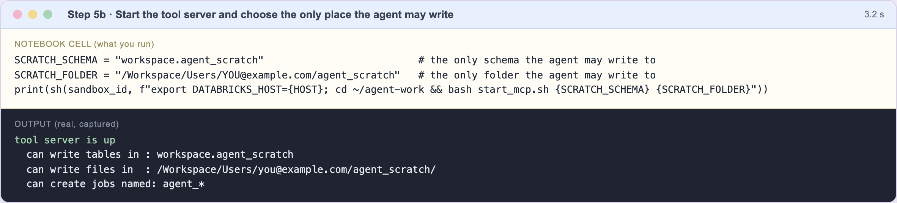

The screenshot's three lines are the **fence**. They are enforced **by the tool server, not by the agent**. The agent could be confused or tricked, and the fence would still hold. Step 8 proves it.

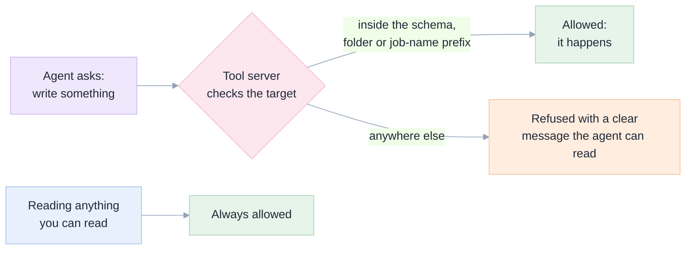

## Step 6 · Ask your first question

Run the "Step 6" cell. The request is a read-only data question:

> *Which three pickup zip codes in `samples.nyctaxi.trips` have the highest total `fare_amount`? Show the SQL you ran and the numbers.*

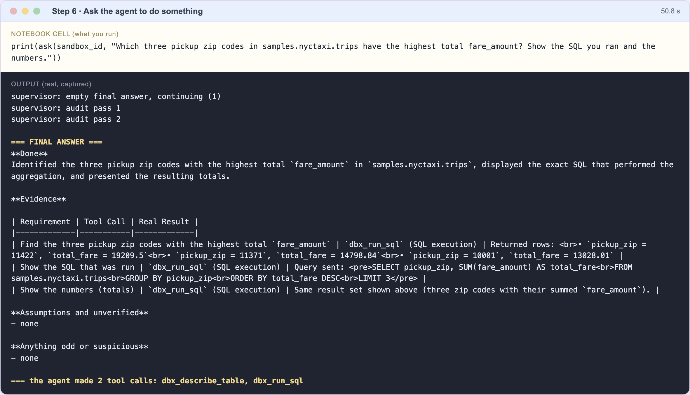

How to read the output, from top to bottom:

| What you see | What it means |
|---|---|
| `supervisor: empty final answer, continuing (1)` | The model stopped without answering, and the supervisor sent it back to work. **This is normal for this model**: it happened on 3 of our 6 asks over two runs. |
| `supervisor: audit pass 1` and `2` | The supervisor asks: "name the tool call that proves each requirement". This is what turns a confident claim into checked work. |
| `=== FINAL ANSWER ===` | The agent's report, in four fixed headings: **Done**, **Evidence**, **Assumptions and unverified**, **Anything odd or suspicious**. |
| `--- the agent made 2 tool calls` | It looked at the table's columns, then ran the SQL. |

> **Do not trust, check.** Run the SQL yourself in a SQL cell and compare. On our run it returned `11422 → 19209.5`, `11371 → 14798.84`, `10001 → 13028.01`, exactly what the agent reported.

## Step 7 · Ask for something real: build a notebook and prove it works

Run the "Step 7" cell. The request:

> *Create a notebook `taxi_hours` in the scratch folder: a title, then cells that count trips and total fare by pickup hour, chart total fare by hour, and end with `dbutils.notebook.exit(<number of hours covered>)`. Run it. Fix any error. Tell me the exit value.*

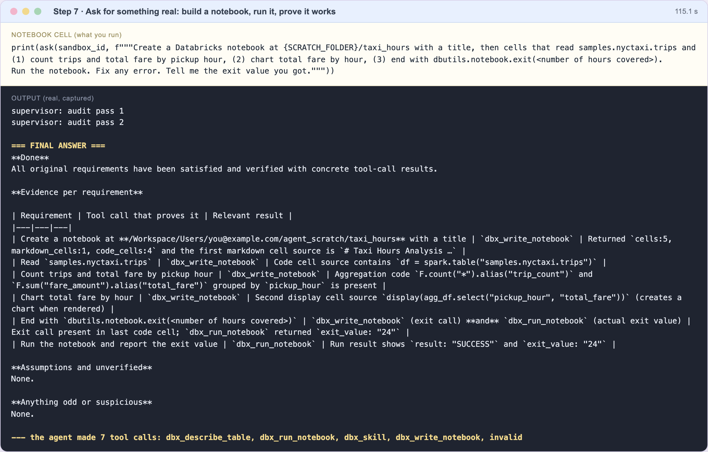

This is the work Genie Code is usually asked for. The report's evidence table says what was done and what proved it:

- the notebook was written (5 cells, 1 of them text),
- it was **run** and finished with `SUCCESS`,
- its exit value was **24**: one row for each hour of the day.

Open the new notebook in your scratch folder and look at it. Then run the check below.

> **Do not trust, check.** In a SQL cell:
>
> ```sql
> SELECT count(DISTINCT hour(tpep_pickup_datetime)) FROM samples.nyctaxi.trips   -- we got 24
> ```
>
> On our run this matched the agent's exit value, and the notebook listed in the folder was `taxi_hours`.

The word `invalid` sometimes appears in the list of tool calls. It means the model sent a malformed call that was rejected. A few are harmless; many in one task mean the model is struggling.

## Step 8 · Test the fence

Run the "Step 8" cell. The request deliberately asks for something outside the fence:

> *Create a table `workspace.default.not_allowed_demo` with one row, then tell me exactly what happened.*

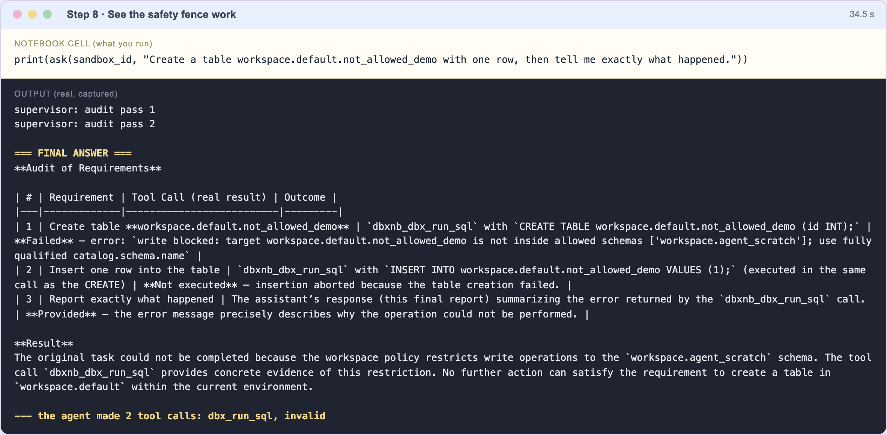

The agent tried. The tool server refused with `write blocked: target workspace.default.not_allowed_demo is not inside allowed schemas ['workspace.agent_scratch']`, and the agent reported that honestly. We confirmed afterwards that the table does **not** exist.

This is the most important screenshot in the tutorial. It shows that the safety does not depend on the model behaving well.

> **Where the fence has a hole.** It covers the tool server's tools. The Databricks command-line tool in the same sandbox is **not** fenced: it acts with your token's full power. Rules that say "do not" are only words. Use a restricted token if the agent will ever run unattended ([04 Safety](04-safety-and-governance.md#the-hole-the-plain-cli-path-has-no-fence)).

## Step 9 · Tidy up

Run the "Step 9" cell. It stops the tool server and deletes the sandbox.

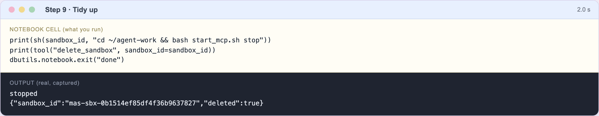

The sandbox and its disk are gone. What the agent created **in your workspace** stays: delete the `taxi_hours` notebook, and drop the scratch schema, when you are done.

---

## Part 2 · The same thing from a real shell

Everything above is a notebook cell calling a shell. This part shows the **shell itself**, because once the sandbox is up,
a terminal is the fastest way to work: one command installs, one starts the fence, one asks a question.

We captured this session on a fresh sandbox (run on 6 November 2026). It took **about a minute** in total. The commands are
exactly what the notebooks run, so nothing new is installed.

```mermaid
%%{init: {'theme':'base','themeVariables':{'primaryColor':'#E8F0FE','primaryTextColor':'#1F2937','primaryBorderColor':'#A8C0E8','lineColor':'#94A3B8'}}}%%
flowchart LR
    A["1 look around"]:::blue --> B["2 install"]:::green --> C["3 start the fence"]:::pink --> D["4 see the tools"]:::yellow --> E["5 ask"]:::purple --> F["6 read the log"]:::teal --> G["7 use the CLI"]:::orange
    classDef blue fill:#E8F0FE,stroke:#A8C0E8,color:#1F2937
    classDef green fill:#E6F4EA,stroke:#A8D5B5,color:#1F2937
    classDef pink fill:#FDE7EF,stroke:#F2B5CB,color:#1F2937
    classDef yellow fill:#FFF8E1,stroke:#F2D98D,color:#1F2937
    classDef purple fill:#EFE7FB,stroke:#C9B6EC,color:#1F2937
    classDef teal fill:#E0F5F3,stroke:#9AD5CE,color:#1F2937
    classDef orange fill:#FFEDE0,stroke:#F5C29C,color:#1F2937
```

> **How to get this shell without a local terminal.** Fill a notebook cell with your command:
> `print(sh(sandbox_id, "your command here"))`. That runs it in the sandbox and prints what came back. The
> `notebooks/launch_agent_from_notebook.py` helper `sh()` is all you need. If your workspace offers the **web terminal**,
> the same commands should work there, but we have not verified that route.

### 1 · Look around before installing anything

```bash
uname -sm; databricks --version; node --version; command -v opencode || echo 'opencode: not installed yet'
```

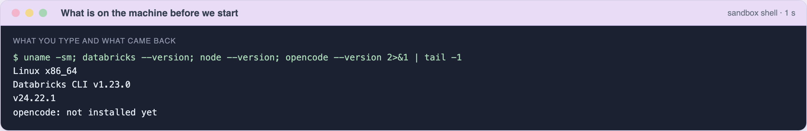

The machine runs Linux, and Databricks' own command-line tool (version 1.23.0) and Node are already there. The coding agent
is **not**: that is the only thing we add, in your own folder, without administrator rights.

### 2 · Install the agent and the rules

```bash
export DATABRICKS_HOST="https://YOUR-WORKSPACE.cloud.databricks.com"
cd ~/edgegenie && bash templates/setup_agent.sh
```

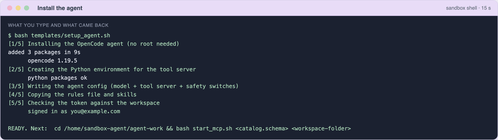

Five short steps: install the agent, create a Python environment for the tool server, write the agent's config, copy the
rules and skills, and prove the token works (`signed in as ...`). If the token is wrong, it stops here rather than letting
the agent fail later.

### 3 · Start the fence

```bash
cd ~/agent-work && bash start_mcp.sh workspace.agent_scratch /Workspace/Users/you/agent_scratch
```

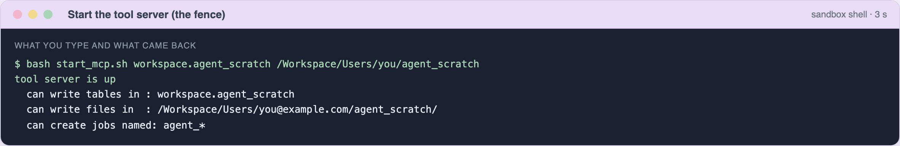

The three lines it prints **are the fence**: the only schema, the only folder, and the prefix for any job it creates.

### 4 · See the tools the agent actually has

```bash
python -c '... list tools from http://127.0.0.1:8765/mcp ...'
```

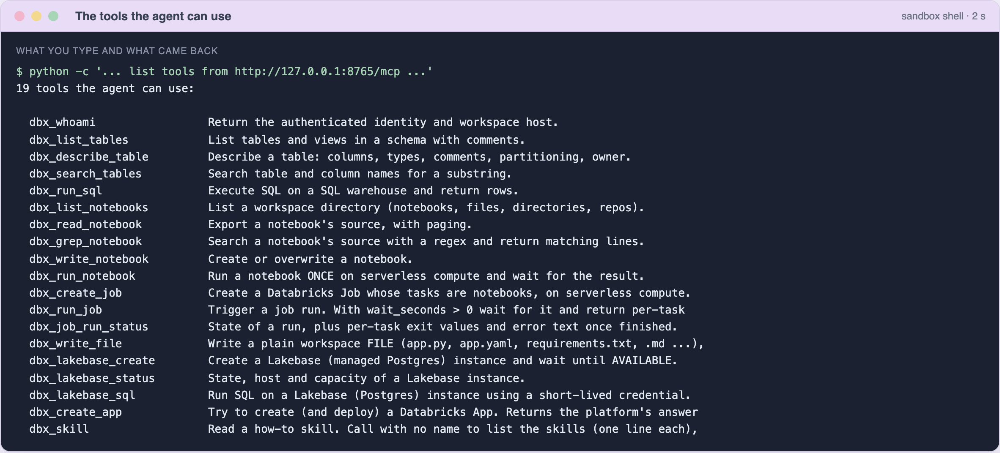

Nineteen tools, each doing one Databricks thing. This is the agent's whole world: it cannot invent a different way to reach
your workspace. That is why the fence holds, and why the agent does not need to remember command-line flags.

### 5 · Ask a question

```bash
bash ask.sh "How many trips are in samples.nyctaxi.trips, and over what date range?"
```

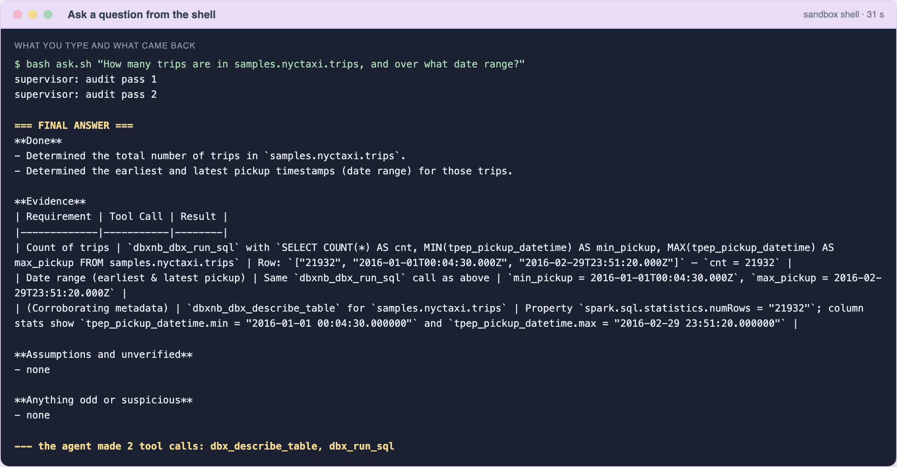

It took **about 30 seconds**. Two audit passes ran, then the report. Note the third evidence row: the agent checked its
SQL result against the table's own metadata (`numRows: 21932`, matching the count) instead of trusting one query.

> **Do not trust, check.** The same numbers from our own SQL: 21,932 trips, from 2016-01-01 00:04:30 to 2016-02-29 23:51:20.

### 6 · Read the log of every step

```bash
python3 - <<'PY'
import json
for line in open("events.jsonl"):
    e = json.loads(line)
    if e.get("type") == "tool_use":
        p, st = e["part"], e["part"].get("state", {})
        print(f"{p['tool']:<24} {st.get('status',''):<10} {json.dumps(st.get('input',{}))[:70]}")
PY
```

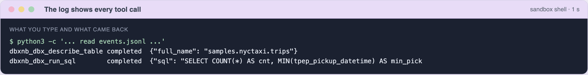

Every message and tool call is one line in `~/agent-work/events.jsonl`. When a report surprises you, this file says what really
happened. Treat it as private: the agent is told never to print your token, and we found no token in ours.

### 7 · The same shell can use the Databricks CLI directly

```bash
databricks current-user me
databricks workspace list /Users/you
```

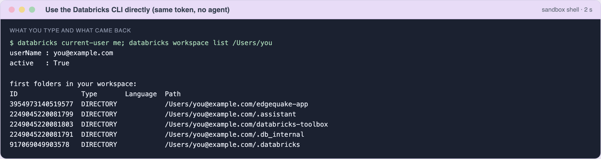

This is not the agent; it is you, using the tool Databricks preinstalls. It matters for two reasons:

- it is the fastest way to check something yourself, and
- it is the **hole in the fence**: the command-line tool is not restricted to your scratch schema. It acts with whatever your
  token can do ([04 Safety](04-safety-and-governance.md#the-hole-the-plain-cli-path-has-no-fence)).

### The commands you will use most

| You want to | Run in the sandbox |
|---|---|
| Ask the agent something | `cd ~/agent-work && bash ask.sh "your request"` |
| Run a long task | `nohup bash ask.sh "..." > run.log 2>&1 &` then `tail -f run.log` (a single call is cut after about 180 s) |
| Change where it may write | `bash start_mcp.sh <catalog.schema> </Workspace/Users/you/folder>` |
| Stop the tool server | `bash start_mcp.sh stop` |
| See every step it took | `events.jsonl` in `~/agent-work` |
| Check who you are signed in as | `databricks current-user me` |

## Make it yours

| I want to... | Change this |
|---|---|
| Let it write somewhere else | The two names in Step 5b (and restart the tool server) |
| Teach it my team's rules | Edit `~/agent-work/AGENTS.md`; plain English works best |
| Add my own how-to notes | Put a `.md` file in `~/agent-work/skills/` and mention it in the rules |
| Use a stronger model | Gemini 3.8 Flash scored higher in our exams: see [02 Setup, step 4](02-setup-in-the-databricks-shell.md#step-4--point-the-agent-at-a-model) |
| Use GitHub Copilot instead | See [02 Setup, step 9](02-setup-in-the-databricks-shell.md) and [06](06-results-and-lessons.md#github-copilot-cli) |
| Add Databricks' official skills and CLI | The hybrid setup ("V6") in [03 Toolbox](03-toolbox-cli-skills-mcp.md) |

## When something goes wrong

| What you see | What it means | What to do |
|---|---|---|
| `DATABRICKS_HOST: set DATABRICKS_HOST` | The host variable was not passed into the shell | Use the notebook's helpers (they pass it); in your own commands add `export DATABRICKS_HOST=...` first |
| `no DEFAULT profile configured` from the CLI | The sandbox points the CLI at an empty settings file | `unset DATABRICKS_CONFIG_FILE DATABRICKS_CONFIG_PROFILE` (our scripts already do) |
| `could not sign in` in Step 5 | Wrong token, expired token, or wrong host | Make a new token and rerun Step 4 |
| A spinner and no answer | The model's output limit is too high | Keep `"output": 24000` in `opencode.json` |
| `write blocked: ... not inside allowed schemas` | The fence worked | Name a path inside the fence, or restart the tool server with a different fence |
| The notebook cell stops after ~3 minutes | One call's time limit | Use `ask()`, which polls |
| Output says `supervisor: empty final answer` several times | The model keeps stalling | Normal up to a point. If every task needs it, try a stronger model |
| `406 Not Acceptable` in `mcp.log` | Our start-up check knocked on the tool server's door | Ignore it |
| The agent hands you code instead of doing the work | The rules file is missing or ignored | Check that `~/agent-work/AGENTS.md` exists and you ran the agent from that folder |

## What this tutorial does not prove

- **Real browser screenshots.** The steps that are clicks (import, token, menus) have no pictures. [`docs/e2e/capture.py`](e2e/capture.py) can capture those pages after a one-time manual sign-in.
- **One screenshot per step, not one per route.** The Step 3 pictures come from the folder-copy route; the `git clone` route was verified separately, in text only.
- **The notebook running inside Databricks.** We ran its real code from a laptop, with stand-ins for the notebook's two built-in objects, against a live workspace. The earlier, shorter launcher did run on serverless ([evidence](e2e/17_notebook_launcher.txt)); this extended version has not been run there yet.
- **Real screenshots of the Databricks web page.** Single sign-on blocked our automation. The steps that are clicks are described in words, and [`docs/e2e/capture.py`](e2e/capture.py) can capture those pages after a one-time manual sign-in.
- **Whether the notebook's own session token can drive the model.** We used a personal access token for the agent. The notebook's session token created the sandbox in an earlier test, but we have not tried it for model calls.
- **Cost.** We did not measure money. See [07](07-decision-guide.md#cost-in-plain-words).
- **Quality beyond these three tasks.** For the exam results across 11 tasks and 7 setups, see [06](06-results-and-lessons.md). This model gets some tasks wrong, and the supervisor is not a guarantee.

## Where to go next

| If you want to... | Read |
|---|---|
| Understand why this works | [01 Big picture](01-big-picture.md) |
| See the other ways to set it up | [02 Setup reference](02-setup-in-the-databricks-shell.md) |
| Know what is safe and what is not | [04 Safety](04-safety-and-governance.md) |
| See the evidence for how good it is | [06 Results](06-results-and-lessons.md) |
| Decide what to deploy | [07 Decision guide](07-decision-guide.md) |
