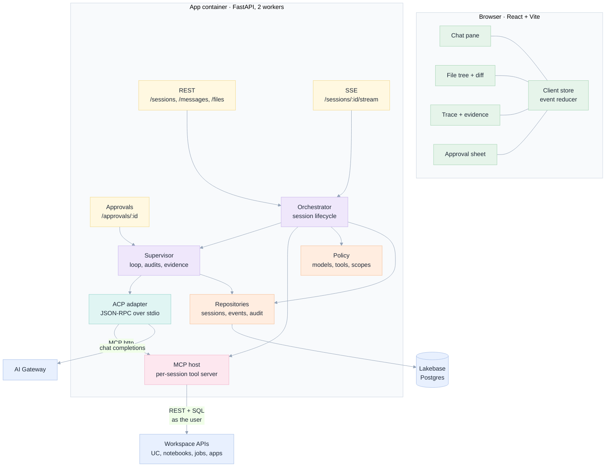
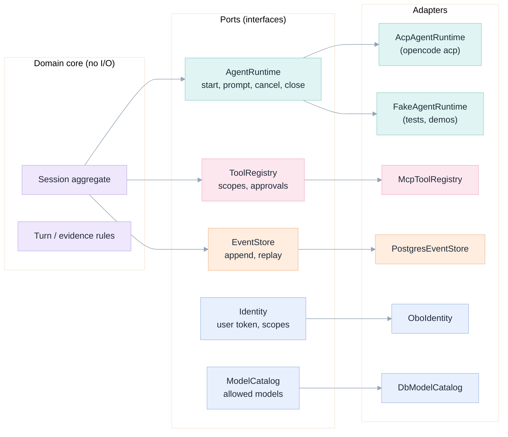
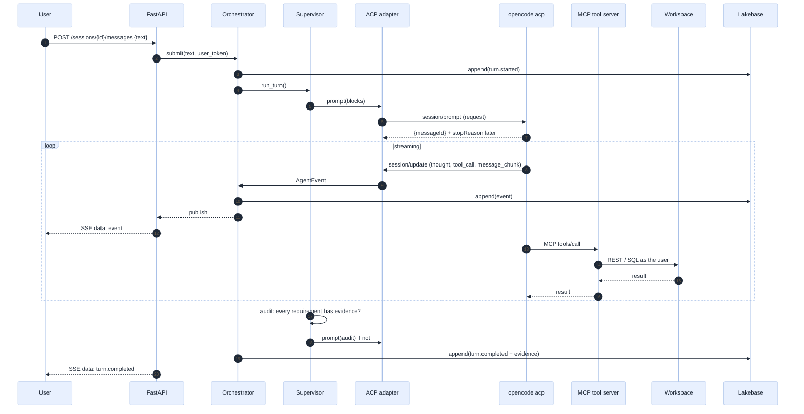
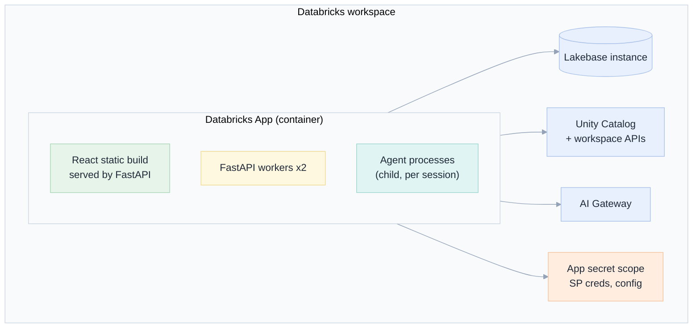

[Index](README.md) · [00 Why](00-why-first-principles.md) · [01 Product](01-product-requirements.md) · **02 Architecture** · [03 ACP](03-acp-integration.md) · [07 Back end](07-backend.md) · [12 Ops](12-operations.md)

# 02 · Architecture

## The shape: a host, not an agent

The app **hosts** agents. It never contains agent logic, model prompts or tool implementations. Three consequences:

1. The agent can be swapped (OpenCode → another ACP agent) without touching the UI, schema or governance.
2. The tool server is a separate process with its own credentials and its own policy: the fence is not in the same memory space as the loop that a model can influence.
3. Every boundary is a process boundary or a network call, so every boundary can be tested in isolation.



## Components and their single responsibility

| Component | Owns | Must not own | Home doc |
|---|---|---|---|
| **React app** | Rendering, local event reduction, optimistic UI, reconnection | Business rules, permissions decisions | [06](06-frontend.md) |
| **REST + SSE API** | Transport, auth extraction, request validation | Session logic | [07](07-backend.md) |
| **Orchestrator** | Session lifecycle: create, start, resume, cancel, delete | Prompting, tool policy | [07](07-backend.md) |
| **Supervisor** | Deciding when a turn is *done*: continue, audit, or stop | Executing tools | [04](04-tools-skills-mcp.md) |
| **ACP adapter** | Translating our `AgentRuntime` port to ACP JSON-RPC | Knowing about Databricks | [03](03-acp-integration.md) |
| **MCP host** | Starting, scoping and health-checking one tool server per session | Rendering, UI events | [04](04-tools-skills-mcp.md) |
| **Policy** | Which models, which tools, which scopes, which writes need approval | Enforcing the fence (the tool server does that) | [09](09-security-security.md) |
| **Repositories** | Persistence, event append, audit | Formatting for the UI | [08](08-data-model.md) |

## Ports and adapters (this is what makes it testable)

The design uses hexagonal architecture, not for elegance but because *the agent is the thing most likely to change*.



**`FakeAgentRuntime` is a first-class citizen.** It replays recorded ACP transcripts, which gives us deterministic tests for
the whole UI and supervisor, and lets demos run without a model. Without it, every test would depend on a non-deterministic
model.

### The `AgentRuntime` port

```python
class AgentRuntime(Protocol):
    async def start(self, spec: SessionSpec) -> RuntimeHandle: ...          # spawn, initialize, session/new
    async def prompt(self, h: RuntimeHandle, blocks: list[ContentBlock]) -> str: ...  # returns messageId
    async def cancel(self, h: RuntimeHandle) -> None: ...
    async def set_model(self, h: RuntimeHandle, model_id: str) -> None: ...
    async def respond_permission(self, h: RuntimeHandle, request_id: str, outcome: Outcome) -> None: ...
    def events(self, h: RuntimeHandle) -> AsyncIterator[AgentEvent]: ...     # normalised updates
    async def close(self, h: RuntimeHandle) -> None: ...
```

Everything the rest of the system knows about an agent is in that interface. **No OpenCode flag, path or version string
appears outside `adapters/acp/`.**

## Data flow of one turn



The SSE stream is **derived from the event store**, not from the agent process. That is the trick that makes reconnection,
multi-tab and pod restarts work: the browser asks "give me events after N" and the server replays from Postgres.

## Why these choices (and the alternatives we rejected)

| Decision | Chosen | Rejected alternative | Why |
|---|---|---|---|
| **Where the agent runs** | Child process inside the app container, spawned per session | A separate service / a Databricks job / a sandbox VM per session | Fewest moving parts; the container is already isolated and has the app's identity. A separate service is the v2 path if we outgrow one container ([12](12-operations.md)). |
| **Streaming transport** | SSE (`text/event-stream`) | WebSocket | Databricks' proxy cuts streamed responses at 300 s but Spaces apps **reject WebSocket upgrades**; SSE works on both and reconnects natively ([12](12-operations.md#streaming-and-timeouts)) |
| **Agent protocol** | ACP over stdio | OpenCode's HTTP API; driving the CLI and parsing stdout; the vendor SDK | ACP is an open contract, gives structured tool calls and permissions, and outlives any one agent ([03](03-acp-integration.md)) |
| **Tools** | Our MCP server, injected via `session/new` | Let the agent use its built-in shell/file tools only | The built-in tools are unfenced; our server enforces scope and returns real errors ([04](04-tools-skills-mcp.md)) |
| **State** | Lakebase Postgres, append-only events | In-memory + Redis; the agent's own session store | Audit and replay are requirements, not features ([08](08-data-model.md)) |
| **Front-end state** | A pure reducer over the event stream | Server-rendered HTML; a state library with side effects everywhere | Replay and reconnection become free; the UI can be tested against recorded transcripts ([06](06-frontend.md)) |
| **Identity** | On-behalf-of-user token per request | A single service principal for everything | Per-user permissions are the point ([09](09-security-security.md)) |
| **Long runs** | Background task + polling on the event stream | Holding the HTTP request open | Proxy limit of 300 s is not configurable ([12](12-operations.md)) |

## Deployment shape



| Resource | Sizing (starting point) | Notes |
|---|---|---|
| App compute | Medium (2 vCPU, 6 GB) | One agent process ≈ 150–250 MB; cap at 4 concurrent agent processes |
| Lakebase | CU_1, autoscaling | Connection pool per worker; never a connection per request |
| AI Gateway | Model per session | gpt-oss-120b default; a stronger model for hard tasks ([04](04-tools-skills-mcp.md)) |

All sizing numbers are **[proposal]**: the load tests in [12](12-operations.md) replace them.

## Edge cases this architecture must survive

Each is handled by a specific component and tested in [11](11-testing-edge-cases.md).

| Edge case | Handled by | Reference |
|---|---|---|
| E-01 Agent process dies mid-turn | Orchestrator detects EOF, marks turn failed, offers resume | [07](07-backend.md) |
| E-02 Proxy cuts the stream at 300 s | SSE reconnects with `Last-Event-ID`; server replays | [12](12-operations.md) |
| E-03 Two tabs on one session | Both subscribe to the same event stream; no duplicate prompts | [06](06-frontend.md) |
| E-04 App pod restarts during a run | Events are durable; the turn is marked interrupted; the user can resume or retry | [07](07-backend.md) |
| E-05 MCP server fails to start | Orchestrator refuses the turn with a clear error instead of running unfenced | [04](04-tools-skills-mcp.md) |
| E-06 Model refuses or returns empty | Supervisor retries with a continue message, then reports honestly | [04](04-tools-skills-mcp.md) |
| E-07 User token expires mid-session | Next Databricks call fails closed; UI prompts re-auth; nothing falls back to the SP | [09](09-security-security.md) |
| E-08 Concurrent writes to the same notebook | Fence is per user + folder; conflict detection on read-back | [04](04-tools-skills-mcp.md) |

Next: [03 ACP integration](03-acp-integration.md).
