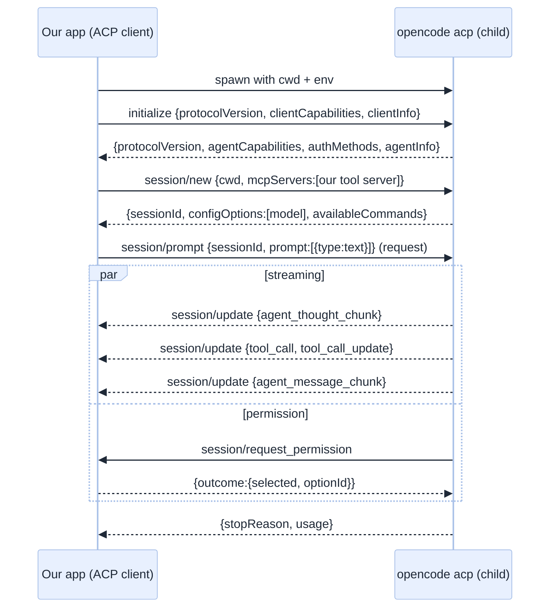
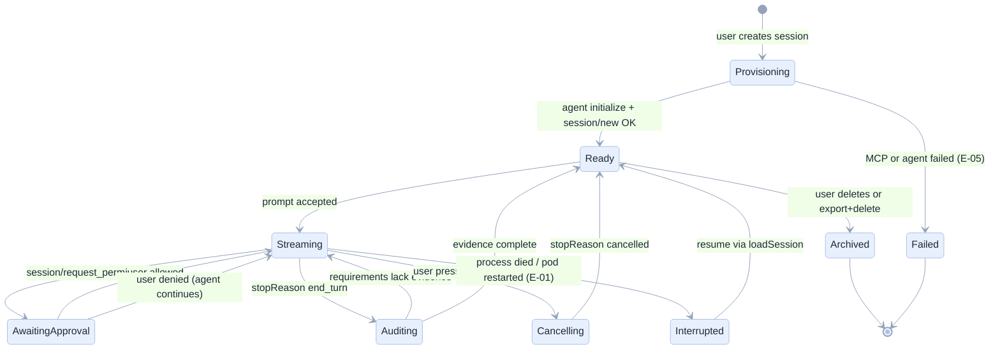

[Index](README.md) · [02 Architecture](02-architecture.md) · **03 ACP** · [04 Tools](04-tools-skills-mcp.md) · [07 Back end](07-backend.md) · [11 Testing](11-testing-edge-cases.md)

# 03 · Driving the agent: Agent Client Protocol

Everything here was verified against `opencode 1.19.5` in a Databricks sandbox unless marked otherwise. The raw transcript is
[`docs/e2e/19_acp_probe.txt`](../../docs/e2e/19_acp_probe.txt) and the client that produced it is
[`experiments/acp_probe.py`](../../experiments/acp_probe.py).

## What ACP is, in one picture

ACP is the editor-to-agent protocol. It looks like LSP: a client starts an agent as a child process and exchanges
newline-delimited JSON-RPC 2.0 over stdin/stdout. The **client** owns the UI, the user and the permissions; the **agent**
owns the model, the loop and the tools.



## Version reality: we speak v1, plan for v2

| | ACP v1 (what opencode implements) | ACP v2 (published schema) |
|---|---|---|
| `session/prompt` | A **request**; its response carries `stopReason` and `usage` | Acknowledges *insertion* only; returns `messageId` |
| Progress | Notifications alongside the pending request | `state_update` with `running` / `requires_action` / `idle` + `stopReason` |
| User message in history | Implicit (the request) | Explicit `user_message` update with an agent-owned `messageId` |
| Cancellation | `session/cancel`, then the prompt responds `cancelled` | `session/cancel`, then an `idle` `state_update` with `stopReason: cancelled` |
| Extra updates | — | `compaction_update`, `notice`, `usage_update`, `session_info_update`, `elicitation/*` |

**Design consequence:** the ACP adapter normalises **both** into one internal event model with an explicit
`turn_finished(stop_reason, usage)` event, driven by whichever signal the negotiated version provides. The version is read
from `initialize`'s response, never assumed.

> **Rule:** the rest of the system must never read a raw ACP shape. `AgentEvent` in [07](07-backend.md#the-event-model-one-vocabulary-for-everything) is
> the only vocabulary the orchestrator, store and UI know.

## The probe, line by line

### 1 · `initialize`

Response we received:

```json
{"protocolVersion": 1,
 "agentCapabilities": {
   "loadSession": true,
   "mcpCapabilities": {"http": true, "sse": true},
   "promptCapabilities": {"embeddedContext": true, "image": true},
   "sessionCapabilities": {"close": {}, "fork": {}, "list": {}, "resume": {}}},
 "authMethods": [{"id": "opencode-login", "name": "Login with opencode", "type": "terminal"}],
 "agentInfo": {"name": "OpenCode", "version": "1.19.5"}}
```

What each capability means for us:

| Capability | Value | What we do with it |
|---|---|---|
| `mcpCapabilities.http` | true | **We can inject our tool server.** This is the whole safety design. |
| `mcpCapabilities.sse` | true | Not needed; HTTP is enough |
| `promptCapabilities.embeddedContext` | true | We can attach file contents (notebooks) as `resource` blocks |
| `promptCapabilities.image` | true | A user can paste a screenshot of an error |
| `loadSession` | true | **Reconnect after a pod restart without losing the conversation** |
| `sessionCapabilities.fork` | true | "Try this same task with another model" ([FR-09](01-product-requirements.md)) |
| `sessionCapabilities.list` / `resume` | true | Recovery and the session sidebar |
| `authMethods` | `opencode-login` (terminal) | We do **not** use it: the model is reached through the AI Gateway with the user's token, so no interactive login is needed. If a model needs provider auth, the app must show a clear error, not a login prompt it cannot complete. |

### 2 · `session/new` with our MCP server

```json
{"cwd": "/home/sandbox-agent/proj",
 "mcpServers": [{"type": "http", "name": "dbx", "url": "http://127.0.0.1:8811/mcp", "headers": []}]}
```

Response includes a **model selector**, which is how the UI offers model choice without spawning a process per model:

```json
{"sessionId": "ses_e4fc...",
 "configOptions": [{"id": "model", "name": "Model", "category": "model", "type": "select",
                    "currentValue": "dbx/system.ai.gpt-oss-120b",
                    "options": [{"value": "databricks/databricks-claude-haiku-4-5", "name": "..."}, "..."]}]}
```

Model switching uses `session/set_config_option` with `{sessionId, configId: "model", value}`. **[documented]**, not yet
exercised by us; it is a must-test in [11](11-testing-edge-cases.md).

### 3 · `session/prompt`

Response for the question *"how many rows are in samples.nyctaxi.trips?"*:

```json
{"stopReason": "end_turn",
 "usage": {"inputTokens": 1149, "outputTokens": 23, "totalTokens": 11700, "cachedReadTokens": 10528}}
```

Three things matter here:

1. **Token usage is available on v1.** We can show cost per turn ([NFR-10](01-product-requirements.md)). Compare GitHub
   Copilot CLI, which exposed no token counts at all in our earlier experiments.
2. **The fixed overhead is large**: 11,700 total against 1,172 "real" tokens, because 10,528 were cache reads. Context
   budgeting is a product feature, not an optimisation.
3. **Wall clock was 14 s** for a two-tool question. First-token latency will be dominated by the model, not by ACP.

### 4 · The update shapes the UI must render

| `sessionUpdate` | Fields we use | UI |
|---|---|---|
| `available_commands_update` | `availableCommands[] {name, description}` | slash palette ([FR-18](01-product-requirements.md)) |
| `tool_call` | `toolCallId, title, kind, status, locations, rawInput` | a new card in the trace |
| `tool_call_update` | `toolCallId, status, rawInput, content` | update that card in place |
| `agent_thought_chunk` | `messageId, content{type:text,text}` | collapsible "thinking" block |
| `agent_message_chunk` | same | streamed answer text |
| `plan_update` | plan entries | the task checklist |
| `state_update` (**v2 only**) | `state, stopReason` | turn lifecycle |

## Two defects we found, and the rules they produce

### Defect 1 · Tool-name mangling

MCP tools are exposed to the model as `<serverName>_<toolName>`. With server `dbxnb` and tool `dbx_run_sql`, the model sees
**`dbxnb_dbx_run_sql`**. Our model called `dbxnb_run_sql` and received:

```
Model tried to call unavailable tool 'dbxnb_run_sql'.
Available tools: bash, dbxnb_dbx_create_app, dbxnb_dbx_create_job, ...
```

This is not cosmetic: a doubled prefix invites exactly this error, and every failed call is a wasted turn.

**Rules:**
- R-ACP-01: the MCP server name MUST be a domain word (`dbx`, `lakebase`), never an abbreviation of the product.
- R-ACP-02: tool names MUST be chosen so that `<server>_<tool>` reads as one phrase (`dbx_run_sql`, not `dbx_dbx_run_sql`).
- R-ACP-03: the MCP server SHOULD expose **aliases** for the most-used tools under the concatenated name the model is most
  likely to type, and the tool-not-found error MUST list valid names (the agent already does this; keep it).
- R-ACP-04: a tool-not-found error is **expected traffic**, not an incident: it must not page anyone, and it must be visible
  in the trace as a normal red card.

### Defect 2 · Duplicate MCP registration doubles the tool surface

Our probe registered the same server twice (`dbxnb` and `dbxnb2`) to test header support. The result: every tool appeared
twice in the available list — 40+ tools where 20 were intended. Every duplicate costs context on **every** turn
([Axiom 3](00-why-first-principles.md)).

**Rules:**
- R-ACP-05: the MCP host MUST de-duplicate servers by URL fingerprint per session.
- R-ACP-06: the tool budget MUST be enforced: if the advertised tool count exceeds `MAX_TOOLS` (default 24), the session
  refuses to start and the trace says why. Silent bloat is a defect.
- R-ACP-07: the app MUST show the advertised tool count in the session header, so regressions are visible to a human.

## Session lifecycle state machine



| Transition | Guard | Emits | Tested by |
|---|---|---|---|
| Provisioning → Ready | tool count ≤ MAX_TOOLS **and** every tool server answered a health probe | `session.ready` | E-05, E-40 |
| Ready → Streaming | the user token is present and unexpired | `turn.started` | E-07 |
| Streaming → AwaitingApproval | permission request from the agent | `approval.requested` | E-30 |
| Auditing → Streaming | at least one requirement without evidence, and audits < 2 | `audit.requested` | E-20 |
| Streaming → Interrupted | adapter EOF or `$/cancel_request` | `turn.interrupted` | E-01, E-04 |

## Concurrency and cancellation details

- **One prompt in flight per session.** ACP allows more, but two prompts produce interleaved thoughts; the orchestrator
  queues a second message and tells the UI it is queued (E-15).
- **Cancellation is cooperative.** `session/cancel`, then keep consuming updates until the stop signal arrives
  (v1: the prompt response; v2: `idle` with `cancelled`). Timeout at 10 s, then kill the process and mark interrupted.
- **Permission requests are answered by a user, not by code**, except in an explicit "auto-approve inside the fence" mode
  ([09](09-security-security.md#approval-policy)).
- **One process serves many sessions** (documented by OpenCode, and true in our probe: one process, several `session/new`
  calls). This is why the pool is per instance, not per user.

## What we have not verified (and must, before shipping)

| Item | Why it matters | Test |
|---|---|---|
| `session/set_config_option` | Model switching is a product feature | E-41: switch model mid-session, assert the next message's `usage` and label |
| `session/request_permission` | The user's trust moment | E-30: forced write outside the fence produces an approval card |
| `session/load` / `resume` after a process restart | FR-08 | E-04: kill the process, resume, assert history |
| `session/fork` | "Retry with another model" | E-42 |
| Behaviour when the model endpoint returns 429 | Cost control | E-21: assert backoff and a clear UI message |
| ACP against a second agent | P8, replaceability | Conformance suite against a stub agent ([11](11-testing-edge-cases.md)) |

Next: [04 Tools, skills and the fence](04-tools-skills-mcp.md).
