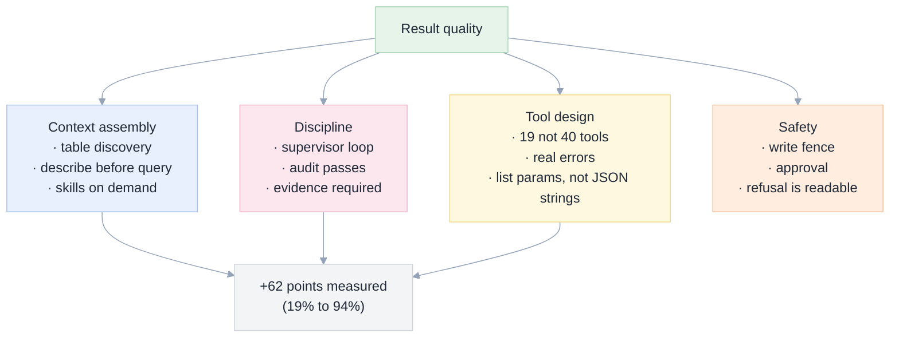
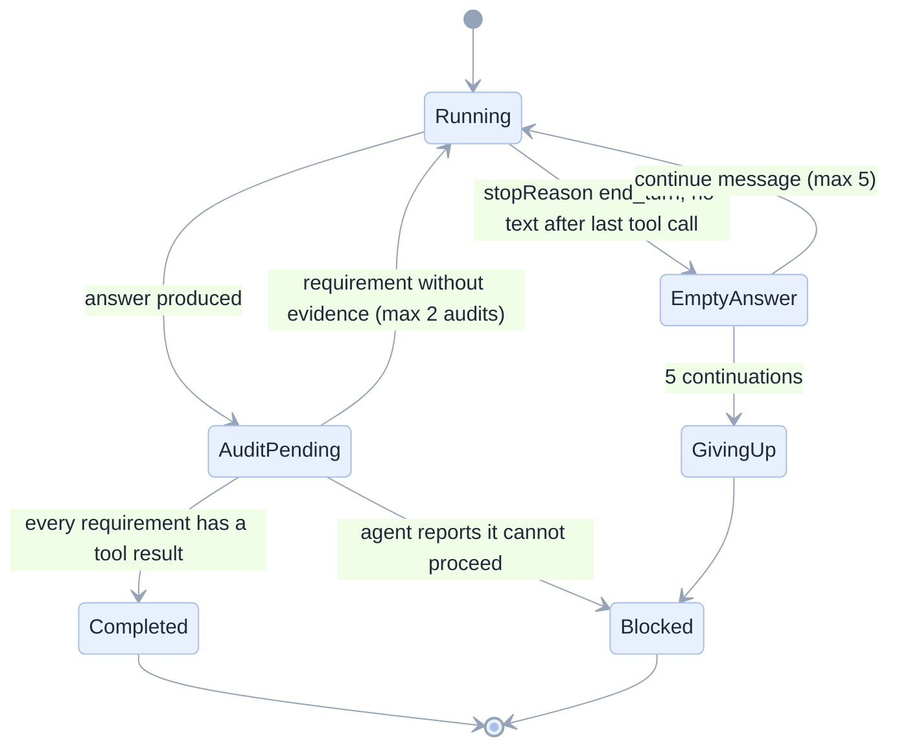
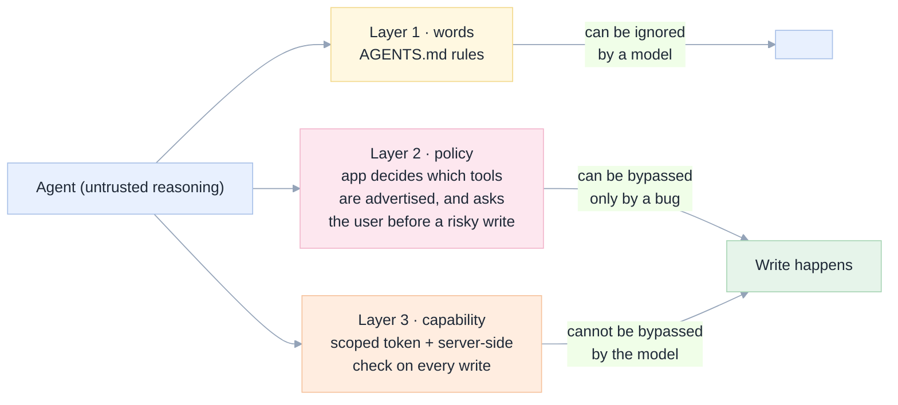
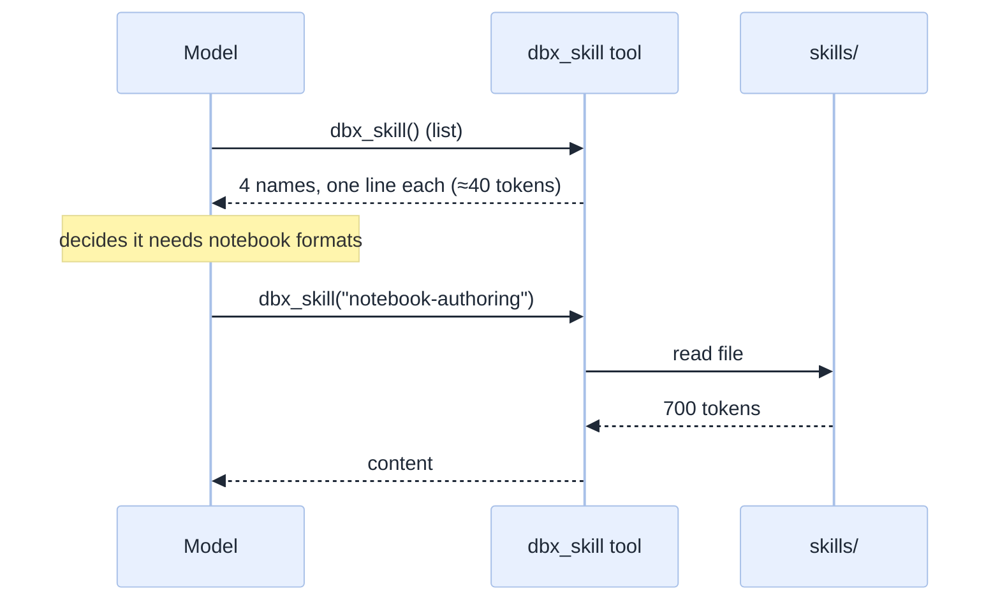

[Index](README.md) · [01 Product](01-product-requirements.md) · [02 Architecture](02-architecture.md) · [03 ACP](03-acp-integration.md) · **04 Tools** · [09 Security](09-security-security.md) · [11 Testing](11-testing-edge-cases.md)

# 04 · Tools, skills, context and the fence

This is where "as good as Genie Code" is won or lost. Our measured results drive every rule here.

## What makes an agent good at Databricks work

The single biggest jump in our exams came from the supervisor and evidence rules, not from more tools. So the app treats
those as **product features with UI**, not hidden prompt text.

## The tool surface

We reuse [`mcp/databricks_notebook_mcp.py`](../../mcp/databricks_notebook_mcp.py). Nine tools carry almost all real work;
the rest are lookups.

| Group | Tools | Why the model needs it | Failure without it |
|---|---|---|---|
| **Identity and discovery** | `dbx_whoami`, `dbx_list_tables`, `dbx_search_tables`, `dbx_describe_table` | never guess a column name | hallucinated columns, wrong SQL |
| **SQL** | `dbx_run_sql` | governed reads; writes inside the fence | the agent hands you SQL to copy |
| **Notebooks** | `dbx_read_notebook`, `dbx_grep_notebook`, `dbx_write_notebook`, `dbx_run_notebook` | read before edit; create with cells; run and see the exit value | "edits" that were never written |
| **Files** | `dbx_list_notebooks`, `dbx_write_file` | app.py, app.yaml, requirements.txt | the app cannot be created |
| **Jobs** | `dbx_create_job`, `dbx_run_job`, `dbx_job_run_status` | orchestration with dependencies | a pipeline that only exists in the chat |
| **Lakebase** | `dbx_lakebase_create`, `dbx_lakebase_status`, `dbx_lakebase_sql` | managed Postgres | a database the user has to create by hand |
| **Apps** | `dbx_create_app` | deploy the app around the database | a half-built deliverable |
| **Knowledge** | `dbx_skill` | formats and facts the model gets wrong from memory | broken notebook JSON, wrong CLI flags |

### Tool rules (each one is a defect we actually saw)

| # | Rule | Defect it prevents |
|---|---|---|
| T-01 | Reads are always allowed; writes are gated by scope **and** approval policy | Ungoverned writes |
| T-02 | A failure returns the real error text plus the object that failed | "Failed" teaches the model nothing; our early tools returned only a status |
| T-03 | Inputs accept **real JSON arrays**, not stringified JSON | Our V3 agent double-escaped `cells_json` and produced an empty notebook |
| T-04 | Big reads page (`offset` / `next_offset`), never truncate silently | A truncated result made our agent report 1 import out of 5, confidently |
| T-05 | A "no match" result says the pattern matched nothing **and** suggests a looser one | An empty grep made our agent invent imports |
| T-06 | The tool names are short, verb-first, and read correctly after the server prefix | `dbxnb_dbx_run_sql` caused a failed call in the ACP probe ([03](03-acp-integration.md#defect-1--tool-name-mangling)) |
| T-07 | Tool descriptions state units, limits and cost ("runs on serverless, costs one cluster start") | The model cannot budget what it cannot see |
| T-08 | Every write returns an identifier the UI can link to | Evidence cards need a target |
| T-09 | No tool exists that only *looks* like it works | A tool that plausibly does nothing is worse than no tool |

### What the model sees, in tokens

| Item | Approx. tokens | Notes |
|---|---|---|
| System prompt + rules (`AGENTS.md`) | 1,200 | Sent every turn |
| 19 tool schemas | 6,000–9,000 | **The largest fixed cost**; this is why the budget is 24 tools |
| Skill (only when read) | 400–800 | On demand, not always |
| Conversation so far | grows | Compacted at 60% of the window |

> Measured in the ACP probe: a two-word answer reported 11,700 total tokens, of which 10,528 were cache reads. Caching helps
> cost but not behaviour: **the context still occupies the window.**

## The supervisor: how "done" is decided

A model's "done" is a claim. The supervisor turns it into a decision with a state machine.

**Evidence extraction.** The supervisor does not trust the agent's prose. It parses the turn's tool calls and builds a table:
*requirement → tool call → result summary → link*. The agent is asked, once, to state this mapping; the supervisor then
**checks that each cited tool call actually exists** in the turn. A citation to a call that did not happen marks the turn
`Blocked` with the reason "claimed evidence is missing".

That single rule catches our most dangerous observed failure: a confident, well-formatted answer describing work that never
happened.

| Supervisor rule | Setting | Rationale |
|---|---|---|
| Max continuations on an empty answer | 5 | Matches our harness; the model stalls after tools |
| Max audit passes | 2 | Third pass never changed an outcome in our runs |
| Audit prompt | "Name the tool call that proves each requirement; if none exists, do the work now" | Measured to work |
| Give-up behaviour | Report `Blocked` with the missing items | Honesty over false completion |
| Cancellation | Always allowed; recorded as `cancelled`, not `failed` | A user's decision is not an error |

## The fence: three layers, only one of which is a boundary

| Layer | Enforced by | Bypassable by the model? | Evidence from our work |
|---|---|---|---|
| Words | `AGENTS.md` | **Yes** | V1 scored 20% while following the words poorly |
| Policy | the app's tool advertising + approval flow | No, unless the app has a bug | New in this product |
| Capability | the tool server's write checks + the user's token | **No** | Our M8 test: the server refused `workspace.default.not_allowed_demo`; the table does not exist |

**The known hole.** The agent process also has a shell and (in the OpenCode case) built-in file and bash tools. Those are
**not** fenced by our server. Mitigations, all mandatory:

1. The tool server is the *only* advertised path to Databricks objects (rules + policy disable the agent's own Databricks CLI).
2. If the built-in shell is enabled (it is useful for quick computation), the sandbox/container must not hold a token with
   broader rights than the fence allows. **In the app, this means running the agent with a scoped token**, not the user's full
   token, wherever the platform allows it ([09](09-security-security.md#identity-who-is-the-agent-acting-for)).
3. Built-in `bash` is a **settings toggle**, off by default for sessions whose folder is not a scratch folder.

## Skills: knowledge on demand, not in the prompt

Four skills ship in [`mcp/skills/`](../../mcp/skills). They exist because these are exactly the things a model gets wrong
from memory: notebook cell JSON, job task dependencies, Lakebase connection details, app file layout.

| Skill | Read when | Payload |
|---|---|---|
| `notebook-authoring` | before writing a notebook | cell format, markdown conventions, `dbutils.notebook.exit`, serverless limits |
| `etl-pipelines` | before a pipeline or job | idempotent writes, `try_cast`, dependency ordering, de-duplication before validation |
| `lakebase-postgres` | before Lakebase work | instance API vs project API, credentials, psycopg connection pattern |
| `databricks-apps` | before an app | `app.yaml`, port binding, `DATABRICKS_APP_PORT`, resource bindings |

Listing then reading costs ~40 tokens until needed, versus ~2,800 if all four were always in the prompt. **That is P7 in
practice.**

## Context management

| Mechanism | Trigger | Effect | UI |
|---|---|---|---|
| Tool budget | session start | refuse to start above 24 tools (R-ACP-06) | header shows the count |
| Skill paging | model chooses | only the needed skill is loaded | trace shows the skill read |
| Paged reads | response > `MAX_CHARS` (6,000) | `offset` / `next_offset` | card says "page 1 of 3" |
| Compaction | 60% of the window | agent summarises; the UI marks the cut | a divider in the transcript |
| Model routing | per session, or per task | cheap model for mechanical edits, strong for analysis | badge on each message |

## Evaluation (how we know the tools are good enough)

The app reuses the graders in [`exams/`](../../exams) and adds app-level checks.

| Level | What it proves | Where |
|---|---|---|
| Tool conformance | each tool behaves as documented, including errors | [`mcp/test_mcp_v2.py`](../../mcp/test_mcp_v2.py) |
| Task grading | the artefact is correct in the live workspace (EXCEPT both ways, job run succeeds) | `exams/missions/*` |
| App E2E | the same tasks, driven through the UI, produce the same artefacts | [11](11-testing-edge-cases.md) |
| Regression | a prompt or model change does not lower the score | CI on a fixed subset (3 tasks, ~15 min) |

**Grading rule (non-negotiable):** a grader is trusted only if the reference solution scores 100% and a do-nothing agent
fails. We learned this the hard way: an early grader passed a no-op on X2.

Next: [05 UX and wireframes](05-ux-ui-wireframes.md).
