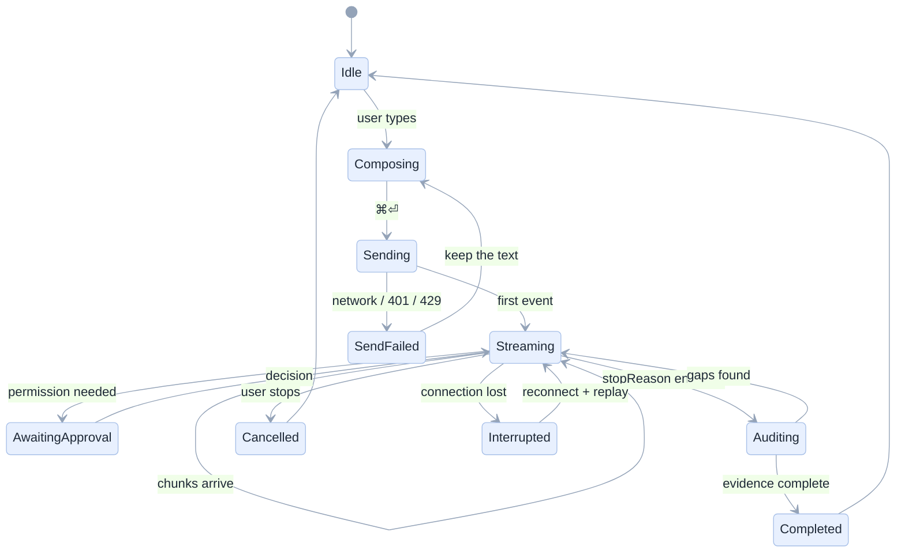

[Index](README.md) · [01 Product](01-product-requirements.md) · [02 Architecture](02-architecture.md) · **05 UX** · [06 Front end](06-frontend.md) · [09 Security](09-security-security.md) · [11 Testing](11-testing-edge-cases.md)

# 05 · UX and UI: wireframes, states and interactions

## Design intent

Three panes, because a coding agent produces three different things at once: **a conversation**, **an artefact**, and
**proof**. Most chat products show only the first and then ask the user to go and find the rest.

| Principle | What it means on screen |
|---|---|
| The transcript is a *record*, not a chat log | every turn has a status: running, completed, blocked, cancelled |
| Work is visible while it happens | tool cards appear, change state, and stay |
| Proof sits next to the claim | evidence cards under the answer, each linking to the artefact |
| Permission is a conversation | approvals appear inline, with what/where/why |
| Nothing is a dead end | every error offers the next action (retry, resume, ask why) |

## Screen 1 · Main workspace (three panes)

```
┌──────────────────────────────────────────────────────────────────────────────────────────────────────────────────────────────────────────┐
│  ◧  Databricks Coding Agents                                                                                           raphael.mansuy ▾  │
├────────────────────────┬──────────────────────────────────────────────────────────────────────┬──────────────────────────────────────────┤
│                        │ Top zips by revenue                          model ▾ gpt-oss-120b    │ FILES IN THIS SESSION  ⟳                 │
│ SESSIONS               │ ──────────────────────────────────────────────────────────────────── │                                          │
│ + New session          │ YOU  10:42                                                           │ ▾ /Users/you/agent_scratch               │
│                        │ Rank the top 10 pickup zips by revenue with a running share,         │    ▸ taxi_hours           .py            │
│ TODAY                  │ and each zip's busiest hour.                                         │    ▸ daily_revenue        .py  ●         │
│ ▸ Top zips by revenue  │                                                                      │    ▸ app                                 │
│   ● streaming          │ AGENT  10:42                                                         │      app.py               .py            │
│ ▸ Fix the job          │ ▸ thinking  (2 s, 340 tokens)                                        │      app.yaml             .yaml          │
│                        │ ┌──────────────────────────────────────────────────────────────┐     │                                          │
│ YESTERDAY              │ │ ✓ describe_table  samples.nyctaxi.trips                1.2s │      │ ────────────────────────────             │
│ ▸ Daily ETL            │ │ ✓ run_sql         3 rows                               0.8s │      │ CHANGES                                  │
│ ▸ Lakebase scratch     │ │ ✓ write_notebook  taxi_hours (5 cells)                 1.1s │      │ daily_revenue.py                         │
│                        │ │ ✓ run_notebook    SUCCESS                              4.1s │      │ ┌──────────────────────────┐             │
│ ────────────────────   │ └──────────────────────────────────────────────────────────────┘     │ │ - SELECT *               │             │
│ 20 sessions            │                                                                      │ │ + SELECT pickup_zip,     │             │
│                        │ Here are the top three zips by revenue:                              │ │ +   sum(fare_amount)     │             │
│                        │   zip    revenue      share   busiest hour                           │ │ - order by 1             │             │
│                        │   11422  19,209.50    31%     18:00                                  │ │ + order by 2 desc        │             │
│                        │   11371  14,798.84    24%     08:00                                  │ └──────────────────────────┘             │
│                        │   10001  13,028.01    21%     19:00                                  │                                          │
│                        │                                                                      │ [ Open in Databricks ↗ ]                 │
│                        │ EVIDENCE                                                             │                                          │
│                        │ ┌──────────────────────────────────────────────────────────────┐     │                                          │
│                        │ │ ✓ Rank top 10 by revenue    run_sql → 10 rows      [view]    │     │                                          │
│                        │ │ ✓ Running share             run_sql → 10 rows      [view]    │     │                                          │
│                        │ │ ✓ Busiest hour per zip      run_sql → 10 rows      [view]    │     │                                          │
│                        │ └──────────────────────────────────────────────────────────────┘     │                                          │
│                        │ ⚠ Assumptions: 12 rows have a null pickup_zip and were excluded.     │                                          │
│                        │   Verified with a second, independent query.                         │                                          │
│                        │                                                                      │                                          │
│                        │ ┌──────────────────────────────────────────────────────────────┐     │                                          │
│                        │ │ Ask, or type / for commands                            ➤     │     │                                          │
│                        │ │ 📎 attach          ⏹ stop            ⌘⏎ send                │      │                                          │
│                        │ └──────────────────────────────────────────────────────────────┘     │                                          │
├──────────────────────────────────────────────────────────────────────────────────────────────────────────────────────────────────────────┤
│ ● streaming · 19 tools · 11,712 tokens this turn · trace 7f3a · ⌘K commands                                                              │
└────────────────────────┴──────────────────────────────────────────────────────────────────────┴──────────────────────────────────────────┘
```

Why each element exists:

| Element | Requirement | Purpose |
|---|---|---|
| Session list with a live dot | FR-11 | "what am I in the middle of" |
| Model chip in the header | FR-09 | model choice is visible, not buried in settings |
| Collapsible thinking block | FR-02 | shows progress without drowning the answer |
| Tool cards with status and duration | FR-03 | the honest record of what happened |
| Evidence table | FR-14 | the reason to trust the answer |
| "Assumptions" strip | FR-15 | surfaces what was inferred, not verified |
| File tree with a change dot | FR-05 | where the artefacts are |
| Diff panel | FR-05 | minimal-edit discipline is visible |
| "Open in Databricks" | FR-04 | the app is a workspace, not a walled garden |

## Screen 2 · Empty state: starting a session

```
┌──────────────────────────────────────────────────────────────────────────────────────────────────────────────────────────────────────────┐
│  ◧  Databricks Coding Agents                                                                                            new session   ⟳  │
├──────────────────────────────────────────────────────────────────────────────────────────────────────────────────────────────────────────┤
│                                                                                                                                          │
│                                                                                                                                          │
│             What should we build today?                                                                                                  │
│                                                                                                                                          │
│  ┌────────────────────┐  ┌────────────────────┐  ┌────────────────────┐                                                                  │
│  │ 📓 Build a notebook│  │ 🧪 Investigate     │  │ ⚙ Create a job     │                                                                  │
│  │ Revenue by month,  │  │ Why did revenue    │  │ Daily recompute at │                                                                  │
│  │ a chart, a summary │  │ drop on the 10th?  │  │ 06:00, dependent   │                                                                  │
│  └────────────────────┘  └────────────────────┘  └────────────────────┘                                                                  │
│                                                                                                                                          │
│  ┌────────────────────┐  ┌────────────────────┐  ┌────────────────────┐                                                                  │
│  │ 🗄 Lakebase + app  │  │ 📚 Document tables │  │ 🔍 Debug a job     │                                                                   │
│  │ Postgres, then a   │  │ Comments grounded  │  │ Find the cause and │                                                                  │
│  │ small web page     │  │ in real values     │  │ prove the fix      │                                                                  │
│  └────────────────────┘  └────────────────────┘  └────────────────────┘                                                                  │
│                                                                                                                                          │
│  Working folder  /Users/you/agent_scratch              [change]                                                                          │
│  Model           gpt-oss-120b (Databricks AI Gateway)  [change]                                                                          │
│  ────────────────────────────────────────────────────────────                                                                            │
│  This agent writes only inside that folder and its schema.                                                                               │
│  Anything else asks you first.                                                                                                           │
└──────────────────────────────────────────────────────────────────────────────────────────────────────────────────────────────────────────┘
```

The six cards are the six task families our exam suite grades ([05 exam suite](../../docs/05-exam-suite.md)), so the empty
state teaches the product's real capabilities.

## Screen 3 · Approval request (the trust moment)

```
┌────────────────────────────────────────────────────────────────────────────────────────────────────┐
│  ◧  Approval required                                                          20:04  ⏸ paused     │
├────────────────────────────────────────────────────────────────────────────────────────────────────┤
│ ⏸  The agent is waiting for your decision                                                          │
│                                                                                                    │
│ Write to a table outside your working schema                                                       │
│                                                                                                    │
│ The agent wants to create                                                                          │
│   workspace.default.revenue_daily                        [ TABLE ]                                 │
│                                                                                                    │
│ Why   the task asks for a table the whole team can read, and your                                  │
│       working schema (agent_scratch) is private to you.                                            │
│                                                                                                    │
│ What will change   one new table, 4 columns, about 1,000 rows.                                     │
│                    nothing is overwritten.                                                         │
│ What will NOT      no other table, notebook or job is touched.                                     │
│                                                                                                    │
│ ┌───────────────────────┐ ┌───────────────────────┐ ┌──────────────────────┐                       │
│ │ Allow once            │ │ Allow this session    │ │ Deny                 │                       │
│ └───────────────────────┘ └───────────────────────┘ └──────────────────────┘                       │
│                                        the agent will try another way                              │
│                                                                                                    │
│ ⓘ Recorded in the audit log with your name, the session and the object.                            │
└────────────────────────────────────────────────────────────────────────────────────────────────────┘
```

Rules ([09](09-security-security.md#approval-policy)):

1. **What, where, why** in the user's words; never an API path.
2. **Blast radius**: what changes, what does not.
3. **Three outcomes**, deny included as a first-class choice.
4. **Remembered** for the session after "allow for this session".
5. **Audited** — and the sheet says so, because users behave better when they know it is recorded.

## Screen 4 · Blocked: the agent cannot proceed

```
┌────────────────────────────────────────────────────────────────────────────────────────────────────┐
│  ◧  Databricks Coding Agents                                                  20:04  ⛔ blocked    │
├────────────────────────────────────────────────────────────────────────────────────────────────────┤
│ ⛔ Cannot continue                                                                                 │
│                                                                                                    │
│ What I could not do                                                                                │
│   read samples.nyctaxi.trips — permission denied (USE SCHEMA on samples)                           │
│                                                                                                    │
│ What I tried                                                                                       │
│   ✓ describe_table  samples.nyctaxi.trips  →  permission denied                                    │
│   ✓ list_tables     samples                →  permission denied                                    │
│                                                                                                    │
│ What would unblock it                                                                              │
│   • ask an admin for USE SCHEMA on samples, or                                                     │
│   • point me at a table you can read, or                                                           │
│   • attach the CSV and I will work from that                                                       │
│                                                                                                    │
│ [ Attach a file ]   [ Try another table ]   [ Ask why ]                                            │
└────────────────────────────────────────────────────────────────────────────────────────────────────┘
```

This screen exists because a model's default failure mode is to *pretend*. The supervisor turns a missing capability into a
structured refusal ([FR-15](01-product-requirements.md)).

## Navigation map

```
                          ┌───────────────────────────────┐
                          │  /   sessions list            │
                          └───────────────┬───────────────┘
                                          │ open
                                          ▼
                 ┌─────────────────────────────────────────────┐
                 │  /sessions/:id   chat + trace + files       │
                 └───┬─────────────────┬─────────────────┬─────┘
                     │ tab: trace      │ tab: files      │ tab: audit
                     ▼                 ▼                 ▼
             ┌─────────────────────┐  ┌─────────────────────┐  ┌─────────────────────┐
             │ all tool calls      │  │ tree + diffs        │  │ who / what / when   │
             │ filter by status    │  │ open in DBX         │  │ per object          │
             └─────────────────────┘  └─────────────────────┘  └─────────────────────┘
                                 │  "ask why about this call"
                                 ▼
                        ┌───────────────────────────────────┐
                        │ /sessions/:id?focus=call_123      │
                        │ that card highlighted, composer   │
                        │ prefilled with the question       │
                        └───────────────────────────────────┘

   global   /settings   default folder, default model, approval policy
            /help       what the agent can and cannot do, and when Genie is better
```

## Interaction states (every one must be designed and tested)



| State | What the user sees | What must never happen |
|---|---|---|
| Sending | the message appears immediately, greyed | a spinner with no message |
| Streaming | tokens, tool cards, a stop button | layout shift when a card appears |
| Awaiting approval | the inline sheet, scroll-locked to it | the run continuing silently |
| Auditing | "checking the work…" with the requirements listed | a false "done" |
| Interrupted | "connection lost, reconnecting" with a retry | losing the partial answer |
| SendFailed (401) | "your sign-in expired" + a re-auth button | silently retrying with a service principal |
| Cancelled | the partial transcript kept, marked cancelled | deleting the partial work |

## Accessibility and keyboard

| Requirement | Implementation | Test |
|---|---|---|
| Full keyboard use | tab order: sessions → transcript → composer → inspector; `⌘⏎` send, `Esc` stops streaming | E-52 |
| Screen readers announce streaming | `aria-live="polite"` on the answer region, `aria-busy` while streaming; tool cards announce status changes | E-53 |
| Contrast | ≥ 4.5:1 body text on all pastel surfaces | axe-core |
| Motion | respects `prefers-reduced-motion`; no infinite spinners | E-54 |
| Focus on approval | focus moves into the sheet, returns to the composer after | E-30 |

## Empty, loading and error copy (write it once, reuse it)

| Situation | Copy |
|---|---|
| No sessions yet | "No sessions yet. Start with what you want to build — the agent will create the files." |
| Agent starting | "Starting the agent… (usually 3–8 s)" |
| Tool server failed | "The tool server did not start, so writes are disabled. This is a platform issue, not your prompt. Retry or contact the platform team." |
| Model rate-limited | "The model is busy. Retrying in 8 s (attempt 2 of 4)." |
| Fence refused | "Blocked: `workspace.default.x` is outside your working schema. Nothing was changed." |
| Token expired | "Your Databricks session expired. Sign in again to continue; nothing was lost." |
| Long run | "Still working — 6 minutes so far. You can leave this page; the run continues." |

## Design tokens (pastel, consistent with the rest of this repository)

| Token | Value | Use |
|---|---|---|
| `--bg` | `#F4F1FA` | page background |
| `--surface` | `#FFFFFF` | panes |
| `--blue-100` | `#E8F0FE` | headers, info |
| `--green-100` | `#E6F4EA` | success, evidence |
| `--yellow-100` | `#FFF8E1` | warnings, assumptions |
| `--pink-100` | `#FDE7EF` | errors, approvals |
| `--purple-100` | `#EFE7FB` | agent identity |
| `--ink` | `#1F2937` | primary text |
| `--mono` | `ui-monospace, Menlo` | code, SQL, tool args |

Next: [06 Front end](06-frontend.md).
