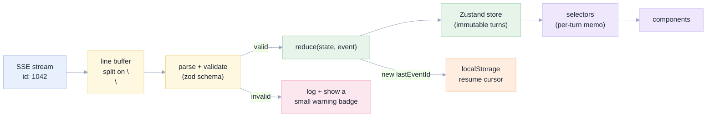
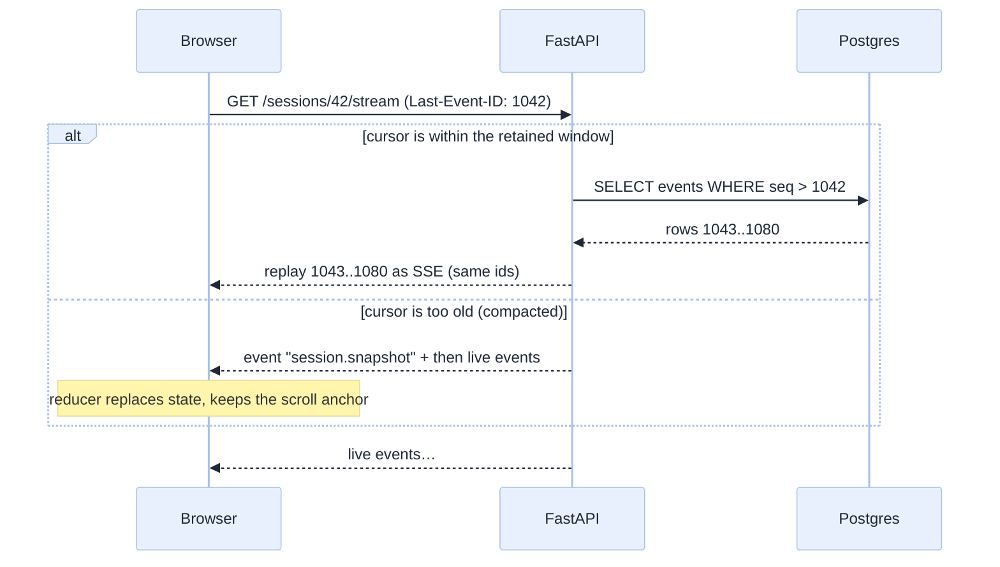

[Index](README.md) · [02 Architecture](02-architecture.md) · [05 UX](05-ux-ui-wireframes.md) · **06 Front end** · [07 Back end](07-backend.md) · [11 Testing](11-testing-edge-cases.md)

# 06 · Front end: React, streaming, and a reducer that survives anything

## Stack, and why each piece

| Choice | Version target | Why | Rejected |
|---|---|---|---|
| **React 19** + TypeScript strict | — | Server components are irrelevant here; this is a long-lived single-page app | Svelte/Vue: fine, but no team advantage |
| **Vite** | 7 | Fast dev, small build, serves as static files from FastAPI | Next.js: we have no server rendering need and want one deployable |
| **TanStack Query** | 5 | Server cache for REST (sessions, files); retries and invalidation | Redux for all state: the event stream needs a different model |
| **Zustand** + a **pure reducer** | 5 | The transcript is an event-sourced projection; a reducer is testable against recorded transcripts | Context-only state: re-renders the whole tree on every token |
| **Tailwind** + CSS variables | 4 | Tokens from [05](05-ux-ui-wireframes.md#design-tokens-pastel-consistent-with-the-rest-of-this-repository) | CSS-in-JS: runtime cost during streaming |
| **Radix primitives** | — | Accessible dialogs/sheets for approvals | Hand-rolled modals: accessibility debt |
| **Monaco** (lazy) | — | Read-only notebook and diff rendering | CodeMirror: heavier for our read-only need |
| **Vitest** + **Playwright** | — | Unit + E2E, including recorded-transcript replay | — |

## Component tree

```
App
├── SessionListPane            (REST: GET /sessions, paginated)
├── SessionView                (owns the SSE subscription)
│   ├── SessionHeader          model chip · tool count · tokens · status
│   ├── Transcript             virtualised list of Turn
│   │   ├── UserMessage
│   │   ├── AgentThought       collapsible, collapsed if < 3 s
│   │   ├── ToolCallCard       status, duration, args summary, expand → raw
│   │   │   ├── ToolCallContent   sql result table · file diff · log lines
│   │   │   └── AskWhyButton      prefills the composer
│   │   ├── AgentMessage       markdown + code blocks (no HTML injection)
│   │   ├── EvidencePanel      requirement → tool call → artefact link
│   │   ├── AssumptionsStrip
│   │   └── BlockedPanel       what/why/what-would-unblock
│   ├── ApprovalSheet          Radix dialog, focus-trapped
│   └── Composer               textarea, attachments, stop button, slash palette
└── InspectorPane              tabs: Files | Changes | Audit
    ├── FileTree
    ├── DiffView               unified, minimal-edit highlighting
    └── AuditTable
```

## The event pipeline (the heart of the front end)



### Why a pure reducer

`reduce(state, event) -> state` has no I/O, no timers, no randomness. That gives us:

1. **Replay tests**: load `fixtures/turn-notebook.jsonl` (a recorded ACP transcript), replay it, snapshot the rendered tree.
2. **Time travel** for bug reports: export the event log of a bad session, replay it locally, see exactly what the user saw.
3. **Deterministic screenshots** for review.

```ts
// The only place UI state changes.
export function reduce(s: SessionState, e: AgentEvent): SessionState {
  switch (e.type) {
    case "turn.started":     return openTurn(s, e);
    case "tool_call.started":return upsertTool(s, e, { status: "running" });
    case "tool_call.updated":return upsertTool(s, e, e.patch);
    case "message.delta":    return appendText(s, e.turnId, e.text);
    case "approval.requested": return { ...s, approvals: [...s.approvals, e.approval] };
    case "turn.completed":   return closeTurn(s, e, "completed");
    case "turn.blocked":     return closeTurn(s, e, "blocked");
    case "turn.cancelled":   return closeTurn(s, e, "cancelled");
    case "session.ready":    return { ...s, status: "ready", tools: e.toolCount };
    default:                 return s;              // unknown events are ignored, never crash
  }
}
```

**Rule FE-01:** an unknown event type is ignored with a counter, never thrown. A newer server must not break an older tab.

## Reconnection and replay



| Edge case | Handling |
|---|---|
| E-02 proxy cut at 300 s | `EventSource` reconnects automatically with `Last-Event-ID`; server replays; the UI shows "reconnecting" only after 2 s |
| E-03 two tabs | each tab holds its own stream; prompts are allowed only from the tab that owns the composer lock (a soft lock via SSE `session.focused`) |
| E-04 server restart | snapshot path; state reconstructed from Postgres |
| E-10 out-of-order events | reducer is idempotent per `seq`; a stale event is dropped |
| E-11 huge session (2,000+ events) | virtualised transcript; only the last 200 events are in React state, older ones are fetched on scroll |

## Performance rules

| Rule | Target | How |
|---|---|---|
| FE-02 | One re-render per animation frame during streaming | buffer tokens for 16 ms, then flush |
| FE-03 | Transcript virtualised above 100 turns | TanStack Virtual |
| FE-04 | No layout shift when a tool card changes height | reserve min-height, animate |
| FE-05 | Bundle < 250 KB gzip for the initial route | Monaco and charts lazy-loaded |
| FE-06 | Memory stable in a 2,000-event session | events stored in a ring buffer with a window |

## Security in the front end

| Risk | Mitigation |
|---|---|
| Markdown from the model contains HTML/script | render with a strict allow-list; **no `dangerouslySetInnerHTML`**; code blocks are text |
| A tool result contains a link to a hostile site | external links open with `rel="noopener noreferrer"` and a domain hint |
| The token reaches the browser | **it never does**: the browser only holds an HTTP-only session cookie; Databricks' proxy adds `x-forwarded-access-token` server-side |
| SQL results leak another user's data | results are fetched per request with the user's token; nothing is cached across users in the browser |
| Screen sharing leaks secrets | the UI never renders credential material; a "values hidden" toggle masks result columns marked sensitive |

## Front-end test plan

| Level | Tool | Example |
|---|---|---|
| Reducer unit | Vitest | replay a recorded turn, assert tool card order and statuses |
| Component | Testing Library | approval sheet traps focus and returns it (E-30) |
| Visual | Playwright screenshots | the four wireframe states, at 1280 and 768 widths |
| E2E | Playwright + FakeAgentRuntime | full flows with no model, deterministic |
| E2E real | Playwright + real agent | 3 tasks nightly ([11](11-testing-edge-cases.md)) |
| Accessibility | axe-core in CI | zero serious violations on 6 routes |
| Failure injection | Playwright route interception | 401, 429, 500, dropped SSE mid-stream |

## What the front end must never do

1. **Never** decide whether an action is allowed (that is the server's job).
2. **Never** display a turn as completed without a `turn.completed` event carrying evidence.
3. **Never** retry a prompt automatically after a network error (it may duplicate work) — instead show "retry" and let the user decide (E-12).
4. **Never** trust `tool_call.title` as a display name: map known tool names to human labels, fall back to the raw name.

Next: [07 Back end](07-backend.md).
