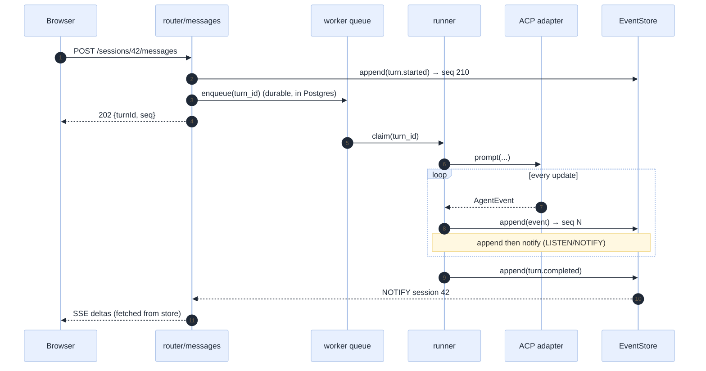

[Index](README.md) · [02 Architecture](02-architecture.md) · [03 ACP](03-acp-integration.md) · [06 Front end](06-frontend.md) · **07 Back end** · [08 Data](08-data-model.md) · [12 Ops](12-operations.md)

# 07 · Back end: FastAPI, the orchestrator and the ACP adapter

## Module layout (SOLID, by construction)

```
api/
├── main.py                     # create_app(), middleware, routers
├── config.py                   # pydantic-settings, one place for env
├── deps.py                     # dependency providers (repos, runtime, identity)
├── routers/
│   ├── sessions.py             # CRUD + messages
│   ├── stream.py               # SSE
│   ├── approvals.py            # POST decision
│   ├── files.py                # tree + diff + content
│   └── audit.py                # queries
├── domain/                     # pure Python, no I/O, no FastAPI
│   ├── session.py              # Session, Turn, states (the state machine)
│   ├── evidence.py             # requirement→tool-call mapping rules
│   ├── supervisor.py           # decide(continue|audit|stop)
│   └── events.py               # AgentEvent types (the only vocabulary)
├── ports/                      # Protocols (interfaces)
│   ├── agent_runtime.py
│   ├── tool_registry.py
│   ├── event_store.py
│   ├── identity.py
│   └── model_catalog.py
├── adapters/
│   ├── acp/                    # the ONLY place that knows OpenCode exists
│   │   ├── runtime.py          # AcpAgentRuntime
│   │   ├── jsonrpc.py          # newline framing, ids, timeouts
│   │   ├── mapper.py           # ACP updates → AgentEvent (v1 and v2)
│   │   └── probe.py            # capabilities at startup
│   ├── fake/                   # FakeAgentRuntime (transcript replay)
│   ├── mcp/                    # server lifecycle, health, scoping
│   ├── postgres/               # repositories
│   └── databricks/             # identity, model catalogue, workspace links
└── worker/
    ├── runner.py               # background turn execution
    └── janitor.py              # orphan processes, stale sessions
```

**Dependency rule (checked in CI):** `domain` imports nothing from `adapters` or `routers`; `adapters` import `ports`;
`routers` import `domain` + `ports`. A violation fails the build.

### SOLID, concretely

| Principle | How it is visible here |
|---|---|
| **S**ingle responsibility | `supervisor.py` decides *when* a turn is done; it never executes a tool or writes a row |
| **O**pen/closed | a second agent is a new `AgentRuntime` adapter; no existing file changes |
| **L**iskov | `FakeAgentRuntime` satisfies the same contract, including cancellation and permission requests |
| **I**nterface segregation | five small ports, not one `Services` god-object |
| **D**ependency inversion | the orchestrator takes `AgentRuntime` and `EventStore` as arguments; tests pass fakes |

## The event model (one vocabulary for everything)

```python
# domain/events.py  — the ONLY shape the UI, store and supervisor share
@dataclass(frozen=True)
class Event:
    seq: int                 # monotonic per session
    session_id: str
    turn_id: str | None
    at: datetime
    type: EventType          # discriminated union below
    actor: str               # user id or "agent"
    payload: dict            # type-specific
```

| `EventType` | Payload | Source |
|---|---|---|
| `session.created` | folder, model, policy | app |
| `session.ready` | tool_count, agent_info, capabilities | adapter |
| `turn.started` | message id, prompt text | app |
| `thought.delta` | text | ACP `agent_thought_chunk` |
| `message.delta` | text | ACP `agent_message_chunk` |
| `tool_call.started` | id, name, args summary, kind | ACP `tool_call` |
| `tool_call.updated` | id, status, duration, result summary | ACP `tool_call_update` |
| `plan.updated` | entries | ACP `plan_update` |
| `approval.requested` | id, what, where, why, options | ACP `session/request_permission` |
| `approval.decided` | id, outcome, decided_by | app |
| `evidence.proposed` | requirement rows | supervisor |
| `turn.auditing` | pass number, gaps | supervisor |
| `turn.completed` | stop_reason, usage, evidence | supervisor |
| `turn.blocked` | reason, missing[], attempted[] | supervisor |
| `turn.cancelled` | at | app |
| `turn.interrupted` | cause | adapter |
| `session.compacted` | tokens_before, tokens_after | agent (v2) |

**Rule BE-01:** new event types are additive; the reducer ignores unknown types (FE-01). **Rule BE-02:** an event is
appended **before** it is published, so a browser that receives it can always fetch it.

## Request lifecycle, with the durability trick



Why a **durable queue in Postgres** rather than an in-process `asyncio.create_task`:

- a worker restart does not lose an accepted turn (E-04);
- two workers cannot run the same turn (`SELECT … FOR UPDATE SKIP LOCKED`);
- the queue is observable with SQL during an incident.

`asyncio.create_task` is still used *inside* a worker for streaming fan-out, but it is never the source of truth.

## The ACP adapter

```python
class AcpAgentRuntime:                     # adapters/acp/runtime.py
    async def start(self, spec: SessionSpec) -> RuntimeHandle:
        proc = await asyncio.create_subprocess_exec(
            *spec.command,                      # e.g. ("opencode", "acp")
            cwd=spec.cwd, env=self._env(spec),  # scoped token, config dir
            stdin=PIPE, stdout=PIPE, stderr=PIPE, limit=8 * 1024 * 1024)
        caps = await self._initialize(proc, spec)
        self._assert_supported(caps)            # fail fast, loudly
        session = await self._session_new(proc, spec)
        return RuntimeHandle(proc, session.session_id, caps, spec)
```

Adapter responsibilities, and nothing else:

| Responsibility | Detail |
|---|---|
| Framing | newline-delimited JSON; **never** assume one message per read (a read can contain 3 lines) |
| Ids | our own monotonic ids for requests; agent-initiated requests carry theirs |
| Timeouts | `initialize` 30 s, `session/new` 60 s, prompt **none** (a turn may run for minutes); per-request cancel at 10 s |
| Versioning | read `protocolVersion` from `initialize`; map v1 or v2 shapes into `AgentEvent` |
| Permissions | translate `session/request_permission` into `approval.requested`; **wait** for the user, do not auto-answer |
| Errors | `auth_required` → a typed `AgentAuthError`; process death → `AgentCrashed` |
| Hygiene | kill the process on `close()`; never leave zombies ([12](12-operations.md)) |

### The mapper is where the version split is absorbed

```python
def to_events(msg: AcpMessage, version: int) -> list[AgentEvent]:
    if msg.method == "session/update":
        u = msg.params["update"]
        k = u["sessionUpdate"]
        if k == "agent_thought_chunk": return [thought_delta(u)]
        if k == "agent_message_chunk": return [message_delta(u)]
        if k == "tool_call":           return [tool_started(u)]
        if k == "tool_call_update":    return [tool_updated(u)]
        if k == "state_update":        # v2 only
            return [turn_finished(u["stopReason"], u.get("usage"))] if u["state"] == "idle" else []
        ...
    if msg.id == prompt_request_id:    # v1: the prompt response ends the turn
        return [turn_finished(msg.result["stopReason"], msg.result.get("usage"))]
```

**Test:** the same `fixtures/*.jsonl` recorded from a v1 agent, plus synthetic v2 frames, must produce **identical**
`AgentEvent` streams. That is a unit test, not an integration test.

## API surface

| Method | Path | Purpose | Notes |
|---|---|---|---|
| POST | `/api/sessions` | create | body: folder, model, policy; returns 201 + session |
| GET | `/api/sessions?cursor=` | list | cursor pagination, never offset (E-13) |
| GET | `/api/sessions/{id}` | detail | includes status and token totals |
| POST | `/api/sessions/{id}/messages` | submit a turn | 202 + turnId; idempotency key required |
| POST | `/api/sessions/{id}/cancel` | cancel | idempotent |
| GET | `/api/sessions/{id}/stream` | SSE | `Last-Event-ID` honoured |
| POST | `/api/approvals/{id}` | decide | body: allow_once / allow_session / deny |
| GET | `/api/sessions/{id}/files` | tree | from the tool server, not the disk |
| GET | `/api/sessions/{id}/files/content?path=` | file | paged |
| GET | `/api/sessions/{id}/diff?path=` | diff | before/after from the event log |
| GET | `/api/sessions/{id}/audit` | audit rows | filterable |
| POST | `/api/sessions/{id}/model` | switch model | maps to `session/set_config_option` |
| GET | `/api/health` | liveness | must not touch the DB |
| GET | `/api/ready` | readiness | DB + one MCP probe |

**Rule BE-03:** every mutating endpoint requires an `Idempotency-Key` header; a repeat within 10 minutes returns the first
result. Duplicate prompts are the most likely bug in a chat UI (double ⌘⏎, retry after a timeout).

## Configuration (one place, validated at boot)

```python
class Settings(BaseSettings):
    databricks_host: str
    lakebase_dsn: SecretStr
    default_model: str = "databricks/system.ai.gpt-oss-120b"
    allowed_models: list[str] = [...]                # policy
    agent_command: tuple[str, ...] = ("opencode", "acp")
    max_tools: int = 24
    max_concurrent_agents: int = 4
    max_turns_per_session: int = 200
    stream_heartbeat_seconds: int = 10
    approval_policy: Literal["fence_only", "always"] = "fence_only"
    enable_builtin_bash: bool = False
```

Startup fails fast if a required setting is missing — never a half-configured app that silently weakens the fence.

## Error handling contract

| Failure | HTTP | Event | User copy |
|---|---|---|---|
| User token missing/expired | 401 | — | "Your Databricks session expired" |
| Not allowed to use this folder | 403 | `turn.blocked` | "You do not have access to that folder" |
| Model rate-limited | 429 + `Retry-After` | `turn.retrying` | "The model is busy, retrying" |
| Agent crashed | 502 | `turn.interrupted` | "The agent stopped unexpectedly" |
| Tool server down | 503 | `session.degraded` | "Writes are disabled" |
| Prompt too large | 413 | — | "This message is too large; attach the file instead" |
| Unknown | 500 | `turn.failed` | "Something failed; the trace has the detail" |

**Rule BE-04:** never return a 200 with an error inside it. The UI decides rendering from the status and the event.

## Concurrency

| Concern | Rule |
|---|---|
| Turns in one session | one in flight; the second is queued and visibly "queued" (E-15) |
| Sessions per process | ≤ `max_concurrent_agents`; beyond that, the new session waits with a position in line |
| DB connections | pool of 10 per worker, 2 workers; never a connection per SSE stream |
| SSE fan-out | one `LISTEN` connection per worker, dispatched to local subscribers |
| Background work | the Postgres queue with `SKIP LOCKED` |

## What the back end must never do

1. **Never** call Databricks with the app's service principal on behalf of a user's data question (fail closed, E-07).
2. **Never** hold a turn's state only in memory.
3. **Never** answer a permission request automatically, unless the policy explicitly says "inside the fence, auto-allow".
4. **Never** log a token, a full prompt containing secrets, or a full SQL result; log lengths and hashes (E-33).

Next: [08 Data model](08-data-model.md).
