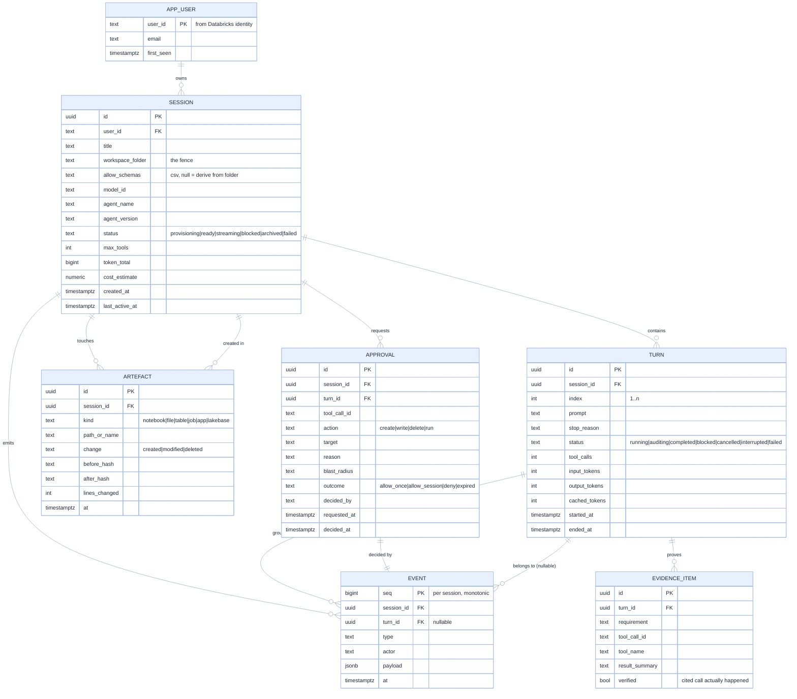
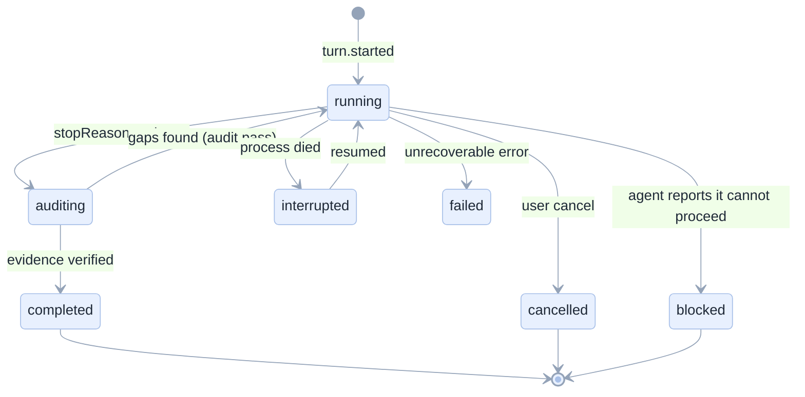

[Index](README.md) · [07 Back end](07-backend.md) · **08 Data** · [09 Security](09-security-security.md) · [12 Ops](12-operations.md)

# 08 · Data model (Lakebase Postgres)

## Entities

## Event sourcing, but pragmatic

The `EVENT` table is the source of truth for a transcript; `TURN` is a **projection** kept for fast listing and for
cost reporting. We do not re-derive turns on every read (too slow for a session list), and we do not pretend the projection
is authoritative: a repair job re-derives `TURN` from `EVENT` if they disagree.

## Indexes and access patterns

| Query | Frequency | Index |
|---|---|---|
| Session list for a user, newest first | every page load | `(user_id, last_active_at desc)` |
| Events for a session after seq N | every SSE connect/reconnect | PK `(session_id, seq)` |
| Turn list for a session | on open | `(session_id, index)` |
| Artefacts for a session | inspector tab | `(session_id, at)` |
| Audit: who wrote object X | incident | `(path_or_name)` + GIN on `payload` |
| Cleanup: idle sessions | hourly job | `(last_active_at)` |
| Approvals pending | the UI polls the stream, not a table scan | `(session_id) WHERE outcome IS NULL` (partial) |

## Retention and privacy

| Data | Retention | Reason |
|---|---|---|
| `EVENT` payloads | 30 days (configurable) | Debugging; then only `type`, `at`, counts remain |
| `TURN.prompt` | 90 days | "what did I ask" |
| `APPROVAL` | 1 year | Governance evidence |
| `ARTEFACT` | session lifetime | Diffs are regenerated from events, not stored |
| SQL result rows | **never stored** | Avoids creating a second copy of governed data outside Unity Catalog |
| Tokens | **never stored** | Passed through per request ([09](09-security-security.md)) |

That last row is a deliberate design decision: **the app stores what happened, not the data itself.** It keeps the app
outside the data-governance blast radius.

## Migration strategy

- Alembic, forward-only, one migration per PR.
- Every migration is additive for one release (add column → backfill → drop old in the next release).
- `events` is partitioned monthly (`PARTITION BY RANGE (at)`) from day one: a chat app accumulates rows fast.
- A `_schema_version` row is checked at boot; a mismatch refuses to start (never run half a schema).

## Capacity estimate (\[proposal], to be confirmed by the load test)

| Item | Per turn | Per session (10 turns) | 100 users × 5 sessions/month |
|---|---|---|---|
| Events | 40–120 | 400–1,200 | 0.6–1.8 M rows/month |
| Event bytes | 2–8 KB | 20–100 KB | 50–250 MB/month (90% in payloads) |
| Turns | 1 | 10 | 5,000/month |

At those volumes a CU_1 Lakebase instance is comfortable; the first real constraint will be the 30-day payload window,
which keeps the table small.

## Edge cases in the data layer

| Edge case | Handling |
|---|---|
| E-13 deep pagination with new rows appearing | keyset pagination on `(last_active_at, id)`, never OFFSET |
| E-14 two workers appending the same turn | `turn_id` + unique `(session_id, seq)`; sequence from a Postgres sequence, not the app |
| E-16 session deleted while streaming | soft delete + `archived_at`; stream sends `session.archived` and closes |
| E-17 event payload with a secret | the writer redacts known patterns before insert (token regex, `Bearer `), with a unit test |
| E-18 clock skew between workers | all timestamps `now()` from the database, never `datetime.now()` in Python |
| E-19 GDPR-style deletion request | delete rows for a user in one transaction, then vacuum; audit rows keep a pseudonymous actor id |

Next: [09 Security and governance](09-security-security.md).
