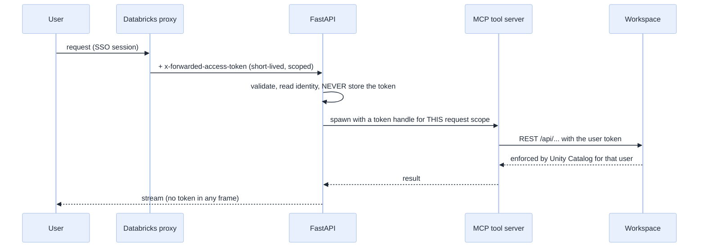
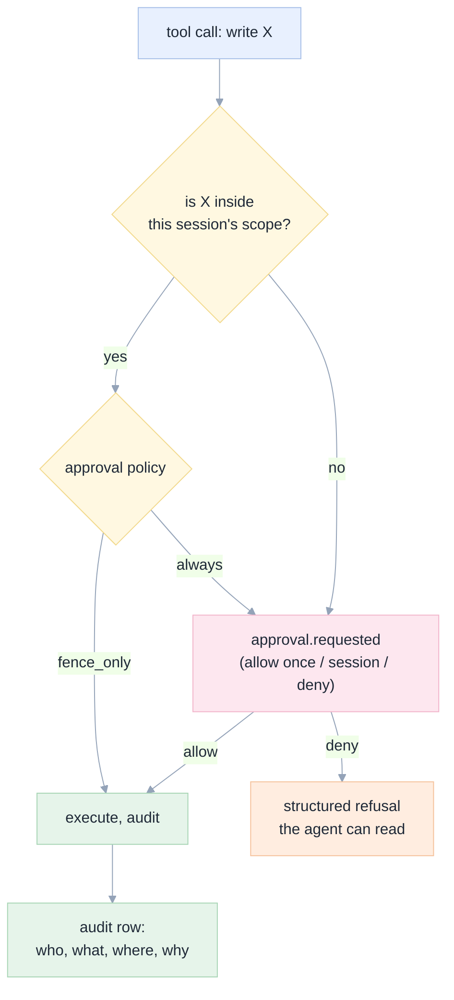

[Index](README.md) · [00 Why](00-why-first-principles.md) · [04 Tools](04-tools-skills-mcp.md) · [07 Back end](07-backend.md) · [08 Data](08-data-model.md) · **09 Security** · [11 Testing](11-testing-edge-cases.md)

# 09 · Security and governance

## The threat model, in plain words

| # | Threat | Who | Consequence if unhandled |
|---|---|---|---|
| TH-1 | **Prompt injection** through data (a table comment, ticket body, file) | anyone who can write data | the agent deletes or exfiltrates something |
| TH-2 | **Over-broad token** | the platform team, by accident | the agent can do anything the user can, everywhere |
| TH-3 | **Credential leak** into logs, traces, exports or the browser | a bug | full workspace compromise |
| TH-4 | **Confused deputy**: user A's app session acting with user B's rights | a caching bug | cross-tenant data exposure |
| TH-5 | **Destructive mistake**, not malicious: a wrong `DROP` | the model | data loss |
| TH-6 | **Supply chain**: a malicious MCP server, skill or agent build | an upstream dependency | code execution in the container |
| TH-7 | **Denial of budget**: a loop that burns tokens | the model | cost incident |
| TH-8 | **UI spoofing**: a tool result that looks like a system message | injected content | the user approves something harmful |

## Principles

1. **Least privilege by identity, not by prompt** ([Axiom 4](00-why-first-principles.md)).
2. **Fail closed.** No fallback to a service principal when the user token is missing.
3. **Two-person rule for irreversible actions** (delete, drop, overwrite a production object).
4. **Everything is attributable**: who, when, in which session, with which model and agent version.
5. **The app stores what happened, not the data** ([08](08-data-model.md#retention-and-privacy)).

## Identity: who is the agent acting for?

| Decision | Choice | Rationale |
|---|---|---|
| Whose identity for data work | **the user's** (`x-forwarded-access-token` + `user_api_scopes`) | per-user permissions and audit are the product |
| Whose identity for platform work (listing the app's own config, reading a secret) | the app's service principal | the user has no such rights |
| Token lifetime in the app | **the request** | Databricks' token is per-request and short-lived; caching it is a vulnerability |
| Scopes requested | minimum: `sql`, `catalog.*:read`, `files` — **not** `genie`, not `apps` write unless needed | scope blocks functionality outside it even if the user has rights |

### The inconvenient truth about the fence and the token

Our tool server's fence is real, but it is a **check inside a process that holds a token**. If the agent also has a shell
(it does, in OpenCode), a determined prompt injection could call the Databricks CLI directly with that token and bypass the
fence. Three defences, in order of strength:

| Defence | How | Residual risk |
|---|---|---|
| 1. **Tool server holds the token; the agent does not** | the agent process gets only a loopback URL to the MCP server; the server authenticates to Databricks | the agent could still `curl` the MCP server itself — so the MCP server also enforces per-session capabilities |
| 2. **MCP server enforces capabilities per session**, not per token | each session's server instance only permits the objects it was started with; a call for anything else is refused and audited | a bug in the check |
| 3. **Agent's built-in shell disabled by default** | `enable_builtin_bash: false`; enabling it requires a session in a scratch folder | user enables it knowingly |

> See [RB-15](15-roadblocks.md#rb-15--the-agents-own-shell-and-file-tools-bypass-our-fence-protocol): OpenCode documents that its
> built-in tools (file operations, terminal) work over ACP too, so this hole is a protocol-level certainty, not a theory.

> **Not yet built:** defence 1 and 2 are straightforward; the current MCP server enforces scope by *environment variables at
> start* (`NBMCP_WRITE_SCHEMAS`, `NBMCP_WRITE_PATHS`), which is exactly the per-session capability model. The gap is that it
> currently reads `DATABRICKS_TOKEN` from its own environment — the app must pass the **user's** token per session instead,
> and must not leave a broader token in the agent's environment. This is a required change ([10](10-implementation-plan.md), phase 3).

## The write fence, precisely

| Scope element | Default | Set by | Enforced by |
|---|---|---|---|
| Workspace folder | `/Users/<user>/agent_scratch` | session creation | tool server path check |
| Schemas writable | `workspace.agent_scratch` | session creation or approval | tool server SQL parse |
| Job name prefix | `agent_<session8>_` | session creation | tool server |
| Lakebase instance prefix | `agent-<session8>-` | session creation | tool server |
| Apps | must be `agent-<session8>-*` | session creation | tool server |
| Deletes | **never automatic** | explicit approval, always | tool server + policy |
| Reads | everything the user can read | — | Unity Catalog |

## Approval policy

| Action class | `fence_only` (default) | `always` (strict) |
|---|---|---|
| Read anything the user can read | allow | allow |
| Write inside the fence | allow, audit | ask |
| Write outside the fence | **ask** | ask |
| Run a job | allow if inside the fence prefix | ask |
| Create/delete an app | ask | ask |
| Drop/truncate/delete data | **ask** | ask, and require typing the object name |
| Use a model outside the allowed list | deny | deny |

Approval requests expire after 10 minutes (E-31) and are recorded as `expired`, not `deny`, so the audit trail is honest.

ACP offers exactly four permission option kinds — `allow_once`, `allow_always`, `reject_once`, `reject_always`
([schema](https://agentclientprotocol.com/protocol/v2/schema)) — which map onto our three buttons plus "never ask again for
this class". A request still pending when a turn is cancelled MUST be treated as **not approved**, per the same schema
([RB-13](15-roadblocks.md#rb-13--a-permission-request-is-a-blocking-round-trip-into-a-human-protocol)).

## Prompt injection: defence in depth

| Layer | Mechanism | Test |
|---|---|---|
| Capability | the fence: an injected instruction cannot reach an object outside scope | E-30 |
| Policy | destructive actions always require a human | E-34 |
| Detection | the supervisor asks the agent to report "anything odd or suspicious"; the UI shows it prominently | E-35 |
| Redaction | known secret patterns are redacted from events before storage | E-33 |
| Human | the evidence panel shows the actual tool calls, so an odd action is visible | E-36 |

**What we do not claim:** we do not claim to detect every injection. We claim that an injection **cannot silently exceed the
session's scope**, and that destructive actions require a person.

## Secrets

| Secret | Where it lives | Never |
|---|---|---|
| User token | request header → in-memory only | in a log, a row, a DOM node, an export |
| App SP credentials | injected by the platform | in the repo, in a session, in a trace |
| Lakebase connection string | app environment / secret scope | in the front end |
| Model API keys | AI Gateway (the app never sees them) | — |

**Rule SEC-01:** any string matching `dapi[0-9a-f]{20,}` or `Bearer [A-Za-z0-9._-]{20,}` is redacted by a middleware **before**
it can be logged or stored, and CI runs a scan of every recorded fixture.

## Supply chain

| Risk | Control |
|---|---|
| A malicious MCP tool | our server is in this repo, reviewed, and the only one allowed by policy |
| An agent build with a backdoor | pin the version; the app records the `agentInfo` from `initialize` per session |
| A skill that tells the agent to do something harmful | skills are repo-reviewed Markdown; they are **instructions, not code**, and cannot exceed the fence |
| A dependency compromise | lockfiles, `pip-audit`, `npm audit` in CI, Dependabot |

## What we recommend but have not tested

1. **Run the agent with a scoped token, not the user's full token.** The platform gives the app the user's token; for the
   agent process we could mint a narrower one (a service principal with rights only on the scratch schema) *and* keep the
   user token for read-only data calls. This would make the shell hole harmless. **Untested: needs a token-exchange flow.**
2. **Two-person approval for production schemas** (an optional second approver on approvals outside the fence).
3. **An egress allow-list** so the container cannot reach arbitrary internet hosts.

These are listed again with owners in [14](14-decisions-risks.md).

Next: [10 Implementation plan](10-implementation-plan.md).
