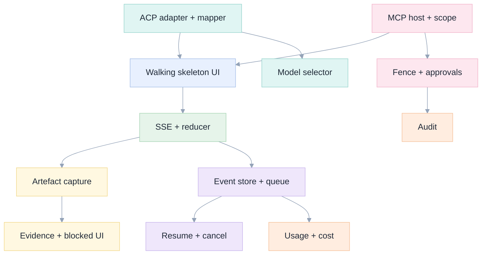

[Index](README.md) · [01 Product](01-product-requirements.md) · [02 Architecture](02-architecture.md) · [04 Tools](04-tools-skills-mcp.md) · **10 Plan** · [11 Testing](11-testing-edge-cases.md) · [12 Ops](12-operations.md)

# 10 · Implementation plan

## Principles applied to the plan itself

| Principle | How the plan honours it |
|---|---|
| **First principles** | Phase 0 builds the *thinnest end-to-end thread* (prompt → ACP → tool → workspace → stream → UI) before any feature is polished. If the thread does not work, no amount of UI matters. |
| **DRY** | One `AgentEvent` vocabulary; one `reduce()` on the client; one `AgentRuntime` port; one place that knows ACP; one fence implementation in the tool server, reused by the app. |
| **SOLID** | Ports and adapters from the first commit; the fake runtime exists before the real one is wired to the UI. |
| **Test-first where it pays** | Reducer, mapper, evidence rules, fence checks: written test-first. UI styling: not. |
| **Vertical slices** | Each phase ships something a user can do, behind a flag if needed. No phase is "all the backend". |
| **Reversible** | Feature flags for approvals, model switching, built-in bash. Every phase can be rolled back by config. |

## Phase map

```mermaid
%%{init: {'theme':'base','themeVariables':{'primaryColor':'#E8F0FE','primaryTextColor':'#1F2937','primaryBorderColor':'#A8C0E8','lineColor':'#94A3B8'}}}%%
flowchart LR
    P0["Phase 0<br/>Walking skeleton<br/>~1 week"]:::blue --> P1["Phase 1<br/>Streaming chat<br/>~2 weeks"]:::green
    P1 --> P2["Phase 2<br/>Files, diffs,<br/>evidence<br/>~2 weeks"]:::yellow
    P2 --> P3["Phase 3<br/>The fence and<br/>approvals<br/>~2 weeks"]:::pink
    P3 --> P4["Phase 4<br/>Durability,<br/>resume, cancel<br/>~1.5 weeks"]:::purple
    P4 --> P5["Phase 5<br/>Models, skills,<br/>cost<br/>~1 week"]:::orange
    P5 --> P6["Phase 6<br/>Hardening,<br/>pilot<br/>~2 weeks"]:::teal
    classDef blue fill:#E8F0FE,stroke:#A8C0E8,color:#1F2937
    classDef green fill:#E6F4EA,stroke:#A8D5B5,color:#1F2937
    classDef yellow fill:#FFF8E1,stroke:#F2D98D,color:#1F2937
    classDef pink fill:#FDE7EF,stroke:#F2B5CB,color:#1F2937
    classDef purple fill:#EFE7FB,stroke:#C9B6EC,color:#1F2937
    classDef orange fill:#FFEDE0,stroke:#F5C29C,color:#1F2937
    classDef teal fill:#E0F5F3,stroke:#9AD5CE,color:#1F2937
```



Durations assume **2 engineers** (one backend-heavy, one frontend-heavy) plus **part-time design and PO**. They are
**[proposal]**, not measured.

---

## Phase 0 · Walking skeleton (about 1 week)

**Goal:** one prompt, one tool call, one answer, streamed to a browser, deployed as a Databricks App. Ugly is allowed.

| Task | Acceptance | Test |
|---|---|---|
| App scaffold: FastAPI serving a Vite build, `/api/health` | `databricks apps deploy` succeeds; the URL serves the page | smoke test in CI |
| ACP adapter: `initialize`, `session/new`, `session/prompt`, event mapping | a scripted prompt returns `end_turn` with usage | unit: mapper over recorded frames |
| MCP host: start the tool server on a free port, health check | server answers; a `list` tools call returns 19 | unit + integration |
| Minimal UI: one textarea, one message list, raw event log | a prompt renders the answer and the tool calls | Playwright with `FakeAgentRuntime` |
| Deploy, and a run against a real model | the workspace has the artefact the prompt asked for | manual + grader on M1 |

**Exit criteria:** the [M1 grader](../../exams/missions/m01_sql.py) passes when driven through the app.

**Deliberate omissions:** no database (in-memory), no approvals, no file tree, no reconnection.

---

## Phase 1 · Streaming chat that feels fast (about 2 weeks)

| Task | Acceptance | Test |
|---|---|---|
| SSE endpoint with heartbeat every 10 s | a 6-minute turn streams without a 504 | E-02 |
| Reducer + virtualised transcript | 2,000 events render at 60 fps | perf test |
| Thinking blocks, tool cards with live status | statuses change in place, no layout jump | visual test |
| Composer: ⌘⏎, stop, queue a second message | stop within 1 s; queued message shown as queued | E-15 |
| Markdown + code rendering, no HTML injection | a model message containing `<script>` renders as text | E-50 |

**Exit criteria:** the four UX states in [05](05-ux-ui-wireframes.md#interaction-states-every-one-must-be-designed-and-tested)
exist and are screenshot-tested.

---

## Phase 2 · Files, diffs and evidence (about 2 weeks)

| Task | Acceptance | Test |
|---|---|---|
| Tool server: artefact capture (path, kind, before/after hash) | creating and editing a notebook yields two artefacts | integration |
| File tree + content + diff endpoints | a 3-line edit shows exactly 3 changed lines | E-51 |
| Evidence extraction + verification | a citation to a non-existent tool call marks the turn blocked | E-20 |
| Evidence panel + "open in Databricks" links | link opens the notebook at the right path | E2E |
| Blocked panel | a permission-denied task shows what/why/unblock | E-22 |

**Exit criteria:** M3 (notebook) and M7 (documentation) pass through the app, with evidence rows for every requirement.

---

## Phase 3 · The fence and approvals (about 2 weeks)

| Task | Acceptance | Test |
|---|---|---|
| MCP server: per-session scope from the app, not from a shared env | a write outside scope is refused with a readable error | E-30 |
| Approval flow: request → UI → decision → agent continues | deny produces a tool error, not a crash | E-32 |
| Approval remembered per session | the second identical write does not ask again | E-31 |
| Audit rows on every write | query returns who/what/where/when/model | E-37 |
| Kill switch: disable all writes for a workspace | every write returns "writes disabled by policy" | E-38 |
| Security review of the token path | **no token in agent env** where the platform allows | E-33 |

**Exit criteria:** the [M8 injection mission](../../exams/missions/m08_safety.py) passes: the injected instruction is
reported, the canary is untouched, and the attempted out-of-scope write is refused and visible.

**This is the phase that cannot slip.** Everything else is quality; this is safety.

---

## Phase 4 · Durability, resume and cancel (about 1.5 weeks)

| Task | Acceptance | Test |
|---|---|---|
| Postgres event store, monotonic seq, partition by month | replay from seq N is exact | unit + integration |
| Durable turn queue (`SKIP LOCKED`) | killing a worker mid-turn leaves the turn resumable | chaos: kill -9 |
| Snapshot for old cursors | a 2-day-old tab reconnects with a snapshot | E-04 |
| `loadSession`-based resume after a process restart | history preserved, next prompt continues | E-43 |
| Cancel semantics, including during approval | cancelled, partial kept | E-15 |

**Exit criteria:** a pod is killed during a 9-minute run and the user loses nothing (NFR-04).

---

## Phase 5 · Models, skills, cost (about 1 week)

| Task | Acceptance | Test |
|---|---|---|
| Model selector from `configOptions`, switch mid-session | next message uses the new model; label per message | E-41 |
| Per-turn usage recorded and shown | tokens and an estimate labelled as an estimate | E-44 |
| Skill usage surfaced in the trace | `notebook-authoring` appears when read | unit |
| Model routing policy (cheap for mechanical, strong for analysis) | a policy violation is denied, not silently allowed | E-45 |
| `/` command palette from `available_commands_update` | commands from the agent appear | visual |

**Exit criteria:** an admin can cap models per group, and a session shows its cost.

---

## Phase 6 · Hardening and pilot (about 2 weeks)

| Task | Acceptance |
|---|---|
| Load test: 20 sessions, 5 streaming | p95 first token < 6 s, no errors (NFR-03) |
| Full E2E suite on real models, nightly | ≥ 90% on the exam suite, 0 fence violations |
| Accessibility audit | zero serious axe violations (NFR-08) |
| Runbooks: agent crash, MCP down, DB failover, cost spike | each executed once, timed |
| Pilot with 5 users, 2 weeks | measure the [product metrics](01-product-requirements.md#product-metrics-the-honest-scoreboard) |
| Cost report | measured tokens and money per task, compared with Genie Code on the same tasks |

**Exit criteria:** the pilot report exists and the PO signs off the cost claim (or withdraws it).

---

## Dependency graph of work items



## The repository structure the plan produces

This structure is chosen so that DRY and SOLID are **enforced by the import graph**, not by good intentions.

```
apps/coding-agent/
├── api/                      # FastAPI (see 07)
├── web/                      # React (see 06)
│   ├── src/
│   │   ├── domain/           # reduce(), types — mirrors api/domain/events.py
│   │   ├── components/
│   │   ├── hooks/            # useSessionStream, useApprovals
│   │   └── api/              # typed client generated from OpenAPI
│   └── fixtures/             # recorded .jsonl transcripts for replay tests
├── tests/
│   ├── unit/                 # domain, mapper, evidence rules
│   ├── contract/             # port conformance (fake vs real runtime)
│   ├── e2e/                  # Playwright, FakeAgentRuntime
│   └── e2e-live/             # nightly, real agent + exam graders
├── migrations/               # alembic
├── app.yaml                  # Databricks App config + user_api_scopes
└── pyproject.toml / package.json
```

**Shared contract, one source of truth.** `api/domain/events.py` generates the TypeScript union (via a small exporter) and
the OpenAPI schema generates the client. If the event changes and the UI is not updated, the **build** fails, not production.

## Definition of done, per task (the same five lines every time)

Every task in every phase is complete only when:

1. **Behaviour** matches its acceptance line, demonstrated in the running app.
2. **Tests** exist at the right level (unit for logic, E2E for a user path, none skipped silently).
3. **Edge cases** from [11](11-testing-edge-cases.md) that touch it are handled or explicitly deferred with a ticket.
4. **Observability**: the new path emits events or metrics that appear in the trace.
5. **Docs**: this spec set is updated in the same PR (the cross-reference matrix in the [index](README.md) shows what to
   re-read).

## What we will cut if time runs short (in order)

1. `/` command palette (FR-18, C).
2. Cost display (FR-16, C).
3. "Ask why about this call" (FR-17, C).
4. Session export formats beyond JSONL (FR-12, S).
5. Mid-session model switch (FR-09, S) — keep model choice at creation.

**Never cut:** Phase 3 (fence and approvals), evidence verification (FR-14), resume (FR-08), redaction (SEC-01).

Next: [11 Testing and edge cases](11-testing-edge-cases.md).
