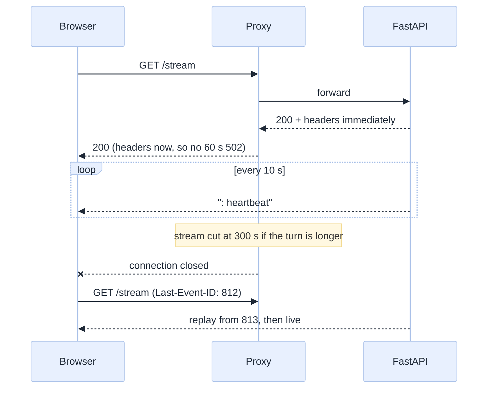
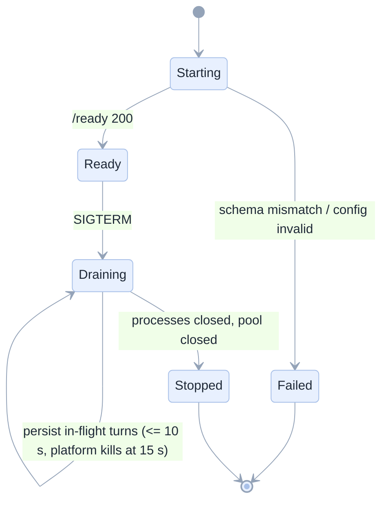
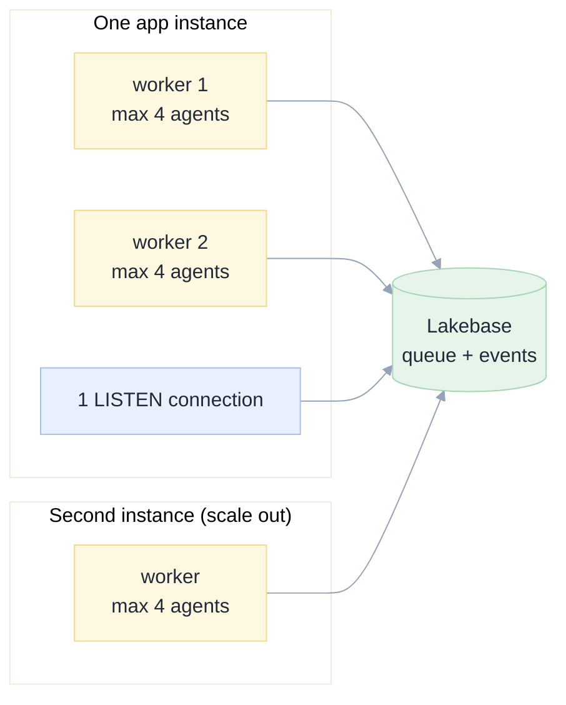

[Index](README.md) · [02 Architecture](02-architecture.md) · [07 Back end](07-backend.md) · [10 Plan](10-implementation-plan.md) · [11 Testing](11-testing-edge-cases.md) · **12 Ops**

# 12 · Operations: running it in the real world

## The platform constraints that shape everything

These are properties of Databricks Apps, not of our code. They are **[documented]** in Databricks' own Apps guidance (see
[Grounding](README.md#grounding-what-we-verified-and-what-we-did-not)); we have not independently re-measured them.

| Constraint | Value | Consequence for us |
|---|---|---|
| Plain response (headers only at the end) | cut at 300 s on container apps; **60 s on Spaces apps** | we stream from the first byte, always |
| Streamed response | cut at 300 s | SSE + reconnect + replay ([E-02](11-testing-edge-cases.md)) |
| WebSocket | works on container apps, **rejected on Spaces apps** | we do not use WebSockets ([02](02-architecture.md)) |
| Start-up budget | must start within 10 min | our target < 90 s |
| Proxy-generated errors | never appear in app logs | we log our own timing, and treat an HTML error body as a proxy timeout |
| Containers | no root, no GPU, no `apt`; dependencies install **at build** | all agent packages declared in `package.json` ([RB-04](15-roadblocks.md#rb-04--unprivileged-container-no-apt-and-the-agent-binary-must-be-installed-at-build-platform)) |
| `app.yaml` `command` | an array, **never run through a shell**; only `DATABRICKS_APP_PORT` is substituted | the app spawns the agent itself with an explicit env ([RB-03](15-roadblocks.md#rb-03--command-is-not-run-through-a-shell-only-databricksappport-is-substituted-platform)) |
| Graceful shutdown | `SIGTERM`, then `SIGKILL` after **15 s** | checkpoint every event; drain budget 10 s ([RB-02](15-roadblocks.md#rb-02--sigterm--sigkill-after-15-seconds-and-no-scale-to-zero-platform)) |
| Idle | **no auto-stop**; billed while Running | scheduled stop/start job, or accept the cost |
| Egress | deny-by-default when a restricted network policy is set | allow-list PyPI, npm and the workspace host; restart the app after a policy change ([RB-05](15-roadblocks.md#rb-05--egress-may-be-denied-by-default-a-policy-change-needs-a-restart-resource)) |
| Logs | stdout/stderr only; one instance per log view | structured JSON with a trace id; app telemetry tables for correlation |
| Source files | no file over **10 MB**; 100 apps per workspace | vendor at build, never commit `node_modules` |

## Streaming and timeouts

Rules:

| Rule | Detail |
|---|---|
| OPS-01 | Send response headers before doing any work; never buffer the first chunk |
| OPS-02 | Heartbeat every 10 s (an SSE comment line) even when the agent is silent |
| OPS-03 | A turn longer than 5 minutes is expected; the client must treat a cut connection as normal ([FR-13](01-product-requirements.md)) |
| OPS-04 | Never rely on a WebSocket for a customer-facing feature |
| OPS-05 | Server-side, a turn's work is detached from the HTTP request (the durable queue), so a closed connection never cancels the work |

## Health, readiness and graceful shutdown

| Endpoint | Checks | Used by |
|---|---|---|
| `GET /api/health` | process alive only (no I/O) | liveness |
| `GET /api/ready` | Postgres reachable **and** one MCP probe succeeds | readiness / deploy gate |
| `GET /api/version` | build sha, agent version, model default | humans, incident response |

**Graceful shutdown:** the platform gives **15 seconds** between `SIGTERM` and `SIGKILL`
([Databricks best practices](https://docs.databricks.com/aws/en/dev-tools/databricks-apps/best-practices), confirmed by the
[builder's guide](https://www.databricks.com/blog/builders-guide-scaling-databricks-apps)). Stop accepting turns immediately,
persist the interruption, close agent processes and the pool, and set Uvicorn's `--timeout-graceful-shutdown` to **10** so a
long request cannot eat the checkpoint window. Anything still running is re-queued ([E-04](11-testing-edge-cases.md)).
See [RB-02](15-roadblocks.md#rb-02--sigterm--sigkill-after-15-seconds-and-no-scale-to-zero-platform).

## Scaling

| Question | Answer | Why |
|---|---|---|
| Can we run two instances? | Yes: the queue and the event store are shared; SSE fans out per instance via `LISTEN` | no sticky sessions needed |
| What breaks first? | agent processes (memory) | cap per worker; queue the rest |
| What is the hard ceiling? | the model's rate limit | see cost controls |
| How do we scale model capacity? | per-session model choice, and a fallback model in policy | [04](04-tools-skills-mcp.md) |

## Observability

| Signal | What | Why |
|---|---|---|
| `turn.first_token_ms` | histogram | NFR-01 |
| `turn.duration_ms` by outcome | histogram | where the time goes |
| `tool_call.duration_ms` by tool | histogram | which tool is slow |
| `agent.restarts_total` | counter | stability of the child process |
| `sse.reconnects_total` | counter | proxy behaviour in the wild |
| `turn.tokens_total` by model | counter | cost |
| `approval.latency_ms`, `approval.outcome` by class | histogram + counter | the trust moment, measured |
| `fence.refusals_total` | counter | **should be > 0 in tests, ~0 in production** |
| `queue.depth` | gauge | saturation |
| `redactions_total` | counter | **must be 0**; any increase is an incident |

Every session has a **trace id** that appears in the UI ("copy trace id") and in every log line. An incident starts with
that id.

## Cost controls

| Control | Setting | Effect |
|---|---|---|
| Model allow-list | per workspace | no accidental frontier-model spend |
| Per-session turn cap | 200 | stops a runaway loop |
| Per-user daily token budget | configurable | a hard stop with a clear message, not a silent failure |
| Tool budget | 24 tools | every turn is cheaper ([P7](00-why-first-principles.md)) |
| Skill paging | on demand | ~2,800 tokens saved per turn |
| Compaction threshold | 60% of window | avoids overflow retries |
| Cost visible per session | UI chip | users self-regulate |

**Honesty rule:** the UI labels cost "estimate" until we have measured real billing. A wrong number presented as truth is
worse than no number.

## Failure playbooks

| Symptom | Likely cause | First action | Then |
|---|---|---|---|
| Every turn fails at provision | MCP server or agent binary missing | `/api/version`, container logs | redeploy; run the smoke script |
| Turns hang at "starting" | model endpoint unreachable or rate-limited | check `agent.restarts_total`, 429s | switch the default model in policy |
| Streams cut at exactly 300 s | a turn with no heartbeat (bug) | check the SSE emitter | fix; OPS-02 test should have caught it |
| Duplicate work after a network blip | missing idempotency key on the client | check the request log | fix the client; the server already guards |
| Approvals not appearing | permission mapping broken | replay the ACP fixture | fix the mapper |
| Cost spike | a loop, or a frontier model selected | per-model token counters, session list by cost | cap; talk to the user |
| `redactions_total` increases | a token reached a log or an event | treat as a Sev-1 | rotate the token, audit the path |

## Runbooks we will write and rehearse

1. Deploy and roll back an app version.
2. Rotate the app's service principal credentials.
3. Rotate a user's compromised token.
4. Restore the event store from backup, and verify a session replays.
5. Drain an instance without losing turns.
6. Disable all writes workspace-wide (the kill switch), and re-enable.

Each is rehearsed once in phase 6 ([10](10-implementation-plan.md)) and timed; the times go in the runbook.

## Support model

| Tier | Who | Handles |
|---|---|---|
| L1 | the product team's on-call | known errors with copy, restart, kill switch |
| L2 | platform engineer | agent/MCP failures, model routing, DB |
| L3 | the build team | ACP or supervisor bugs, with a trace id and an event export |

**Every bug report must include the trace id.** The UI has a copy button next to it next to the session title, because we
will not debug from screenshots.
