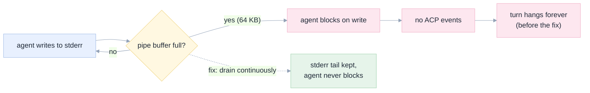

[Index](README.md) · [16 Implementation](16-implementation.md) · [15 Roadblocks](15-roadblocks.md) · [E2E](e2e/README.md)

# 17 · Deployment: what happened, and the two defects it found

Attempted 6 November 2026 against `dbc-cb61f1e1-bd8e.cloud.databricks.com`.

## Outcome in one line

**Not deployed: the workspace has exhausted its free daily quota for both app compute and model endpoints.** Everything
needed to deploy is in the repository and scripted; the run stopped on the platform limit, not on our code. The attempt did
find **two real production defects**, both now fixed and covered by tests.

## What blocked it

| Check | Result | Evidence |
|---|---|---|
| CLI and token | OK — authenticated as the workspace user | `databricks current-user me` |
| Apps available in the workspace | OK — one existing app (`edgequake`) | `databricks apps list` |
| App **creation** | **blocked** — `Sorry, cannot run Databricks App because you have hit your free daily limit` | `databricks apps create` |
| App **compute** | **blocked** — the same limit when starting the existing app | `databricks apps start edgequake` |
| Model endpoint | **blocked** — `cannot run or query foundation model endpoints … free daily limit` | `opencode run` against the gateway |

The third and fourth are the same quota reached through different doors; the fifth is a separate quota. All three reset
daily.

## Two defects the attempt found

Both would have failed in production, and neither was reachable by the unit tests as they stood.

### 1 · The agent's stderr was piped and never read (a guaranteed deadlock)

`AcpAgentRuntime` spawned the agent with `stderr=PIPE` and nobody consumed it. On macOS, opencode logged ~90 lines during a
model failure, filled the 64 KB pipe buffer, and **blocked forever**. The turn showed "working" with no events and no error.
Every backend test passed, because the fake agent is quiet.



**Fix:** a reader task drains stderr continuously into a bounded deque; the tail is attached to any error. Test:
`test_a_chatty_agent_on_stderr_does_not_deadlock`.

### 2 · A failed model call hung the turn instead of ending it

When the endpoint returns an error, opencode logs it and **never ends the ACP turn** — there is no "the model call failed"
signal in the protocol. The UI stayed on "streaming"/"working" indefinitely.

**Fix:** an idle guard on the event loop (`APP_TURN_IDLE_TIMEOUT`, default 180 s). A turn with no events for that long ends
with `turn.failed` and **the agent's own words**. Tests: `test_a_turn_with_no_events_fails_instead_of_hanging`,
`test_stderr_tail_prefers_the_cause_over_a_truncated_object`, `test_a_failed_turn_always_has_a_reason`.

Getting the message *useful* took three iterations: the raw stderr tail showed a truncated JSON object; the first parser
returned `errorName: "APIError"`; the second returned `message=process`. The final version ranks candidates and prefers a
sentence that names a cause. What the user now sees:

> **the model or agent failed:** Internal error: Bad Request: BAD_REQUEST: Sorry, cannot run or query foundation model
> endpoints because you have hit your free daily limit. Please come back again tomorrow.

That is the right outcome for a failure: specific, and true.

## Verified without the cloud

Because the cloud was closed, the production path was exercised locally with the **real agent over real ACP**:

| Check | Result |
|---|---|
| App spawns `opencode acp`, negotiates ACP, reports the agent | **PASS** — `OpenCode`, `1.18.19`, real session id |
| Session creation, model allow-list, 404/422 handling | **PASS** — 11/11 in `scripts/e2e-running-app.sh` |
| A turn reaches a terminal state and explains itself | **PASS** — failed with the gateway's sentence |
| SSE replay from cursor 0 | **PASS** — 4 events |
| A browser shows the real app against the real agent, no console errors | **PASS** — screenshot [`e2e/screenshots/11-deployed-real-opencode.png`](e2e/screenshots/11-deployed-real-opencode.png) |

That last row is worth looking at: it is the real product, driving the real agent, showing the real failure — which is
exactly the behaviour that matters when the model is unavailable.

## Deploying when the quota resets

Everything is scripted. One command, which stops at the first real blocker and names it:

```bash
export DATABRICKS_HOST=https://YOUR-WORKSPACE.cloud.databricks.com
export DATABRICKS_TOKEN=...                       # or a profile
apps/coding-agent/scripts/deploy.sh               # preflight, quota probe, create, scopes, deploy, verify
apps/coding-agent/scripts/e2e-running-app.sh https://<app-url>   # end-to-end against the deployed app
```

What each step does, and why it is written that way:

| Step | Detail | Source |
|---|---|---|
| Preflight | fails fast if the CLI, the token or the app folder is wrong | this run |
| Quota probe | starts a stopped app **and re-reads its state**, because a start request alone is not proof | this run: a first version wrongly reported "compute is available" |
| Create | `--json @app.create.json`; `git_repository` is required in this workspace, and `source_code_path` goes at the top level, not inside it | three validation iterations |
| Scopes | `user_api_scopes` are **requested** by `app.yaml` and must be **granted** separately | Databricks auth docs |
| Deploy | waits for `RUNNING`, fails on `CRASHED` | app runtime contract |
| Verify | HTTP checks plus the E2E script above | this run |

## Two pitfalls found while scripting it

1. **A `databricks.yml` in a source folder breaks every CLI call made from it.** The CLI resolves
   `targets.*.workspace.host` *before* reading `DATABRICKS_HOST`, so a `${var...}` placeholder makes `databricks apps list`
   fail with `invalid character "{" in host name`. The bundle now lives at the repository root and deliberately has **no
   host** in its targets.
2. **`apps create` in this workspace requires `git_repository`.** A workspace-folder source is rejected with
   *"Git repository is required for Databricks Apps in this workspace"*, so the app builds from the public repo at
   `apps/coding-agent`.

## Still unverified (and honestly so)

| Item | Why |
|---|---|
| The app running as a Databricks App | quota; not started |
| The build inside the platform image (npm + Python install of opencode, RB-04) | needs a real deploy; the 10-minute start budget is the risk |
| User authorization end to end (`x-forwarded-access-token` honoured) | needs a deployed app with granted scopes |
| The MCP tool server inside the container | needs a deploy; locally it was left unconfigured on purpose (demo path) |

These are the same three items listed as open in [16](16-implementation.md#what-is-deliberately-still-open), now with a
deployment attempt behind them rather than a plan.
