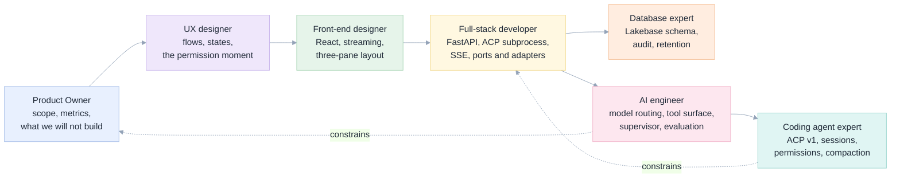
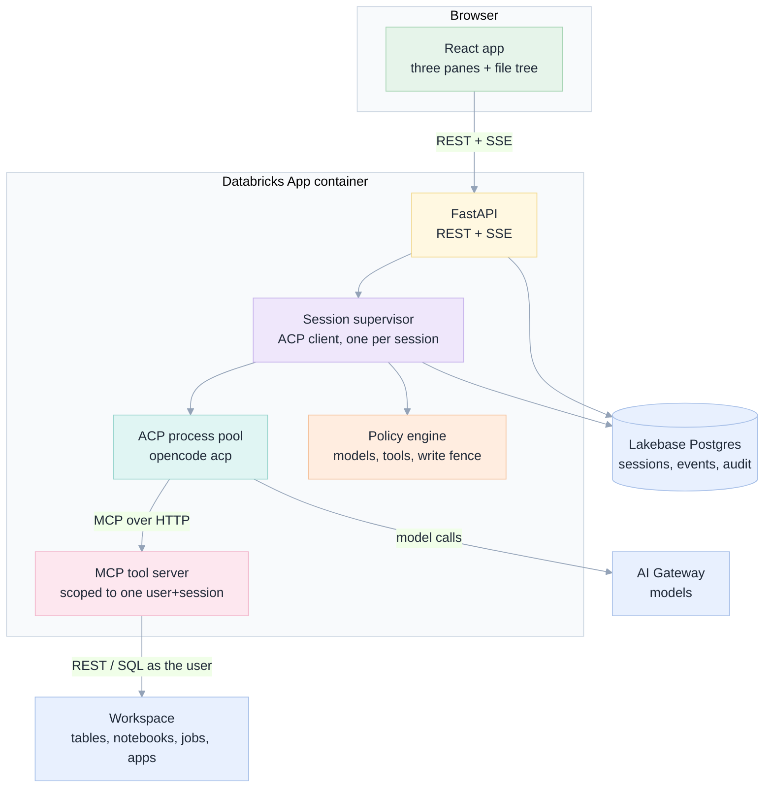

# 001 · Databricks Coding Agents

**A specification and implementation plan for Databricks Apps that work like Genie Code, built on ACP-compatible
agents (OpenCode), MCP tools and agent skills.** React front end, FastAPI back end, Lakebase for state.

> **Status:** specification **and a working implementation** · 6 November 2026
> **Built and running.** The app exists in [`apps/coding-agent/`](../../apps/coding-agent): pure domain, ports and adapters,
> FastAPI + SSE, a React UI, 68 Python tests and 16 front-end tests, and [ten real screenshots](e2e/README.md) of every UI
> state. Nine defects were found by running it, including one that would have shipped an empty transcript —
> see [16 Implementation](16-implementation.md).
> **Audience:** the team that will build it (product, design, front end, back end, data, AI).
> **Grounding:** every claim about ACP, OpenCode, Databricks Apps and our tool server is backed by a probe or a document
> recorded in [§Grounding](#grounding-what-we-verified-and-what-we-did-not). Product claims are marked as proposals.

## The one-paragraph version

Genie Code gives you a chat box inside Databricks that can read your data, write notebooks, build jobs and answer
questions, because Databricks pre-assembles the context for it. This specification builds the same experience as a
**Databricks App**: a three-pane chat workspace where a general coding agent (OpenCode, spoken to over the **Agent Client
Protocol**) does the work, a **Databricks MCP tool server** gives it governed access to the workspace, and a **supervisor**
inside the server refuses to accept an answer that has not been proved. The app is a *host*, not an agent: it owns
identity, permissions, persistence, streaming and the user interface, and treats the agent as a replaceable subprocess.

## Reading map

Read in this order the first time. Each document is self-contained and cross-linked.

| # | Document | Question it answers | Lens |
|---|---|---|---|
| 00 | [Why, and from first principles](00-why-first-principles.md) | Why build this at all? What is irreducibly true about the problem? | PO + AI engineer |
| 01 | [Product requirements](01-product-requirements.md) | Who is it for, what must it do, how do we know it worked? | Product Owner |
| 02 | [Architecture](02-architecture.md) | What are the parts, and what talks to what? | Full-stack |
| 03 | [ACP integration](03-acp-integration.md) | How exactly do we drive OpenCode? What breaks? | Coding Agent Expert |
| 04 | [Tools, skills and the fence](04-tools-skills-mcp.md) | What can the agent do, and what can it not? | AI Engineer |
| 05 | [UX and wireframes](05-ux-ui-wireframes.md) | What does the user see and press? | UX + UI |
| 06 | [Front end](06-frontend.md) | How is the React app structured? | Front-end |
| 07 | [Back end](07-backend.md) | How is the FastAPI server structured? | Full-stack |
| 08 | [Data model](08-data-model.md) | What do we store, and for how long? | Database |
| 09 | [Security and governance](09-security-security.md) | What can go wrong, and what stops it? | Security + PO |
| 10 | [Implementation plan](10-implementation-plan.md) | In what order do we build it, with what acceptance criteria? | All |
| 11 | [Testing and edge cases](11-testing-edge-cases.md) | How do we prove it, including everything that can go wrong? | QA + All |
| 12 | [Operations](12-operations.md) | How does it run, scale, cost and fail? | SRE |
| 13 | [Lens reviews](13-lens-reviews.md) | What does each specialist object to, and what changed? | All seven |
| 14 | [Decisions and risks](14-decisions-risks.md) | What did we decide, and what is still open? | All |
| 15 | [**Roadblock register**](15-roadblocks.md) | What is in the way, which official doc says so, what does it cost us? | All |
| 16 | [**Implementation**](16-implementation.md) | What is built, what did running it teach us, what is still open? | All |
| — | [E2E screenshots](e2e/README.md) | What does it actually look like? | UX |

## The seven lenses, and where each one bites

Each lens has a review pass in [13](13-lens-reviews.md): what it objected to, what the spec changed, what remains a
trade-off.

## Cross-reference matrix

Who depends on what. A change in a row means re-reading the columns marked ●.

| ↓ depends on → | 00 | 01 | 02 | 03 | 04 | 05 | 06 | 07 | 08 | 09 | 10 | 11 | 12 | 15 |
|---|---|---|---|---|---|---|---|---|---|---|---|---|---|---|
| **00 Why** | — | ● | | | | | | | | | | | | ● |
| **01 Product** | ● | — | | ● | ● | ● | | | | ● | ● | ● | ● | ● |
| **02 Architecture** | ● | ● | — | ● | ● | | ● | ● | ● | ● | | | ● | ● |
| **03 ACP** | | | ● | — | ● | ● | ● | ● | ● | ● | | ● | ● | ● |
| **04 Tools** | | ● | ● | ● | — | ● | | ● | ● | ● | | ● | ● | ● |
| **05 UX** | | ● | | ● | ● | — | ● | | | ● | | ● | | ● |
| **06 Front end** | | | ● | ● | | ● | — | ● | | ● | | ● | | |
| **07 Back end** | | | ● | ● | ● | | ● | — | ● | ● | | ● | ● | ● |
| **08 Data** | | ● | ● | ● | ● | | | ● | — | ● | | ● | ● | ● |
| **09 Security** | ● | ● | ● | ● | ● | ● | ● | ● | ● | — | ● | ● | ● | ● |
| **10 Plan** | ● | ● | ● | ● | ● | ● | ● | ● | ● | ● | — | ● | ● | ● |
| **11 Testing** | | ● | ● | ● | ● | ● | ● | ● | ● | ● | ● | — | ● | ● |
| **12 Operations** | | ● | ● | ● | | | | ● | ● | ● | ● | ● | — | ● |
| **15 Roadblocks** | ● | ● | ● | ● | ● | ● | | ● | ● | ● | ● | ● | ● | — |

## The design in one picture

Details, alternatives and rejected options: [02 Architecture](02-architecture.md).

## Grounding: what we verified and what we did not

| Claim | Status | Evidence |
|---|---|---|
| OpenCode exposes ACP **v1** over stdio; `initialize` advertises `loadSession`, `mcpCapabilities.http`, `promptCapabilities.embeddedContext`, `sessionCapabilities.{close,fork,list,resume}` | **verified** | [`docs/e2e/19_acp_probe.txt`](../../docs/e2e/19_acp_probe.txt) |
| ACP `session/new` accepts HTTP MCP servers, so we can inject our own tool server | **verified** | same probe |
| ACP v1 returns `stopReason` **and token usage** on the `session/prompt` response | **verified** (11,700 tokens for a 3-word answer, 10,528 cached) | same probe |
| ACP exposes the model as a session `configOptions` select | **verified** | same probe |
| MCP tool names are exposed as `<serverName>_<toolName>`, and a model will mangle a doubled prefix | **verified defect** | same probe |
| Registering one MCP server twice doubles the tool list in context | **verified defect** | same probe |
| `session/set_config_option` rejects the documented union value and accepts a bare string | **verified defect** | [`docs/e2e/20_acp_config_probe.txt`](../../docs/e2e/20_acp_config_probe.txt) |
| Switching to a catalogue model the workspace cannot serve fails late with `getaddrinfo ENOTFOUND` | **verified defect** | same probe |
| `session/list` exposes the agent's own sessions | **verified** | same probe |
| Apps: 15 s SIGTERM→SIGKILL, no shell in `command`, no `apt`, 10 MB file limit, 10-min start budget | documented | [app-runtime](https://docs.databricks.com/aws/en/dev-tools/databricks-apps/app-runtime), [best practices](https://docs.databricks.com/aws/en/dev-tools/databricks-apps/best-practices) |
| Apps: no GA idle auto-stop; billed while Running | documented | [community answer](https://community.databricks.com/t5/data-engineering/query-on-databricks-apps-idle-time-out/td-p/174694) |
| Lakebase: 218 connections at 1 CU; autoscale limit = min(max CU, 8×min CU); range ≤ 16 CU | documented | [manage computes](https://docs.databricks.com/aws/en/oltp/projects/manage-computes) |
| ACP permission kinds are exactly allow_once / allow_always / reject_once / reject_always; cancel voids pending requests | documented | [ACP schema](https://agentclientprotocol.com/protocol/v2/schema) |
| OpenCode's built-in shell and file tools work over ACP too | documented | [OpenCode ACP](https://opencode.ai/docs/acp/) |
| Databricks Apps proxy: streamed responses work, but are cut at 300 s; Spaces apps reject WebSocket upgrades | documented by Databricks' own agent-skills platform guide | [12 §Streaming](12-operations.md#streaming-and-timeouts) |
| User identity: `x-forwarded-access-token` + `user_api_scopes`, scopes enforced per API | documented | [09 §Identity](09-security-security.md#identity-who-is-the-agent-acting-for) |
| Our MCP server's tools are good enough to score 94% on 8 graded Databricks tasks | verified in this repo | [`docs/06-results-and-lessons.md`](../../docs/06-results-and-lessons.md) |
| `session/set_config_option`, `session/request_permission`, `session/load`, `session/fork`, `session/list` | **not exercised yet** | schema-read only; the app must test them ([11](11-testing-edge-cases.md)) |
| Any latency, cost or concurrency figure for the app itself | **not measured**; this is a design | proposals marked as such |

## Conventions in this document set

- **MUST / SHOULD / MAY** carry their usual meaning (RFC 2119).
- **\[verified\]** means we ran it; **\[documented\]** means a vendor doc says it; **\[proposal\]** means we chose it and
  it is not yet tested.
- Every edge case named `E-xx` in [11](11-testing-edge-cases.md) is referenced from the document that must handle it.
- Screen wireframes are ASCII, in [`05`](05-ux-ui-wireframes.md). Behaviour over time is Mermaid (sequence, state, ER).

## Related work in this repository

| Resource | Why it matters here |
|---|---|
| [`docs/06-results-and-lessons.md`](../../docs/06-results-and-lessons.md) | The measured evidence for tool design, supervisor loops and model choice |
| [`docs/04-safety-and-governance.md`](../../docs/04-safety-and-governance.md) | The layered defences and the known hole in the command-line path |
| [`mcp/databricks_notebook_mcp.py`](../../mcp/databricks_notebook_mcp.py) | The 26-tool server this app wraps (19 in the `core` profile) |
| [`mcp/skills/`](../../mcp/skills) | The four on-demand skills the agent reads |
| [`exams/`](../../exams) | The grader patterns this app's evaluation reuses |
| [`docs/tutorial.md`](../../docs/tutorial.md) | The manual, single-user version of this product |
