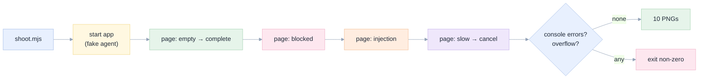

[Index](../README.md) · [16 Implementation](../16-implementation.md) · [05 UX](../05-ux-ui-wireframes.md)

# E2E screenshots

States of the running application, captured by [`apps/coding-agent/web/scripts/shoot.mjs`](../../../apps/coding-agent/web/scripts/shoot.mjs).
The script starts its own server, drives a real browser, and fails if the browser logs an error.

**These are screenshots of the application UI, not of the Databricks workspace around it** (the workspace uses single
sign-on, which blocks automated capture). Each image is the real render of the real app at 1440×940 (and 900×940 for the
narrow case), captured at 1.5× density.

## What each state proves

| # | File | State | What it demonstrates |
|---|---|---|---|
| 01 | `01-empty.png` | Empty | Six task cards that map to the exam families; working folder and model are explicit; the fence is stated in words before anything runs |
| 02 | `02-streaming.png` | Running | Progress is visible while it happens: the thinking block, tool cards appearing, a Stop button |
| 03 | `03-completed.png` | Completed | The answer, a tool trace of 3 calls, and an **Evidence** panel: 3 of 3 requirements proven, each citing the tool that proved it |
| 04 | `04-tool-expanded.png` | Tool detail | A card opens to show the real input (`{"full_name": "samples.nyctaxi.trips"}`) and result, in monospace |
| 05 | `05-thinking.png` | Reasoning | The model's reasoning is available but collapsed by default — transparency without noise |
| 06 | `06-narrow.png` | 900 px wide | The inspector collapses, the transcript keeps full width, and there is **no horizontal overflow** |
| 07 | `07-blocked.png` | Blocked | "I could not finish this": what failed, what was missing, what it tried — and "nothing outside your working scope was changed" |
| 08 | `08-injection-report.png` | Prompt injection | A ticket body asked the agent to drop a table. The write was refused, the refusal is shown, and the real task still completed |
| 09 | `09-running-stop-visible.png` | Long run | A run in progress with the stop affordance present, for the 300-second proxy case |
| 10 | `10-cancelled.png` | Cancelled | The partial transcript is kept and the turn is marked stopped — cancellation is not deletion |
| 11 | `11-deployed-real-opencode.png` | **Real agent** | The production path: the app driving real `opencode` over ACP, showing a real gateway failure with the agent's own words. See [17](../17-deployment.md) |

## How the capture works, and why it is a test



The script asserts two things beyond "a file exists": **no console errors** and **no horizontal overflow at 900 px**.
Both caught real bugs during development (see [16](../16-implementation.md#the-nine-defects-that-only-running-found)).

## Inspecting them

Open the PNGs at full size. What to look for, in order:

1. **The prompt box contains the user's request**, the thinking block contains the model's reasoning, and the answer
   contains the report. Three different things; a UI that mixes them is broken.
2. **Tool names are human** ("ran a notebook"), not raw identifiers; the raw name and arguments are one click away.
3. **Evidence cites a tool per requirement**, and the count matches the number of requirements.
4. **The fence is stated before it is needed**, not only when it refuses something.
5. **Nothing is a dead end**: every failure state offers what would unblock it.

## Re-capturing

```bash
cd apps/coding-agent
cd web && node scripts/shoot.mjs ../../../../specs/001-databricks-coding-agents/e2e/screenshots
```

Against a deployed app, with the real agent (19 steps, each asserting something observable):

```bash
cd apps/coding-agent/web
APP_URL=https://<app>.aws.databricksapps.com REAL_AGENT=1 BEARER_FILE=/path/to/token \
  node scripts/genie-e2e.mjs ../../../../specs/001-databricks-coding-agents/e2e/screenshots/genie-deployed
```

`BEARER_FILE` is a token for the signed-in user, needed because the Databricks proxy requires an
identity; this is a harness detail, not something the web app does.

If Playwright's bundled Chromium is not installed, point `CHROME_PATH` at any Chrome binary.

## Honest limitations

- **Not a browser matrix.** Chromium only; Safari and Firefox are untested.
- **Demo agent, not a model.** The transcript content comes from recorded scenarios, so these images prove the *product*
  (states, layout, evidence rendering) and not the *model's* behaviour. Model behaviour is measured by the exam suite
  ([06](../../../docs/06-results-and-lessons.md)).
- **No workspace chrome.** The Databricks notebook and catalog around the app are absent by design.
