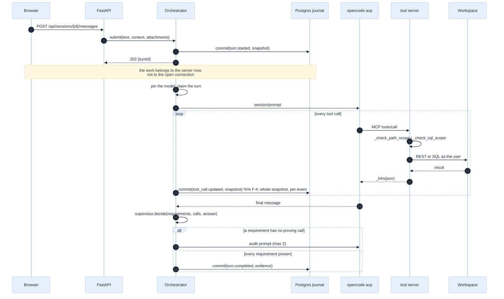

[Index](README.md) · prev: [01 Method](01-method-and-evidence.md) · next: [03 Against Genie Code](03-comparison-genie-code.md)

# 02 · OpenGenie, measured

What the product is, in numbers, and the **seventeen** findings (eleven from reading the request path,
six from exhausting the state machines). Each names the file and line, what
the code actually does, how it was measured, what it costs, and how to fix it. The fixes are
*specified* in [08](08-requirements.md) and *scheduled* in [11](11-implementation-plan.md); this page
only establishes the truth.

> **Status of the seventeen: fixed and proved.** All of them were implemented in the same session that
> wrote this assessment, with `1 525` Python tests and `974` front-end tests passing, and five E2E scenes
> whose screenshots were inspected ([e2e/screenshots](e2e/screenshots/README.md)).
>
> **How to read a `BEFORE` block.** Where a finding quotes the code that was wrong, the block is marked
> `# BEFORE — 2063af3` and shows the *historical* text, because a finding must show the defect it names.
> The fix is named in each finding's **Fix's shape**, and `[R-n]` in [08](08-requirements.md) carries the
> statement that is now true. A block marked `BEFORE` is **not** a claim about the current tree — the
> citation verifier only holds `path:line` blocks (the current code) to be verbatim.

---

## 1 · What the product is, in one page

A single Databricks App that hosts a coding agent for one workspace. One `uvicorn` process serves a
React front end and the HTTP API. For each conversation it starts **two child processes** — an ACP
coding agent and a loopback MCP tool server — and records every state change in **Postgres** so a
closed tab, a reload, or a restarted container never loses work.

| Layer | Reality, counted on `2063af3` |
|---|---|
| API | FastAPI, **6 routers in 7 files**, **82 routes** |
| Domain | **28 pure modules**, no I/O: the fence, the supervisor, the evidence rules, the three deletion rules, the model policy, the notebook model, the run map |
| Services | **12**: orchestrator, model registry/resolver/service, credential service, blobs, context, catalogue, health, identity, python runs, run bridge |
| Ports | **13 protocols in one file** — the only contracts the domain and services see |
| Adapters | **45 files**: ACP runtime, MCP registry, 11 Databricks REST browsers, LLM providers (4), LLM store + vault, durable journal (Postgres/SQLite), blob store, fake agent |
| Tool server | **41 tools**, **28 advertised** per session (`core`), 4 skills |
| Front end | React 19, CodeMirror 6, **55 non-test domain modules**, 69 test files, **959 tests** |
| Journal | Two tables — `agent.session_snapshot` (one row per session, the whole projection) and `agent.session_event` (one row per event, `seq 1..n`) |
| Model catalogue | **13 models over 4 providers** seeded, plus discovered serving endpoints; **7 steps** from an id to a spawnable process |

### 1.1 The three promises, and whether the code keeps them

| Promise | Where it lives | Verdict |
|---|---|---|
| **The model is a setting** | `api/services/model_resolver.py` (7 steps), `seed/llm_models.yaml`, `api/adapters/llm/vault/` | **Kept.** 13 models, 4 providers, envelope-encrypted per-user keys, a turn pins the model it used and never rewrites it (`orchestrator.py:902-921`) |
| **Writes stay inside the fence** | `api/domain/scope.py`, `tools/…:375-431`, `api/adapters/mcp/registry.py:55-80` | **Partly.** The path fence is enforced by the tool server; the *SQL* fence fails open with no schema (`F-1`); the app-side rules have no production caller (`F-7`); writes are unconditionally enabled (`F-8`) |
| **Done means proven** | `api/domain/supervisor.py`, `api/domain/evidence.py`, `web/src/components/MissionScreen.tsx` | **Kept, and unusual.** A claim is matched to a *completed* tool call; an unproven requirement triggers an audit pass, then `blocked` with the gap named. Measured in this repo: 19% → 94% on the same tasks |

The third is the product's real differentiator. [04](04-comparison-best-agents.md) shows that no
market coding agent ships it.

---

## 2 · The agent loop, as it runs



The `%%` comments in the diagram are deliberate: the sequence is correct and the *cost* of the
`commit` arrow is `F-4`.

---

## 3 · The tool surface: what the agent can actually do

41 tools, of which 28 are advertised per session. The 13 outside `core` exist in `full` and are
reachable because a skill names them (a test holds this: `tests/test_tools_fence.py:229-250`).

```
READS                                     WRITES (NBMCP_ALLOW_WRITES=1, always on in the app)
  Unity Catalog                             workspace
    dbx_list_tables*                          dbx_write_notebook*
    dbx_describe_table*                       dbx_write_file*
    dbx_search_tables*                        dbx_create_job*
    dbx_sample_rows                           dbx_run_job*  (idempotency token)
    dbx_table_lineage                         dbx_run_notebook*  (bridge → app SP)
    dbx_grants                                dbx_create_pipeline*
    dbx_list_catalogs                         dbx_start_pipeline*
    dbx_list_schemas                          dbx_stop_pipeline*
  SQL                                         dbx_pipeline_edit
    dbx_run_sql*                              dbx_lakebase_create*
  notebook                                    dbx_lakebase_branch*
    dbx_read_notebook*  (offset/next_offset)  dbx_lakebase_database
    dbx_grep_notebook*  (no_matches)          dbx_lakebase_role
    dbx_run_notebook_status*                  dbx_lakebase_compute
  jobs                                        dbx_create_app*
    dbx_list_jobs*                            dbx_lakebase_sql*
    dbx_job_run_status*                       dbx_lakebase_tables
    dbx_job_failure_context*
  pipelines                                 META
    dbx_list_pipelines                        dbx_skill*  (4 playbooks)
  infra                                       dbx_whoami*
    dbx_list_warehouses                       dbx_app_health*
    dbx_lakebase_status*                      dbx_lakebase_list
                                              dbx_lakebase_database
   * = in `core` (28)
```

**What is missing from this list is the point of [05](05-gaps-and-improvements.md).** There is no git
tool, no `dbt`, no file-system tool for the user's *repo* (the workspace is reachable, a cloned repo's
files only as workspace objects), no lineage write, no dashboard tool, no MLflow tool, no
documentation-search tool (so no citations, which Genie Code has), and no
`system.ai.genie_one_mcp` call despite declaring the `genie` scope.

---

## 4 · The scale of the thing

Numbers a reviewer asks for, each with its command in [01 §5](01-method-and-evidence.md#5--reproducing-this-page).

| Dimension | Value | Consequence |
|---|---|---|
| API : front-end lines | 18 132 : 26 857 | the front end carries most of the *rules*, deliberately: the run map, the fence verdict rendering, the cell prompt, the reconnect reconciliation are pure functions with tests |
| Domain : total | 28 modules of 45 python-file adapters | the safety rules are testable in milliseconds, which is why `test_domain.py` runs in 0.1 s |
| Tests : source | 1 303 : 18 132 (Python), 959 : 26 857 (TS) | ~1 test per 14 lines of Python, ~1 per 28 of TypeScript |
| Tool schemas per request | 28 tools, ~7 k characters of schema | paid on **every** turn; the reason the budget is a test |
| Events per turn | 1 per delta + 1 per tool update | see `F-4`: each one costs a full snapshot write |
| Sessions kept live | 8 (`APP_REAP_KEEP_MINIMUM`) | the 9th idle session is archived; its journal stays |
| Turns per session | 200, **hardcoded** | `settings.max_turns_per_session` exists and has no reader (`F-10`) |

---

## 5 · The eleven findings from the request path

Each is: **what the code does**, **how it was established**, **what it costs**, **the fix's shape**
(specified in [08](08-requirements.md), scheduled in [11](11-implementation-plan.md)).

---

### `[F-1]` The tool-server fence fails open when a session has no schema

**Kind: defect (safety).** The single most important finding in this set.

**Three separate escapes, all in the same 80 lines.**

1. **`_check_sql_scope` returns `None` when no schema is configured.**

```text
# BEFORE — 2063af3, tools/databricks_notebook_mcp.py:375-378
def _check_sql_scope(sql: str) -> str | None:
    """Return an error string if any write target is outside the write scope."""
    if not WRITE_SCHEMAS:
        return None
```

   `None` means "allowed". So a session created with `schema: null` can `DROP TABLE main.production.sales`.
   The app's own rule disagrees and says `ASK` — but nothing in the request path calls the app's rule
   (`F-7`).

2. **`NBMCP_WRITE_PATHS` is `folder.rstrip("/") + "/"`, and both `"/"` and `""` become `"/"`.**

```text
# BEFORE — 2063af3, api/adapters/mcp/registry.py:64-65
            "NBMCP_WRITE_SCHEMAS": schema or "",
            "NBMCP_WRITE_PATHS": folder.rstrip("/") + "/",

# AFTER — the same two lines now ask fence_rules, which answers "" for a root
#   registry.py:69-70
            "NBMCP_WRITE_SCHEMAS": writable_schema(schema),
            "NBMCP_WRITE_PATHS": writable_folder(folder),
```

   `"/".rstrip("/")` is `""`, so `"" + "/"` is `"/"` — a prefix every absolute workspace path matches.
   `Scope.for_session` already handles this correctly for the app side (`scope.py:56-60`, "an empty
   folder stays empty … a root folder is a wildcard, so the distinction matters"), and the registry
   **re-introduces the wildcard one layer down**. The comment on the very next lines is about a
   different fence that "works only because two strings happen to match"; this one matches every
   string.

3. **`_check_path_scope` treats an empty prefix list as "no restriction".**

```text
# BEFORE — 2063af3, tools/databricks_notebook_mcp.py:424-431
    normalised = path.replace("\\", "/")
    while "//" in normalised:
        normalised = normalised.replace("//", "/")
    if ".." in normalised.split("/"):
        raise PermissionError(f"write blocked: {path} contains '..' and is not a real location "
                              f"inside {WRITE_PATHS}")
    if WRITE_PATHS and not any(normalised.startswith(p) for p in WRITE_PATHS):
        raise PermissionError(f"write blocked: {path} outside allowed paths {WRITE_PATHS}")
```

   With `WRITE_PATHS == ["/"]`, the guard is true for every path, so `startswith("/")` is true.
   Measured: `/Users/victim/x.py` is "in scope".

**Measured.** §2.1 of [01](01-method-and-evidence.md), output quoted: app says `ask`, tool says
`in scope`, for both a path and a `DROP TABLE`.

**Cost if ignored.** The product's headline promise is "writes stay inside the fence". A workspace
where sessions are created without a schema — the common case for someone who just wants the agent to
read and analyse — is a workspace where the agent can write anywhere the *user* can. That is not a
privilege escalation (Unity Catalog still applies), but it is the entire difference between "the
agent is confined" and "the agent is not".

**Why the existing parity test did not catch it.** `tests/test_fence_parity.py` constructs a scope
with a *populated* folder and schema (`FOLDER = "/Users/me/agent_scratch"`, `SCHEMA = "main.agent_scratch"`)
and never tests the empty case. The table's `SQL_CASES` therefore includes `INSERT INTO t VALUES (1)` →
`ask` for the app, which passes because the app's fallback is correct; there is no row for the tool
server with an empty `WRITE_SCHEMAS`, and no row with `WRITE_PATHS == ["/"]`.

**Fix's shape.** Three properties, and they belong in a test table before they belong in code:
*no scope means no write* (not "any write"); `WRITE_PATHS` of `"/"` is refused with the reason; the
registry never emits a wildcard. `[R-1]`, `[R-2]`, `[RB-2]`.

---

### `[F-2]` A truncated tool result is not JSON

**Kind: defect (correctness, silent).**

```text
# BEFORE — 2063af3, tools/databricks_notebook_mcp.py:279-284
def _trim(payload: Any) -> str:
    """Serialise and cap, so a wide catalog dump cannot blow the context."""
    text = json.dumps(payload, indent=2, default=str)
    if len(text) <= MAX_CHARS:
        return text
    return text[:MAX_CHARS] + f"\n... [truncated, {len(text)} chars total]"
```

The cut is at an arbitrary byte, so the result is a JSON document with a dangling key, an unclosed
brace, and — measured — **a control character**, because the slice lands mid-escape:

```
JSONDecodeError: Invalid control character at: line 204 column 29 (char 6000)
```

**Cost if ignored.** An agent that tries to parse the result fails in a way that looks like a tool
bug; an agent that reads it as prose sees a table list that ends mid-word and may answer from the
fragment. This is precisely the *class* the repository already documents and already fixed twice:

> *"**Defect 2 — silent context truncation.** Our first server capped at 6 000 chars against a
> 16 840-char notebook. The agent read a third and reported 1 of 5 imports."*
> — `docs/genie-code-replacement-spec.md` §4.8

> *"**A tool that returns an empty success is more dangerous than one that raises.**"*
> — the same document, §4.11

The fix that document ships for `read_notebook` (an explicit `next_offset`, line 689) and for
`grep_notebook` (an explicit `no_matches`, line 757) was **never applied to `_trim`**, which is the
path 20+ other tools use.

**Fix's shape.** A truncation that is still parseable: keep whole array elements until the budget is
spent, and return `{"items": [...], "returned": n, "total": N, "next_offset": n}` — a *window*, not a
slice. A tool that cannot fit must say how to see the rest. `[R-3]`, `[E-3]`.

---

### `[F-3]` The agent process receives the user's workspace token

**Kind: defect (documentation contradicts code).**

```638:647:apps/coding-agent/api/services/orchestrator.py
    async def _child_env(self, live: Live, user_token: str) -> dict[str, str]:
        """The child's environment: the workspace token, plus **exactly one** provider key.

        Composing this through `CredentialService` is what makes "one key in one process" a property
        of the design rather than a habit: there is no code path here that adds a second one.
        """
        env: dict[str, str] = {}
        if user_token:
            env["DATABRICKS_TOKEN"] = user_token
        resolved = live.resolved
```

```45:45:apps/coding-agent/api/adapters/acp/runtime.py
        env = {**os.environ, **self._extra_env, **spec.env}
```

…and `spec.env` is what `create_subprocess_exec(..., env=env)` receives. The agent therefore has
`DATABRICKS_TOKEN` in its environment, and `opencode.json` refers to it —
`"apiKey": "{env:DATABRICKS_TOKEN}"` — because a Databricks model *is* authenticated by the workspace
token.

Meanwhile:

> **The agent does not hold a workspace token.** It holds a loopback URL to the tool server.
> — `docs/08-architecture.md:147`

> the agent process itself **never receives a workspace token**
> — `docs/09-security.md:63`

**What is actually true, and why the design still holds.** The agent's *builtin* tools are denied in
two layers — `opencode.json`'s `permission` block (`agent_config.py:31,166`) and the ACP
`initialize` handshake declaring `fs: false, terminal: false` (`tests/test_agent_isolation.py` asserts
both). So the model cannot run `curl` with that token, today. But the security property is
**"no tool can reach the credential"**, and it rests entirely on deny-lists that a config change, an
agent upgrade, or a `bash: allow` in a future session would remove. The *architectural* claim — the
token is not in the agent's environment — is false.

**Cost if ignored.** A security review that reads the docs and then the code finds a contradiction,
and the reviewer's next question is "what else does the doc say that isn't true?" (Answer: `F-9`'s
"no operation is replayed", and `F-10`'s vocabulary.)

**Fix's shape.** Two options, and this spec picks the second:
(a) stop passing the token and route *model* authentication through a loopback proxy that injects it,
so the child holds only a session secret — this is what Databricks' own `ug` does for Copilot
(`ug copilot` runs Copilot against a loopback proxy; "no Databricks token is written to disk");
(b) keep the env var and **correct the documentation**, adding the deny-list as the named boundary,
and add a test that asserts the child's environment contains no token when a proxy is configured.
`[R-4]` selects (a) for a later phase and (b) immediately, because (a) is a runtime change with a
latency cost and the doc is wrong *now*. `[RB-4]` records why.

---

### `[F-4]` The journal writes the whole snapshot on every event

**Kind: defect (scale).** O(n²) in answer length.

```text
# BEFORE — 2063af3, api/adapters/durable/postgres.py:58-71
    async def commit(self, event: Event, snapshot: dict) -> Event:
        from psycopg.types.json import Jsonb
        if self._conn is None:
            raise RuntimeError("session journal was not opened during startup")
        async with self._lock, self._conn.transaction(), self._conn.cursor() as cur:
            await cur.execute("""INSERT INTO agent.session_snapshot (session_id, body, latest_seq)
                VALUES (%s, %s, 1) ON CONFLICT (session_id) DO UPDATE
                SET body=EXCLUDED.body, latest_seq=agent.session_snapshot.latest_seq+1
                RETURNING latest_seq""", (event.session_id, Jsonb(snapshot)))
            seq = (await cur.fetchone())[0]
            stored = replace(event, seq=seq)
            await cur.execute("INSERT INTO agent.session_event VALUES (%s, %s, %s)",
                              (event.session_id, seq, Jsonb(stored.to_dict())))
        self.publish(event.session_id, stored.to_dict())
        return stored
```

`_snapshot()` includes `turns`, and a turn includes its `answer`. So every `message.delta` writes the
**entire answer so far** — twice, in fact: once as the snapshot, once as the event body. Nothing
coalesces. `_drain` emits every item (`orchestrator.py:1055`), and the mapper produces one
`message.delta` per `agent_message_chunk` (`mapper.py:108-112`).

**Measured** (§2.2 of [01](01-method-and-evidence.md)):

| Quantity | Value |
|---|---|
| Snapshot after one turn (60 k answer, 40 k context) | **121 088 bytes** |
| Deltas for that answer at ~4 chars each | **15 000** |
| Bytes written, one turn | **≈1.8 GB** |
| Bytes written, ten turns | **≈18 GB** |

**Cost if ignored.** Three, in order of when they bite:
1. **Latency.** Every commit is a round trip *and* an `asyncio.Lock` acquisition, in the hot path of
   the stream. At 15 000 commits per turn the turn cannot stream faster than the database.
2. **Storage.** An 18 GB conversation is a conversation you cannot keep for the audit trail the
   product promises.
3. **`since()` cost.** `agent.session_event` grows by one row per delta, and a reconnect replays from
   `?after=0` (`useSessionStream.ts:166`), so a reconnect reads the whole thing.

**Fix's shape.** Separate the two concerns the current `commit` conflates:
* **`agent.session_event`**: append-only, one row per event, cheap. Keep it exactly as is.
* **`agent.session_snapshot`**: a *checkpoint*, written every N events or T seconds, never on every
  event. `latest_seq` moves with the event insert, not the snapshot.
And coalesce at the source: accumulate `message.delta` for ≤100 ms / ≤2 KB and emit one
`message.delta` with the accumulated text. Both are `[R-5]`, `[R-6]`, `[E-6]`.

---

### `[F-5]` The browser copies the whole answer on every delta

**Kind: defect (scale), the client mirror of `F-4`.**

```164:171:apps/coding-agent/web/src/domain/events.ts
export const MAX_ANSWER = 200_000;

/** Append a delta, keeping the newest text and saying so when the start was dropped. */
export function append(current: string, delta: string, max: number): string {
  const next = current + delta;
  if (next.length <= max) return next;
  return "…" + next.slice(next.length - max);
}
```

Called from `case "message.delta"` (`:218`) on every delta. At 15 000 deltas, the tab builds and
discards 15 000 strings whose total length is quadratic — for a 60 k answer, ~450 M characters copied.

**Cost if ignored.** A long turn stutters, and the reducer is the one place the product cannot afford
to be slow, because it runs **inside React's state update**. The comment on `MAX_ANSWER` says "long
enough for any report"; the mechanism does not scale to that report.

**Fix's shape.** The coalescing in `F-4` fixes both ends at once (fewer, larger deltas). Independently,
the reducer can keep `answer` as a *chunk list* and join at render, or — simpler and measured — accept
that ≤100 ms coalescing reduces deltas by ~2 orders of magnitude and keep the string. `[R-6]`
takes the first, and `[E-7]` records the fallback.

---

### `[F-6]` Conversations are listed in random order

**Kind: defect (small, high-visibility).**

```302:307:apps/coding-agent/api/services/orchestrator.py
            (live.state.session for live in self._live.values()
             if live.state.session.user_id == user_id
             and live.state.session.status is not SessionStatus.ARCHIVED),
            key=lambda s: s.id,
            reverse=True,
        )
```

and an id is `uuid4().hex[:16]` (`:455`). Measured: five random ids, `sorted(desc) == ids` is `False`.

**Cost if ignored.** The rail groups by day (correctly — `sessions.ts:35-45`) and then orders *within*
a day by a random string. With 20 conversations in a week the list is visibly wrong, and the docstring
says the opposite, so a reader trusts it. It is also the first thing a user notices and the last thing
anyone reports as a bug, because it looks like "the list is just a list".

**Fix's shape.** Sort by `created_at` (it is on `Session` and already serialised as `createdAt`), with
the id as a deterministic tie-breaker. One line plus a test. `[R-7]`.

---

### `[F-7]` The app-side fence has no production caller

**Kind: defect (architecture claim untrue).**

`api/domain/scope.py` is the app's fence: `check_sql`, `check_path`, `check_job`, `check_app`,
`check_instance`. `rg -n "check_sql\(|check_job\(|check_app\(|check_instance\(" api tools` returns the
definitions and **tests only**. `check_path` is wired (`api/routers/api.py:754,782`), the other four
are not.

The spec that introduced them says the opposite:

> Two implementations of one fence rule, held to one table. … If either side changes alone, a row here
> fails and names which.
> — `tests/test_fence_parity.py:1-8`

That is true of the *test*. It is not true of the *product*: the request path has one fence (the tool
server's), and it is the one `F-1` shows to fail open.

**Cost if ignored.** A reviewer reading `docs/09-security.md` §6 concludes there are two independent
layers. There is one, plus a well-tested function that no request reaches. The parity test also gives
false confidence: it passes, so the fence "agrees with itself", while the side that actually runs has
the bug.

**Fix's shape.** Either wire it (the SQL path is the natural one: a turn's SQL would be classified
before it reaches the tool server — but the tool server is the only process that sees the SQL, so this
means a *new* bridge call, cost and latency), or **retire the dead functions** and say plainly that
the fence is one implementation, in the tool server, tested by a table. `[R-8]` picks the second and
`[RB-5]` explains why the first is expensive.

---

### `[F-8]` Writes are unconditionally on

**Kind: defect (safety posture).**

```78:78:apps/coding-agent/api/adapters/mcp/registry.py
            "NBMCP_ALLOW_WRITES": "1",
```

The tool server's own docstring says *"every mutating tool is behind `NBMCP_ALLOW_WRITES=1`. Reads
never require the flag. This mirrors Genie Code's approval modes but is enforced by the server, not by
an AI classifier"* (`tools/…:22-24`). The app sets the flag to `1` for every session, so that sentence
describes a mode the product never uses.

**What gates a write today.** Only the ACP agent's own `session/request_permission` flow — and
`opencode.json` denies the builtins, so the *only* calls that reach a permission prompt are the agent's
own judgement about the MCP tools. The tool server itself never asks. A SQL `CREATE OR REPLACE TABLE`
inside the session's schema executes.

**Cost if ignored.** The product's story is "a write outside the folder needs your approval"
(`README.md`, `docs/04-safety-and-governance.md`). Inside the schema, that is not true. Genie Code's
own documentation is at least explicit about the equivalent (`"Auto-approve is a productivity feature,
not a security boundary"`); this product's documentation is not.

**Fix's shape.** Make the flag a *policy*, not a constant: a session is created with a write mode
(`read-only`, `fenced` (writes inside the schema/folder only — today's intent), `ask` (the tool server
returns a structured "needs human" payload the app turns into an approval)). Start at `fenced`, which
preserves behaviour, and expose `read-only` in the UI. `[R-9]`, `[E-8]`.

---

### `[F-9]` A restart blocks every conversation, and an evicted one is a 404

**Kind: gap (durability UX).**

```text
# BEFORE — 2063af3, api/services/orchestrator.py:185-190
            live.state.session = updated(s, status=SessionStatus.BLOCKED, requires_resume=True)
            for t in interrupted:
                await self._emit(turn_ended(s.id, t.id, "interrupted",
                    "Server restarted. Saved progress is available; no operation was automatically repeated."))
            await self._emit(Event(s.id, "session.recovery_required", {"requiresResume": True}))
```

Every non-archived session is marked `BLOCKED + requires_resume` on boot — including sessions that
were idle and had no turn in flight. The user must press **Restore** on each one (`compose.ts` gates
sending on `requiresResume`).

And `evict_archived()` pops the projection:

```437:440:apps/coding-agent/api/services/orchestrator.py
            if self.watchers(sid) or (live.task is not None and not live.task.done()):
                continue
            self._live.pop(sid, None)
            gone.append(sid)
```

`get()` then raises `KeyError` → `404 "no such session"` (`routers/api.py:208-212`), although
`agent.session_snapshot` still holds the row. Nothing rehydrates on read.

**Cost if ignored.** Two different costs.
* An app redeploy — which is every release — turns every conversation into a "needs attention" banner.
  Honest, but it teaches users that the app is fragile.
* Archiving is the user's delete, so eviction of an *archived* session is fine. The problem is the
  *inverse*: a session the user did not archive but which was reaped (idle 30 min) keeps
  `requires_resume` and cannot be resumed without a click, and there is no lazy path at all for the
  evicted case. The audit trail survives; the *product* does not surface it.

**Fix's shape.** Distinguish "was mid-turn" from "was idle" on boot: only the former becomes
`requires_resume`; the latter becomes `ready` with the agent lazily provisioned on the next message.
The state machine already permits `blocked -> ready` (`session.py:51`). For the evicted case, a lazy
`get()` that rehydrates from the snapshot. `[R-10]`, `[E-9]`.

---

### `[F-10]` There is no context compaction

**Kind: gap (capability).**

`session.compacted` is one of the 27 event names (`api/domain/events.py:37`), declared in the
TypeScript union, present in `event-parity.json`, and **emitted by nothing** (`rg '"session.compacted"' api` →
the declaration only). So:

* A long conversation has no mechanism to shed history before the model's window.
* The only limit is `MAX_TURNS = 200`, hardcoded at `orchestrator.py:64`, while
  `settings.max_turns_per_session` (`config.py:100`) has **no reader**.

**Cost if ignored.** The failure is not a clean error. At the window boundary the provider truncates,
the agent loses the earlier turns, and the supervisor's evidence check then reports *"requirements
without verified evidence"* for work that was done — the worst possible message, because it is
literally true and completely misleading. Genie Code's command centre and Cursor and Claude Code all
handle this with compaction; the vocabulary here anticipates it and the code does not.

**Fix's shape.** Two parts:
* **Wire the setting** to `MAX_TURNS` (one line, one test).
* **Emit `session.compacted`** when history is summarised, and make the summary a first-class
  projection field so a replay reconstructs it. `[R-11]`, `[E-10]`.

---

### `[F-11]` The ledger read is O(every conversation ever)

**Kind: defect (scale, small).**

```176:184:apps/coding-agent/api/adapters/mcp/registry.py
                or os.path.join(tempfile.gettempdir(), "agent-ledgers"))
    rows: list[dict] = []
    try:
        for path in sorted(root.glob("*.jsonl")):
            session = path.stem
            for line in path.read_text(encoding="utf-8").splitlines():
                if not line.strip():
                    continue
                try:
```

and `routers/jobs.py:110-120` returns **all** of it; the client then filters by session.

**Cost if ignored.** One page load parses every ledger file. At 1 000 conversations with ~10 rows
each that is 10 000 JSON parses per request, on the main thread of an async server. It is a small
thing that becomes the reason a page is slow, and it is invisible in a demo.

**Fix's shape.** `read_ledger(session_id)` — one file, by name. `[R-12]`.

---

## 6 · Why the tests did not catch these

Worth answering directly, because "1 303 tests pass" and "the fence fails open" are both true.

| Finding | Why the suite is green |
|---|---|
| `F-1` | `test_fence_parity.py` builds a scope with a **populated** folder and schema. No row tests empty `WRITE_SCHEMAS`, and none tests `WRITE_PATHS == ["/"]`. The table is right about the cases it contains |
| `F-2` | No test asserts that a trimmed payload **parses**. `_trim`'s contract is "returns a string ≤ MAX_CHARS", which is true |
| `F-3` | `test_agent_isolation.py` asserts the deny-lists (both layers). Nothing asserts what the child's environment contains |
| `F-4` | There is no test with a load, and the durability tests assert *replay correctness*, which is correct |
| `F-5` | `append()` is tested for the truncation marker, not for cost |
| `F-6` | `sessions_for` is tested for *membership* (archived sessions excluded), not order |
| `F-7` | The parity test proves the two implementations agree. Nobody asks who calls the app's |
| `F-8` | The registry's env is asserted for the prefix values, not for the policy behind them |
| `F-9` | `restore()` is tested for "no operation is replayed", which is true and is the *good* half |
| `F-10` | A vocabulary parity test proves both sides **name** `session.compacted`. Neither emits it |
| `F-11` | `read_ledger` has no test with more than one session |
| `F-12` | `finish()` is tested for **what it refuses** (a non-terminal target) and never for **where it starts**. No test asks "may a completed turn change?" |
| `F-13` | `stream.test.ts` tests `afterFailure` per status; no test asserts that every **declared** member is **reachable**. A union is not a reachability proof |
| `F-14` | the jobs fixture covers `TERMINATED` + every result (the honest reading) and every life cycle with `result: None`. The cross-product `ACTIVE × RESULT` — the one the platform actually sends — is absent |
| `F-15` | `result_from_statement` is tested for `SUCCEEDED`, `FAILED`, `CANCELED` and the timeout. `QUEUED` is a state nobody who wrote it had seen |
| `F-16` | `test_blob_retention.py` asserts each reason **at refcount 0**, which is exactly where the ordering bug cannot appear |
| `F-17` | `test_supervisor.py` asserts the table-driven path. "The work was done and the table was omitted" is a model behaviour, and no test writes an answer the model might write |

The pattern: **the tests check that each piece does what it says, and nothing checks that the pieces
say the same thing as the documentation and the user's expectation.** That is the coherence job
[14](14-coherence.md) does for the *new* work, and §6 is the argument for doing it at all.

**The six state-machine findings share a second, sharper pattern**, and it is worth naming because it
predicts where the next one is: each was found by taking a **product** the code never takes — 8 statuses
× 5 targets, 6 life cycles × 10 results, 5 states × 3 refcounts — where the existing tests take the
**diagonal** of that product. A state machine's tests should enumerate its axes, not sample them.

---

## 7 · Documentation drift
Not findings about behaviour; findings about *claims*, which matter because this repository's
credibility rests on its documents being checkable.

| Claim | Where | The truth |
|---|---|---|
| `web/src/domain/reduce.ts` is the reducer | `docs/08-architecture.md:660,770` | The file does not exist. `reduce()` lives in `web/src/domain/events.ts:169` |
| "959 assertions (front-end)" | `docs/08-architecture.md:681` | 959 **tests** in 69 files; the suite contains 1 594 `expect(` calls |
| "the agent does not hold a workspace token" | `docs/08:147`, `docs/09:63` | `F-3` |
| "every session that was mid-turn lands here with requiresResume" | `docs/08:413-417` | Every non-archived session lands there, mid-turn or not: `F-9` |
| "27 types, in one place" | `docs/10-data-model.md:139` | True — and one of the 27 is emitted by nobody: `F-10` |
| "the model is a setting … 13 models from 4 providers" | `README.md` | True; verified against `seed/llm_models.yaml` (13 ids, 4 provider ids) |
| "1 303 Python tests · 959 front-end · 162 site views" | `README.md` badge | Python and front-end verified. Site views not re-run for this assessment |

The drift is small and the documents are unusually honest, which is exactly why the four that are
wrong matter: a reader has been trained to trust them.

---

## 8 · Six state-machine defects, proved by exhaustion

Every state machine in `api/domain/` and `web/src/domain/` was enumerated for this section: each
transition was attempted against the real code, not read off a diagram. The six below are what the
enumeration produced. The full matrices, and the diagrams they corrected, are in
[07 · Diagrams](07-diagrams.md).

### `[F-12]` `finish()` has no source-state guard, so a settled turn can be rewritten

`Turn.start()` refuses anything that is not `QUEUED` or `INTERRUPTED` (`session.py:108-111`).
`Turn.finish()` refuses only a **non-terminal target** (`session.py:113-121`) — it never looks at where
the turn currently is.

```
>>> Turn(status=COMPLETED).finish(TurnStatus.INTERRUPTED, error="timeout").status
<interrupted>
>>> Turn(status=CANCELLED).finish(TurnStatus.COMPLETED).status
<completed>
```

Measured over the whole matrix: **every one of the 8 statuses may finish as any of the 5 terminal
statuses**, including `completed → cancelled` and `cancelled → completed`.

**Why it is reachable, not theoretical.** The timeout handler finishes a turn *by id* after unwinding:

```1073:1073:apps/coding-agent/api/services/orchestrator.py
            live.state.update(turn.finish(TurnStatus.INTERRUPTED, error="The runtime or delegated credential limit was reached."))
```

`next(t for t in live.state.turns if t.id == turn_id)` is the turn as it is *now*. If the turn had
already settled — a race between `_settle` and the `asyncio.timeout` firing on the same tick — this line
rewrites a `completed` turn to `interrupted`, and emits `turn.interrupted` for work that finished. The
journal then holds a `turn.completed` **and** a `turn.interrupted` for one turn, and the reducer's last
one wins (`events.ts:283-293`), so the user is told their successful turn was interrupted.

**Cost.** A turn's terminal state is the product's record of what happened. `[F-12]` is the only finding
in this set where two conflicting records can exist for one turn, and the second is a lie.

**Fix's shape.** `finish()` refuses a transition out of a terminal status (the mirror of `start()`), and
the timeout path reads the status before finishing. `[R-26]`.

### `[F-13]` `closed: "offline"` is a declared state that nothing can enter

```text
# BEFORE — 2063af3, web/src/domain/stream.ts:25-34
export type ClosedReason =
  | "not-found"
  | "cursor-ahead"
  | "rejected"
  /** No HTTP status at all and the browser is offline. Transient. */
  | "offline";        // <- declared, and afterFailure can never produce it
```

and `afterFailure` returns `reconnecting` for every offline case, by design and with a comment saying so
(`stream.ts:74-82`). Measured by breadth-first search over every `(status, online)` pair: the reachable
set is `{idle, connecting, live, reconnecting, closed:not-found, closed:cursor-ahead, closed:rejected}`
— **`closed:offline` is absent**.

Two consequences, and the second is the one that matters:
1. `CLOSED_DETAIL.offline` (`stream.ts:113-117`) is dead copy, and a reader believes offline is handled
   there.
2. The TypeScript union no longer tells the truth about the machine, so `describe()`'s `switch` looks
   total over a state that cannot occur.

**Fix's shape.** Delete the member, or make `describe`'s exhaustive check the only place the set is
declared so an unreachable member is a compile-time error. `[R-27]`.

### `[F-14]` An active run with a `result_state` reads as finished, with a Cancel button beside it

`run_word(life_cycle, result)` prefers `result` whenever it is present (`jobs.py:213-216`). But
`result_state` is documented as terminal-only, and the API does send it on `TERMINATING`. Measured over
the full `ACTIVE × RUN_RESULT` grid: **24 of 60 combinations** produce a terminal word — `succeeded`,
`failed`, `timed out`, `canceled` — while `can_cancel(life_cycle)` is simultaneously `true`
(`jobs.py:267-270`).

```
TERMINATING + SUCCESS  -> word "succeeded", tone "good", can_cancel True
RUNNING     + FAILED   -> word "failed",    tone "bad",  can_cancel True
```

**Cost.** A page shows a green "succeeded" and an enabled Cancel for the same run. That is the exact
class of defect the module's own docstring warns about — *"the field that is convenient is never the
field that is honest"* — inverted: here the honest field is read when it should not be.

**Fix's shape.** The word is a function of **both**: while the life cycle is active, the life cycle
decides; only a terminal life cycle lets `result` decide. `[R-28]`.

### `[F-15]` A `QUEUED` statement is reported as failed, because the fallthrough is `FAILED`

```text
# BEFORE — 2063af3, api/domain/cellrun.py:149-162
    if state in {"PENDING", "RUNNING"}:
        return RunResult(state=RunState.RUNNING, ...)
    if state == "CANCELED" or state == "CANCELLED":
        return RunResult(state=RunState.CANCELLED, ...)
    message = ((status.get("error") or {}).get("message") or "").strip()
    return RunResult(
        state=RunState.FAILED, seconds=waited, statement=statement,
        error=message[:400] or f"the warehouse reported {state or 'an unknown state'}",
    )
# ^ QUEUED is not in either set, so it lands here: failed, with no message.
```

`QUEUED` is a legitimate state of the Statements API and is not in either set, so it lands in the
fallthrough with **no error message**: measured, `QUEUED → failed, "the warehouse reported QUEUED"`.

**Cost.** A user who runs a cell and sees it fail, with the engine's own word as the "reason", retries —
and it fails again the same way. The correct behaviour is to wait, which the code already does for
`PENDING` and `RUNNING`.

**Fix's shape.** `QUEUED` joins the waiting set; a state that is neither known-waiting, known-success,
known-cancelled nor known-failed becomes a **distinct** outcome (not `failed`) with a sentence naming the
state, so an unknown future state cannot masquerade as a failure. `[R-29]`.

### `[F-16]` `KEPT_REFERENCED` also means "I did not understand this state"

`retention()` checks the refcount **first** (`retention.py:75-79`), so a row with an unknown state *and*
a reference reports `a turn references it`. Measured: `state="a-future-state", refcount=1` →
`KEPT_REFERENCED`, while the same row with `refcount=0` reports `its state is not one this policy
understands`.

**Why a *reason* that is wrong matters here more than elsewhere.** This module's whole argument is that a
destructive decision must be assertable *by why*, not by a boolean (`retention.py:46-56`,
`tests/test_blob_retention.py`). A test asserting "unknown states are kept for the right reason" passes
vacuously for any referenced row.

**Fix's shape.** The unknown-state check comes **first**, so the two reasons are distinguishable. Nothing
is swept differently — both keep — but the reason becomes true. `[R-30]`.

### `[F-17]` An agent that did the work but omitted the table is `blocked`

`supervisor.decide` matches claims to calls through `parse_evidence_block(answer)`. If the agent
completed `dbx_write_notebook` **and** `dbx_run_notebook` and wrote a correct prose answer but did not
append an `EVIDENCE` table, `rows` is empty, so every requirement is a gap → `AUDIT` → `BLOCKED`.

Measured:

```
2 completed calls + prose answer, audits=0   -> audit
2 completed calls + prose answer, audits=2   -> blocked, missing = both requirements
2 completed calls + an EVIDENCE table        -> done, 2 evidence rows
```

**Cost.** The product's strongest promise — *"done means proven"* — is enforced by the **agent's own
report**, so a compliant agent that forgot to tabulate is told it failed. That is a false negative in the
one place the product is supposed to be better than its competitors.

**Why the audit loop mostly hides it.** The `AUDIT_PROMPT` explicitly demands the table
(`supervisor.py:48-53`), so two passes usually fix it. `[F-17]` is what happens when they do not,
and `[E-6]` records the mirror case (a real call with a fabricated summary passes).

**Fix's shape.** When the calls prove more than the claims name, the supervisor may *derive* rows from
the completed calls that name an artifact — but only for requirements whose tool mapping is known, and
never to override a gap. That is a narrow change, and `[E-6]` bounds it. `[R-31]`.

> **Two more were found and are *not* requirements**: `SKIPPED + FAILED → can_repair == True` (a Repair
> button on a run that never ran) and `SUCCESS_WITH_FAILURES` is unpairable while its tone is `bad`
> (`jobs.py:273-275`). Both are recorded as `[E-26]`/`[E-27]` and left in phase 3, because neither can
> lose data and both need a product decision about what "repair" means for a partially failed run.

Next: [03 · Against Genie Code](03-comparison-genie-code.md).
