[Index](README.md) · prev: [06 Wireframes](06-wireframes.md) · next: [08 Requirements](08-requirements.md)

# 07 · Diagrams — and the state machines, exhausted

Every state machine in the code, drawn from the transitions the code actually permits, **and proved**
by enumerating them. A diagram in this document is not an illustration of an intention; it is a
transcription of a transition table that was executed.

How that was done, and how to redo it: [§16](#16--reproducing-every-proof) and the `tools/` folder in
this set.

Every diagram is parsed by `node scripts/verify-spec-mermaid.mjs` in the gate, because a diagram that
does not render is worse than no diagram.

**Legend.** Blue = exists and is correct. Green = new in this plan. Amber = a state or transition that is
**wrong today** and has a finding. Red = a refusal or a lost-work path. Purple = a decision that is a
pure function with a test.

---

## 1 · The eleven machines, and which are broken

The code contains eleven state machines. That is not an accident of style: `api/domain/` is 28 pure
modules and `web/src/domain/` mirrors the ones the UI must agree with. Ten are enumerated in this
document; the eleventh (the model catalogue) is a table, not a machine, and is in §14.

| # | Machine | Located in | States | Verdict |
|---|---|---|---|---|
| **M1** | Session | `api/domain/session.py:14-52` | 6 | ✓ sound — one finding in *usage* (`F-9`) |
| **M2** | Turn | `api/domain/session.py:23-126` | 8 | ⚠ **`F-12`**: `finish()` has no source-state guard |
| **M3** | Stream | `web/src/domain/stream.ts:35-40` | 5 (+4 reasons) | ⚠ **`F-13`**: `closed:offline` unreachable |
| **M4** | Mission (derived) | `web/src/domain/mission.ts:117-135` | 14 | ✓ total over its inputs |
| **M5** | Supervisor verdict | `api/domain/supervisor.py:16-19` | 4 | ⚠ **`F-17`**: a false `blocked` |
| **M6** | Job run | `api/domain/jobs.py:29-70` | 9 + 10 results | ⚠ **`F-14`**: 24 contradictory cells |
| **M7** | Pipeline / update | `api/domain/jobs.py:41-52` | 9 + 10 | ✓ but `IDLE` is ambiguous by design |
| **M8** | Cell run | `api/domain/cellrun.py:28-33` | 5 | ⚠ **`F-15`**: `QUEUED` reads as failed |
| **M9** | Blob retention | `api/domain/retention.py:46-86` | 5 dispositions | ⚠ **`F-16`**: a reason that lies |
| **M10** | Reaper / projection | `api/domain/reaper.py`, `projection.py` | 5 + 5 | ✓ sound |
| **M11** | Approval token | `api/domain/approval.py` | valid·expired·tampered | ✓ sound |
| — | Scaffold step | `api/domain/scaffold.py:26-29` | 4 | ✓ sound |
| — | Fence verdict | `api/domain/scope.py:38-41` | 3 | ⚠ **`F-1`** in the unset case |

**Six of fourteen are wrong**, and each wrong one was found by enumerating it rather than by reading it.
That is the argument for this document's shape.

---

## 2 · M1+M2 · Session and turn: where the work lives

Two machines, one owner. A session is a container; a turn is a unit of work inside it. They are drawn
together because every turn transition has a session consequence, and drawing them apart invites a
transition that no one notices breaks the other.

### 2.1 The session

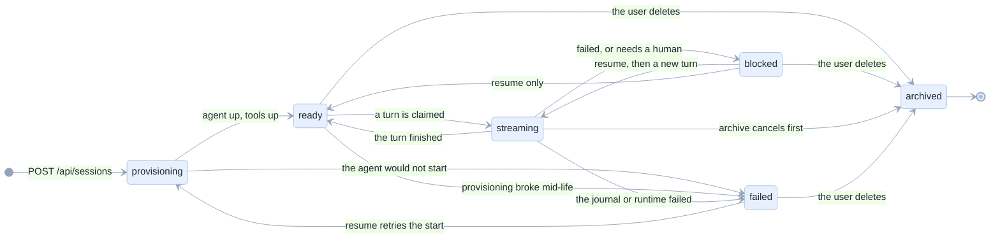

**Proved, not asserted.** The transition table was read out of `_ALLOWED` and closed under reachability:

| From ↓ to → | provis | ready | stream | blocked | archived | failed |
|---|---|---|---|---|---|---|
| **provisioning** | = | ok | — | — | — | ok |
| **ready** | — | = | ok | — | ok | ok |
| **streaming** | — | ok | = | ok | ok | ok |
| **blocked** | — | ok | ok | = | ok | — |
| **archived** | — | — | — | — | = | — |
| **failed** | ok | — | — | — | ok | = |

- **Unreachable states: none.** All six are entered from `provisioning`.
- **Absorbing states: exactly one**, `archived`. That is correct: archiving is the user's delete.
- **`blocked → failed` is forbidden**, and that is deliberate — a blocked turn is a question for a human,
  a failed session is broken machinery. They must not be confused, and the table enforces it.
- **`failed → provisioning`** is the only cycle back to the start, which is what "Resume" does.

### 2.2 The turn — with the defect drawn

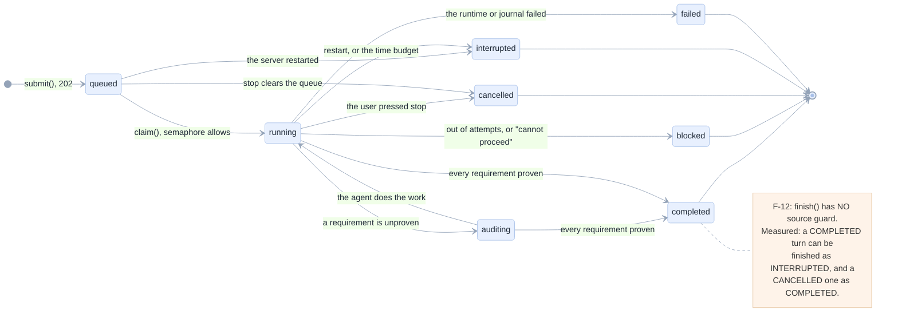

**What the enumeration found.** `start()` guards its source (`QUEUED` or `INTERRUPTED`, nothing else);
`finish()` guards only its *target* (must be terminal). Measured over all 8 statuses:

```
queued      : start=YES  finish-> completed, blocked, cancelled, interrupted, failed
running     : start=no   finish-> completed, blocked, cancelled, interrupted, failed
auditing    : start=no   finish-> completed, blocked, cancelled, interrupted, failed
completed   : start=no   finish-> completed, blocked, cancelled, interrupted, failed   <-- F-12
blocked     : start=no   finish-> completed, blocked, cancelled, interrupted, failed   <-- F-12
cancelled   : start=no   finish-> completed, blocked, cancelled, interrupted, failed   <-- F-12
interrupted : start=YES  finish-> completed, blocked, cancelled, interrupted, failed
failed      : start=no   finish-> completed, blocked, cancelled, interrupted, failed   <-- F-12
```

The last four rows are the defect: for every terminal state, `finish()` accepts any terminal target.

**How it happens in production.** Not by a caller being careless — by a race the code already contains:

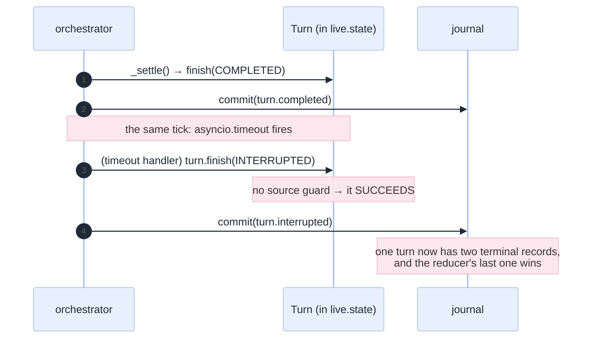

The fix is one guard, and the diagram after it is the one in §2.2 with the `note` removed.

### 2.3 The turn machine *after* `[R-26]`

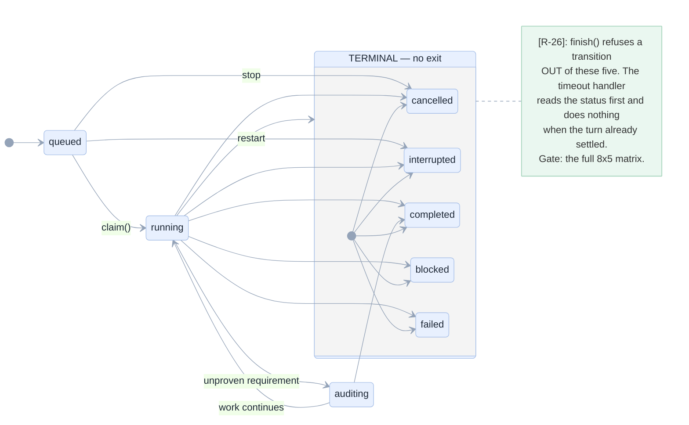

---

## 3 · M3 · The stream — and a state nothing can enter

The machine that decides whether a user is told to wait for something that is never coming. It is the
best-documented machine in the codebase (`stream.ts:1-21`) and it still has a hole.

### 3.1 As built

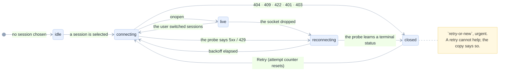

### 3.2 The reachable set, computed

A breadth-first walk from `idle` over every `(status, online)` pair the hook can observe
(`null, 200, 401, 403, 404, 409, 422, 500, 503, 0` × `online, offline`) produced exactly:

```
reachable: idle, connecting, live, reconnecting,
           closed:not-found, closed:cursor-ahead, closed:rejected
missing  : closed:offline          ← F-13
```

And for every declared state, the description it produces — checked for totality, because
`describe()`'s `switch` has no `default` and a missing branch would be a blank screen:

| State | word | action | urgent |
|---|---|---|---|
| `idle` | — | none | no |
| `connecting` | "connecting" | none | no |
| `live` | — | none | no |
| `reconnecting` | "reconnecting…" | retry | no |
| `closed:not-found` | "session closed" | retry-or-new | yes |
| `closed:cursor-ahead` | "session closed" | retry-or-new | yes |
| `closed:rejected` | "session closed" | retry-or-new | yes |
| `closed:offline` | "session closed" | retry-or-new | yes | **← unreachable**

**`F-13` in one sentence.** `afterFailure` returns `reconnecting` whenever `online` is false
(`stream.ts:74-76`, with a comment explaining exactly why) — so the `offline` member of `ClosedReason`,
its copy in `CLOSED_DETAIL`, and its row in the table above are all dead. The machine is *correct*; the
type is not.

### 3.3 The decision table, which is the real specification

The diagram is a picture of this table, and the table is what the test asserts.

| `online` | status | result | why |
|---|---|---|---|
| **false** | *any* | `reconnecting` | offline wins. A captive portal's error page must not read as "your session is gone" |
| true | `null` | `reconnecting` | no status at all: DNS, a closed port |
| true | 404 | `closed:not-found` | the session was archived or reaped |
| true | 409 | `closed:cursor-ahead` | another tab advanced it; reopen from 0 |
| true | 422 / 401 / 403 | `closed:rejected` | repeating the request repeats the refusal |
| true | 200 | n/a | `onopen` → `live` |
| true | 5xx / 429 / 0 | `reconnecting` | the server is unwell, not the request |

**The offline-first rule is the machine's most important line** and it is the one a "fix" for `F-13`
would break. `[R-27]` therefore deletes the unreachable member or makes unreachability a compile error —
it does **not** make offline reach `closed`.

---

## 4 · M4 · The mission view: 14 words from turn status plus four overrides

The UI's state is *derived*, never stored. That is why it can be total, and why it is worth drawing: it
is the only place where session status, turn status, approval presence and connection state are resolved
into one sentence the user reads.

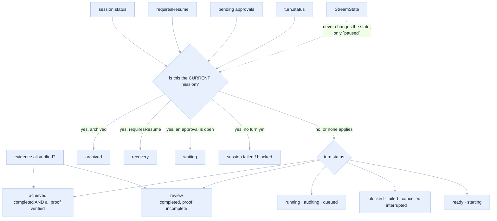

**The rule that makes it sound.** The connection **cannot** change the mission state — only the derived
`paused` flag (`mission.ts:150`). That is a deliberate inversion of the defect spec 012 fixed: a
disconnected browser used to be able to make a finished mission look unfinished. The precedence in
`missionView` is: `archived` > `recovery` > `waiting` > turn status, and `achieved` requires *all* proof
verified (`mission.ts:108-112`).

**Total by construction.** `MISSION_STATES` is a `Record<MissionState, …>` (`mission.ts:120`), so adding
a state without copy is a compile error. Enumerated: 14 declared, 14 reachable, 0 without copy.

---

## 5 · M5 · The supervisor — the machine that decides "done"

Four verdicts, five continuations, two audits. This is the machine that took a measured score from 19%
to 94%, so drawing it exactly matters.

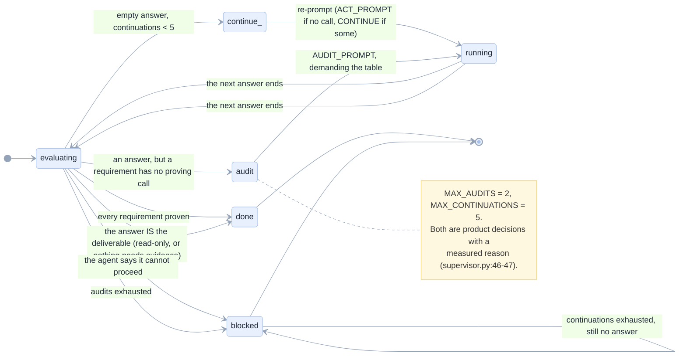

### 5.1 The verdict grid, executed

Each row is a real call to `decide()` with two requirements (`write the notebook`, `run it and quote
the result`):

| Scenario | Verdict | Why |
|---|---|---|
| empty answer, no calls | `continue` | `ACT_PROMPT`: planning is finished, call the tool |
| empty answer, 1 call in flight | `continue` | `CONTINUE_PROMPT`: it stopped mid-task |
| answer, no calls | `audit` | a claim with no call |
| answer + 2 **completed** calls, **no table** | `audit` | ← **`F-17`** |
| answer + 2 completed calls + a table | **`done`** | 2 evidence rows verified |
| answer admits "cannot proceed" | `blocked` | the agent's own words |
| read-only + attached context | `done` | the answer *is* the deliverable |
| continuations = 5, still empty | `blocked` | no final answer |
| audits = 2, still unproven | `blocked` | requirements without verified evidence |

### 5.2 `F-17` drawn: the false `blocked`

```mermaid
%%{init: {'theme':'base','themeVariables':{'primaryColor':'#E8F0FE','primaryTextColor':'#1F2937','primaryBorderColor':'#A8C0E8','lineColor':'#94A3B8','noteBkgColor':'#FDE7EF','noteBorderColor':'#F2B5CB'}}}%%
flowchart LR
    A["the agent did the work<br/>dbx_write_notebook ✓<br/>dbx_run_notebook ✓"]:::green
    B["it wrote a correct prose answer<br/>and forgot the EVIDENCE table"]:::amber
    C["parse_evidence_block(answer)<br/>returns []"]:::amber
    D["gaps() = every requirement"]:::amber
    E["AUDIT twice, then BLOCKED"]:::bad
    F["the user is told their<br/>successful turn failed"]:::bad
    A --> B --> C --> D --> E --> F
    classDef green fill:#E6F4EA,stroke:#A8D5B5,color:#1F2937
    classDef amber fill:#FFF8E1,stroke:#F2D98D,color:#1F2937
    classDef bad fill:#FDE7EF,stroke:#F2B5CB,color:#1F2937
```

`[R-31]` closes it with a **closed mapping** from a completed call's name to the requirement class it can
prove — and it can only *add* a row, never mark an incomplete call verified. The mirror case, `[E-6]`
(a real call with a fabricated summary still passes), is deliberately **not** fixed: tightening that
needs a result diff, and getting it wrong produces false `blocked` turns, which is this same failure
inverted.

---

## 6 · M6 · The job run — 9 life cycles × 10 results, and 24 contradictions

This machine has two axes and the code reads one axis too eagerly. Drawn as the **product** of the two,
because that is what the platform actually reports.

### 6.1 The life cycle, which is a real machine

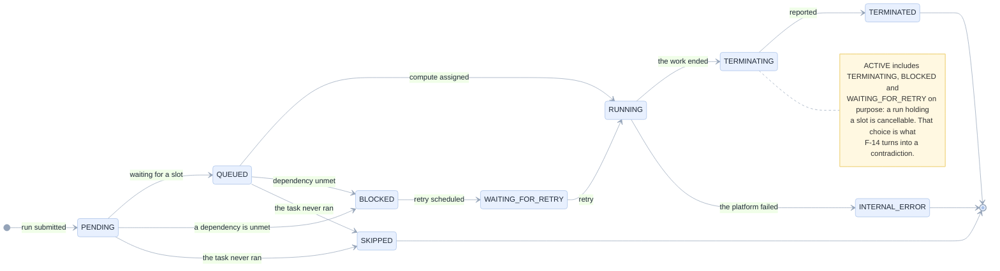

### 6.2 The contradiction, as a matrix

`run_word(life_cycle, result)` prefers `result` whenever present (`jobs.py:212-216`). But
`result_state` is documented as terminal-only, and it does arrive early. Measured over all
`ACTIVE × RUN_RESULT` pairs:

| | SUCCESS | FAILED | TIMEDOUT | CANCELED | others |
|---|---|---|---|---|---|
| **PENDING** | ⚠ | ⚠ | ⚠ | ⚠ | ⚠ |
| **QUEUED** | ⚠ | ⚠ | ⚠ | ⚠ | ⚠ |
| **RUNNING** | ⚠ | ⚠ | ⚠ | ⚠ | ⚠ |
| **TERMINATING** | ⚠ | ⚠ | ⚠ | ⚠ | ⚠ |
| **BLOCKED** | ⚠ | ⚠ | ⚠ | ⚠ | ⚠ |
| **WAITING_FOR_RETRY** | ⚠ | ⚠ | ⚠ | ⚠ | ⚠ |

**Every ⚠ is a cell where the page shows a finished word *and* offers Cancel.** 24 of 60 cells. Two
examples, quoted from the run:

```
TERMINATING + SUCCESS -> word "succeeded"  tone "good"  can_cancel True
RUNNING     + FAILED  -> word "failed"     tone "bad"   can_cancel True
```

The module's own docstring states the rule it then breaks:

> *"the field that is convenient is never the field that is honest"* — `jobs.py:6-7`

### 6.3 The machine after `[R-28]`

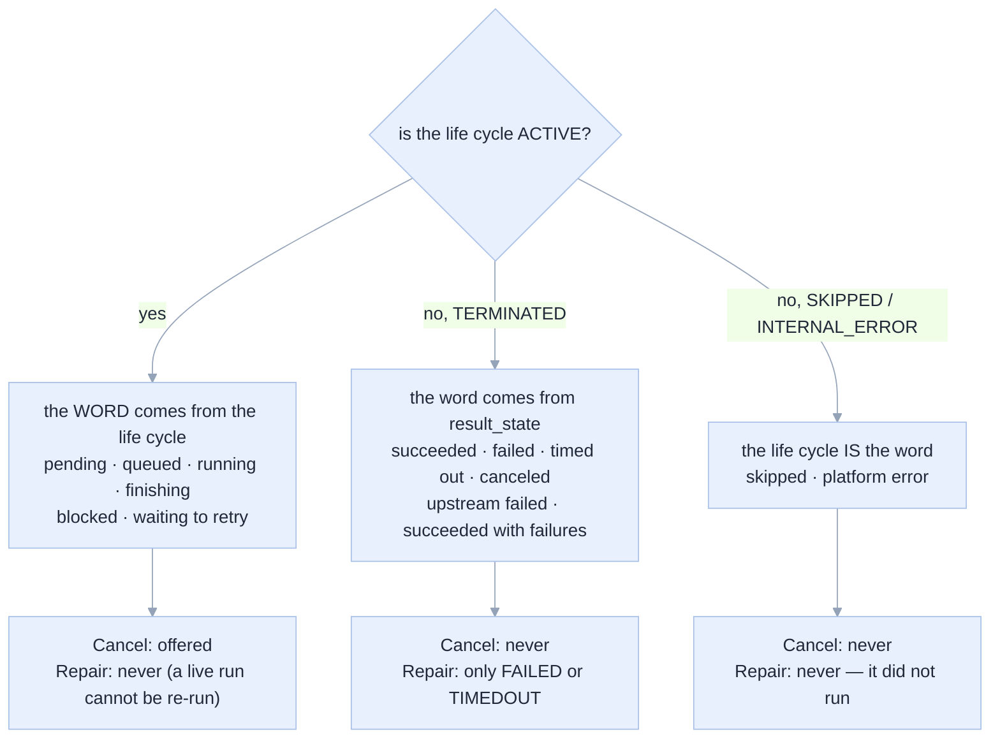

**Why `SKIPPED + FAILED → repair` must stay false.** Today it is `true` (`can_repair` checks only
`is_terminal` and the result) — measured. A Repair button on a run that never started invites a user to
re-run nothing. `[F-14]`'s fix covers the same predicate, and `[E-26]` records it.

---

## 7 · M7 · The pipeline — where `IDLE` is the whole problem

A pipeline's own state cannot answer the only question a user has. The machine below is *two* machines
with a priority rule, and drawing them separately is what makes the rule obvious.

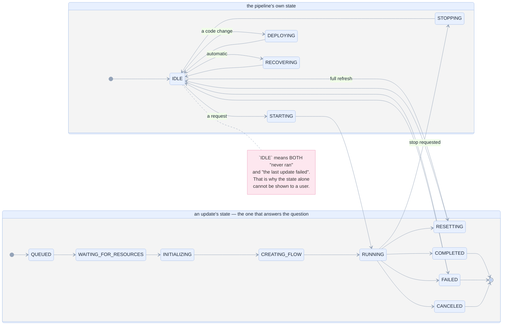

**The priority rule, which `[R-28]` also enforces.** `pipeline_word(state, last_update)` returns the
**update's** word whenever an update exists (`jobs.py:233-241`), and the pipeline's own state only as the
fallback. This machine is correct today — it is the model for how the run machine should behave, which is
why the two are drawn side by side.

---

## 8 · M8 · The cell run — five states, one of them wrong

A cell run is the smallest machine with a user waiting on it, and it is total by a fallthrough. That is
the defect.

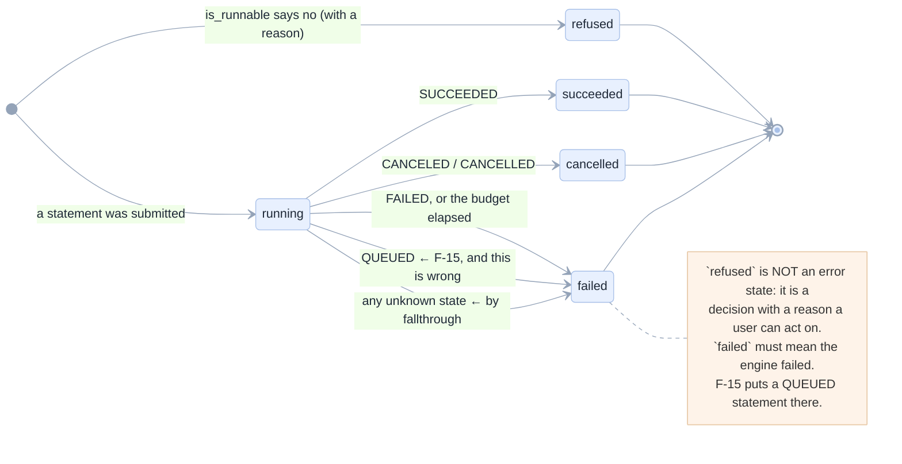

### 8.1 The mapping, executed

| Warehouse state | Becomes | The sentence |
|---|---|---|
| `SUCCEEDED` | `succeeded` | — |
| `PENDING` | `running` | "still running after Ns. It was cancelled so the page stays responsive" |
| `RUNNING` | `running` | the same sentence |
| `CANCELED` / `CANCELLED` | `cancelled` | "cancelled before it finished" |
| `FAILED` | `failed` | the engine's own message, or "the warehouse reported FAILED" |
| **`QUEUED`** | **`failed`** | **"the warehouse reported QUEUED"** ← `F-15` |
| `""` | `failed` | "the warehouse reported an unknown state" |
| `WEIRD_NEW_STATE` | `failed` | "the warehouse reported WEIRD_NEW_STATE" |

**Why `QUEUED` hurts.** A statement spends real time queued on a busy warehouse — that is the normal
case for a large query on a shared SQL endpoint. The user sees a red failure whose "reason" is the name
of a state that means *not yet*.

### 8.2 The machine after `[R-29]`

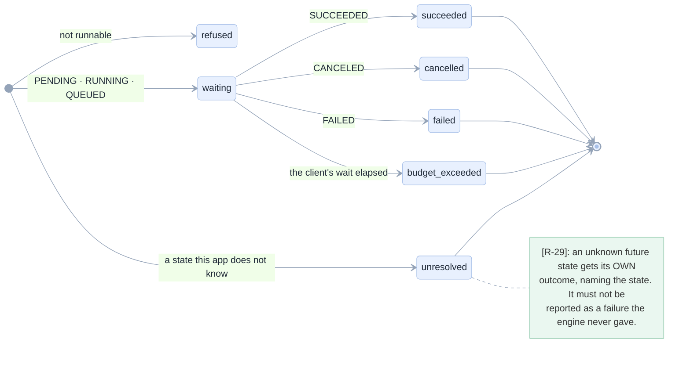

---

## 9 · M9 · Blob retention — three questions, in order of cost

The only machine in the product that deletes a file, which is why its *reason* must be exact.

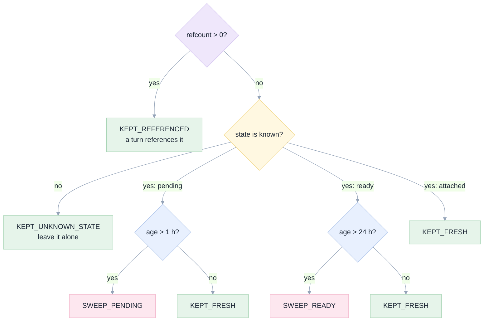

### 9.1 The order defect

The amber box is drawn **after** the refcount question, and that is exactly `F-16`: as built, a row with
an unknown state *and* a reference reports `KEPT_REFERENCED`. Measured across the full grid:

| state | refcount | age | disposition |
|---|---|---|---|
| `a-future-state` | 0 | any | `KEPT_UNKNOWN_STATE` |
| **`a-future-state`** | **1** | any | **`KEPT_REFERENCED`** ← the reason changes |
| `swept` | 0 | any | `KEPT_UNKNOWN_STATE` |
| `attached` | 0 | any | `KEPT_FRESH` — never swept, at any age |

Nothing is swept differently. **Only the reason is wrong**, and in this module the reason is the
contract: `tests/test_blob_retention.py` asserts *why*, not a boolean, and a test for "unknown states are
kept because their state is unknown" passes vacuously whenever the row also has a reference.

### 9.2 The corrected order, `[R-30]`

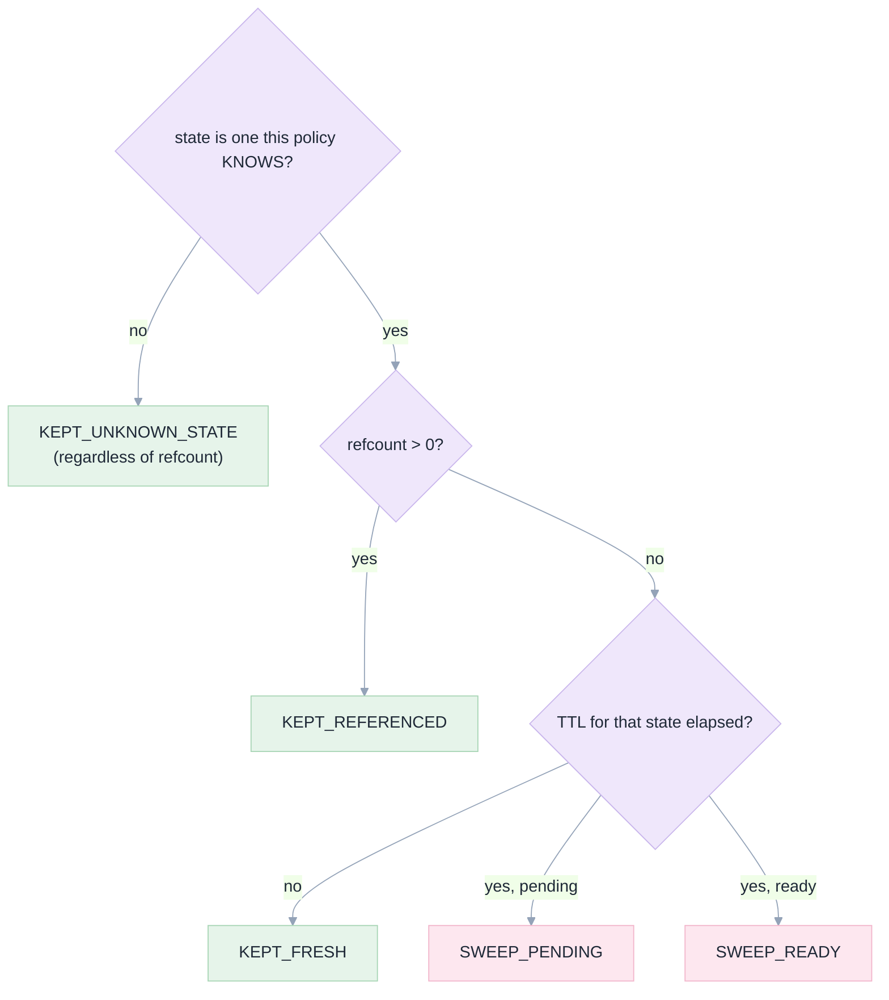

The **sweep set is unchanged** — an unknown state was already kept. Only the reason becomes true, which
is what makes the module's own argument honest.

---

## 10 · M10 · The reaper and the projection: two rules over one lifecycle

Two machines that look alike and answer different questions. Drawing them together is the point: they
must not be merged, and each has a rule the other does not.

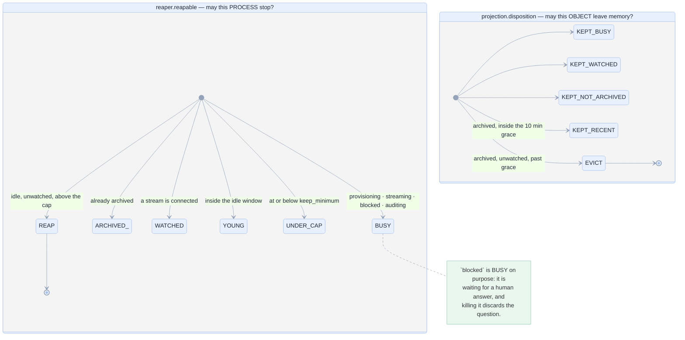

**The distinction, which is the design.** `reaper` decides about a **process** and its cost is data loss,
so `blocked` is protected. `projection` decides about an **object in memory** and its cost is a cache
miss, so it may evict an archived one — the journal is untouched.

**Proved exhaustive.** Both are total functions with a `Why`/`Disposition` value, so every input gets a
named answer and none raises:

| status | watchers | turns | idle | live_count | reaper |
|---|---|---|---|---|---|
| streaming / blocked / auditing | any | any | any | any | `BUSY` |
| archived | any | any | any | any | `ARCHIVED` |
| ready | 1 | 3 | 4000 s | 20 | `WATCHED` |
| ready | 0 | 0 | 4000 s | 2 | **REAP** (no floor for an unused session) |
| ready | 0 | 3 | 4000 s | 20 | **REAP** |
| ready | 0 | 3 | 10 s | 20 | `YOUNG` |
| ready | 0 | 3 | 4000 s | 2 | `UNDER_CAP` |

| status | watchers | busy | age | disposition |
|---|---|---|---|---|
| archived | 0 | false | 10 s | `KEPT_RECENT` |
| archived | 0 | false | 601 s | **`EVICT`** |
| archived | 0 | true | any | `KEPT_BUSY` |
| archived | 1 | false | any | `KEPT_WATCHED` |
| ready | 0 | false | any | `KEPT_NOT_ARCHIVED` |

**The one rule that keeps it safe.** Eviction is never data loss: `restore()` rebuilds from Postgres. The
defect is on the *read* path (`F-9`), not here — an evicted session answers `404` because nothing
rehydrates, which is `[R-10]`.

---

## 11 · The fence verdict — three answers, and the unset case

The machine that decides whether a write may happen. Three states, one axis: *can the target be placed
inside the fence?*

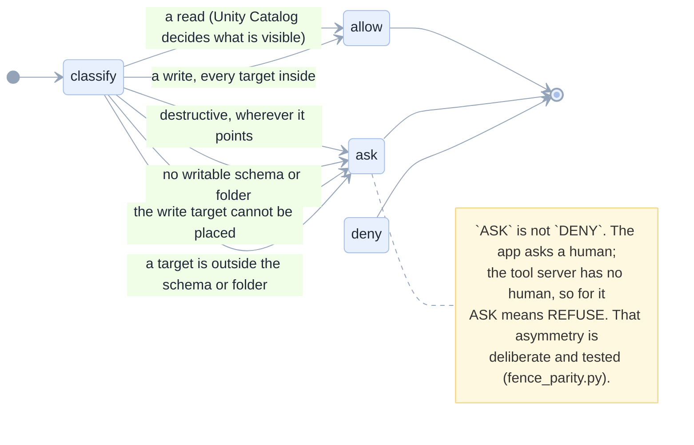

### 11.1 The verdict grid, executed

| Statement | action | app verdict | placed inside? |
|---|---|---|---|
| `select 1` | read | `allow` | — |
| `create table main.s.t` | write | `allow` | inside |
| `create table main.other.t` | write | `ask` | outside |
| `drop table main.s.t` | destructive | **`ask`** | inside — and still a human |
| `drop table main.other.t` | destructive | `ask` | outside |
| `insert into main.s.t select … from main.other.u` | write | `allow` | the `FROM` is a read, not a target |
| `optimize main.s.t` | write | `allow` | inside |
| `insert into t values (1)` | write | `ask` | unplaceable |
| `comment on table main.s.t is 'x'` | write | `allow` | metadata is a write, and it is fenced |

| Path | verdict | why |
|---|---|---|
| `/Users/me/a/x.py` | `allow` | inside |
| `/Users/me/a/../b/x.py` | `ask` | a `..` segment is refused *before* the prefix test |
| `/Shared/x.py` | `ask` | outside |
| `/Users/me/a/` | `allow` | the folder itself |

**The app side is right in every row.** The defect is the *other* side, and the unset case:

| Session | Target | app says | tool server says |
|---|---|---|---|
| folder `""`, schema `None` | `/x.py` | `ask` | **in scope** ← `F-1` |
| folder `""`, schema `None` | `create table main.other.t` | `ask` | **no restriction** ← `F-1` |

Drawn as the two machines they are, with the divergence marked:

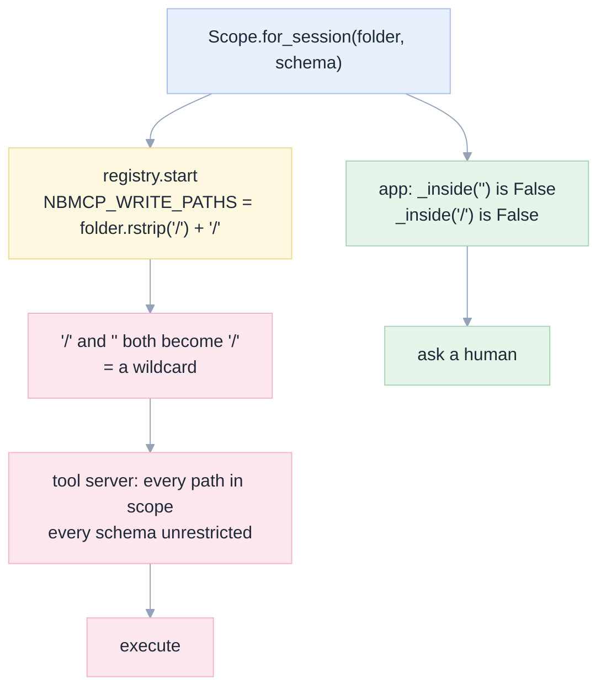

`[R-1]` puts the rule in `fence_rules.require_folder`, so there is **one** place that decides what "unset"
means and the registry can no longer re-introduce the wildcard.

---

## 12 · M11 · The approval token — a machine with no storage

Stateless, and therefore a machine whose states are *predicates*, not rows. Proved by construction over
every input:

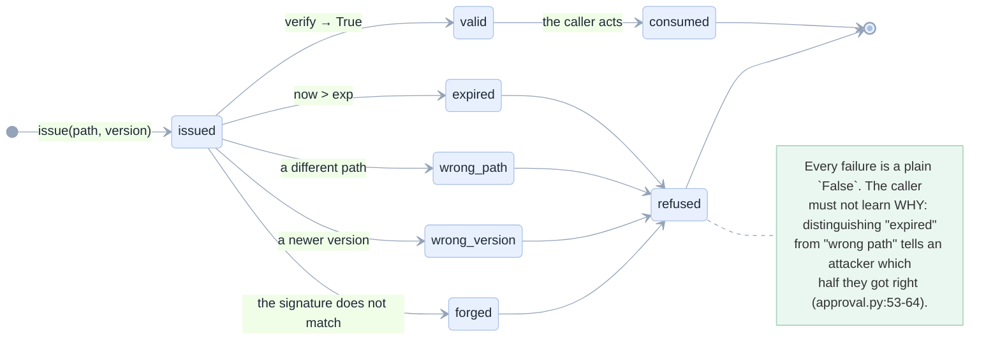

| Input | Result |
|---|---|
| valid now | `True` |
| at `TTL - 1` s | `True` |
| at `TTL + 1` s | `False` |
| wrong path | `False` |
| wrong version (a replay onto a newer revision) | `False` |
| tampered signature | `False` |
| `None` | `False` |
| garbage | `False` |

**Why it is in this document.** It is the only machine in the product that authorises a *human's* write,
it has no session state to fall back on, and its correctness is entirely the table above. `TTL = 120 s`.

---

## 13 · The scaffold step — four states, and one precedence rule

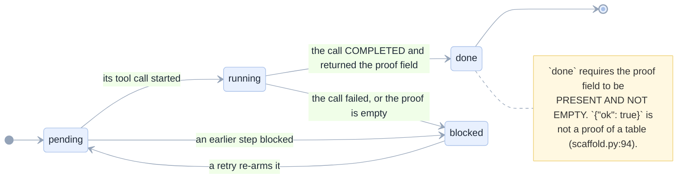

**The precedence rule, measured in the code's own words (`scaffold.py:137-141`):**
`done` wins over a later `blocked`; a `blocked` step forces every **later** step to `pending` with a
reason naming the blocker. Creating an app over a missing table is not a partial success.

---

## 14 · The two tables that are not machines

Recorded so the inventory is complete, and because both are held to one fixture across two runtimes.

**The model catalogue (`ModelState`, 6 members).** A state word per model with one predicate —
`usable` — and the deliberate choice that `unknown` is usable ("never probed is not broken"):

```
available   usable=True      degraded     usable=False
unknown     usable=True      unauthorised  usable=False
                            not_served    usable=False
                            not_enabled   usable=False
```

**The refusal vocabulary (`REFUSALS`).** Nine codes, mirrored key-for-key between `api/domain/blob.py`
and `web/src/domain/blob.ts`, with a test on each side asserting the key sets match. Not a machine; a
contract that must not drift.

---

## 15 · The work, drawn as sequences

Three sequences that the state charts cannot show, because their point is an **order**.

### 15.1 A turn's events, before and after `[R-5]`+`[R-6]`

```mermaid
%%{init: {'theme':'base','themeVariables':{'primaryColor':'#E8F0FE','primaryTextColor':'#1F2937','primaryBorderColor':'#A8C0E8','lineColor':'#94A3B8','noteBkgColor':'#FFF8E1','noteBorderColor':'#F2D98D'}}}%%
sequenceDiagram
    autonumber
    participant A as opencode acp
    participant R as ACP runtime
    participant C as coalescer
    participant O as orchestrator
    participant J as Postgres
    participant U as browser

    A->>R: agent_message_chunk x3
    Note over R,C: TODAY — one event each
    R-->>O: message.delta × 3
    O->>J: commit(snapshot 121 KB) × 3
    O-->>U: SSE × 3

    A->>R: more chunks
    R->>C: buffer to 100 ms or 2 KB
    C-->>O: message.delta (accumulated)
    O->>J: append(event) — O(1), always
    O->>J: checkpoint(snapshot) — every 50
    O-->>U: SSE, one per batch
    Note over J: append BEFORE publish, always.<br/>The checkpoint may fail, the truth may not.
```

### 15.2 A tool call, before and after `[R-3]`

```mermaid
%%{init: {'theme':'base','themeVariables':{'primaryColor':'#E8F0FE','primaryTextColor':'#1F2937','primaryBorderColor':'#A8C0E8','lineColor':'#94A3B8','noteBkgColor':'#FEF3E9','noteBorderColor':'#E8C9A8'}}}%%
sequenceDiagram
    autonumber
    participant A as agent
    participant T as tool server
    participant W as workspace
    participant M as model
    rect rgb(253, 231, 239)
    Note over A,M: TODAY — _trim slices text
    A->>T: dbx_list_tables
    T->>W: 200 tables
    T->>T: text[:6000]
    T-->>A: an unparseable fragment
    A->>M: "malformed JSON", or answers from it
    end
    rect rgb(230, 244, 234)
    Note over A,M: AFTER [R-3] — a window
    A->>T: dbx_list_tables(offset=0)
    T-->>A: {"items":[38],"returned":38,"total":200,"next_offset":38}
    A->>M: I have 38 of 200, so I will page
    A->>T: dbx_list_tables(offset=38)
    T-->>A: {"returned":38,"next_offset":76,…}
    end
```

### 15.3 A restart, split by `[R-10]`

```mermaid
%%{init: {'theme':'base','themeVariables':{'primaryColor':'#E8F0FE','primaryTextColor':'#1F2937','primaryBorderColor':'#A8C0E8','lineColor':'#94A3B8','noteBkgColor':'#EAF7F0','noteBorderColor':'#A8D5BE'}}}%%
sequenceDiagram
    autonumber
    participant K as container
    participant O as orchestrator
    participant S as snapshot row
    participant U as browser
    K->>K: SIGTERM
    O->>S: read projection rows
    alt the turn was running
        O->>S: status=blocked, requiresResume=true
        S-->>U: session.recovery_required
        Note over U: "needs you" — the only case
    else the session was idle
        O->>S: status=ready, requiresResume=false
        S-->>U: ready, no banner
        Note over U: type to continue — the agent<br/>starts on the first message
    end
    Note over O,S: resumed sessions keep their journal,<br/>and no operation is replayed
```

---

## 16 · Reproducing every proof

Every table in this document came from one of these commands. Run them before trusting a diagram.

```bash
cd /Users/raphaelmansuy/Github/03-working/opengenie/apps/coding-agent

# M1 session: the allowed-transition table + reachability + absorbing states
.venv/bin/python - <<'PY'
import sys; sys.path.insert(0,'.')
from api.domain.session import SessionStatus, _ALLOWED
st=list(SessionStatus); reach={SessionStatus.PROVISIONING}; f=[SessionStatus.PROVISIONING]
while f:
    s=f.pop()
    for t in _ALLOWED[s]:
        if t not in reach: reach.add(t); f.append(t)
print("unreachable:", [s.value for s in set(st)-reach])
print("absorbing :", [s.value for s in st if not _ALLOWED[s]])
PY

# M2 turn: the 8x5 matrix, and F-12
.venv/bin/python - <<'PY'
import sys; sys.path.insert(0,'.')
from api.domain.session import TurnStatus, Turn, DomainError
base=dict(id="t",session_id="s",index=1,prompt="p",model="m")
for st in TurnStatus:
    fin=[]
    for target in TurnStatus:
        try: Turn(**{**base,"status":st}).finish(target); fin.append(target.value)
        except DomainError: pass
    print(f"{st.value:>12} finish-> {', '.join(fin)}")
print("F-12:", Turn(**{**base,"status":TurnStatus.COMPLETED}).finish(TurnStatus.INTERRUPTED).status.value)
PY

# M5 supervisor: the verdict grid, and F-17
.venv/bin/python - <<'PY'
import sys; sys.path.insert(0,'.')
from api.domain.supervisor import decide, State, MAX_AUDITS
from api.domain.evidence import Requirement, ToolCall
r=[Requirement("write the notebook"), Requirement("run it and quote the result")]
c=[ToolCall("c1","dbx_write_notebook","completed","ok"),ToolCall("c2","dbx_run_notebook","completed","5 rows")]
for audits in (0, MAX_AUDITS):
    print("prose only, audits=",audits,"->",decide(State(requirements=r,calls=c,answer="Done, 5 rows.",audits=audits)).verdict.value)
PY

# M6 jobs: the full grid, and the contradiction count
.venv/bin/python - <<'PY'
import sys; sys.path.insert(0,'.')
from api.domain import jobs as J
bad=[(lc,rs) for lc in J.ACTIVE for rs in J.RUN_RESULT
     if J.run_word(lc,rs) in ("succeeded","failed","canceled","timed out")]
print("contradictory cells:", len(bad), "of", len(J.ACTIVE)*len(J.RUN_RESULT))
PY

# M8 cell run: every warehouse state
.venv/bin/python - <<'PY'
import sys; sys.path.insert(0,'.')
from api.domain.cellrun import result_from_statement
for st in ["SUCCEEDED","PENDING","RUNNING","QUEUED","CANCELED","FAILED","X"]:
    r=result_from_statement({"status":{"state":st},"statement":"s"},waited=1.0)
    print(f"{st:<10} -> {r.state.value:<10} {r.error[:50]}")
PY

# M9 retention: the reason grid
.venv/bin/python - <<'PY'
import sys; sys.path.insert(0,'.')
from api.domain.retention import Candidate, retention
for rc in (0,1):
    print("unknown state, refcount",rc,"->",retention(Candidate("b","future",0.0,rc),now=9e5).value)
PY

# M3 stream: the BFS (TypeScript) — the file is in this folder's tools/
cp tools/prove_stream.test.ts ../../apps/coding-agent/web/src/domain/__prove_stream.test.ts
cd web && npx vitest run src/domain/__prove_stream.test.ts --reporter=verbose 2>&1 | grep -E "REACHABLE|producible"
rm src/domain/__prove_stream.test.ts
```

**The two verifiers that check this document's diagrams:**

```bash
cd apps/coding-agent/web
node scripts/verify-spec-ascii.mjs ../../../../specs/001-opengenie-assessment
NODE_PATH=/tmp/mmd/node_modules JSDOM_PATH=/tmp/mmd/node_modules/jsdom/lib/api.js \
  MERMAID_PATH=/tmp/mmd/node_modules/mermaid/dist/mermaid.core.mjs \
  node scripts/verify-spec-mermaid.mjs ../../../../specs/001-opengenie-assessment
```

---

## 17 · What the enumeration changed in this specification

Not one diagram in this document was drawn from an intention. Six findings, six requirements, and three
diagrams that exist only because a matrix had a hole in it:

| Enumeration | Produced | Requirement | The diagram it changed |
|---|---|---|---|
| the 8×5 turn matrix | `F-12` | `[R-26]` | §2.2 gains its `note`; §2.3 is new |
| a BFS over `(status, online)` | `F-13` | `[R-27]` | §3.2's "missing" row |
| the `ACTIVE × RESULT` grid | `F-14` | `[R-28]` | §6.2's matrix; §6.3 is new |
| every warehouse state through `result_from_statement` | `F-15` | `[R-29]` | §8.2 is new |
| the retention reason grid | `F-16` | `[R-30]` | §9.2 reorders the decision |
| the supervisor grid with a table and without | `F-17` | `[R-31]` | §5.2 is new |

And two more that are recorded and **deliberately not fixed here**: `SKIPPED + FAILED → repair`
(`[E-26]`) and `SUCCESS_WITH_FAILURES` being unpairable while its tone is `bad` (`[E-27]`). Both need a
product decision, and neither can lose data.

Next: [08 · Requirements](08-requirements.md).
