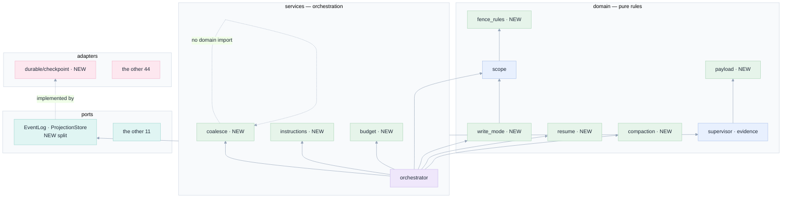

[Index](README.md) · prev: [09 Seven lenses](09-lenses.md) · next: [11 Implementation plan](11-implementation-plan.md)

# 10 · Architecture

Where each new rule lives, why there, and what it may import. This is written against the layering the
code already has (`docs/08-architecture.md` §3), not a new one: **routers → services → domain → ports**,
with adapters implementing ports and importing nothing upward.

The two questions every section answers:

* **DRY** — is there exactly one place this rule is written?
* **SOLID** — does each new module have one reason to change, and does it depend on an abstraction rather
  than on the thing that happens to be convenient?

---

## 1 · The rule that decides everything: where a rule is allowed to live

| Layer | May import | Must not contain | Why |
|---|---|---|---|
| `api/routers/` | services, domain | a rule; a vendor name | a handler that decides something cannot be tested without HTTP |
| `api/services/` | domain, ports | an HTTP status; a `databricks` import that could be an adapter | orchestration changes when the *flow* changes |
| `api/domain/` | each other, ports | **I/O of any kind** — no clock, no network, no file | a rule that destroys data must be assertable in milliseconds |
| `api/adapters/` | domain, ports | anything from routers or services | the vendor is replaceable by construction |
| `tools/` | nothing from `api/` | an import of `api.*` | it is a **separate process**; see `[RB-5]` |

Every item below is placed by that table, and the placement is the design.

---

## 2 · The eight new modules, and one refusal

```
                            NEW IN PHASE 1                    NEW IN PHASE 2
  +-------------------------+-------------------------+   +-------------------------+
  | domain/payload.py       | PURE  the window rule   |   | domain/write_mode.py    |
  |   window(items, budget) |       (no I/O)          |   |   may_write(mode, t)    |
  +-------------------------+-------------------------+   +-------------------------+
  | services/coalesce.py    | STATE the buffer rule   |   | domain/resume.py        |
  |   Coalescer             |       (a clock, no net) |   |   disposition(snap)     |
  +-------------------------+-------------------------+   +-------------------------+
  | adapters/durable/       | I/O   checkpointing     |   | domain/instructions.py  |
  |   checkpoint.py         |       (SQL only)        |   |   merge(sources)        |
  +-------------------------+-------------------------+   +-------------------------+
  | domain/fence_rules.py   | PURE  the unset rule    |   | domain/compaction.py    |
  |   unset(field)          |       (shared by both)  |   |   plan(turns, budget)   |
  +-------------------------+-------------------------+   +-------------------------+
                                                            | domain/budget.py        |
                                                            |   decide(usage, limit)  |
                                                            +-------------------------+
```

| Module | One reason to change | Depends on | What it replaces |
|---|---|---|---|
| `domain/payload.py` | the truncation contract changes | nothing (pure) | the `_trim` slice, in the tool server |
| `services/coalesce.py` | the batching policy changes | a clock, injected | nothing — it is new |
| `adapters/durable/checkpoint.py` | how often a snapshot is written | the store's cursor | the per-event write in `commit()` |
| `domain/fence_rules.py` | what "unset" means for a fence dimension | nothing (pure) | two ad-hoc `if not X` checks |
| `domain/write_mode.py` | what a mode permits | nothing (pure) | the constant `NBMCP_ALLOW_WRITES=1` |
| `domain/resume.py` | what to do after a restart | nothing (pure) | the blanket `requires_resume = True` |
| `domain/instructions.py` | how sources merge and how precedence works | nothing (pure) | nothing — it is new |
| `domain/compaction.py` | what to shed and what to keep | nothing (pure) | nothing — it is new |
| `domain/budget.py` | whether a turn may spend | nothing (pure) | nothing — it is new |

**The refusal.** There is no `domain/fence.py` that merges the app's fence and the tool server's. That
temptation is the single biggest architectural risk in this plan, because it looks like DRY and is its
opposite: the two sides run in **different processes**, and a shared module would have to be duplicated
into the tool server's tree anyway, which is exactly the drift `tests/test_fence_parity.py` exists to
catch. The DRY answer here is **one table of cases**, not one module. `[RB-5]`.

---

## 3 · `[R-1]` `[R-2]` · The fence, in one table and two runtimes

### The problem as a design problem

`F-1` is not "a bug in `_check_sql_scope`". It is **three places that each treat "unset" differently**:

| Place | Unset schema means | Unset folder means |
|---|---|---|
| `api/domain/scope.py::check_sql` | `ASK` (correct) | n/a |
| `api/domain/scope.py::_inside` | n/a | `False` — "no writable folder", correct, with a comment saying why |
| `tools/…::_check_sql_scope` | `None` = allow | n/a |
| `tools/…::_check_path_scope` | n/a | `WRITE_PATHS` empty → `if WRITE_PATHS and …` is false → allow |
| `api/adapters/mcp/registry.py` | `schema or ""` → `""` | `folder.rstrip("/") + "/"` → `"/"` = wildcard |

Five answers to one question. The design fix is to make the question explicit:

```python
# api/domain/fence_rules.py  — PURE, no imports outside this module
"""What an unset fence dimension means. ONE answer, in one place.

The fence has five dimensions and every one of them can be unset: a session created without a schema,
without a folder, or (for the named kinds) without a prefix. The rule below is the *only* statement of
what "unset" means, and both runtimes are held to it by tests/test_fence_parity.py.

Unset means NO WRITE. Never "any write". The distinction is the whole fence: a session that was
created to read and analyse must not gain write access because a field it never set came back empty.
"""

class Unset(BaseException):        # not Exception: a missing fence is not a recoverable condition
    """A fence dimension was not configured. The answer is refusal, always."""

def require_schema(schema: str | None) -> str:
    if not schema or not schema.strip(" .`"):
        raise Unset("schema")
    return schema.strip()

def require_folder(folder: str | None) -> str:
    """A writable folder is a PREFIX, and a prefix of "" or "/" is a wildcard.

    `"/".rstrip("/")` is `""`, so the naive `folder.rstrip("/") + "/"` turns both "" and "/" into a
    wildcard that matches every absolute path. This is measured: the tool server allowed
    `/Users/victim/x.py` for a session created with folder="/".
    """
    f = (folder or "").strip()
    if f.strip("/") == "":
        raise Unset("folder")
    return f.rstrip("/") + "/"

def is_unset(value: str | None) -> bool:
    return value is None or value.strip(" .`/") == ""
```

**How it is used, twice, without a shared import.** The tool server cannot import `api.domain`, so
`tools/databricks_notebook_mcp.py` carries an equivalent twelve-line block with a comment naming the
file it mirrors — the pattern `job_graph.py` already follows for spec 014. The guard is the table:

```python
# tests/test_fence_parity.py
#: Every fence dimension, and what an UNSET value must produce on both sides.
UNSET_CASES = [
    ("schema",      None, "refuse"),
    ("schema",       "",  "refuse"),
    ("schema",     "  ",  "refuse"),
    ("folder",      None, "refuse"),
    ("folder",        "", "refuse"),
    ("folder",       "/", "refuse"),   # the wildcard: the finding
    ("folder",      "//", "refuse"),
    ("job_prefix",  None, "refuse"),
    ("app_prefix",  None, "refuse"),
    ("inst_prefix", None, "refuse"),
]
```

### DRY and SOLID, stated

| Question | Answer |
|---|---|
| Is "unset means no write" written once? | **Yes**, in `fence_rules.py`, and once again as a twelve-line mirror in the tool server, because the process boundary forbids the import. The *test* is one table |
| Does `fence_rules` have one reason to change? | Yes: what "unset" means |
| Does it depend on abstractions? | It depends on nothing. It is a total function over `str \| None` |
| Is `registry.py` still responsible for computing the scope? | Yes — one responsibility, and `[R-1]` removes its second one (deciding what "empty" means) |
| What breaks if a sixth dimension is added? | A test fails, because `UNSET_CASES` is checked against `Scope`'s fields |

---

## 4 · `[R-3]` · The payload window

### The shape

One pure function, one contract, used by every tool that can overflow.

```python
# api/domain/payload.py — mirrored in tools/ as a twelve-line block (same reason as §3)
"""A truncation that the reader can SEE. Pure."""

@dataclass(frozen=True, slots=True)
class Window:
    items: list            # what fits
    returned: int
    total: int
    next_offset: int | None

def window(items: list, budget: int, offset: int = 0) -> Window:
    """Take as many WHOLE items as fit in `budget` characters of their serialised form.

    A byte-slice of a serialised object is not JSON, and an agent that is handed a fragment reports it
    as the whole truth. Measured in this repository: `json.loads(_trim(200 tables))` raises
    `Invalid control character at char 6000`.

    `next_offset is None` means "this is everything". A reader that sees an offset knows it has not
    seen the world, which is the only property that matters.
    """
```

### Why this is a domain module and not a helper in the tool server

Because the **client** needs the same answer. `[R-3]`'s window has a rendering — *"38 of 200 tables,
page 2"* — and a pure function with a test is the only way the words and the numbers cannot disagree.
`web/src/domain/paging.ts` mirrors it and `paging.test.ts` holds an identical fixture, exactly as
`blob.ts` and `blob.py` are held to one table today (`domain/blob.py:75-90`).

| SOLID | |
|---|---|
| **S** | `window()` decides what fits. It does not decide what to fetch, or how to render |
| **O** | A new tool gets the contract by calling it; no tool is edited |
| **L** | Any `list` is acceptable; no subclass assumptions |
| **I** | One function, two parameters, no optional soup |
| **D** | The tool server depends on the *shape* (`returned/total/next_offset`), not on this module |

---

## 5 · `[R-5]` `[R-6]` · The journal, split into what it conflated

### The defect restated as an architecture fault

`commit(event, snapshot)` does **two** jobs in one method:

1. **record a fact** — append `event` to `agent.session_event`. `O(1)`, must happen for every event,
   must be durable before publish.
2. **cache the projection** — write `body` to `agent.session_snapshot`. `O(size)`, need not happen for
   every event, and is an *optimisation* of a rebuild that could be done from (1).

One method, two responsibilities, two cost profiles. That is the interface-segregation violation at the
heart of `F-4`, and the fix is to separate the interfaces.

```python
# api/ports/__init__.py — two protocols where one method used to be
class EventLog(Protocol):
    """The truth: append-only, O(1) per event, durable before publish."""
    async def append(self, event: Event) -> Event: ...
    async def since(self, session_id: str, seq: int, limit: int = 2000) -> list[dict]: ...
    async def latest_seq(self, session_id: str) -> int: ...
    def subscribe(self, session_id: str) -> asyncio.Queue: ...

class ProjectionStore(Protocol):
    """An optimisation: rebuildable from the log, written on a policy."""
    async def checkpoint(self, session_id: str, seq: int, body: dict) -> None: ...
    async def read(self, session_id: str) -> dict | None: ...
    async def open_sessions(self, limit: int) -> list[dict]: ...
```

```python
# api/adapters/durable/checkpoint.py — the ONLY module that knows the policy
class Checkpointer:
    """When a snapshot is written. One reason to change: the policy.

    `commit()` used to write the snapshot inside the same lock as the event, per event: a 60k answer
    is ~15 000 deltas, so ~1.8 GB per turn and a serialised write path shared by every session.
    """
    def __init__(self, store, *, every: int = 50, seconds: float = 5.0, clock=time.monotonic): ...

    async def after_append(self, live, event, snapshot_of) -> bool:
        """Write a checkpoint if the policy says so. Returns whether it did (so a test counts)."""
```

**The invariant that must not move.** `docs/10-data-model.md:120-130`:

> the commit happens before the publish … the queue is a **wake-up**, never the truth.

`append()` keeps that order exactly. `checkpoint()` happens *after* the append and *never* gates the
publish. If the checkpoint fails, the turn continues — the journal is still complete, and the next boot
rebuilds from it. That is the property that makes the split safe: **the cache may fail, the truth may
not.**

### Why coalescing lives in `services/`, not `domain/` or the adapter

| Candidate | Why not |
|---|---|
| `domain/coalesce.py` | it holds state and reads a clock — that is I/O, and `domain/` forbids it |
| `adapters/acp/` | the *runtime* should not know a batching policy; a second runtime would reimplement it |
| `services/coalesce.py` | **correct**: an orchestration policy, one instance per session, clock injected so a test is instant |

```python
class Coalescer:
    """Accumulate deltas; emit at most every `ms` or every `chars`, and always at the end.

    `flush()` is called on: the interval, the size, the turn's end, a cancel, and shutdown. A missing
    flush is a lost tail, which is why it is a test and not a comment.
    """
    def __init__(self, emit, *, ms: int = 100, chars: int = 2048, clock=time.monotonic): ...
    async def push(self, event: Event) -> None: ...
    async def flush(self) -> None: ...
```

---

## 6 · `[R-9]` · Write mode: a value object, not a boolean

`NBMCP_ALLOW_WRITES=1` is a boolean pretending to be a policy. Three modes, one enum, one pure decision,
and the tool server receives a **mode string** rather than a flag — which means the tool server can
explain itself.

```python
# api/domain/write_mode.py — PURE
class WriteMode(str, Enum):
    READ_ONLY = "read-only"   # every mutating tool refused, with a reason
    FENCED    = "fenced"      # inside the fence executes; outside ASKs  (today's intent)
    ASK       = "ask"         # any write ASKs, one prompt per object

def permits(mode: WriteMode, decision: "Decision") -> Literal["allow", "ask", "refuse"]:
    """One function, total over (mode × verdict). `scope.check_sql` already produces the verdict;
    this says what a MODE does with it, so the two concerns stay apart."""
```

**Substitution, properly.** `check_sql`/`check_path` answer *"is this inside the fence"*. `permits`
answers *"what does this mode do about that"*. A test walks the 3×3 grid. Adding a fourth mode is a
compile error in the `Literal` return, not a silent fallthrough — the same trick `layout.ts` uses for
its `Zone` lookups and `compose.ts` for its `BlockedReason`.

---

## 7 · `[R-10]` · The restart decision, extracted from `restore()`

`restore()` currently does five things: read rows, build `Live`s, expire approvals, mark sessions, emit
events. The pure decision is one of them.

```python
# api/domain/resume.py — PURE
class Disposition(str, Enum):
    WAS_MID_TURN = "mid_turn"   # -> blocked + requiresResume
    WAS_IDLE     = "idle"       # -> ready, agent provisioned on the next message
    WAS_ARCHIVED = "archived"   # -> untouched

def disposition(snapshot: dict) -> Disposition:
    """What a restored session becomes. Total over every snapshot shape.

    The defect this fixes: every non-archived session was marked `blocked + requiresResume`, so an
    idle conversation with nothing in flight still asked the user to press Restore. `was_mid_turn` is
    the only case that needs a human.
    """
```

This is the third member of a family that already has three: `reaper.reapable`, `projection.disposition`,
`retention.may_delete`. Same shape — total, `Why`/`Disposition` valued, no clock — and the pattern is
named in `docs/08-architecture.md` §12.1. **Adding a fourth in the same shape is the DRY answer**;
inventing a different one would be the violation.

---

## 8 · `[R-17]` `[R-18]` · Instructions: a merge of labelled sources

```python
# api/domain/instructions.py — PURE
@dataclass(frozen=True, slots=True)
class Source:
    kind: Literal["workspace", "personal", "agents_md", "skill"]
    path: str
    author: str            # who wrote it, for the label
    text: str
    truncated: bool

def merge(sources: list[Source], rules: str) -> str:
    """Render the context blocks. `rules` is LAST and overrides, always.

    The order is the specification: a team's workspace instruction cannot widen the fence, and a
    personal instruction cannot either. Only `rules` — generated from the session's scope — is
    authoritative, because it is the only one derived from a decision the app made.
    """
```

**Why the merge is pure and the reading is not.** Reading is `services/instructions.py` (it needs a
token and a workspace client); merging is a pure function so the **precedence** is testable without a
workspace. That split is the same one `context.py` (resolve, I/O) and `domain/context.py` (parse,
validate) already use — and reusing an existing split is DRY, not a new pattern.

---

## 9 · `[R-11]` · Compaction: a plan, not an action

```python
# api/domain/compaction.py — PURE
@dataclass(frozen=True, slots=True)
class Plan:
    keep: tuple[str, ...]        # turn ids kept verbatim
    summarise: tuple[str, ...]   # turn ids to replace with a summary
    reason: str                  # "over budget by 41k tokens"

def plan(turns: Sequence[Turn], *, budget: int, estimate) -> Plan | None:
    """None when nothing needs shedding. A Plan otherwise.

    Keeping the FIRST turn and the LAST n is deliberate: the first states the objective, the last is
    live work. The middle is what a summary is for. `estimate` is injected so a test needs no model.
    """
```

`estimate` injected is the same interface-segregation move as `Reentry`'s `clock`: the rule does not
know how a token count is obtained, so it can be asserted exactly.

---

## 10 · `[R-13]` · Hooks: a rule evaluated where the fence already is

```python
# api/domain/hooks.py — PURE
@dataclass(frozen=True, slots=True)
class Rule:
    name: str
    on: Literal["before_tool", "after_tool"]
    tool: str                    # exact name, or a regex with a leading "^"
    when: Predicate | None       # a small, closed expression language — NOT eval
    then: Literal["refuse", "run"]
    say: str

def evaluate(rules: Sequence[Rule], phase: str, tool: str, args: dict) -> Verdict:
    """The first matching rule wins; later rules do not run. Total: an unevaluable rule REFUSES.

    `then: run` is specified and gated: it executes a program inside the tool server, so it is an
    administrator-only action ([E-16]). The schema for it exists from phase 4 day one so the YAML does
    not change when it lands.
    """
```

**Why not `eval`.** A predicate language that can call Python is a remote-code path inside the process
that holds the user's token. The expression language is deliberately small: `equals`, `starts_with`,
`matches`, `in`, `not`, `all`, `any`, over the tool name and its named arguments. That is enough for
every rule the assessment could name, and it cannot exfiltrate.

---

## 11 · What is *not* changed, and the argument for leaving it

| Thing | Why it stays |
|---|---|
| The `scope.check_path` path fence | It is correct, wired, and has the `..` case right. Only the *unset* case moves |
| `_dbx_errors` | One status mapping. Every new route uses it |
| The SSE contract | `?after=` + `Last-Event-ID` + the queue-as-wakeup is the most thought-through part of the codebase |
| `_snapshot()`'s whitelist | It is a whitelist on purpose ("a new field is included only when someone decides to include it"). `[R-9]` and `[R-24]` add **columns**, not `asdict` leaks |
| The 28-tool budget | `[R-19]` must account for a second server's schemas. `[R-13]` adds **zero** tools: a hook is evaluated inside an existing one |
| `MAX_AUDITS = 2` | A product decision with a measurement behind it (`supervisor.py:46`) |
| The ACP agent choice | It is behind a port, and the port has three implementations. Replacing it is a config change |

---

## 12 · The dependency graph after phase 2



Every arrow points one way. The six new domain modules import nothing but each other; the two new
service modules import domain and ports; the one new adapter implements a port. That is the same shape
as before, which is the point: **the fix is inside the architecture, not beside it.**

Next: [11 · Implementation plan](11-implementation-plan.md).
