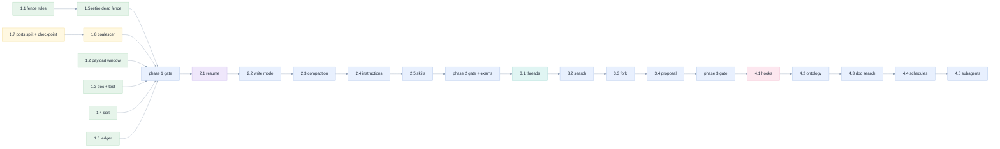

[Index](README.md) · prev: [10 Architecture](10-architecture.md) · next: [12 Edge cases](12-edge-cases.md)

# 11 · Implementation plan

Phases, files, tests, order, and the gate that closes each. The order is not a preference: every phase
gate is *the full suite green plus the named new tests*, on a baseline that is green today
([01 §1.2](01-method-and-evidence.md#12-the-baselines-run-for-this-assessment)).

The rule that governs the whole plan: **a phase that cannot be reverted in one `git revert` is too
big.** Phase 1 is seven small commits; phase 2 is five; phase 3 and 4 are one per requirement.

---

## 1 · The phases

| Phase | Weeks | What it makes true | Gate |
|---|---|---|---|
| **1** | 2 | the four false claims are true, and the journal is O(n) | 1 303 + 4 new test files, all green; both spec verifiers |
| **2** | 3 | a team can configure it, resume it, budget it, and it compacts | + 9 new test files; the exam suite score does not regress |
| **3** | 4 | parallel chats, search, fork, diff accept | + 4 new files; 4 E2E scenes |
| **4** | 4+ | hooks, ontology, doc search, schedules, subagents | + 5 new files; 4 E2E scenes |

---

## 2 · Phase 1 — two weeks, because it is two different jobs

### Week 1: surgical, one commit per item

| Step | Files | Test | Risk |
|---|---|---|---|
| **1.1** | `api/domain/fence_rules.py` (new), `api/domain/scope.py` (use it), `tools/databricks_notebook_mcp.py` (mirror it), `api/adapters/mcp/registry.py` (stop building a wildcard) | `test_fence_parity.py::UNSET_CASES`, `test_tools_fence.py::test_no_wildcard_path_is_ever_accepted` | **low** — a refusal path, and the parity table proves both sides |
| **1.2** | `api/domain/payload.py` (new), `tools/…::_trim` delegates to it, 20 call sites unchanged | `test_payload_window.py` (new, ~30 cases) | **low** — the contract is additive: a payload that fits is returned unchanged |
| **1.3** | `tests/test_agent_isolation.py` + `docs/08:147`, `docs/09:63` | `test_the_child_environment_matches_the_documented_contract` | **none** — documentation and one test |
| **1.4** | `api/services/orchestrator.py::sessions_for` | `test_api.py::test_sessions_are_newest_first` | **none** — one key |
| **1.5** | `api/domain/scope.py` — delete `check_sql`/`check_job`/`check_app`/`check_instance` or wire them (`[RB-5]`: delete) | `test_dead_code.py` (new) | **medium** — 12 test files reference them; the tests move to `test_fence_parity.py`'s table |
| **1.6** | `api/adapters/mcp/registry.py::read_ledger(session_id)` | `test_infra_routes.py` | **low** |

### Week 1b: the six state-machine defects (same week; disjoint files)

These came from exhausting the machines ([02 §8](02-assessment-opengenie.md#8--six-state-machine-defects-proved-by-exhaustion)), not from
reading the request path, and they touch files week 1 does not. That is why they are additive rather than
a second queue.

| Step | Requirement | Files | Test | Risk |
|---|---|---|---|---|
| **1.9** | `[R-26]` | `api/domain/session.py` — a guard in `finish()`; `orchestrator.py:947` reads the status first | `test_domain.py::test_a_terminal_turn_cannot_change` (the 8×5 matrix) | **low** |
| **1.10** | `[R-27]` | `web/src/domain/stream.ts` — delete `"offline"` from `ClosedReason` and its `CLOSED_DETAIL` row | `stream.test.ts::test_every_declared_state_is_reachable` | **low** |
| **1.11** | `[R-28]` | `api/domain/jobs.py::run_word` + `can_repair`; `web/src/domain/jobs.ts` mirror | `test_jobs_domain.py::test_an_active_run_never_reads_as_finished` (the full grid) | **medium** — the fixture is shared |
| **1.12** | `[R-29]` | `api/domain/cellrun.py::result_from_statement` — `QUEUED` waits; an unknown state gets its own outcome | `test_cellrun.py` | **low** |
| **1.13** | `[R-30]` | `api/domain/retention.py::retention` — state before refcount | `test_blob_retention.py::test_the_reason_for_an_unknown_state_is_its_state` | **low** |
| **1.14** | `[R-31]` | `api/domain/supervisor.py` — a closed call→requirement mapping that may only add rows | `test_supervisor.py` (new) | **medium** — the supervisor is the 19%→94% rule |

**Why 1.5 is the only medium risk.** `check_sql` is used by `tests/test_domain.py` and
`tests/test_scope_targets.py` — 20+ assertions that encode a *correct* rule. Deleting the function means
moving those cases into `test_fence_parity.py` where they guard the side that actually runs. That is not
a deletion; it is a **relocation to where the rule is enforced**, and it is the honest version of the
documentation's claim.

### Week 2: the one structural change

| Step | Files | Test | Risk |
|---|---|---|---|
| **1.7a** | `api/ports/__init__.py` — split `EventLog` / `ProjectionStore`; all three stores implement both | the existing suite, unchanged: the split is an interface, and the current `commit` satisfies both protocols | **medium** — this touches every store |
| **1.7b** | `api/adapters/durable/checkpoint.py` (new); `commit()` becomes `append()` + `checkpoint.after_append()` | `test_journal_cost.py` (new, 3 tests) | **medium** — the hot path |
| **1.8** | `api/services/coalesce.py` (new); `orchestrator._drain` pushes through it; `flush()` on end/cancel/shutdown | `test_delta_coalescing.py` (new, 5 tests) | **medium** — a lost tail is a lost answer, which is why flush is tested five ways |

**The one thing that must not break.** `docs/10-data-model.md:120-130`: *commit before publish, queue is
a wake-up.* The implementation order is `append()` → publish → `checkpoint()`. A test asserts the order
with a spy: `test_checkpoint_never_precedes_append`.

**Gate for phase 1.**

```bash
cd apps/coding-agent
.venv/bin/python -m pytest -q          # 1303 passing today; + test_payload_window, test_journal_cost,
                                       #   test_delta_coalescing, test_dead_code
cd web && npx vitest run               # 959 passing, unchanged
node scripts/verify-spec-ascii.mjs ../../../../specs/001-opengenie-assessment
NODE_PATH=… node scripts/verify-spec-mermaid.mjs ../../../../specs/001-opengenie-assessment
```

**A gate must read the RUNNER's exit code, never a pipe's.** Twice during the assessment a green suite
was reported as a failure because the command ended in `| grep -E "^ +Tests"`, and `grep` exits `1` when
it prints nothing ([01 §1.2](01-method-and-evidence.md#12-the-baselines-run-for-this-assessment)). Use a
structured result, or the runner's own status:

```bash
cd apps/coding-agent/web
npx vitest run --reporter=json --outputFile=/tmp/v.json || exit 1
python3 -c "import json,sys;d=json.load(open('/tmp/v.json'));sys.exit(0 if d['success'] and not d['numFailedTests'] else 1)"
```

**And read it as "green twice, or the failure named."** The one flaky front-end test was found, named and
fixed during phase 3 (`JobsPages.test.tsx`, a race between the button and its own `title`; see
[01 §1.2](01-method-and-evidence.md#12-the-baselines-run-for-this-assessment)). The rule stands for any future
red run: a single red is not evidence of a regression and a single green is not evidence of its absence —
name the failure, fix the cause, and prove the fix under the load that produced it.

---

## 3 · Phase 2 — five requirements, in this order

The order is by *dependency*, not by value. `[R-10]` must come before `[R-9]` because the write mode is
stored in the snapshot and the restart rule decides what happens to a snapshot's new column.

| Step | Requirement | Files | New test file |
|---|---|---|---|
| **2.1** | `[R-10]` restart disposition | `api/domain/resume.py` (new); `orchestrator.restore()`; `adapters/durable/postgres.py` + `sqlite.py` (a migration for `resume_reason`) | `test_restart_disposition.py` |
| **2.2** | `[R-9]` write mode | `api/domain/write_mode.py` (new); `Scope`; `registry.start` (mode string); `tools/…` (3 modes); `routers/api.py` (accept it); `components/…` (the selector in F5) | `test_write_mode.py` |
| **2.3** | `[R-11]` compaction | `api/domain/compaction.py` (new); `orchestrator._execute_turn`; `events.py` (emit `session.compacted`); `events.ts` + `reduce` (handle it) | `test_compaction.py` |
| **2.4** | `[R-17]` instructions | `api/domain/instructions.py` (new); `api/services/instructions.py` (new, I/O); `agent_config.session_rules` | `test_instructions.py` |
| **2.5** | `[R-18]` skills | `tools/…::dbx_skill` (three sources); `NBMCP_SKILLS_*` env; `registry.start` | `test_skills.py` |
| **2.6** | `[R-21]` xlsx | `api/domain/blob.py` (family + converter); `web/src/domain/blob.ts` (mirror) | `test_blob_rules.py` (extend) |
| **2.7** | `[R-24]` budget | `api/domain/budget.py` (new); `SESSION_BUDGET` migration; `orchestrator._run_turn` (before claim); `ModelFacts` (F8) | `test_budget.py` |

**Why `[R-11]` before `[R-17]`.** Compaction changes what a turn's prompt contains. Instructions add a
block to the same prompt. Doing them in the other order means writing the instruction injection twice.

**Gate for phase 2.** Phase-1 suite + 9 new files, **plus a regression gate that is not a unit test**:

```bash
cd /Users/raphaelmansuy/Github/03-working/opengenie
# the exam suite: same 11 missions, same models. The score must not drop.
python3 exams/run_exam.py --batch 001-phase2-gate --variants V6
python3 site/claims.py          # CL-1..CL-8 must not regress
```

That gate exists because `[R-17]` and `[R-18]` change what the model is told, and the only honest way to
know that more context did not make the agent worse is to re-run the tasks that measured it.

---

## 4 · Phase 3 — four surface features

| Step | Requirement | Files | Test |
|---|---|---|---|
| **3.1** | `[R-14]` parallel chats | `web/src/hooks/useThreads.ts` (new, replacing the singleton), `components/ThreadTabs.tsx` (new), `App.tsx`, `keys.ts` | `threads.test.ts` |
| **3.2** | `[R-15]` search | migration (`tsvector` + GIN), `services/search.py` (new), `routers/api.py` (1 route), `components/SessionList.tsx` | `test_search.py`, `sessions.test.ts` |
| **3.3** | `[R-16]` fork | `domain/fork.py` (new, pure: which seqs), `services/orchestrator.fork()` (one `INSERT … SELECT`), 1 route | `test_fork.py` |
| **3.4** | `[R-22]` proposal | `web/src/domain/proposal.ts` (new, pure), `CellOutput`/`EditorSurface`, `events.ts` (2 event types) | `proposal.test.ts`, `event-parity` update |

**`[R-14]` is the only one that touches the stream hook**, and it is the one with the most risk: the
hook currently resets `seq.current = 0` per session (`useSessionStream.ts:166`) and merges a detail
fetch with streamed state (`:140-157`). A keyed map must preserve both behaviours per session, which is
why the pure part (`threads.ts`) is separated and tested first.

---

## 5 · Phase 4 — five, each one revertable

| Step | Requirement | Depends on | Effort |
|---|---|---|---|
| **4.1** | `[R-13]` hooks | `[R-9]` (a hook and a mode both decide about a write) | M |
| **4.2** | `[R-19]` ontology | `[RB-7]` resolved: a second server | M |
| **4.3** | `[R-20]` doc search | an index over `site/content/` | M |
| **4.4** | `[R-23]` schedules | an identity that outlives a browser: the app SP, with the limits `[RB-1]` describes | L |
| **4.5** | `[R-25]` subagents | `[R-19]`'s second-server plumbing | L |

---

## 6 · The test map

**Nineteen new files, six extensions** — counted from the table below, not estimated. Every one is listed
with what it proves, so a reviewer can check
that no requirement is "covered" by a test of something else.

| File | New? | Proves | Requirement |
|---|---|---|---|
| `test_fence_parity.py` | extend | every fence dimension, set and unset, both runtimes | `[R-1]` `[R-2]` |
| `test_tools_fence.py` | extend | no wildcard is accepted; the budget holds | `[R-1]` |
| `test_payload_window.py` | **new** | a truncated payload parses; paging reconstructs it | `[R-3]` |
| `test_agent_isolation.py` | extend | the child's environment matches the doc | `[R-4]` |
| `test_journal_cost.py` | **new** | writes per turn; replay from a checkpoint equals replay from zero | `[R-5]` |
| `test_delta_coalescing.py` | **new** | text identity, five flush paths, ≤600 events | `[R-6]` |
| `test_api.py` | extend | newest-first, stable | `[R-7]` |
| `test_dead_code.py` | **new** | no test-only function in `scope.py` | `[R-8]` |
| `test_infra_routes.py` | extend | the ledger reads one file | `[R-12]` |
| `test_restart_disposition.py` | **new** | mid-turn vs idle, plus rehydration | `[R-10]` |
| `test_write_mode.py` | **new** | 3 modes × every mutating tool | `[R-9]` |
| `test_compaction.py` | **new** | the plan is pure; the event is emitted; the setting is read | `[R-11]` |
| `test_instructions.py` | **new** | precedence, labels, unreadable, override | `[R-17]` |
| `test_skills.py` | **new** | three sources, labels, write refusal | `[R-18]` |
| `test_blob_rules.py` | extend | xlsx family + caps | `[R-21]` |
| `test_budget.py` | **new** | allow/blocked, boundary, restart | `[R-24]` |
| `threads.test.ts` | **new** | which tab is working, from cursors only | `[R-14]` |
| `test_search.py` | **new** | the index, the snippet, the turn link | `[R-15]` |
| `test_fork.py` | **new** | the prefix, the isolation, the pins | `[R-16]` |
| `proposal.test.ts` | **new** | which cells changed, the reason | `[R-22]` |
| `test_hooks.py` | **new** | every combination, unparseable, un-evaluable, widening | `[R-13]` |
| `test_second_server.py` | **new** | the fence is not widened; the budget accounts | `[R-19]` |
| `test_docsearch.py` | **new** | the index, the citation shape | `[R-20]` |
| `test_schedule.py` | **new** | identity, refusal, the run record | `[R-23]` |
| `test_subagent.py` | **new** | the tighter scope, the ceilings | `[R-25]` |

---

## 7 · Migrations, forward-only

`api/adapters/llm/store/migrations/` is the mechanism. Three files, in this order, each idempotent
(`CREATE … IF NOT EXISTS` / `ALTER TABLE … ADD COLUMN IF NOT EXISTS`), because a redeploy can restart a
container mid-migration.

```
005_session_write_mode.sql        ALTER TABLE agent.session_snapshot
                                    ADD COLUMN IF NOT EXISTS write_mode text NOT NULL DEFAULT 'fenced'
005_resume_reason.sql             … ADD COLUMN IF NOT EXISTS resume_reason text
005_checkpoint_seq.sql            … ADD COLUMN IF NOT EXISTS checkpoint_seq bigint NOT NULL DEFAULT 0
006_session_budget.sql            CREATE TABLE IF NOT EXISTS agent.session_budget (…)
007_event_search.sql              ALTER TABLE agent.session_event
                                    ADD COLUMN IF NOT EXISTS body_tsv tsvector
                                    GENERATED ALWAYS AS (to_tsvector('english', body::text)) STORED
                                  CREATE INDEX IF NOT EXISTS session_event_tsv ON … USING gin (body_tsv)
```

**Why columns and not fields in `body`.** `_snapshot()` writes `version: 1` and `restore()` **raises** on
any other version (`orchestrator.py:168-169`). Putting new facts inside the JSON forces a version bump,
which refuses to start against existing rows — a deploy that cannot roll back. A nullable column is
additive, safe in both directions, and readable by SQL. `[L-4]`'s argument, and it is decided here.

---

## 8 · Order of work, as a graph



The parallel pair in week 1 (`1.1`–`1.6` and `1.7`–`1.8`) is deliberate: they touch disjoint files, so
two people can work without a merge conflict, and the safety fixes land even if the structural change
slips a week.

---

## 9 · What each phase proves, in one line

| Phase | The sentence that becomes true |
|---|---|
| 1 | "Writes stay inside the fence" is true for every session, including one with no schema, and a conversation costs `O(n)` to record |
| 2 | "It follows our conventions, it resumes cleanly, and it stops before it overspends" |
| 3 | "I can run three things at once, find what I said last week, and see a change before I take it" |
| 4 | "My platform team writes the rules, and business terms resolve against the ontology" |

Next: [12 · Edge cases](12-edge-cases.md).
