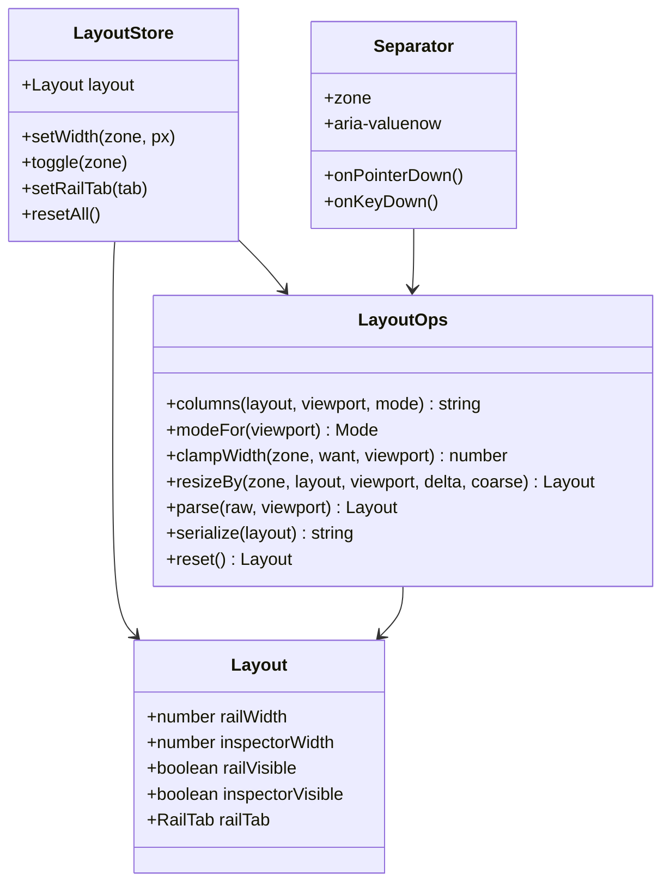
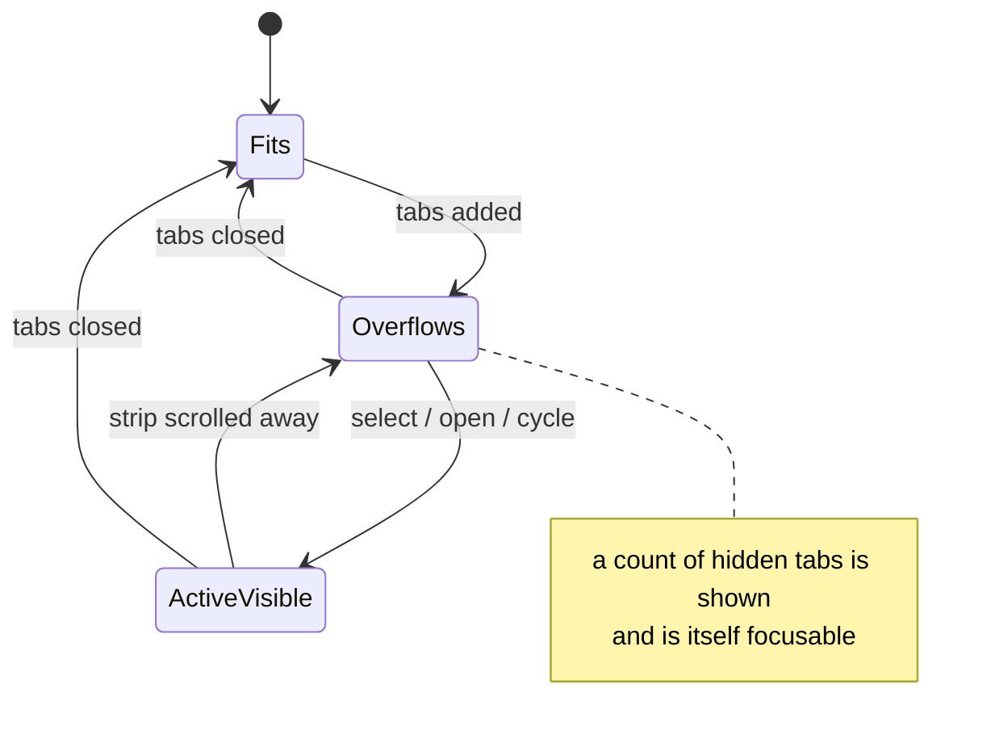
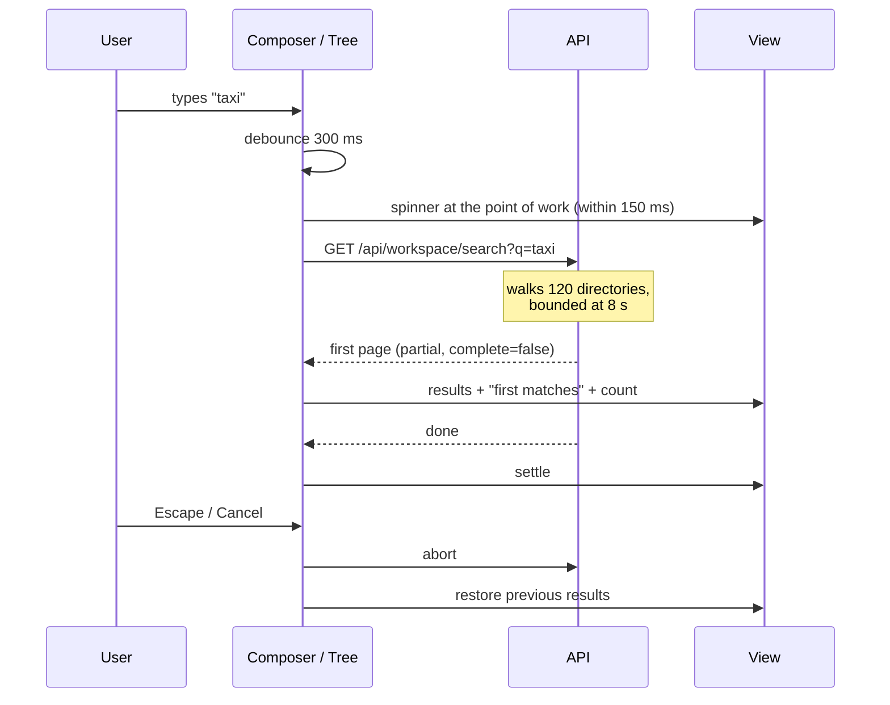
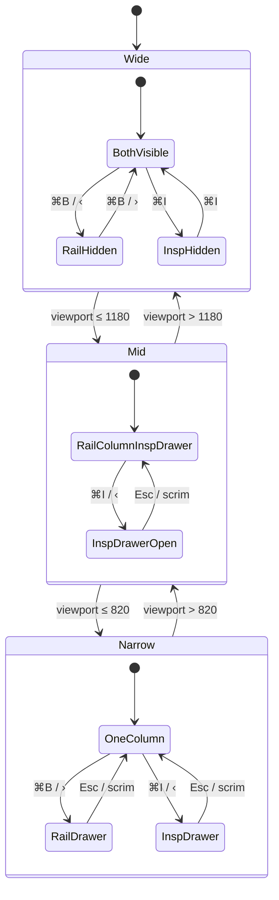
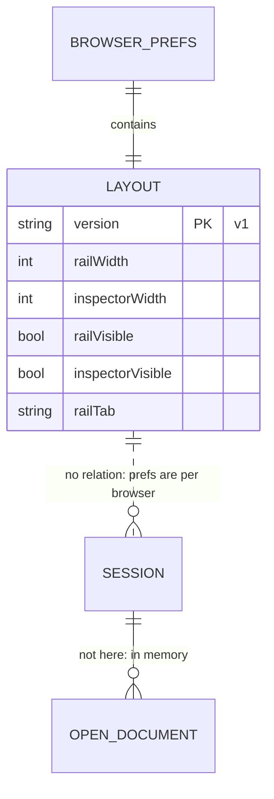

# 03 · Architecture

[Index](README.md) · prev: [02 Requirements](02-requirements.md) · next: [04 Lenses](04-lenses.md)

The design in one sentence: **a small pure module owns every geometric decision; React renders what
that module decides.** Nothing else sets a column width, and nothing else knows what a default is.

## Zone model

```
┌─ CHROME ──────────────────────────────────────────────────────────────────────────┐
│  topbar: brand · model · status · ⌘K · keys · refresh        (fixed 52 px)         │
├─ WORKBENCH ───────────────────────────────────────────────────────────────────────┤
│ ┌ NAVIGATOR ─┐ ┌────────────── CENTRE ──────────────┐ ┌ INSPECTOR ────┐          │
│ │ rail       │ │ strip                               │ │ context       │          │
│ │  resizable │ │ doc tabs (scroll-managed)           │ │  resizable    │          │
│ │  collapsible│ │ work surface (transcript | viewer) │ │  collapsible  │          │
│ │  persisted │ │ composer                            │ │  persisted    │          │
│ └────────────┘ └─────────────────────────────────────┘ └───────────────┘          │
│      ▲                    ▲                                   ▲                   │
│      └──────── separators: pointer + keyboard + a11y ─────────┘                   │
└───────────────────────────────────────────────────────────────────────────────────┘
```

Four zones, not six. The **strip** and the **composer** belong to the centre zone: they are not
independently resizable or collapsible, they are parts of one column. Treating them as zones would
multiply states without adding capability.

## The contracts

### Layout (pure, no React)

```ts
// web/src/domain/layout.ts — the only place that knows a width

export interface Layout {
  railWidth: number;        // px, within [RAIL_MIN, ...]
  inspectorWidth: number;   // px, within [INSPECTOR_MIN, ...]
  railVisible: boolean;
  inspectorVisible: boolean;
  railTab: "sessions" | "files" | "catalog";
}

export const DEFAULTS: Layout;

/** The grid for a viewport. Everything that decides a column lives here. */
export function columns(layout: Layout, viewport: number, mode: Mode): string;
export function modeFor(viewport: number): "wide" | "mid" | "narrow";
export function clampWidth(zone: "rail" | "inspector", want: number, viewport: number): number;
export function resizeBy(zone, layout, viewport, delta, coarse: boolean): Layout;
export function parse(raw: string | null, viewport: number): Layout;   // validates, falls back
export function serialize(layout: Layout): string;
export function reset(): Layout;
```

`columns()` returns the value for `grid-template-columns`. It is the **only** producer of that string;
the CSS declares the grid container, never its columns.



### Persistence

One key, versioned, written debounced:

```ts
const KEY = "coding-agent:layout:v1";
```

`parse()` is total: unknown version → defaults; non-numeric width → defaults; width outside bounds →
clamped; unknown rail tab → defaults. It never throws, because a stored preference must never be able
to break the shell ([SH-B2](02-requirements.md)).

### Separator as a role, not a div

`role="separator"` with `aria-orientation="vertical"`, an accessible name ("Resize the navigator"),
and `aria-valuenow`/`min`/`max` in pixels. Pointer Events with `setPointerCapture` so a fast drag that
leaves the 6 px strip keeps resizing. Keyboard: `←`/`→` = 8 px, with `Shift` = 64 px, `Home` = reset.

### Tab strip scroll manager



The rule: **after any change to the active tab or the tab list, the active tab must be fully inside
the strip** — `scrollIntoView({ block: "nearest", inline: "nearest" })`, in one animation frame.

### Progressive feedback



Against [SH-D1..D4](02-requirements.md): the spinner is local to the tree, the count appears with the
first page, and cancel restores rather than empties.

## Layout state machine (visibility × viewport)



Crossing a breakpoint **re-derives** visibility from the mode (drawers closed), and does not persist
that derived value — so resizing the window back restores what the user actually chose.

## Data model (there is no database in this spec)



Deliberately, layout is **not** a server concern ([SH-B5](02-requirements.md)). Two consequences worth
stating: the shell has no migration story to write, and two tabs side by side may have different
layouts — which is correct, because they are different windows.

## Where the code goes

| Concern | File | Change |
|---|---|---|
| Geometry, bounds, defaults, parse/serialize | `web/src/domain/layout.ts` | **new**, pure, unit-tested |
| Persistence + React binding | `web/src/hooks/useLayout.ts` | **new** |
| Separator | `web/src/components/Separator.tsx` | **new** |
| Tab strip scroll + overflow | `web/src/components/DocTabs.tsx` | **new**, extracted from `App.tsx` |
| Grid container | `web/src/styles.css` | one `.layout` rule; columns from `columns()` via a CSS custom property |
| Shell composition | `web/src/App.tsx` | consumes the above; loses geometry logic |
| Search feedback | `web/src/components/WorkspaceTree.tsx`, `CatalogTree.tsx` | spinner, count, cancel |
| Landmarks | `App.tsx`, `components/Transcript.tsx`, `components/Composer.tsx` | names for region/main |
| z-index scale | `styles.css` | tokens `--z-*` |

## Why a CSS custom property for the columns

`grid-template-columns` has to be on the container, but its *value* must come from the pure module.
So the module produces the string, the app sets it as a custom property, and one CSS rule reads it:

```css
.layout { display: grid; grid-template-columns: var(--layout-columns, 276px minmax(0, 1fr) 340px); }
```

The fallback in that rule is the **only** literal column list in the codebase ([SH-G1](02-requirements.md)),
and it exists so first paint is correct before the module has run.
