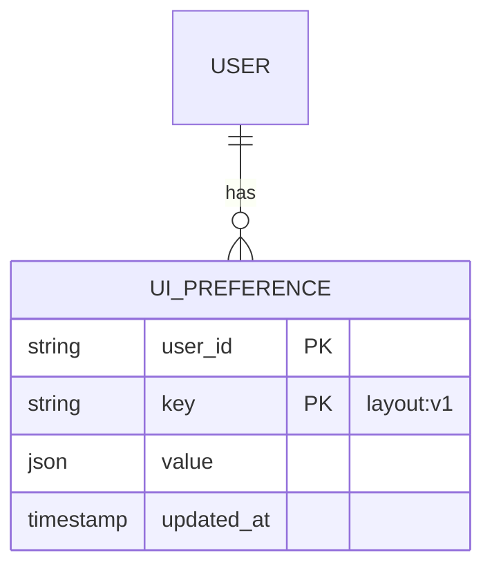

# 04 · Seven lenses

[Index](README.md) · prev: [03 Architecture](03-architecture.md) · next: [05 Implementation plan](05-implementation-plan.md)

The same shell, looked at by seven people who will each judge it by a different failure. Each lens
ends with the one thing it would refuse to ship without.

---

## 1 · Product Owner

**The question I ask:** *what does a user stop doing because of the shell?*

The measured answer today: they stop resizing (impossible), they stop trusting their setup (resets
every reload), and with many documents open they stop knowing where they are (the active tab can be
off screen). Three habits a competitor does not break.

**What I will pay for, and what I will not.** Resizing and persistence are retention features, not
polish: they are the difference between "I try it" and "I use it". Dark mode was already shipped,
which was the right call for the same reason. I will **not** pay for a fourth panel, a theme editor,
or a layout that can be rearranged arbitrarily — see [07](07-decisions-risks.md) for why.

**How I will judge it:** a five-second test and a five-day test. Five seconds: does the layout look
deliberate? Five days: after twenty sessions, has anything reset?

**My metric:** time-to-first-useful-action drops, and session count per user per week rises without
any change to the agent. If only agent metrics improve, the shell work failed.

**Refuse to ship without:** *Reset layout*. A user who makes the layout unusable must have one
obvious way back. Without it, customisation is a trap, and support tickets replace retention.

---

## 2 · Full Stack Developer

**The question I ask:** *where does this state live, and who owns it?*

Today: geometry lives in CSS literals **and** in React state **and** nowhere else, so it cannot be
persisted and cannot be tested. Two `.layout` rules already disagree (F4). That is a design smell
before it is a bug.

**What I want instead.** One pure module (`domain/layout.ts`) that owns bounds, defaults, clamping and
serialisation; one hook (`useLayout`) that binds it to React and `localStorage`; components that
render. That is SOLID applied honestly rather than as a slogan:

| Principle | Where it shows up |
|---|---|
| **S**ingle responsibility | `layout.ts` computes; `Separator` captures input; `App` composes. No file does two of these. |
| **O**pen/closed | A third resizable zone needs a new entry in a zone table, not edits to the separator, the hook, or the CSS. |
| **L**iskov | Any zone implements the same `ResizableZone` contract: `minWidth(viewport)`, `maxWidth(viewport)`, `defaultWidth`. The separator works with all of them identically. |
| **I**nterface segregation | The tab strip gets `{ tabs, active, onSelect, onClose }` — not the whole session. |
| **D**ependency inversion | `App` depends on the `Layout` interface and the `columns()` function, never on `localStorage` or on a CSS literal. |

**DRY, concretely.** Today three things duplicate the same knowledge: the two `.layout` rules, the
`no-rail`/`no-inspector` variants, and the media queries. After: **one** function returns the columns
string for every combination of mode and visibility, and one CSS rule consumes it. The number `276`
appears once, as `DEFAULTS.railWidth`.

**What will make me reject a PR:** a `getBoundingClientRect()` in a render path; a `localStorage` call
outside `useLayout`; a hard-coded pixel width outside `layout.ts`; a resize handler without
`requestAnimationFrame` throttling.

**Refuse to ship without:** a unit test file for `layout.ts` that covers the bounds, the three modes,
corrupt persisted input, and the reset — because geometry is exactly the kind of logic that is trivial
to break and impossible to eyeball.

---

## 3 · Database / Data Expert

**The question I ask:** *is any of this persisted state, and if so, what is its shape and lifetime?*

The honest answer for the shell: **none of it belongs in a database.** Layout is per-browser
preference, not account data ([SH-B5](02-requirements.md)). Putting it in the session store would mean
a layout chosen on a laptop fighting one chosen on a desktop, and would add a migration to a product
that currently has none.

**But the audit surfaced a real data finding next to the shell:** sessions live only in
`Orchestrator._live`, and the event store is `MemoryEventStore` — so *the session list and every
transcript disappear when the app restarts*. That is outside this spec's scope and is recorded as a
risk in [07](07-decisions-risks.md), because a shell that remembers its panels while forgetting its
sessions would be an embarrassing combination to ship.

**The one table this spec would add, if it ever left the browser:**



Key–value, versioned in the key, last-write-wins. No relational modelling of individual columns: the
moment layout becomes a table with a column per zone, every new zone is a migration.

**What I insist on regardless:** `parse()` must be **total**. A stored blob is untrusted input like any
other; a corrupt value must fall back to defaults, never throw. That is the same rule as a request
body, applied to a place people forget is a data boundary.

**Refuse to ship without:** evidence that a corrupt or future-versioned layout value does not break the
shell — a test that writes garbage into the key and asserts the app still renders.

---

## 4 · UX Designer

**The question I ask:** *can the user make the app fit their task, and do they discover that they can?*

Resizing that nobody finds is not a feature. So the affordance carries the discovery: a 6 px hit area
that becomes visible on hover, a cursor change, the standard double-click-to-reset, and a shortcut in
the sheet (`⌘/`) that names it. The same discipline as the palette: the feature exists *and* is listed.

**The three states of every separator, designed rather than defaulted:**

```
 idle              hover / drag           focus (keyboard)
 │                 ┃                      ┃
 │ 1 px hairline   ┃ 2 px accent          ┃ 2 px accent + 2 px offset ring
 │                 ┃ cursor: col-resize   ┃ aria-valuenow announced
```

**Progressive feedback as a UX rule, not a spinner.** A 4 s search that says "searching…" teaches the
user the app is slow. The same 4 s that says "found 3 so far, still looking" teaches them it is
thorough. Same duration, opposite impression — so the requirement is on the *message*, not on the
speed ([SH-D2](02-requirements.md)).

**What I will not accept:** a resize that reflows the transcript mid-sentence. The drag must move the
boundary, not re-wrap the text the user is reading. This is why [SH-A6](02-requirements.md) forbids a
transcript re-render during the drag.

**Refuse to ship without:** "Reset layout" discoverable in the palette **and** in the shortcut sheet,
in the user's words — not hidden behind an icon.

---

## 5 · Front-End Designer

**The question I ask:** *is it one system, or a collection of components that happen to sit together?*

Today's shell is close but has the tell-tale signs of accretion: two `.layout` definitions, eight
distinct `z-index` values with no scale (`1, 2, 3, 20, 39, 40, 41, 50`), three different radii in the
tab strip alone. None of it is visible to a user; all of it will be visible the first time someone
adds a popover inside a drawer.

**The tokens this work introduces, and nothing more:**

```css
--z-base: 0;      --z-sticky: 10;   --z-dropdown: 20;
--z-drawer: 40;   --z-scrim: 39;    --z-modal: 50;   --z-toast: 60;
--sep-hit: 6px;   --sep-line: 1px;  --sep-accent: 2px;
```

**The layout is a grid with a property, not a component.** That is the front-end decision that matters:
`grid-template-columns: var(--layout-columns)` keeps the browser's layout engine doing the work (it is
fast, it is correct, it handles minmax) while the value comes from one testable place. A JS-driven
flex layout with inline widths would be slower and would re-implement what the browser already does.

**Motion.** A resize has no animation: it must track the pointer exactly. A drawer has 120 ms of
ease-out. Both disappear under `prefers-reduced-motion` — already enforced globally and verified by the
accessibility audit.

**Refuse to ship without:** the separator visual states being defined for idle, hover, drag, and
focus — because that is where a "resizable panel" either looks like a product or like a demo.

---

## 6 · AI Engineer

**The question I ask:** *does the shell fight the agent, or does it stay out of the way?*

The agent's output is the product. Every shell behaviour that competes with it — re-rendering the
transcript on every token, stealing scroll, jumping the composer, re-wrapping text mid-stream — is a
defect regardless of how nice the panel looks.

**Two rules from the streaming path, already learned the hard way.** A long answer froze the tab until
events were batched at 40 ms and the answer was rendered as plain text past 4 kB. A drag that re-renders
the transcript would reintroduce exactly that failure. So the resize path must not touch transcript
state ([SH-A6](02-requirements.md)), and the audit must measure it.

**Progressive feedback is an agent-UX problem too.** A turn that takes 90 s with no narration reads as
a hang; the same turn with a plan checklist and tool cards reads as work. The shell's job is to keep
those affordances visible while the composer stays usable ([SH-D4](02-requirements.md)) — so a user can
queue the next thought while the agent runs.

**What I will measure:** main-thread long tasks during a resize and during a stream. The target is
zero frames over 50 ms caused by shell work.

**Refuse to ship without:** a test that resizes both panels while a turn is streaming, and asserts the
turn still completes and the transcript did not lose content. That is the interaction of the two
systems this spec is most likely to break.

---

## 7 · Databricks Expert

**The question I ask:** *does the shell tell the truth about where the agent may write, and does it stay
inside the platform's rules?*

Two platform facts constrain the shell directly:

1. **Unity Catalog is the permission boundary.** The navigator shows the user's own objects and nothing
   else; the inspector states the write fence (`folder`, `schema`, `job prefix`) on every session. Any
   shell change must keep that statement visible — it is not decorative, it is the user's contract with
   the agent.
2. **Workspace search has no server-side equivalent.** That is why search is a bounded client-side walk
   (120 directories, 8 s) and why it measures 4.1–4.3 s. The shell cannot make it faster; it can only be
   honest about it ([SH-D2](02-requirements.md), [SH-D3](02-requirements.md)).

**Catalog search across the whole metastore** is the one place where a shell requirement meets a
platform limit: the table-name walk is already per-credential and cached
([001/18](../001-databricks-coding-agents/18-gap-analysis.md)). The shell must not add a second,
independent cache, or the two will disagree about what the user can see.

**What I insist on:** the persisted layout must never include anything derived from a token or a
session — no user id, no path. Two people sharing a browser profile must not inherit each other's
working folder from a layout blob.

**Refuse to ship without:** a check that the layout key contains geometry and view preference only —
nothing that came from the workspace.

---

## The lenses in tension, and the resolutions

| Tension | Parties | Resolution |
|---|---|---|
| Customisation vs. supportability | PO ↔ UX | Reset is a first-class action in two places ([SH-B3](02-requirements.md)) |
| Persistence vs. privacy | Databricks ↔ PO | Persist geometry only; never a path or an identity ([SH-B5](02-requirements.md)) |
| Rich feedback vs. main-thread cost | UX ↔ AI Engineer | Feedback is local to the zone and cheap; never a transcript re-render ([SH-D4](02-requirements.md)) |
| Browser layout vs. JS control | Front-end Designer ↔ Full Stack | The browser lays out; the module supplies one string; CSS owns the rest |
| Many documents vs. tab clarity | UX ↔ Front-End | Active tab always visible; hidden count surfaced ([SH-C3](02-requirements.md)) |
