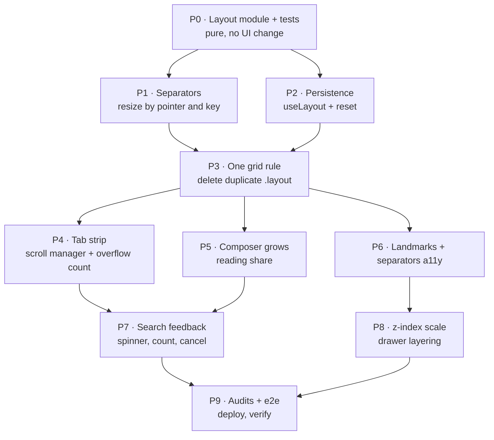

# 05 · Implementation plan

[Index](README.md) · prev: [04 Lenses](04-lenses.md) · next: [06 Edge cases & tests](06-edge-cases-testing.md)

Grounded in the files that exist. Each phase is independently shippable and independently revertible;
none leaves the app in a state where a previously passing audit fails.

## Phase order, and why this order



The module comes first because everything else reads from it; the duplicate CSS is deleted only after a
module produces the columns (so there is never a moment with two live sources). Persistence comes
before the tab strip so a reload during testing preserves the state being tested.

---

## P0 · The layout module

**New:** `web/src/domain/layout.ts`, `web/src/domain/layout.test.ts`

```ts
export type RailTab = "sessions" | "files" | "catalog";
export type Mode = "wide" | "mid" | "narrow";

export const RAIL_MIN = 200, RAIL_MAX_SHARE = 0.4, RAIL_DEFAULT = 276;
export const INSP_MIN = 260, INSP_DEFAULT = 340, CENTRE_MIN = 480;

export interface Layout {
  railWidth: number; inspectorWidth: number;
  railVisible: boolean; inspectorVisible: boolean; railTab: RailTab;
}

export const DEFAULTS: Layout = { railWidth: RAIL_DEFAULT, inspectorWidth: INSP_DEFAULT,
  railVisible: true, inspectorVisible: true, railTab: "sessions" };

export function modeFor(viewport: number): Mode {
  return viewport <= 820 ? "narrow" : viewport <= 1180 ? "mid" : "wide";
}

export function clampWidth(zone: Zone, want: number, viewport: number): number;
export function columns(layout: Layout, viewport: number): string;
export function resizeBy(zone: Zone, l: Layout, viewport: number, delta: number): Layout;
export function parse(raw: string | null, viewport: number): Layout;
export function serialize(l: Layout): string;
export function reset(): Layout;
```

**Bounds, stated as arithmetic** (this is the part that must be tested, not the pixels):

- `railWidth ∈ [200, min(0.4·viewport, viewport − inspectorWidth − CENTRE_MIN)]`
- `inspectorWidth ∈ [260, min(0.4·viewport, viewport − railWidth − CENTRE_MIN)]`
- If both maxima are unsatisfiable (viewport small), the centre column wins: the rails clamp to their
  minimums and the centre takes the rest.
- `columns()` returns `"<rail> minmax(0, 1fr) <insp>"`, dropping a zone that is hidden, and returns
  `"minmax(0, 1fr)"` in `narrow` mode.

**Tests (unit, no DOM):** bounds at 1600/1180/900/760; hidden-zone variants (2×2); clamping a drag past
each bound; `parse(null)`, `parse(garbage)`, `parse('{"version":"v9"}')`, `parse` with a NaN width;
round-trip `parse(serialize(x)) === x`; `reset()` equals `DEFAULTS`.

**Acceptance:** `npx vitest run src/domain/layout.test.ts` passes; nothing else in the app changed.

---

## P1 · Separators

**New:** `web/src/components/Separator.tsx`
**Edit:** `App.tsx` (mount two), `styles.css` (three visual states, `--sep-hit`)

```tsx
export function Separator({ zone, width, min, max, label, onResize, onReset }: SeparatorProps) {
  // role="separator" + aria-orientation="vertical" + aria-valuenow/min/max
  // onPointerDown → setPointerCapture, rAF-throttled move, commit on pointerup
  // onKeyDown → ArrowLeft/Right (8 px), Shift (64 px), Home (reset)
}
```

**DRY:** one component, two instances, zone as data. **SOLID:** the separator depends on
`{min, max, width, onResize}` — it does not know what a rail is.

**Acceptance:** dragging moves the boundary with the pointer within 1 px; `←`/`→` moves 8 px; `Home`
resets; the drag works when the pointer leaves the 6 px strip; the value is announced.

---

## P2 · Persistence

**New:** `web/src/hooks/useLayout.ts`
**Edit:** `App.tsx` (replace `railShown`/`inspShown` with the hook)

```ts
const KEY = "coding-agent:layout:v1";
export function useLayout(viewport: number) {
  const [layout, setLayout] = useState(() => parse(localStorage.getItem(KEY), viewport));
  useEffect(() => { const id = setTimeout(() => {
    try { localStorage.setItem(KEY, serialize(layout)); } catch { /* quota: preference is a nicety */ }
  }, 150); return () => clearTimeout(id); }, [layout]);
  return { layout, setWidth, toggle, setRailTab, resetAll };
}
```

**Why a debounce of 150 ms:** a drag fires ~60 updates/s; writing 60 times both costs frames and wears
flash on some devices. 150 ms is below human perception of "did it stick" and above drag frequency.

**Acceptance:** hide the rail, reload, it is still hidden; resize both panels, reload, widths hold;
write garbage into the key, reload, the app renders with defaults; "Reset layout" restores all five
fields.

---

## P3 · One grid rule

**Edit:** `styles.css` — delete the first `.layout` block (line 66) and its `.no-inspector` variant;
replace the surviving rules with the custom-property form; delete `.no-rail` variants.

```css
.layout { display: grid; grid-template-columns: var(--layout-columns, 276px minmax(0, 1fr) 340px);
  gap: 1px; background: var(--line); min-height: 0; }
```

**Edit:** `App.tsx` — `<div className="layout" style={{ "--layout-columns": columns(layout, viewport) }}>`.

**Acceptance:** `rg "grid-template-columns: \d+px" web/src/styles.css` returns exactly one line (the
fallback). The measured rects are unchanged from the pre-work audit at every width.

---

## P4 · Tab strip

**New:** `web/src/components/DocTabs.tsx` (extracted from `App.tsx`), `DocTabs.test.tsx`

Rules: active tab always fully visible after any change; `scrollIntoView({block:"nearest",
inline:"nearest"})` in one rAF; hidden-tab count at the end when overflowing; `⌘W` closes the active
tab and activates the neighbour.

**Acceptance:** with 12 documents open at 900 px, the active tab is fully inside the strip after every
`Ctrl+Tab`; the hidden count matches `tabs − visible`; closing the last document shows the chat.

---

## P5 · Composer grows

**Edit:** `components/Composer.tsx` — already auto-sizes to 200 px; cap at 8 lines and make the empty
state one line; make sending not change the height ([SH-E1](02-requirements.md)).

**Acceptance:** empty composer ≈ 1 line; a 10-line draft caps and scrolls; sending from a capped
composer does not move the transcript; reading share at 1440 rises from 0.78 to ≥0.84 when empty.

---

## P6 · Landmarks and separator semantics

**Edit:** `App.tsx`, `components/Transcript.tsx`, `components/Composer.tsx`

```html
<section class="transcript" role="region" aria-label="Conversation" aria-live="polite">
<section class="composer" role="region" aria-label="Message the agent">
```

**Acceptance:** the a11y audit gains a landmark check; navigating by landmark reaches header, navigator,
conversation, message box, inspector.

---

## P7 · Search feedback

**Edit:** `components/WorkspaceTree.tsx`, `components/CatalogTree.tsx`

Spinner appears within 150 ms at the point of work; the first page shows results plus a count; a
"still looking" line states partial completeness; `Escape` in the search field cancels and restores the
previous results.

**Acceptance:** measured 4.1 s search shows a spinner and a count before it completes; `Escape` restores
the previous list rather than emptying it.

---

## P8 · z-index scale

**Edit:** `styles.css` — introduce `--z-*` tokens and replace the eight raw values.

**Acceptance:** `rg "z-index: \d" web/src/styles.css` returns zero; the drawer, its scrim, the palette
and the approval sheet keep their current stacking at every width.

---

## P9 · Verify and deploy

```bash
cd apps/coding-agent/web
npx vitest run && npm run build && npm run audit:shell && npm run audit:a11y \
  && npm run audit:overflow && npm run e2e:shell
cd .. && .venv/bin/python -m pytest -q
# then deploy, then the same audits against the deployment with BEARER_FILE set
```

The shell audit is extended in this phase to *fail* on any of: fewer than 2 separators, a reload that
loses a width, a reload that loses visibility, an active tab outside the strip.

---

## What each phase touches, so PRs stay reviewable

| Phase | Files touched | Risk |
|---|---|---|
| P0 | 2 new | none (unused code) |
| P1 | 1 new, 2 edited | medium (pointer capture) |
| P2 | 1 new, 1 edited | low |
| P3 | 1 edited | medium (CSS deletion) |
| P4 | 2 new, 1 edited | medium (extraction) |
| P5 | 1 edited | low |
| P6 | 3 edited | low |
| P7 | 2 edited | low |
| P8 | 1 edited | low |
| P9 | scripts | none |

**Rollback:** P0–P2 are additive; P3 is the only destructive edit and is a single diff hunk; P4 keeps
the old tab markup until the new component is proven by its own test.

## Definition of done

1. Every requirement in [02](02-requirements.md) has a test that names its ID.
2. `npm run audit:shell` reports **resizable: yes**, **remembered: yes**, 0 findings.
3. Overflow, accessibility, shell e2e and live e2e all pass **against the deployed app**.
4. The measured rects at 1600/1440/1180/900/760 match the intent in
   [01](01-shell-audit.md#measured-at-every-width) except where a user's own choice changed them.
5. `specs/001-perfect-shell` states what is still not done.
