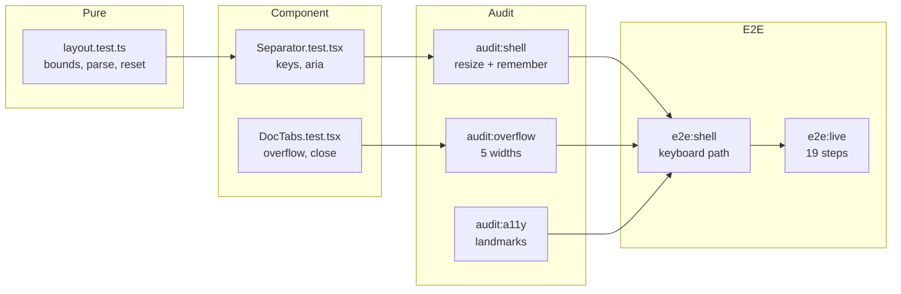

# 06 · Edge cases, and the test that catches each

[Index](README.md) · prev: [05 Implementation plan](05-implementation-plan.md) · next: [07 Decisions & risks](07-decisions-risks.md)

Every row is a way this can fail. `Auto` means an automated test; `Audit` means the shell/overflow/a11y
audit catches it; `Manual` means it needs a person, and says what they do.

## A · Resizing

| # | Edge case | Expected | Caught by |
|---|---|---|---|
| A1 | Drag past the rail's minimum | Stops at 200 px; the pointer keeps moving, the boundary does not | Auto (`clampWidth`) |
| A2 | Drag past the maximin such that the centre would fall under 480 px | The centre wins: the rail clamps earlier than its 40% share | Auto |
| A3 | Drag both panels wide in a 1180 px window | Neither can exceed its share; the centre stays ≥ 480 | Auto |
| A4 | Pointer leaves the 6 px strip mid-drag | Resize continues (pointer capture), ends on pointerup anywhere | Auto (e2e: move outside the window box) |
| A5 | Pointer released outside the browser window | Drag ends; no stuck state; next click is normal | Manual |
| A6 | Drag a separator, then press `⌘B` mid-drag | The drag commits, then the panel hides; no lost pointer | Auto |
| A7 | Resize during a streaming turn | The turn completes; transcript content unchanged | Auto (e2e, both at once) |
| A8 | Double-click a separator | Resets that zone only, not both | Auto |
| A9 | `Home` on a focused separator | Resets that zone | Auto |
| A10 | `Shift+→` | Moves 64 px, clamped | Auto |
| A11 | Touch device | Drag works with a finger; no page scroll during the drag (`touch-action: none`) | Manual (device) |
| A12 | Separator focused, no keyboard support in the browser | Falls back: the handle still works by pointer | n/a |
| A13 | Window resized while a width is at its maximum | Width re-clamps to the new viewport without needing a drag | Auto |
| A14 | Zoom to 200% | Effective viewport halves; bounds apply to the CSS viewport, not device pixels | Audit (overflow at 720 px) |

## B · Persistence

| # | Edge case | Expected | Caught by |
|---|---|---|---|
| B1 | Reload after hiding both panels | Both still hidden; centre full width | Audit (`remembers: true`) |
| B2 | Reload after resizing | Exact pixel widths restored | Audit |
| B3 | `localStorage` disabled (Safari private) | App works; layout just does not persist; no error thrown | Auto (mock throwing storage) |
| B4 | Quota exceeded on write | Silently ignored; no console error surfacing to the user | Auto |
| B5 | Corrupt value (`"{nope"`) | Defaults; app renders | Auto |
| B6 | Future version (`{"version":"v9"}`) | Defaults, and the bad key is overwritten | Auto |
| B7 | Width stored as `null` / `"abc"` / `NaN` | Defaults for that field only; other fields kept | Auto |
| B8 | Stored width larger than the current viewport allows | Clamped on read; not rejected wholesale | Auto |
| B9 | Two tabs open, each resized | Each keeps its own; last write wins per key | Manual |
| B10 | Reset layout | All five fields back to defaults, persisted immediately | Auto |
| B11 | Stored value contains a workspace path | Impossible by construction: `serialize` writes geometry and a tab name only | Auto (assert key contents) |
| B12 | Storage key from a previous product version | Namespaced `coding-agent:layout:v1`; a different product's key is untouched | Auto |

## C · Tab strip

| # | Edge case | Expected | Caught by |
|---|---|---|---|
| C1 | 20 documents open at 760 px | Active tab fully visible after every selection | Auto (e2e) |
| C2 | Open a document from the palette while the strip is scrolled to the end | The new tab scrolls into view | Auto |
| C3 | `Ctrl+Tab` past the last tab | Wraps to the first; both ends bring their tab into view | Auto |
| C4 | Close the active tab | The right neighbour activates; if none, the left; if none, Chat | Auto |
| C5 | Close a tab while its document is loading | No error; the load result is discarded | Auto |
| C6 | Same document opened twice | One tab, activated (dedupe by doc id) | Auto |
| C7 | Very long document name | Tab truncates with ellipsis; the title attribute has the full path | Audit (overflow) |
| C8 | Tab strip at exactly the overflow boundary | No flicker: the hidden count appears once, not per frame | Manual |
| C9 | `⌘W` with only Chat open | Nothing closes; the chat is never closed | Auto |
| C10 | Reload with documents open | Documents and the active one are restored from the layout key | Auto |

## D · Feedback and slow work

| # | Edge case | Expected | Caught by |
|---|---|---|---|
| D1 | Search returns nothing | "Nothing matches" after completion, not before | Auto |
| D2 | Search times out (8 s budget) | Partial results plus "first matches"; no spinner forever | Auto |
| D3 | Cancel a search | Previous results restored, not an empty list | Auto |
| D4 | Type during a search | Debounced 300 ms; only the last query's results land (stale responses dropped) | Auto |
| D5 | Search while a turn streams | Both progress independently; the transcript keeps streaming | Auto |
| D6 | Endpoint 401/403 | "you do not have access" in the zone, not a spinner forever | Auto |

## E · Frame stability

| # | Edge case | Expected | Caught by |
|---|---|---|---|
| E1 | Send a long draft | Composer shrinks to one line only after send; transcript does not jump | Auto |
| E2 | Toggle the inspector mid-read | Text re-wraps once; scroll position preserved | Auto |
| E3 | A 300 kB answer arriving | Batched; no long task over 50 ms attributable to the shell | Manual (Performance panel) |
| E4 | Drawer opens over the transcript | Scrim covers; Esc closes; focus returns to the handle | Auto |
| E5 | Approval sheet + palette open together | Only one modal at a time; the second does not stack invisibly | Auto |

## F · Accessibility of the new controls

| # | Edge case | Expected | Caught by |
|---|---|---|---|
| F1 | Keyboard-only user wants to resize | Tab reaches the separator; arrows resize; value announced | Auto (e2e) |
| F2 | Screen reader announces a separator with no value | `aria-valuenow` in px, name says which zone | Audit |
| F3 | Focus inside the rail, then `⌘B` | Focus moves to the restore handle, not lost to `<body>` | Auto |
| F4 | High contrast / forced colours | Separator still visible; hit area unchanged | Audit |
| F5 | Zoom 200% with drawers open | Drawer width is a share of the viewport, not a pixel constant | Audit |
| F6 | Landmark navigation | header, navigator, conversation, composer, inspector in order | Audit |

## G · Regression guards (the ones that must never go quiet)

| # | Guard | Why |
|---|---|---|
| G1 | `audit:shell` fails if separators < 2 | The feature cannot silently disappear |
| G2 | `audit:shell` fails if a reload loses a width or a visibility | Persistence cannot regress silently |
| G3 | `audit:shell` fails if the active tab is outside the strip | The tab bug cannot come back |
| G4 | `audit:overflow` at five widths, plus an injected 300-char token | The frame cannot start spilling |
| G5 | `audit:a11y` with landmark checks added | Contrast, names, targets stay at zero |
| G6 | `e2e:live` 19 steps | The product workflow still works end to end |
| G7 | Layout unit tests | Bounds arithmetic, parse totality, reset |

## The test matrix, as a picture



## How these are run

```bash
cd apps/coding-agent/web
npx vitest run                  # pure + component
npm run audit:shell             # resize, remember, tab visibility
npm run audit:overflow          # no spill, five widths
npm run audit:a11y              # WCAG + landmarks
npm run e2e:shell               # the keyboard path
npm run e2e:live                # the product path
```

Against a deployment, add `APP_URL=... BEARER_FILE=...` and run **one audit at a time** — two headless
browsers against one app produced a false "page crashed" in an earlier run (see
[001/20](../001-databricks-coding-agents/20-accessibility.md#a-note-on-running-these-audits)).
