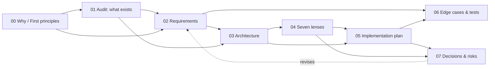

# 001 · Perfect Shell

The shell is the part of the product that is always on screen: the header, the navigator, the tab
strip, the reading surface, the composer, the inspector. This specification audits it against the
best web applications of November 2026, states what it must become, and plans the work in a way that
is grounded in the code that exists today.

**Scope boundary.** This spec is about the *shell*: layout, zones, resizing, show/hide, navigation,
focus, and the state that makes them feel instant. It does not re-specify the agent, the tool server,
or the Databricks integration. Those are [001-databricks-coding-agents](../001-databricks-coding-agents/README.md).

## Documents

| # | Document | Answers |
|---|---|---|
| 00 | [Why, from first principles](00-why-first-principles.md) | Why does the shell decide whether this product feels good? Five whys, then the axioms. |
| 01 | [Shell audit](01-shell-audit.md) | What is actually there? Every zone, its role, its measurements, and nine defects. |
| 02 | [Requirements](02-requirements.md) | What must be true when this is done, as testable statements. |
| 03 | [Architecture](03-architecture.md) | The zone model, the layout state machine, the contracts, the diagrams. |
| 04 | [Seven lenses](04-lenses.md) | The same shell seen by a PO, a full-stack dev, a data expert, a UX designer, a front-end designer, an AI engineer, a Databricks expert. |
| 05 | [Implementation plan](05-implementation-plan.md) | How it gets built, in phases, DRY and SOLID, against real files. |
| 06 | [Edge cases and tests](06-edge-cases-testing.md) | Every way it can break, and the test that catches each. |
| 07 | [Decisions and risks](07-decisions-risks.md) | The choices, the alternatives rejected, and what could still go wrong. |

Related: [001-databricks-coding-agents](../001-databricks-coding-agents/README.md) — the product this
shell frames; its [19 interaction design](../001-databricks-coding-agents/19-interaction-design.md) and
[20 accessibility](../001-databricks-coding-agents/20-accessibility.md) are the direct predecessors of
this spec.

Cross-references run both ways: each document names the ones it depends on, and every claim in 02
traces to a measurement in 01.

## The one-paragraph finding

The shell is **structurally sound and behaviourally incomplete**. Its zones are in the right places
and the layout arithmetic is correct at every width — measured, no dead space, no overlap, and zero
overflow at 1480/1180/900/760. But three capabilities that every product at this level has are
**absent**: panels cannot be resized at all (0 splitters, 0 resizers, `resize` never set); the
layout does not remember anything across a reload (the only two persisted keys are a stream cursor
and prompt history); and the tab strip scrolls but never brings the active tab into view, so with
enough documents open the tab you are looking at can be off screen. Alongside those, the layout has
**two competing definitions** in CSS, one of which is dead code, and search feedback is a single
"searching…" with no progress and no cancel across a measured 4.1–4.3 s wait.

The fix is not a redesign. It is: one source of truth for layout, a resize affordance with persistence,
a tab strip that manages its own overflow, progressive feedback for slow work, and a focus model that
survives all of it.

## What "frontier" means here

Six properties, taken from the products that define the bar right now — Linear, Raycast, Cursor,
Superhuman, Figma, VS Code:

1. **The layout is the user's**, not the designer's: resizable zones, remembered, restorable.
2. **Nothing is a dead end**: every zone can be hidden, and every hidden zone can be brought back
   without a mouse.
3. **Space is never wasted**: a hidden zone gives its pixels back, measured to the pixel.
4. **Slow work narrates itself**: progress, an estimate, and a way to cancel.
5. **The frame never jumps**: no reflow that moves what you were reading.
6. **The keyboard reaches everything**, and focus is visible and trapped where it should be.
