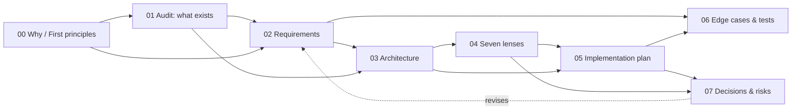

# 001 · Perfect Shell

The shell is the part of the product that is always on screen: the header, the navigator, the tab
strip, the reading surface, the composer, the inspector. This specification audits it against the
best web applications of November 2026, states what it must become, and plans the work in a way that
is grounded in the code that exists today.

**Scope boundary.** This spec is about the *shell*: layout, zones, resizing, show/hide, navigation,
focus, and the state that makes them feel instant. It does not re-specify the agent, the tool server,
or the Databricks integration. Those are [001-databricks-coding-agents](../001-databricks-coding-agents/README.md).

## Documents

| # | Document | Answers |
|---|---|---|
| 00 | [Why, from first principles](00-why-first-principles.md) | Why does the shell decide whether this product feels good? Five whys, then the axioms. |
| 01 | [Shell audit](01-shell-audit.md) | What is actually there? Every zone, its role, its measurements, and nine defects. |
| 02 | [Requirements](02-requirements.md) | What must be true when this is done, as testable statements. |
| 03 | [Architecture](03-architecture.md) | The zone model, the layout state machine, the contracts, the diagrams. |
| 04 | [Seven lenses](04-lenses.md) | The same shell seen by a PO, a full-stack dev, a data expert, a UX designer, a front-end designer, an AI engineer, a Databricks expert. |
| 05 | [Implementation plan](05-implementation-plan.md) | How it gets built, in phases, DRY and SOLID, against real files. |
| 06 | [Edge cases and tests](06-edge-cases-testing.md) | Every way it can break, and the test that catches each. |
| 07 | [Decisions and risks](07-decisions-risks.md) | The choices, the alternatives rejected, and what could still go wrong. |

Related: [001-databricks-coding-agents](../001-databricks-coding-agents/README.md) — the product this
shell frames; its [19 interaction design](../001-databricks-coding-agents/19-interaction-design.md) and
[20 accessibility](../001-databricks-coding-agents/20-accessibility.md) are the direct predecessors of
this spec.

Cross-references run both ways: each document names the ones it depends on, and every claim in 02
traces to a measurement in 01.

## The one-paragraph finding

The shell is **structurally sound and behaviourally incomplete**. Its zones are in the right places
and the layout arithmetic is correct at every width — measured, no dead space, no overlap, and zero
overflow at 1480/1180/900/760. But three capabilities that every product at this level has are
**absent**: panels cannot be resized at all (0 splitters, 0 resizers, `resize` never set); the
layout does not remember anything across a reload (the only two persisted keys are a stream cursor
and prompt history); and the tab strip scrolls but never brings the active tab into view, so with
enough documents open the tab you are looking at can be off screen. Alongside those, the layout has
**two competing definitions** in CSS, one of which is dead code, and search feedback is a single
"searching…" with no progress and no cancel across a measured 4.1–4.3 s wait.

The fix is not a redesign. It is: one source of truth for layout, a resize affordance with persistence,
a tab strip that manages its own overflow, progressive feedback for slow work, and a focus model that
survives all of it.

## What "frontier" means here

Six properties, taken from the products that define the bar right now — Linear, Raycast, Cursor,
Superhuman, Figma, VS Code:

1. **The layout is the user's**, not the designer's: resizable zones, remembered, restorable.
2. **Nothing is a dead end**: every zone can be hidden, and every hidden zone can be brought back
   without a mouse.
3. **Space is never wasted**: a hidden zone gives its pixels back, measured to the pixel.
4. **Slow work narrates itself**: progress, an estimate, and a way to cancel.
5. **The frame never jumps**: no reflow that moves what you were reading.
6. **The keyboard reaches everything**, and focus is visible and trapped where it should be.

## Appearance: a real theme layer (added after the first delivery)

The first delivery had one palette and a `prefers-color-scheme` block that restated nine variables.
That is not a theme: the semantic tints, the semantic inks, and every surface past `--surface-2`
stayed light, so dark mode was a grey wash with green and pink pastels glowing through it.

The theme is now a first-class layer, following the reference design system in `gr8r-studio`:

| Decision | Why |
|---|---|
| Three preferences — `system`, `light`, `dark` — not a two-state switch | A binary switch silently overrides the OS, so the app stops following the machine at dusk and the user has to remember to undo it. `system` is the default. |
| Dark is **restated**, not inverted | Inversion gives grey text on grey paper, and folds every semantic tint into the same colour. Every token is given a dark value chosen for that background. |
| `data-theme` is **removed** for `system` | The CSS media query then drives the paint, so switching the OS repaints with no JavaScript in the path. Writing `data-theme="system"` would make every `[data-theme="dark"]` rule miss. |
| The attribute is applied **before first paint** | `applyStoredTheme()` runs synchronously in `main.tsx`. An effect would paint one white frame for every dark-mode user on every load. |
| The control is a **segmented control with glyphs** | Three states are readable at a glance, the third option is discoverable, and the glyph carries the meaning so colour is not the only signal. |
| Accent-tinted hovers replaced with neutral ones | Tinting every row of a long list makes it read as a wall of colour and leaves nothing to distinguish the selected row. Selection is a raised card, as in the reference. |

Tokens live at the top of `styles.css` under a single banner. The vocabulary (`--ink`, `--line`,
`--surface`, the numbered ramps) is unchanged, so the theme is a change of values rather than a
rewrite of the 900 rules that consume them.

### What the theme work uncovered

- **An emoji cannot be themed.** `🗄` on a `--teal-100` tile measured **1.06:1** in dark mode — invisible. Emoji are coloured by the font and ignore `color`; the card icons are now text glyphs that inherit `currentColor`.
- **`opacity: 0.5` on a disabled primary button** dropped its label to **2.4:1** in dark. Disabled text is formally exempt from WCAG 1.4.3, but "unreadable" is the wrong way to say "not available yet". Disabled now uses the palette (surface-3 on ink-3) and still reads as off.
- **The accessibility audit only tested light mode.** Contrast is a property of a colour *pair*, so every finding cleared in light can reappear in dark. The audit now runs a dark pass and a light pass and **fails if both paint the same colour**, which is what an inert theme layer would look like.

### Verification

| Check | Result |
|---|---|
| `vitest` | 112 passed (9 new, for the pure theme module) |
| `audit:a11y` — light **and** dark | 0 findings |
| `audit:shell` | resizable and remembered |
| `audit:overflow` | 0 / 20 |
| `e2e:shell` | problems: none |
| screenshot scenes | 16, including `theme-light`, `theme-dark`, `theme-follows-system`, each asserting the ground colour it painted |

## Polish pass: what changed on each screen, and why

A second pass after the theme layer, working screen by screen against the reference design system
rather than against the audit findings alone. The bar was "would this look right in Linear or
Cursor", and every change below came from looking at a capture, not from the spec.

### Chrome (every screen)

| Change | Reason |
|---|---|
| `shadow`/`shadow-card` became a **hairline ring plus a 1px settle**; in dark mode the ring alone | A drop shadow on every small surface turns a dense list into noise. On charcoal a black shadow is invisible anyway, so the ring has to carry the edge. |
| Menu and palette hovers went **neutral** instead of accent-tinted | Tinting each row made the hovered item look *selected*. Selection and hover must be distinguishable. |
| Popovers gained the reference's **`popIn`** (4px rise + 0.97 scale, 140ms) | A menu that appears instantly feels like a glitch; a 140ms scale-up reads as coming from the control. |
| Menus tightened to a **30px row**; palette to a 50px input and 38px rows | Two type sizes and two heights across all chrome, instead of five. |
| Focus ring moved from `offset: 2px` to `1px`, and hugs bordered controls at `0` | A second floating box around a control that already has a border is visual noise. |
| Scrollbars made **thin and ghosted** | A 15px OS scrollbar on a 276px rail takes 5% of the panel and reads as chrome. |
| Brand given **`white-space: nowrap`** and hidden below 620px, mark kept | Measured: at 480px the brand was **65px tall inside a 52px bar** — clipped. The identity survives as the mark. |
| Search trigger moved to the reference's **sunken fill, 30px, no border at rest**; hover deepens the border, not the hue | A search field that turns blue on hover reads as focused when it is not. |

### Empty state

Display line to 24px at −0.024em with `text-wrap: balance`, body to 520px at 1.55 with
`text-wrap: pretty`, card gap to 8px. The earlier 23px/−0.025em was close but the sub-line ran to
560px, which is past the measure where the eye starts losing the line.

### Sessions rail

Two real gaps, found by looking rather than by testing:

1. **Sessions were indistinguishable.** Every row read "Build a notebook that shows revenue b…";
   truncation made them identical. Each row now carries a **relative stamp** ("now", "12m", "3h",
   "Tue") with the exact time in the `title` and an `aria-label`, so the abbreviation is never the
   only encoding. This needed a backend change: `Session.created_at`, serialised as `createdAt` and
   **omitted when absent** so the client can tell "no timestamp" from "epoch 0".
2. **Loading looked like failure.** The catalog rendered an italic "loading…". A tree that is
   fetching is not empty and must not say so: it now shows **shimmer skeletons** shaped like the
   rows that are arriving, with the honest slow hint after 1.2s.

Selected rows became a **raised card** (paper on paper), not an accent wash, matching the reference.

### Composer, tool cards, inspector

- Composer focus ring uses the accent at 14% alpha rather than a 3px slab of the light tint, which
  at that size read as a colour change rather than as focus.
- Evidence and plan gradients had hard-coded `#fff`, which painted a white slab in dark mode; both
  now resolve to `var(--surface)`.
- The tool "open in Databricks" pill had a hard-coded light-green hover; it now uses the palette.
- Inspector tabs use the same quiet raised-pill language as the rail tabs, so the two panes agree.

### Bugs this pass caught

| Bug | How it was found |
|---|---|
| **White text on a light accent in dark mode.** `.btn.primary` hard-coded `color: #fff`, but `--blue-600` *inverts* in dark (it becomes a light blue), so the label sat at ~2.5:1. Fixed with an `--on-accent` token: white in light, `#171716` in dark. Measured now: **5.58:1 light, 7.48:1 dark.** | Noticed while reviewing a dark capture; confirmed by computing the pair. |
| **Heading levels skipped h1 → h3** on every turn of the live app. Markdown renders `###` as a real `h3`, and there was no `h2` above it. The answer is now a `<section>` with a visually-hidden `h2`, which also makes the transcript navigable by heading. | The a11y audit, run against the **deployed** app rather than locally. |
| **Screenshot numbering collided.** A partial `SCENE=` run wrote `01-mid-…` next to `01-default-…`, and scenes taking two shots shared a number. Filenames now come from a declared `ORDER` keyed by shot name, and an unlisted name throws. A partial run now writes byte-identical filenames to a full run. | Seen when a renderer crash forced a partial re-run. |

### Verification

| Check | Local | Deployed |
|---|---|---|
| `vitest` | 120 passed (14 files) | — |
| `pytest` | 150 passed | — |
| `audit:a11y` — light **and** dark | 0 findings | **0 findings** |
| `audit:overflow` | 0 / 20 | — |
| `audit:shell` | resizable + remembered | — |
| `e2e:shell` | problems: none | — |
| screenshot scenes | 16 / 16 | **16 / 16** |
| top bar at 6 widths | no overflow, brand never wraps | — |

## Cumulative Layout Shift: measured to zero, and proven

CLS is the share of the viewport that moves without user input. An IDE-class shell has no excuse for
it: every zone has a known width and nothing above it is genuinely asynchronous. So the budget here
is **0**, not the 0.1 that Core Web Vitals calls "good".

It was not zero. Measured with a `PerformanceObserver` installed before the first byte, the first
run read **0.0071** worst-case, and the two entries were both real bugs rather than measurement
noise:

| Shift | Cause | Fix |
|---|---|---|
| **0.0049** on the catalog tab, 3.6s in | The loading skeleton was a **sibling above** `.tree-body`, so when the catalog arrived the skeleton's 51px vanished and pulled every row up (`dy=-51`). | The skeleton moved **inside** the tree box. The box keeps its geometry and only its children are replaced. |
| **0.0023** on every screen, ~95ms in | `p.composer-note` rendered `Session in <code></code> — …` before `/api/me` resolved, then reflowed to the real path a frame later. Sub-pixel `margin: auto` centring (the content box is 1107px, so the 860px column sat at x=123.5) made it a fractional shift with all-zero deltas — which is why it was invisible by eye. | The note renders its real text only once the folder is known, with a reserved line height either way, so the composer below never moves. |

### Why the zero is trustworthy

A CLS audit that reports 0.0000 everywhere is indistinguishable from a broken observer, so the
suite has to prove it can see:

- **`cls-selftest.mjs`** injects a deliberate 60px shift and requires the observer to measure it —
  it reports **+0.6108**, so the instrument works. It also asserts the stress conditions really are
  hostile: warm **1089ms** vs throttled **1494ms**, or the stress run would be testing nothing.
- **`cls-stress.mjs`** re-measures under a cold cache on every request, **400ms** of injected API
  latency and **4× CPU throttling**. Still 0.0000. A layout that only survives a warm cache is not
  stable, it is lucky.

### Coverage and result

Nine scenarios at 1440 and 760, in both themes: home, session, Files, Catalog, palette, and hiding
a pane (a deliberate layout change, which must be one clean jump and no more).

| | Worst CLS |
|---|---|
| Local | **0.0000** |
| Local, under stress (cold + 400ms + 4× CPU) | **0.0000** |
| **Deployed app** | **0.0000** |

`npm run audit:cls` runs the self-test, the audit and the stress pass in that order, and is part of
`npm run audit`.

## Icons: one geometry, and why every text glyph was replaced

The question that started this pass was "what is this icon, is it useful?" — about `⟳` in the
catalog header. It is the Refresh button. It was useful (measured: clicking it re-issues
`GET /api/catalog`), but it was not *icon-shaped*: a **12px font character in a 24×27 button**. So
the pass became an audit of every glyph in the app.

### What was wrong with text glyphs

Our chrome used characters — `⟳ ▤ ▥ ✓ ▾ ▸ ● ○ ☀ ☾ ▭ ◧ ＋ ⌕ ›`. Each one is a defect:

| Problem | Consequence |
|---|---|
| Sized by the font, not a grid | The refresh glyph was 12px in a 24px button; the tree caret was 11px in a 12px slot |
| Centred by the font's em box | A `✓` or `×` sits high in its box and never optically centres, however carefully the flex parent is built |
| Different per platform | `☀` and `☾` render at different weights on macOS, Windows and Linux, and some fonts substitute colour emoji |
| Cannot carry a stroke weight | So they could never match each other, and the toolbar looked assembled from parts |
| Cannot animate as a unit | A rotating `⟳` character rotates its own bounding box and wobbles its neighbours |

### The system

`components/Icons.tsx` — one file, one convention, taken from the reference design system:

- **24×24 viewBox**, drawn at 14–16px (12 for an inline caret), **stroke 1.8**, round caps and joins.
- **`currentColor`**: an icon inherits the colour of its control, so disabled/active/hover need no
  icon-specific rule.
- **`flex: none`** and `display: block`: a long label can no longer squeeze a glyph out of shape,
  which is what used to happen to `⟳` inside a shrinking flex row.
- **Always `aria-hidden`**: the name lives on the control (`aria-label`), never on the drawing.
- **Verified in the DOM**, not by eye: a check asserts every `svg.icon` in the running app shares
  **one viewBox and one stroke**. Measured after the change: **24 icons, `0 0 24 24`, `1.8px`**.

### Choices worth naming

- **Filled means state, outline means command.** `PanelLeft`/`PanelRight` are filled panes (they
  answer "is this zone on?"), while the layout menu is an outlined shell with a header bar. The
  first attempt used two near-identical hairline-boxes; at 16px they read as duplicates, and the
  distinction had to be fill-versus-outline, which survives greyscale.
- **A refresh that spins is a refresh that is working.** The catalog reload now has a real loading
  flag — distinct from `!roots`, which is also true after a *failure*, so the old code would have
  spun forever on an error.
- **`--on-accent`-style correctness for icons:** the card icons are glyphs that inherit
  `currentColor`, so they follow the theme; the earlier `🗄` emoji measured **1.06:1** in dark mode.
- **One icon per idea.** `Notebook`, `Table`, `Folder`, `Database`, `Schema` and `Repo` are used by
  the trees, the doc tabs, the chips and the mention list — the same drawing in all four places,
  instead of a `▤` here and a `▦` there.

### Result

| Check | Result |
|---|---|
| Text glyphs left in rendered JSX | **0** (only a comment mentions one) |
| Icon geometry consistency | 24 icons, one viewBox, one stroke |
| Refresh hit target | **24×27 → 28×28**, SVG 15px |
| `vitest` | 120 passed |
| `audit:a11y` (light + dark) | 0 findings, local **and deployed** |
| `audit:overflow` | 0 / 20 |
| `audit:cls` | 0.0000, local **and deployed** |
| `e2e:shell` | problems: none |

## Two bugs the regenerated screenshots caught

The committed screenshots predated the icon work, so they documented a design that no longer
existed. Regenerating them surfaced two real defects that no unit test had covered.

### 1. The active tab really could sit off screen — the F2 fix was incomplete

Finding F2 said the strip scrolls but never brings the active tab into view, and the first fix was
a `scrollIntoView` plus a one-frame measure. With **9 tabs** that fix did not hold: measured
`{"tabs":9,"overflows":true,"activeVisible":false}`, with the active tab at x 1000–1096 inside a
strip ending at 1059.

Cause: the `+N` overflow badge was a **flex sibling** of the strip, so rendering it removed
**41px** of strip width (823 → 782) *after* the scroll had been computed. That re-clipped the tab,
and the effect's deps (`[active, docs.length]`) had not changed, so nothing re-ran. Two successive
scroll attempts could never win that race.

Fix: the badge is `position: absolute`, over the strip's tail. The strip's width is final before
the scroll is measured. The scroll also now corrects with an explicit delta in a bounded loop
(3 passes) instead of trusting one `scrollIntoView`. Measured after: **`inside: true`, 9 tabs,
badge `+1` at `position: absolute`**.

A test that only ever opened 2–3 tabs could never have caught this. Opening nine is what exposed it.

### 2. A startup race made the app send an invalid model

Sending before `/api/models` resolved sent `"model": "model-a"` — the placeholder in the
`<select>` — and the server correctly rejected it: **422 "model model-a is not allowed for this
user"**. The session was never created, and the failure surfaced much later as a misleading
"the work area did not take the whole width".

This is a real app-level fragility, not only a test artefact: the model list and the composer both
render before the list arrives, so a fast typist can hit it. The harness now waits for a model id
that contains `/` and a non-empty folder before typing, and asserts that a `.turn` actually
appeared rather than failing several assertions downstream.

### Also fixed in this pass

- **The Chat tab still used a `💬` emoji**, the same class of defect as the `🗄` card icon
  measured at 1.06:1 in dark mode: an emoji is coloured by the font and ignores `currentColor`,
  so it cannot follow the theme. It is now a drawn `Chat` icon.
- **Test harness determinism.** The `tabs` scene clicked rows by index and toggled containers shut
  as often as it opened tables; a later attempt looped over a *live* locator, which re-resolved to
  a different row each pass and collapsed what it had just opened. It now walks the tree by
  `aria-level` (catalog → schema → table), waiting for each level to exist. Nothing depends on
  row order, index stability, or timing.
