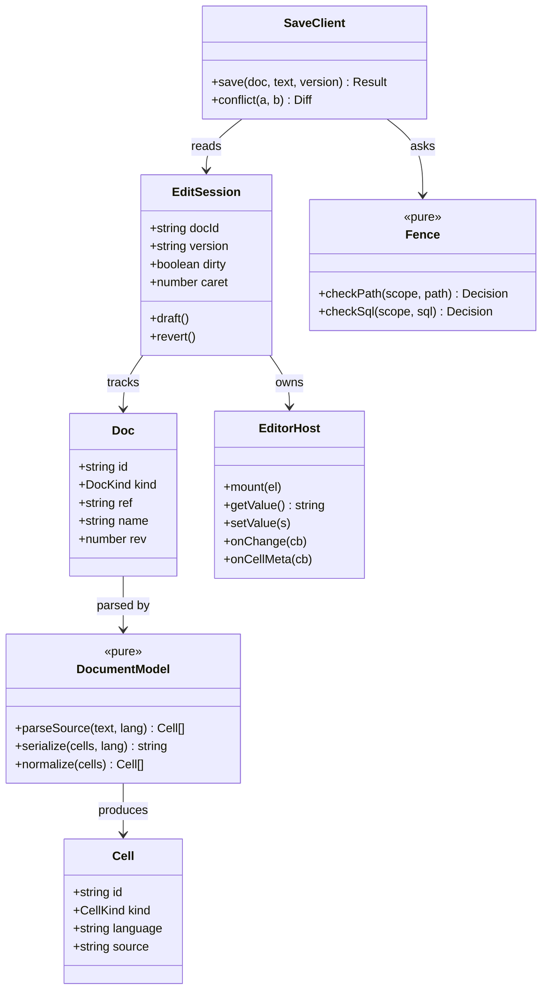
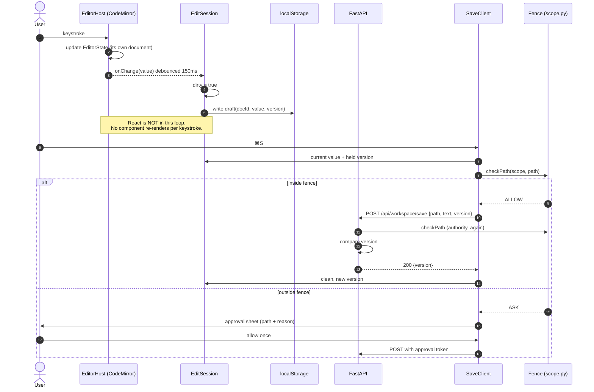
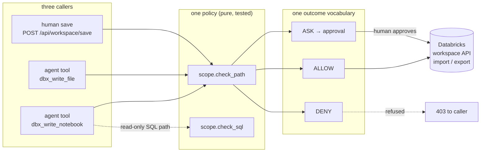
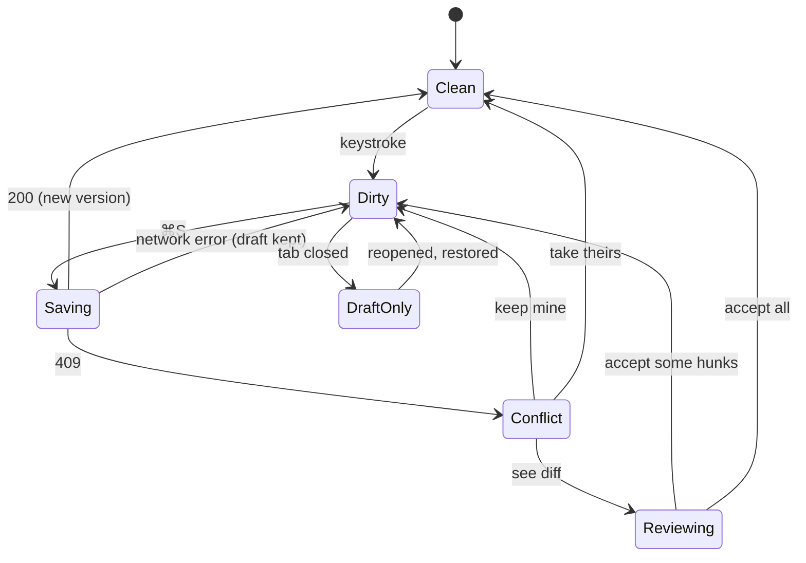
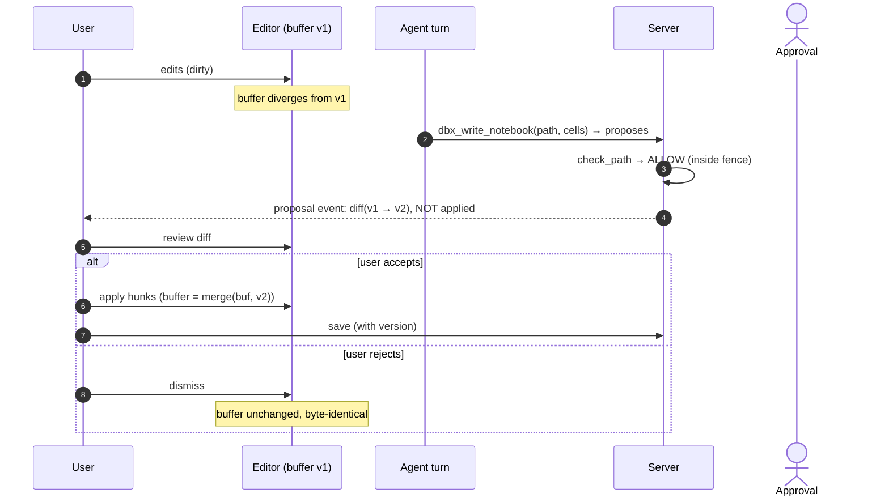
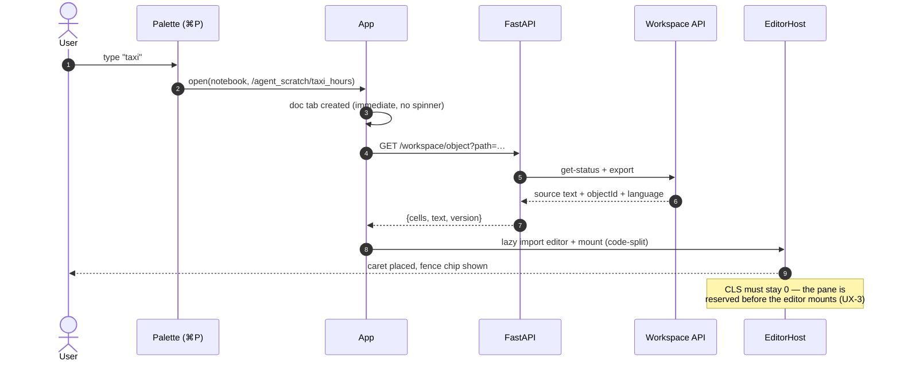
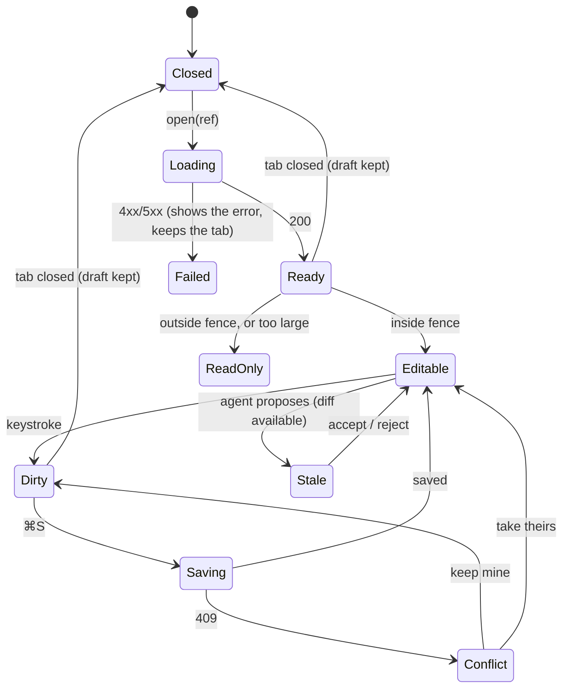

# 03 · Architecture

[Index](README.md) · prev: [02 Requirements](02-requirements.md) · next: [04 Lenses](04-lenses.md)

The design in one sentence: **the document is pure data, the editor is an uncontolled view of that
data that owns its own state, and every write — human or agent — passes one policy function before
touching the workspace.**

---

## Screen wireframe

The editing surface lives in the **centre zone** as a second work surface beside the transcript.
No new zone is added: [001-perfect-shell](../001-perfect-shell/03-architecture.md#zone-model)
established four zones, and a fifth would multiply states without adding capability.

```
┌─ CHROME ─────────────────────────────────────────────────────────────────────────────────────────┐
│ ◧ Databricks Coding Agents    [▣] [▤] [sys|light|dark]   ⌘K   ⌘   ⟳                              │
├─ WORKBENCH ──────────────────────────────────────────────────────────────────────────────────────┤
│┌────────────────────────┐ ┌─ DOC TABS ───────────────────────────────┐ ┌────────────────────────┐│
││ Sess Files Catalog     │ │ ◆ Chat │ ▪ taxi_hours × │ ▪ notes × │+2  │ │ Context  Audit         ││
││                        │ └──────────────────────────────────────────┘ │                        ││
││ + New        RECENT    │ ┌─ EDITOR BAR ─────────────────────────────┐ │ CELL 3 / 9             ││
││                        │ │ taxi_hours.py  py  ⌂ fence ✓             │ │ ────────────────────── ││
││ ▾ samples              │ │                   [Run] [Diff] [Save]    │ │ what it does           ││
││     ▸ nyctaxi          │ └──────────────────────────────────────────┘ │ reads 1 table          ││
││     ▸ tpcds            │ ┌─ CODE ───────────────────────────────────┐ │ ran ✓ 4.2s · 24 rows   ││
││ ▸ /Users/raph…         │ │ 1 │ %python                              │ │ agent wrote this cell  ││
││                        │ │ 2 │ import pandas as pd                  │ │                        ││
││ ◆ revenue    12m       │ │ 3 │ df = spark.table("samples.ny         │ │ FENCE                  ││
││ ◆ hello       3d       │ │ 4 │ df.groupBy("pickup_hour").av         │ │ ✓ inside               ││
││ ◆ debug job    1h      │ │ 5 │                                      │ │   /agent_scratch/      ││
│└────────────────────────┘ └──────────────────────────────────────────┘ │                        ││
│                           ┌─ COMPOSER ───────────────────────────────┐ │ ⌘S   save              ││
│                           │ Ask, or ⇧⌘K to edit this cell...    ⌘↵   │ │ ⌘↵   run cell          ││
│                           └──────────────────────────────────────────┘ │ ⌘/   shortcuts         ││
│                                                                        └────────────────────────┘│
└──────────────────────────────────────────────────────────────────────────────────────────────────┘

┌─ DOC TABS ───────────────────────────────────────────────────────────────────────────────────────┐
│  ◆ Chat │ ▪ taxi_hours  ● ×  │ ▪ notes.md × │ +3                                                 │
├─ EDITOR BAR ─────────────────────────────────────────────────────────────────────────────────────┤
│  taxi_hours   notebook   py   9 cells   ⌂ in fence ✓    [Run all] [Diff] [Save]                  │
├──────────────────────────────────────────────────────────────────────────────────────────────────┤
│ ┌──────────────────────────────────────────────────────────────────────────────────────────────┐ │
│ │ [md]                                        [⋯] [🗑]                                          │ │
│ │ # Revenue by pickup hour                                                                     │ │
│ │ Renders as prose when unfocused; click to edit.                                              │ │
│ └──────────────────────────────────────────────────────────────────────────────────────────────┘ │
│ ┌──────────────────────────────────────────────────────────────────────────────────────────────┐ │
│ │ ▶ [py]                                      [⋯] [🗑]                                          │ │
│ │ 1 │ df = spark.table("samples.nyctaxi.trips")                                                │ │
│ │ 2 │ df.groupBy("pickup_hour").avg("fare").show()                                             │ │
│ │ ── agent wrote this cell · ran 4.2s · 24 rows ──                                             │ │
│ └──────────────────────────────────────────────────────────────────────────────────────────────┘ │
│ ┌──────────────────────────────────────────────────────────────────────────────────────────────┐ │
│ │ ▶ [py]                                   ┌ caret ┐                                           │ │
│ │ 3 │ ▏                                                                                        │ │
│ └──────────────────────────────────────────────────────────────────────────────────────────────┘ │
│                                                                                                  │
│                                   [ + code ]        [ + markdown ]                               │
│                                                                                                  │
└──────────────────────────────────────────────────────────────────────────────────────────────────┘
```

### Reading the fence before you type

WR-5 requires the fence to be visible **before** the first keystroke, not at save time. It is a
chip in the editor bar, and it has three states:

```
  ⌂ in fence ✓          →  writable, save enabled
  ⚠ outside fence       →  save asks for approval (and says which folder you are in)
  ◼ read-only           →  no save at all: too large, or the object is not writable
```

---

## Component model



**Why `EditorHost` is an interface, not the CodeMirror type.** The rest of the app must not import
CodeMirror. Everything it needs is this five-method surface, so the editor can be swapped (or
mocked in a unit test) without touching a single component. This is the Dependency Inversion in
[04](04-lenses.md#2-full-stack-developer).

---

## The document model

`Cell` already exists and is pure (`api/domain/notebook.py`). It gains an `id`, which is what makes
A5 possible:

```ts
// web/src/domain/notebook.ts — the pure core, no React, no CodeMirror

export type CellKind = "code" | "markdown";
export interface Cell {
  id: string;          // stable across reorder; derived at parse, kept afterwards
  kind: CellKind;
  language: string;    // "python" | "sql" | "scala" | "r" | "markdown" | "shell" | ...
  source: string;
}

export function parseCells(text: string, language: string): Cell[];
export function serializeCells(cells: readonly Cell[]): string;
export function moveCell(cells: readonly Cell[], from: number, to: number): Cell[];
export function setCellKind(cells: readonly Cell[], id: string, kind: CellKind): Cell[];
export function insertCell(cells: readonly Cell[], at: number, cell: Cell): Cell[];
export function removeCell(cells: readonly Cell[], id: string): Cell[];
```

The round trip is the contract:

```
serializeCells(parseCells(t)) ≡ t        for every SOURCE document t we can read
parseCells(serializeCells(c)) ≡ c        up to id regeneration, for every cell list c we can build
```

The first is a property test over real notebooks from the workspace; the second is a property test
over generated cell lists. Both must hold, because a violation means opening and saving a notebook
silently rewrites it — the worst possible bug in an editor.

### Why `id` cannot be the index

A move changes every index in the tail. If `id` were the index, then:

```
move(5 → 1)  ⇒  cells 5,4,3,2 all appear "changed"  ⇒  diff says 4 edits, not 1 move
```

With a content+position key at parse and a preserved key thereafter, a move is one operation and the
diff can say "moved". This is A5, and it is why `parseCells` attaches ids in a second pass rather
than treating them as data.

---

## The edit path (no React in the keystroke)

This is the single most important diagram in the spec. A3 says a keystroke must not re-render
anything but the editor.



### Why the client check exists at all

WR-1 makes the server authoritative. So why duplicate? Because the fence has to **explain itself**
before a round trip: "this path is outside `/agent_scratch/`, saving will ask for approval" is useful
information at the moment of typing, and useless as a `403` after a 300 ms pause. The client check is
a **preview of a decision it cannot make**. If they ever disagree, the server wins — and that
disagreement is a logged defect, not a tolerated case.

---

## The write path

Three callers, one policy function. This is the whole point of the spec.



The rule that makes this safe: **`H1` must be indistinguishable from `A1`/`A2` from the policy's point
of view.** Same function, same `Scope`, same `Decision` type, same event recorded. A test asserts
this by calling all three with the same path and requiring identical verdicts.

### The save route

```python
# api/routers/api.py — sketch, not final
class SaveObject(BaseModel):
    path: str = Field(min_length=1, max_length=1024)
    text: str
    format: Literal["SOURCE", "AUTO"] = "SOURCE"
    version: str | None = None          # CX-1: the token the client held
    approval_id: str | None = None      # WR-3: present when the fence said ASK

@router.post("/workspace/save")
async def workspace_save(request: Request, body: SaveObject) -> dict:
    scope = _scope(request)
    decision = scope_mod.check_path(scope, body.path)      # WR-1: the same function
    if decision.verdict is Verdict.ASK and not _approval_valid(request, body.approval_id, body.path):
        raise HTTPException(403, f"{decision.reason} — approval required")
    current = await _browser(request).status(body.path, _user_token(request))
    if body.version and body.version != _version_of(current):   # CX-2
        raise HTTPException(409, {"current": _version_of(current), "yours": body.version})
    await _browser(request).import_source(body.path, body.text, _user_token(request), overwrite=True)
    await _record_human_write(request, body.path, len(body.text))  # WR-4
    return {"version": _version_of(await _browser(request).status(body.path, _user_token(request)))}
```

Every line here is a requirement: `check_path` (WR-1), the approval gate (WR-3), the version
comparison (CX-2), the event record (WR-4). The route contains no path logic of its own.

---

## Concurrency: what we can and cannot promise

The workspace API has **no conditional write** ([01](01-current-state-audit.md#what-the-databricks-workspace-api-gives-us)).
So:

```
time ──────────────────────────────────────────────────────────────────►
  get-status ──── compare ──── import          ← our window: TOCTOU, unavoidable
                   ▲
                   └── another writer can land here, between our check and our write
```

We therefore make three honest promises and no fourth:

| Promise | How | Test |
|---|---|---|
| A conflicting save is **detected** in the overwhelming majority of cases | version compare immediately before import | CX-2 |
| A detected conflict is **never auto-resolved** | 409 → user chooses | CX-3 |
| An undetected conflict is **always recoverable** | local draft of every buffer, plus the pre-save snapshot | CX-5 |

We explicitly **do not** promise "no lost writes", because we cannot keep it. Saying so in the UI —
"your version was saved locally" — is more honest than a lock that does not hold.



---

## Both writers, one model

A6 says the agent is a client of the document, not a privileged writer. Concretely:



The key decision: **an agent write inside the fence that targets a document the user has open
becomes a proposal rather than a silent write.** Outside that case it writes as it does today.
That is a change in agent behaviour, scoped narrowly, and it is what makes DF-1 true without
weakening the agent.

> Trade-off, stated: this makes the agent slightly less autonomous for open documents. It is worth
> it — "the agent changed the file while I was editing it and I lost my work" is the single failure
> users forgive least.

---

## Where each piece lives

| Piece | Path | Kind | Responsibility |
|---|---|---|---|
| Document model | `web/src/domain/notebook.ts` | pure | parse / serialize / cell ops |
| Fence preview | `web/src/domain/fence.ts` | pure | mirror of `scope.check_path` for display only |
| Version token | `web/src/domain/version.ts` | pure | derive + compare tokens |
| Diff algorithm | `web/src/domain/diff.ts` | pure | line + cell diffs, hunk apply/reject |
| Draft store | `web/src/domain/drafts.ts` | pure | key scheme, TTL, recovery |
| Editor host | `web/src/editor/host.ts` | adapter | the 5-method `EditorHost` over CodeMirror |
| Editor mount | `web/src/editor/Editor.tsx` | React | mounts the host, no per-keystroke state |
| Notebook surface | `web/src/components/NotebookEditor.tsx` | React | cell stack, focus model |
| Diff surface | `web/src/components/DiffView.tsx` | React | hunks, accept/reject |
| Save client | `web/src/api/save.ts` | adapter | talks to the route, maps 409 |
| Save route | `api/routers/api.py` | FastAPI | fence + version + import |
| Serialization | `api/domain/notebook.py` | pure | add `serialize_source` next to `parse_source` |
| Workspace write | `api/adapters/databricks/workspace.py` | adapter | `import_source`, `status` |

Three rules keep this DRY and SOLID ([04](04-lenses.md#solid-applied)):

1. **`domain/` never imports React or CodeMirror.** All of it is unit-testable without a DOM.
2. **One adapter per external system.** CodeMirror behind `EditorHost`; the workspace API behind
   `WorkspaceBrowser`. Swapping either touches exactly one file.
3. **The fence is never re-implemented.** `domain/fence.ts` is a *display* mirror, and a test asserts
   it agrees with the Python for a corpus of paths — if it drifts, the test fails, not the user.

---

## Sequence: opening a document



---

## Mermaid: the state of a document as the app sees it



[Next: the eight lenses →](04-lenses.md)
