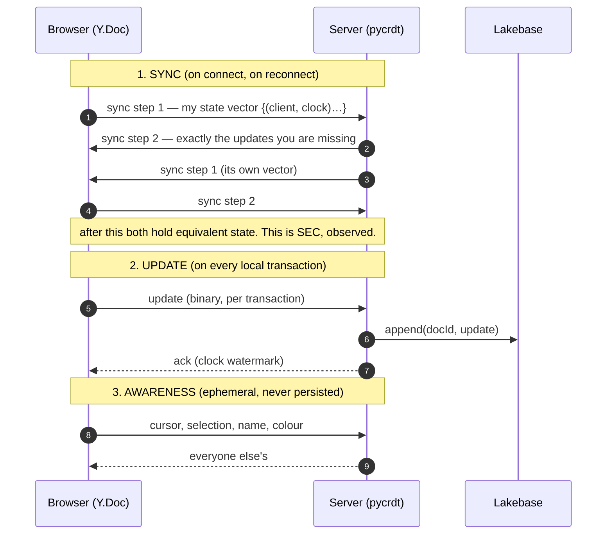
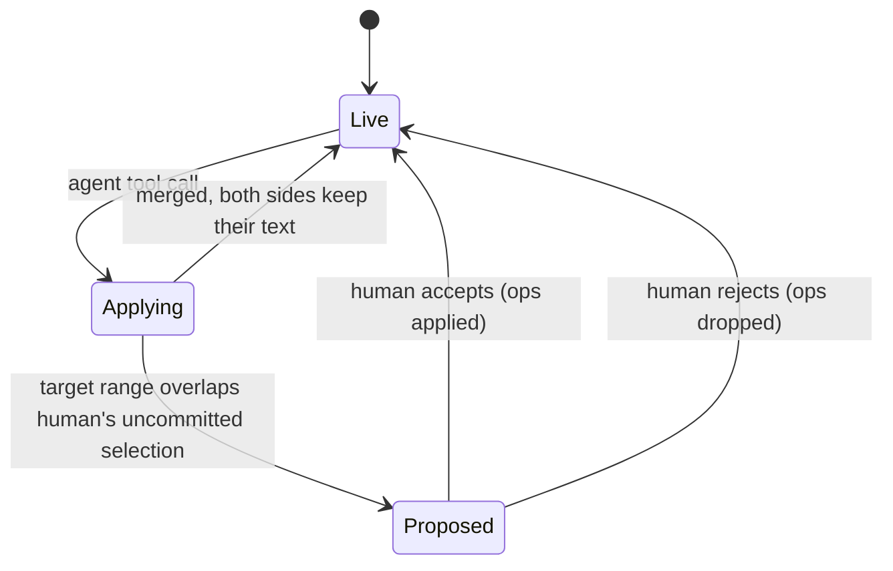
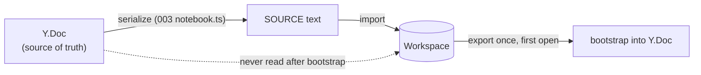

# 02 · Architecture

[Index](README.md) · prev: [01 Current state](01-current-state.md) · next: [03 Implementation plan](03-implementation-plan.md)

The design in one sentence: **the document is a Yjs `Y.Doc`; the client and server hold replicas; the
agent emits operations against the same document; the workspace receives a projection.**

Every section below names the condition from [00](00-why-first-principles.md) that it satisfies.

---

## Topology

```
        BROWSER                                    SERVER (one FastAPI process)
┌──────────────────────────────┐          ┌──────────────────────────────────────────┐
│  CodeMirror + y-codemirror    │          │  /api/ws/documents/{docId}               │
│            │                  │          │        │                                 │
│            ▼                  │  ws      │        ▼                                 │
│  Y.Doc (authoritative locally)│◄────────►│  pycrdt Y.Doc (authoritative for export) │
│            │                  │  deltas  │        │            ▲                    │
│            ▼                  │ + state  │        │            │ writes             │
│  y-indexeddb  (offline)       │  vector  │        ▼            │                    │
│                               │          │  update log ──► snapshot ──► Lakebase    │
│  presence (awareness)         │          │        │                                 │
└──────────────────────────────┘          │        ▼                                 │
                                           │  export projection ──► Workspace API      │
                                           │  (on save, on idle, on close)             │
                                           │                                           │
                                           │  agent tool: insert_cell / replace_range  │
                                           └──────────────────────────────────────────┘
```

Three replicas, not two: the browser's, the server's, and — deliberately — **none for the workspace**.
The workspace is a sink. That is C6.

---

## The document model

A notebook is `Y.Doc` → `Y.Array<Y.Map>` → cells, plus a `Y.Map` for notebook-level fields.

```
Y.Doc
├─ "cells" : Y.Array<Y.Map>          one entry per cell, in order
│    ├─ id       : string  (stable, never regenerated)
│    ├─ kind     : "code" | "markdown"
│    ├─ language : string
│    └─ source   : Y.Text             ← a nested CRDT, so concurrent edits inside one cell merge
└─ "meta"  : Y.Map
     ├─ language : string            the notebook's language (PYTHON/SQL/…)
     └─ trunced  : boolean           read-only guard carried from 003 ED-6
```

**Why `source` is a nested `Y.Text` and not a plain string.** Two people in the same cell is exactly
the case this spec exists for. A plain string attribute in a `Y.Map` is last-writer-wins, so two
concurrent keystrokes in cell 3 would lose one. A `Y.Text` is a sequence CRDT and merges
character-wise. This is C2 applied one level down.

**Why cells are an `Y.Array`, not a `Y.Map` keyed by id.** Maps are unordered. Order is half of a
notebook's meaning. C2.

### The cell id is application data, not a CRDT artifact

003 axiom A5 said a cell needs an identity stable across reorder. Yjs gives every *item* an
`ID(clientID, clock)`, but that identity is positional — it changes meaning when the array is
reordered. So the cell `id` is a plain value we own, generated once on creation and never
regenerated. The array's order is the CRDT's concern; the cell's identity is ours.

---

## The three protocols

There are exactly three message flows, and each has one job.



**State vectors, not timestamps.** A vector is the set of `(clientID, clock)` pairs a replica has
seen; it lets the peer compute the minimal missing update in one round trip
([Yjs INTERNALS §Network protocol](https://github.com/yjs/yjs/blob/main/INTERNALS.md)). This is what
makes reconnect cheap and replay-free — C5.

---

## Agent as a peer

This is the part the theorems force and the part that is most work.

### Before (003): whole-file write

```
agent → dbx_write_notebook(path, cells=[...]) → import(SOURCE, whole file)
```

Under this model a concurrent human edit is either clobbered or caught by the version token. C1 says
this is not a CRDT at all.

### After: operation write

The agent gets tools that speak the document's language:

| Tool | Emits | When the agent means |
|---|---|---|
| `doc_insert_cell(path, at, cell)` | `cells.insert(at, Y.Map{…, source: Y.Text})` | "add a cell here" |
| `doc_replace_source(path, cell_id, from, to, text)` | `source.delete(from,to); source.insert(from,text)` | "fix this line" |
| `doc_set_kind(path, cell_id, kind)` | `cellMap.set("kind", kind)` | "this should be markdown" |
| `doc_move_cell(path, cell_id, to)` | `cells.delete(i,1)` + `cells.insert(to, map)` | "move it up" |
| `doc_delete_cell(path, cell_id)` | `cells.delete(i,1)` | "remove it" |
| `doc_write_notebook(path, cells)` | **all of the above in one `doc.transact`** | "here is the whole thing" |

The last row matters: a model that thinks in whole notebooks must still be able to express itself.
Wrapping the whole replacement in one transaction keeps it **atomic** and, crucially, still
**merges** — a concurrent human edit inside the transaction's range survives as a nested `Y.Text`
merge rather than being lost.

### Why the agent must not hold a replica

The agent is a subprocess that may be restarted; Yjs requires a durable replica to hold state
between updates. So the agent does **not** hold a `Y.Doc`. It calls a tool; the tool's server-side
handler opens the document, applies one transaction, and returns. The authoritative replica is the
server's. The agent is a *client of a tool*, not a replica — which keeps its lifecycle simple and
avoids a third replica that can diverge.

### Proposals still exist, for the cases that need them

003 D3 made an agent write to an open document a *proposal*. That is now the **default only when the
range does not commute cleanly with the human's** — specifically, when the agent replaces a range the
human is actively editing. In every other case the write is applied and appears live, which is the
point of collaboration.



---

## Persistence

```
update log (append-only)                    snapshot (periodic)
─────────────────────────                   ────────────────────
docId | seq | update BYTES | at             docId | seq | state BYTES | at
```

On load: latest snapshot, then every update with `seq > snapshot.seq`, applied in order. The snapshot
interval is a function of log length, not wall time, so a busy document snapshots more often.

**Why both.** The log alone replays forever; a snapshot alone loses the tail. Yjs encodes both a full
document state and an incremental update as `Uint8Array`, so a snapshot is
`Y.encodeStateAsUpdate(doc)` and the tail is the per-transaction `update` payload
([`Y.Doc` events](https://docs.yjs.dev/api/y.doc)).

**Why Lakebase and not memory.** 003's `MemoryEventStore` is fine for a transcript that can be
rebuilt by the agent. A CRDT cannot be rebuilt: once the process ends, unreplayed ops are gone and
replicas diverge permanently. That is the one place where this spec *must* add durable storage.

### The garbage-collection decision

`doc.gc = true` discards deleted content (replacing it with a `GC` struct). It is **on** here, because
a long-lived document with tombstones grows without bound otherwise. The cost, from C4: deleted text
is unrecoverable from the CRDT. That is why the draft store from 003 survives — see below.

---

## The workspace as a projection



Export triggers:

| Trigger | Why |
|---|---|
| explicit save (⌘S) | the user asked for it to be durable outside the app |
| 5 s after the last update | bounds the divergence window |
| document closed | the last chance |
| idle 30 s | catches a forgotten tab |

**Import happens exactly once**, on first open, to seed the `Y.Doc`. After that the CRDT is the truth
and the workspace is written, never read. Reading it later would resurrect a stale state and, worse,
would look like a concurrent writer.

**The UI must show the projection age.** "Saved 4 s ago" in the editor bar, not "saved". Claiming the
workspace is current when it is a projection is the one lie C6 forbids.

---

## What dies

This is a replacement, not an addition. Removed from 003:

| 003 artifact | Fate | Why |
|---|---|---|
| `version.py` (version tokens) | **deleted** | Convergence replaces comparison |
| `POST /workspace/save` version check + `409` | **deleted** | There is no "stale" |
| `ConflictPanel.tsx` | **deleted** | No code path can produce a conflict |
| CX-1..CX-5 requirements | **withdrawn** | Superseded by convergence |
| `approval.py` (path-bound approval) | **kept** | The fence is orthogonal to concurrency |
| `scope.check_path` fence | **kept, and now guards the tool calls too** | C1 does not weaken A1 |

> **The single most important deletion is `ConflictPanel`.** Its existence was the admission that
> two writers cannot both be right. If it survives this refactor in any form, the CRDT is decorative.

## What survives

| 003 artifact | Why it stays |
|---|---|
| `domain/notebook.ts` parse/serialize | still the projection format, still property-tested |
| `domain/drafts.ts` | **C4**: deleted text is unrecoverable from the CRDT, so the draft is the undo |
| `domain/fence.ts` + `approval.py` | the write fence is a *security* boundary, unrelated to merge |
| `EditorHost` seam (D6) | the editor swap is one file: `y-codemirror.next` behind the same interface |
| `Icons.tsx`, theme tokens, a11y/CLS gates | unchanged |

---

## Presence

Awareness is a **separate, ephemeral** channel in the Y protocol. It carries:

```
{ clientId, name, colour, docId, cursor: { cellId, anchor, head } }
```

Rules that matter:

- **never persisted** — a stale caret is worse than no caret;
- **expires on disconnect** — a 30 s timeout, then the participant disappears;
- **advisory only** — a caret at a position that no longer exists is clamped, never applied.

Presence rides the same websocket but a different message type, so a presence storm can never delay a
document update.

---

## Security

| Concern | Decision |
|---|---|
| Who may open a document | the same Unity Catalog / workspace ACL check as today, performed **at websocket connect** and on every reconnect |
| Does the CRDT carry ACLs | no. Authorization stays outside the document |
| What is persisted in Lakebase | document bytes only, per user, with the same tenant boundary as sessions |
| Can a client forge another's updates | updates are opaque binary; the server accepts only from the authenticated socket and attributes by `clientId` it assigned, not one the client chose |
| Does the agent see unsaved text | **no**, unless the tool call names the document. Presence of a dirty buffer is not content |

[Next: implementation order →](03-implementation-plan.md)
