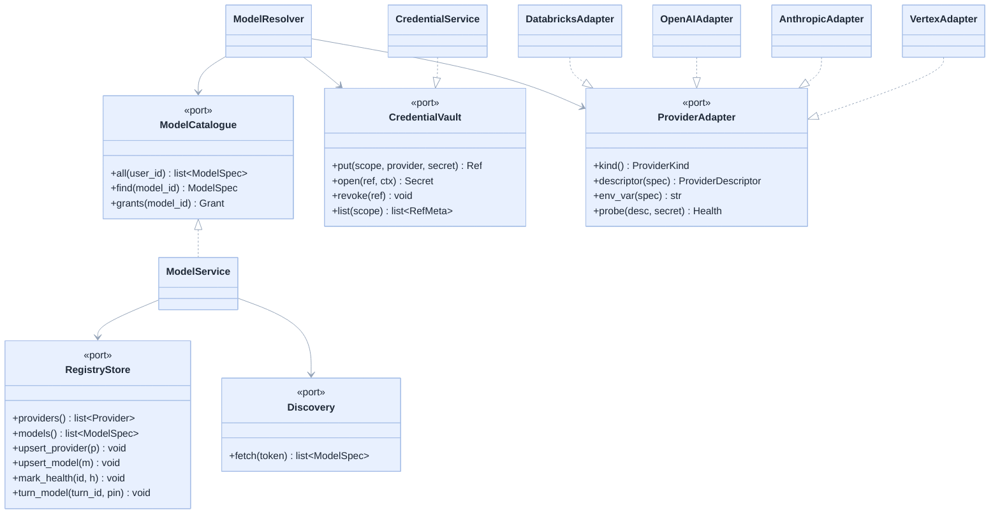
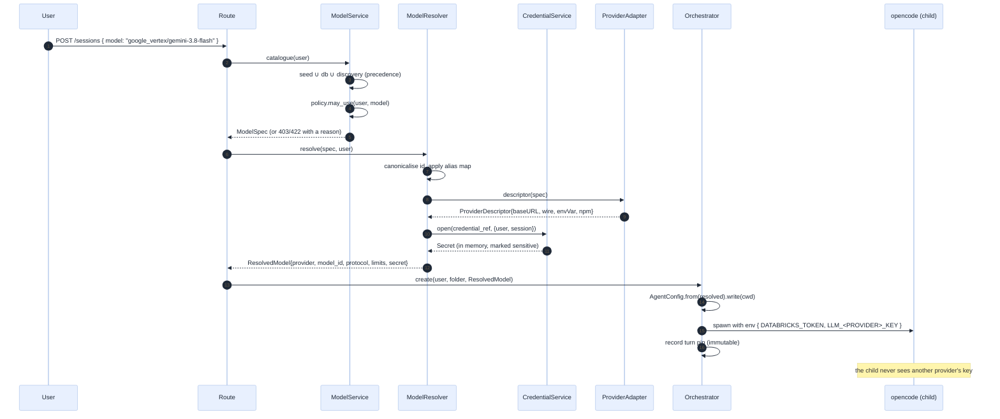
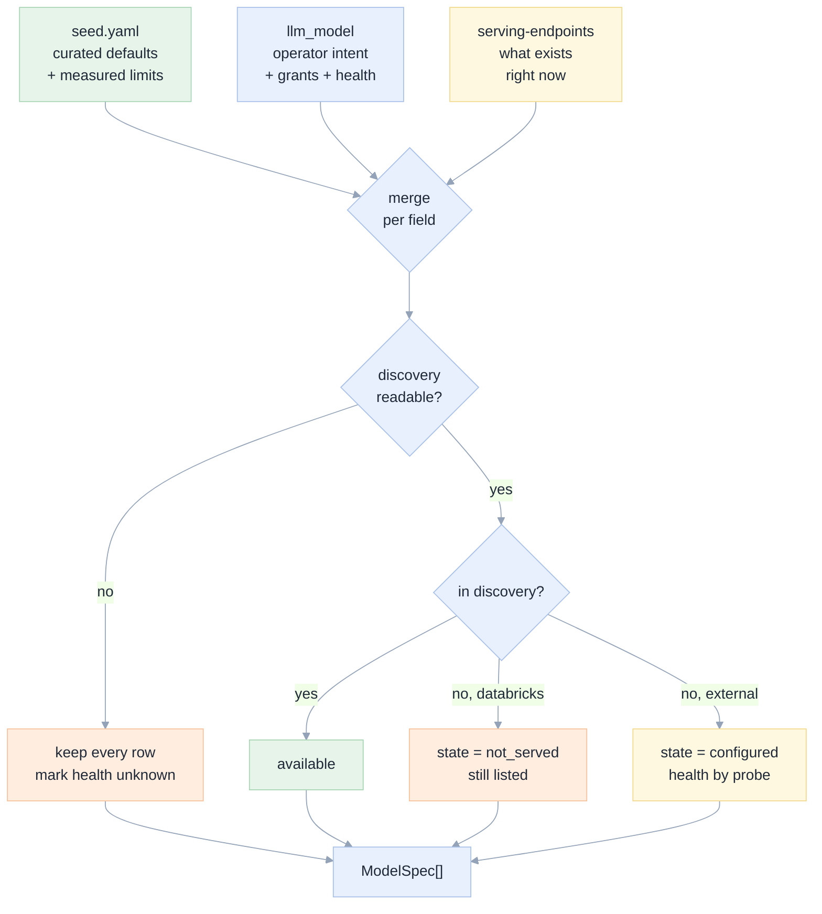
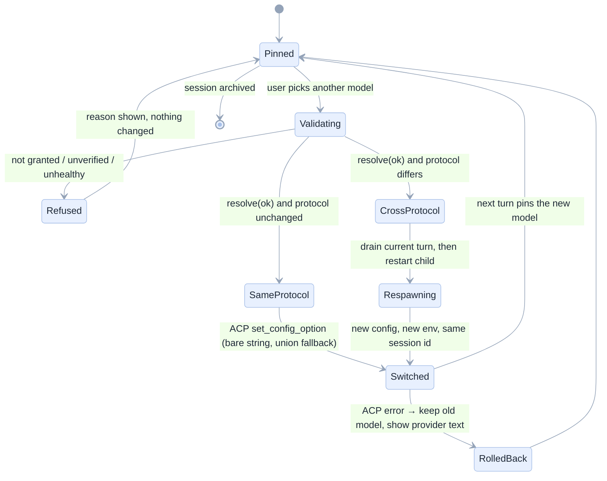
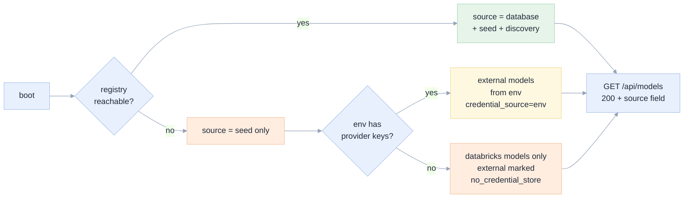

# 03 · Architecture

[Index](README.md) · prev: [02 Requirements](02-requirements.md) · next: [04 Providers](04-providers.md)

The design in one sentence: **a model is a row, a provider is an adapter, a credential is a
reference, and one resolver turns an id into everything a child process needs — with no vendor
branch in the domain.**

Every section names the axiom from [00](00-why-first-principles.md#the-four-axioms-that-follow) it
satisfies.

---

## The layer map

<!-- GEN:layers -->

```text
┌───────────────────────────────────────────────────────────────────────┐
│  web/   React 19                                                      │
│  ModelPicker · ModelInspector · ProviderSettings · HealthBadge        │
│  domain/models.ts   pure: grouping · rank · label · order             │
└───────────────────────────────────────────────────────────────────────┘
                                   │ /api/models · /api/llm/*   JSON only, never a secret
                                   ▼
┌───────────────────────────────────────────────────────────────────────┐
│  api/routers/       thin: validate, delegate, map errors to statuses  │
└───────────────────────────────────────────────────────────────────────┘
                                   │
                                   ▼
┌───────────────────────────────────────────────────────────────────────┐
│  api/services/                                                        │
│  ModelService       catalogue assembly + policy   I/O-free            │
│  ModelResolver      id → ResolvedModel            I/O-free            │
│  CredentialService  ref → secret   the only decrypter                 │
│  HealthService      probe + classify + cache                          │
└───────────────────────────────────────────────────────────────────────┘
                                   │
                                   ▼
┌───────────────────────────────────────────────────────────────────────┐
│  api/domain/llm/    PURE: dataclasses, no I/O, no vendor names        │
│  model.py   ModelId · ProviderKind · ModelSpec · ResolvedModel        │
│  limits.py  clamp() · Limits(evidence)                                │
│  policy.py  may_use(user, model, grants) → Decision                   │
│  errors.py  ModelError taxonomy                                       │
└───────────────────────────────────────────────────────────────────────┘
                                   │
                                   ▼
┌───────────────────────────────────────────────────────────────────────┐
│  api/adapters/      the ONLY place a vendor string may appear         │
│  llm/store/pg.py        RegistryStore (Lakebase)                      │
│  llm/store/memory.py    RegistryStore (tests, demo)                   │
│  llm/store/seed.py      seed loader                                   │
│  llm/providers/         databricks · openai · anthropic · vertex      │
│  llm/vault/pg.py        CredentialVault                               │
│  llm/vault/local.py     env-only vault (no database, C-5)             │
│  llm/discovery/         serving-endpoints → ModelSpecs                │
│  acp/agent_config.py    ResolvedModel → opencode.json                 │
└───────────────────────────────────────────────────────────────────────┘

  arrows never point up: a request descends, results return as data
```

<!-- /GEN:layers -->

The arrows never go up. `domain/llm` imports nothing from `adapters` or `services`; `services`
imports `domain` and ports only; `adapters` imports ports and `domain`. This is the same shape 001
already uses ([001 02](../001-databricks-coding-agents/02-architecture.md)) and it is enforced
mechanically, not by convention ([09 §Enforcement](09-implementation-plan.md#enforcement-not-convention)).

---

## Ports and adapters

New ports join the existing ones in [`api/ports/__init__.py`](../../apps/coding-agent/api/ports/__init__.py),
which today declares nine protocols including `ModelCatalog`
([`api/ports/__init__.py:92-94`](../../apps/coding-agent/api/ports/__init__.py)). `ModelCatalog` is
extended rather than replaced, so nothing that already depends on it breaks.



**Why an adapter per protocol and not a data-driven table.** Because the differences are behavioural:
Anthropic needs a header pair and a streaming flag, Vertex needs a signature round-trip and a different
URL shape, Databricks needs a per-endpoint cap lookup. A table of URL templates cannot express any of
that, which is exactly what `docs/e2e/07_gemini_thought_signature_failure.txt` is the receipt for.

**Why the adapter returns a *descriptor* rather than the final JSON.** The `opencode.json` shape is an
agent detail, not a provider detail. Keeping it in `agent_config.py` means a second agent runtime (ACP
v2, or a different agent entirely) changes one file, not four adapters. This is the Open/Closed
boundary.

---

## The resolution pipeline

Seven steps from a string the user clicked to an environment variable in a child process. Every
document in this spec is an input to one of these steps or a check on it.



### Step by step

| # | Step | Where | Axiom | Failure it prevents |
|---|---|---|---|---|
| 1 | Parse and canonicalise the id | `domain/llm/model.py` | A1 | string surgery inventing an endpoint |
| 2 | Alias-map legacy ids | `domain/llm/model.py` | A1, NFR-7 | a stored `databricks-system.ai.gpt-oss-120b` becoming unroutable |
| 3 | Build the catalogue with precedence | `services/model_service.py` | A1 | a stale row shadowing a live endpoint |
| 4 | Authorise | `domain/llm/policy.py` | — | a user using a model they were not granted |
| 5 | Resolve the provider descriptor | `adapters/llm/providers/*` | A2 | the domain learning a vendor's URL shape |
| 6 | Clamp limits | `domain/llm/limits.py` | A3 | a 24000 request against an 8192 cap |
| 7 | Open the credential and build the env | `services/credential_service.py` | A4 | a secret written to disk or to a log |

**Step 6 is deliberately pure.** `clamp(limits, requested) → (context, output)` takes a
`Limits` value object that always carries its evidence, so the answer "unknown" is representable and
the resolver cannot pretend a guess is a measurement.

### The `ResolvedModel` value object

```python
@dataclass(frozen=True, slots=True)
class ResolvedModel:
    id: ModelId                 # provider/model, canonical
    provider: ProviderKind      # enum, never a string in the domain
    wire: WireProtocol          # enum: serving | openai | anthropic | vertex
    endpoint: str               # what the provider calls the model
    base_url: str
    context: int
    output: int
    capability: Capability      # TOOLS | TOOLS_AND_REASONING | CHAT_ONLY
    secret_ref: CredentialRef | None
    evidence: LimitEvidence
```

Frozen, slots, no behaviour beyond accessors. It is the only object that crosses from the resolver into
the orchestrator, so there is exactly one place where a model can be wrong.

---

## Catalogue assembly

Three inputs, one deterministic output. Precedence is **explicit**, per field, not per record — that is
the part that is easy to get wrong.



| Field | Precedence | Why |
|---|---|---|
| existence, ready state (Databricks) | discovery | only the workspace knows |
| `display_name`, `group` | database → seed | an operator's naming beats a default |
| `context_window`, `max_output` | measured db → seed → default | A3: a measurement beats a documented number beats a guess |
| `grants` | database only | never from a file: authorisation is not a build artefact |
| `health` | probe only, never static | a cached opinion is not a health check |
| `credential_ref` | database only | a reference to a secret, never the secret |

**A row is never deleted by discovery.** FR-14 and FR-13 both depend on this: a model that disappears
from the workspace becomes `not_served`, keeps its grants, and can be resumed if it comes back. The
alternative — discovery deleting rows — would silently revoke access the moment a workspace was
momentarily unreadable, which is precisely what the current `None`-means-do-not-filter rule protects
against ([`serving.py:22-32`](../../apps/coding-agent/api/adapters/databricks/serving.py)).

---

## Switching a model

The current code has three defects in eleven lines ([01 E6](01-current-state.md#e6-a-model-switch-can-be-sent-in-the-wrong-dialect)).
The replacement keeps the ACP call and fixes what surrounds it.



| Case | Behaviour | Why |
|---|---|---|
| Same protocol, agent knows the model | ACP `session/set_config_option` with the resolved **agent** id | the probe shows the bare string works and the union shape is rejected ([`docs/e2e/20_acp_config_probe.txt`](../../docs/e2e/20_acp_config_probe.txt) §A/B) |
| Different protocol, same provider | rewrite config, ACP switch | one process, one provider block |
| Different protocol or different provider | drain the running turn, restart the child with a new config and a new env, keep the session id | a second provider's key must reach a **new** process; an existing process's environment cannot be extended (see note below) |
| ACP returns an error | keep the old model, surface the provider's words, do not record a switch | FR-9: the current turn is never retargeted |
| The model is `not_served` | refuse with the workspace's state | RB-11 |

> **Why a restart and not an env mutation.** A child process's environment is fixed at spawn on every
> platform that matters, and `runtime.py:42-43` builds it once:
> `env = {**os.environ, **self._extra_env, **spec.env}`. Adding a variable later would mean writing a
> file the child polls — which is a second injection mechanism and violates Axiom A4's "one
> mechanism". A restart is the honest implementation. It costs about 1-2 s, measured in
> [09 P5](09-implementation-plan.md#p5-cross-provider-switching-and-immutable-provenance); if the cost is worse
> than that, the fallback is "open a new session", decided with the number in hand.

**The restart is not a session restart.** The session id, folder, schema, transcript and tool server
survive. Only the agent process is replaced, and the conversation is re-established through the same
`session/new` → `load_session` path the runtime already supports
([`api/adapters/acp/runtime.py:105-124`](../../apps/coding-agent/api/adapters/acp/runtime.py)).

---

## Degradation is a first-class state

Not an error path bolted on at the end. C-5 says the app boots without a database, and the reason is
practical: local development and demo mode use `agent_mode="fake"` and a memory store
([`api/main.py:47-54`](../../apps/coding-agent/api/main.py)).



`GET /api/models` therefore returns `{"available": [...], "default": "...", "source": "database|seed|degraded"}`.
The `source` field is not decoration: the settings screen states it, so a user who added a key to an
app running in degraded mode is told it was not saved rather than discovering it next session
([E-14](10-edge-cases-testing.md#storage-and-degradation)).

---

## Front end

The topbar chip stays a chip. The picker is a **popover** with a full keyboard model, and the
inspector carries the long-form facts. That split is forced by an existing constraint: at ≤1100 px the
chip hides because "the model is in the inspector"
([`web/src/styles.css:209-212`](../../apps/coding-agent/web/src/styles.css)).

```
domain/models.ts   (pure, unit-tested, no React)
  groupModels(specs, {query, grants}) → Group[]
  rank(query, spec) → number         one scoring function, used by both picker and tests
  label(spec) → string               display_name || pretty(id) — the ONE place a label is derived
  availabilityCopy(state) → string   every ModelState has copy, exhaustively
```

`label()` replaces the `id.split("/").pop()` that currently produces two naming conventions in one
dropdown ([01 E8](01-current-state.md#e8-the-picker-is-two-select-elements)).

The picker is a `combobox` over a `listbox` with `aria-activedescendant`, because a native `<select>`
cannot render groups with a status badge and a "needs a key" affordance. The accessible contract is in
[07 §Accessibility](07-ux-ui-wireframes.md#accessibility-contract), and it is tested by
`scripts/a11y-audit.mjs` plus a component test.

**No new bundle weight beyond the components.** Search is a small local scorer
([`web/src/domain/fuzzy.ts`](../../apps/coding-agent/web/src/domain/fuzzy.ts) already exists and is
used by the palette); the picker reuses it rather than adding a search library — DRY, and it keeps
ranking behaviour consistent between the palette and the picker.

---

## What this spec does not touch

| Untouched | Why it must stay untouched |
|---|---|
| `api/domain/scope.py` (the write fence) | C-7. Adding a model adds no write path. |
| `api/adapters/mcp/registry.py` (tool server lifecycle) | the tool server's env is the fence's env; it gets the workspace token only |
| `api/adapters/acp/runtime.py` turn handling, idle guard, stderr tail | correct and hard-won ([`runtime.py:278-338`](../../apps/coding-agent/api/adapters/acp/runtime.py)) |
| `agent_config.py`'s `permission` denies and `AGENTS.md` writer | the working agreement is what took the exam score from 19 % to 94 % |
| `set_model` ACP fallback shape | dialect drift insurance, measured |

`agent_config.py` **is** refactored — `AgentConfig` gains a provider-agnostic builder — but its
behaviour for the Databricks case is byte-identical, and a golden-file test asserts that
([10 E-16](10-edge-cases-testing.md#backward-compatibility)).

---

## Scaling and cost notes

| Concern | Today | After |
|---|---|---|
| Discovery calls | one per 300 s per process | the same, plus a persisted watermark so replicas share the result |
| Credential decryptions | 0 | 1 per session start; 1 per switch; never per turn (cached in memory for the process lifetime of the child) |
| Catalogue reads | config object | one query per request, or a 30 s process cache; the query is a single `SELECT` over two small tables |
| Provider keys in memory | — | one plaintext secret per live child process; zeroed on archive where the language allows |

The last row is stated because it is the residual risk that cannot be designed away: a secret used by
a child process exists in that process's memory. [06 §Residual risk](06-security-credentials.md#residual-risk-that-cannot-be-designed-away)
says so plainly instead of claiming otherwise.
