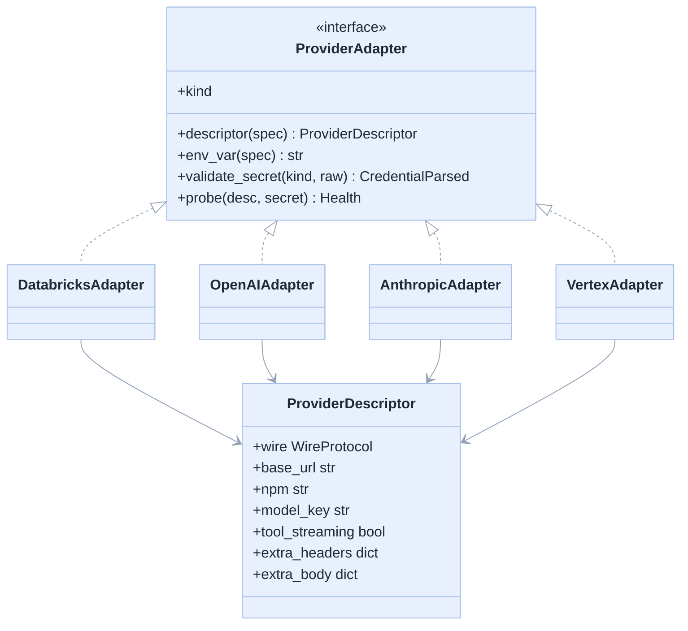
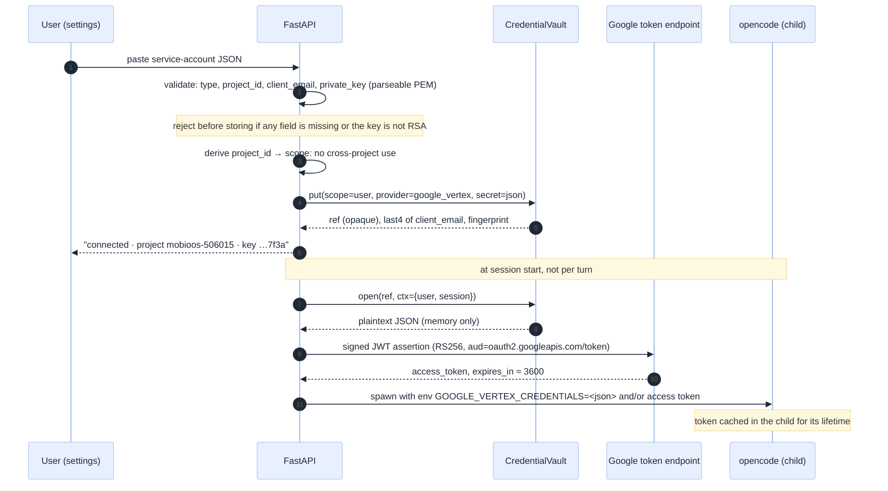
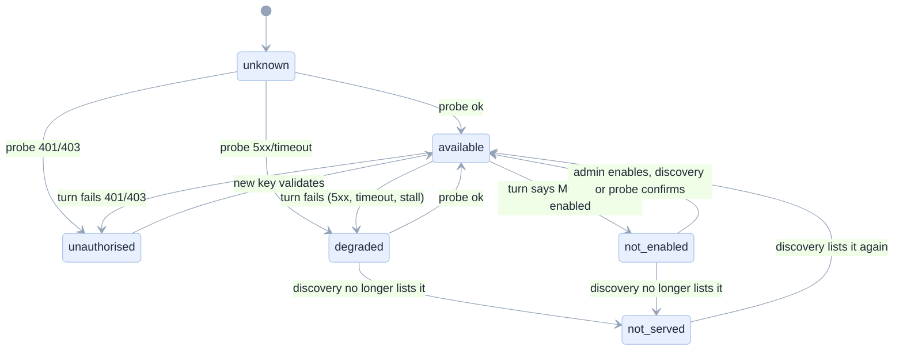

# 04 · Provider integration

[Index](README.md) · prev: [03 Architecture](03-architecture.md) · next: [05 Data model](05-data-model-lakebase.md)

Four protocols, one interface. This document is what an engineer reads before writing an adapter, and
what a reviewer reads to check that a provider was added correctly. Every trap named here was either
observed in this repository or is a documented vendor requirement.

---

## The adapter contract

One interface, four implementations. The adapter knows the wire; the domain knows the model.

```python
class ProviderAdapter(Protocol):
    kind: ProviderKind                    # databricks | openai | anthropic | google_vertex

    def descriptor(self, spec: ModelSpec) -> ProviderDescriptor:
        """URL, npm package, wire protocol, tool-streaming flag. Pure; no network."""

    def env_var(self, spec: ModelSpec) -> str:
        """The environment variable name the credential is delivered in. Stable per provider."""

    def validate_secret(self, kind: CredentialKind, raw: str) -> CredentialParsed:
        """Reject a malformed key at entry (bad JSON, wrong project, no private_key)."""

    async def probe(self, desc: ProviderDescriptor, secret: Secret | None) -> Health:
        """A cheap, bounded liveness call. Must not spend more than a few hundred tokens."""
```

`descriptor()` is pure so it can be unit-tested without a network and reused by the front end to
explain a model. `probe()` is the only method that costs money, so it is rate-limited and cached
([05 §Health](05-data-model-lakebase.md#llmhealth-append-only-observations)).



`ProviderDescriptor` is the only thing the config writer sees. It has **no** field for a secret: the
secret travels separately, as an environment variable name plus a value handed to the child. That
separation is what makes Axiom A4 mechanical rather than a promise.

---

## Databricks AI Gateway (serving endpoints)

**Status: working today.** [`agent_config.py:37-66`](../../apps/coding-agent/api/adapters/acp/agent_config.py).

| Field | Value |
|---|---|
| Wire | `openai-compatible` over serving endpoints |
| Base URL | `{DATABRICKS_HOST}/serving-endpoints` |
| Model key | the endpoint name, e.g. `databricks-gpt-oss-120b` |
| Credential | the workspace token, `DATABRICKS_TOKEN` (OBO user token in a deployed app) |
| npm | `@ai-sdk/openai-compatible` |

**Trap: per-endpoint output caps.** Measured, three different numbers
([original spec §3.2](../../docs/genie-code-replacement-spec.md)):

```
max_new_tokens 32000 cannot be greater than max_output_tokens 25000   (gpt-oss-120b)
max_tokens (24000) cannot exceed 10000                                (qwen3-next-80b)
max_tokens (24000) cannot exceed 8192                                 (llama-4-maverick)
```

The registry stores `(context, output)` per model with `evidence = measured`, and the seed file ships
the three numbers above because they were measured in this workspace
([`agent_config.py:84-91`](../../apps/coding-agent/api/adapters/acp/agent_config.py)).

**Trap: the roster is gated.** `system.ai.claude-*` and `system.ai.gemini-*` return
`MODEL is not enabled` (`INVALID_STATE`) until an account admin enables the Unity Gateway beta
([original spec §3.2](../../docs/genie-code-replacement-spec.md)). Handling: FR-20 — list the model
under "not enabled in this workspace", quote the platform, name the action.

**Trap: discovery may be unreadable.** `ServingBrowser.served()` returns `None` on a permission error
and the caller must **not** filter ([`serving.py:22-32`](../../apps/coding-agent/api/adapters/databricks/serving.py)).
The registry keeps this rule: `None` means "do not change anything", not "nothing is served".

**Trap: two id dialects.** The agent wants `dbx/<endpoint>`; the session stores `databricks/<id>`. The
alias map in §Ids below is the fix, and it is the reason the resolver exists rather than a longer
prefix-stripping function.

---

## OpenAI

| Field | Value |
|---|---|
| Wire | `openai-compatible` |
| Base URL | `https://api.openai.com/v1` (or an Azure/proxy base) |
| Model key | e.g. `gpt-4.1`, `o-series` |
| Credential | `Authorization: Bearer sk-…` |
| npm | `@ai-sdk/openai-compatible` (or `@ai-sdk/openai` when reasoning controls are needed) |

The simplest adapter: the Databricks adapter's descriptor with a different base URL and env var. It
exists as a separate class rather than a row because OpenAI's reasoning models need
`reasoning_effort`/`max_completion_tokens` handling that a plain compatible call gets wrong, and that
difference must be expressible without touching the domain. [proposal]

**Two things that will bite:**

1. **`max_tokens` vs `max_completion_tokens`.** Reasoning models reject the old field. The adapter
   emits whichever the model spec declares, as `extra_body`.
2. **A proxy base URL is a credential, not a secret.** An Azure or self-hosted compatible endpoint has
   a URL that is configuration, and a key that is a secret. They are stored in different tables for
   exactly this reason ([05](05-data-model-lakebase.md#tables)): a URL can be shown in the UI; a key
   cannot.

---

## Anthropic

| Field | Value |
|---|---|
| Wire | `anthropic-messages` |
| Base URL | `https://api.anthropic.com/v1` (or `{host}/ai-gateway/anthropic/v1`) |
| Model key | e.g. `claude-sonnet-4-5` |
| Credential | `x-api-key: …` plus `anthropic-version: 2023-06-01` |
| npm | `@ai-sdk/anthropic` |

The repository already carries a verified config shape for this route, including the flag everyone
forgets ([`docs/genie-code-replacement-spec.md` §7.2](../../docs/genie-code-replacement-spec.md)):

```json
{
  "model": "databricks-anthropic/system.ai.claude-sonnet-4-6",
  "provider": {
    "databricks-anthropic": {
      "npm": "@ai-sdk/anthropic",
      "options": {
        "baseURL": "https://<workspace>/ai-gateway/anthropic/v1",
        "apiKey": "{env:DATABRICKS_TOKEN}",
        "headers": { "Authorization": "Bearer {env:DATABRICKS_TOKEN}" }
      },
      "models": { "system.ai.claude-sonnet-4-6": { "options": { "toolStreaming": false } } }
    }
  }
}
```

**`toolStreaming: false` is not optional.** With it on, tool calls arrive in a shape the agent's mapper
does not reassemble; the documented Databricks configuration turns it off
([`docs/genie-code-replacement-spec.md` §7.2](../../docs/genie-code-replacement-spec.md)). The adapter
sets it from the model spec (`extra_body`/`options`), so a model that does support streaming can
override it per row.

**Two routes, one provider.** The same protocol is reachable through Anthropic directly and through
the Databricks gateway, with different credentials and different gating. The registry models this as
two providers (`anthropic` and `databricks_anthropic`) sharing one adapter, chosen by
`ProviderDescriptor.base_url`. Axiom A2 holds: the domain sees a provider row, not a vendor branch.

---

## Gemini on Vertex AI

**This is the case the request named, and the one with a genuine protocol problem.**

### The two endpoints, and which to use

| Endpoint | Shape | Auth | Verdict |
|---|---|---|---|
| **Vertex OpenAI-compatible** | `https://aiplatform.googleapis.com/v1/projects/{project}/locations/{location}/endpoints/openapi` | OAuth bearer (service account or ADC) | **chosen**: reuses the agent's OpenAI adapter, one line of config |
| Vertex native | `https://{location}-aiplatform.googleapis.com/v1/projects/{p}/locations/{l}/publishers/google/models/{m}:generateContent` | OAuth bearer | needs a native adapter; more work, more fidelity |
| Gemini API (AI Studio) | `https://generativelanguage.googleapis.com/v1beta/models/{m}:generateContent` | `x-goog-api-key` | simplest auth, different product and quota |

The repository already uses the Vertex OpenAI-compatible shape with location `global`
([`experiments/steps/06_opencode_vertex_gemini.sh`](../../experiments/steps/06_opencode_vertex_gemini.sh)),
so that is the seeded default. [verified: the shape appears in a working script]

### The thought-signature problem, precisely

Gemini 3.x returns an opaque `thought_signature` on every function-call part and **requires it echoed
back** on the next turn. It travels in a non-standard field,
`extra_content.google.thought_signature`. Generic OpenAI-compatible clients serialise tool calls into
their own message model and drop unknown fields, so the *second* turn fails. Captured verbatim:

```
Function call is missing a thought_signature in functionCall parts.
This is required for tools to work correctly, and missing thought_signature
may lead to degraded model performance.
Additional data, function call `default_api:write`, position 2.
```

Two working answers exist in this repository:

| Answer | How | Cost | Verdict |
|---|---|---|---|
| **Native adapter** | `@ai-sdk/google-vertex`, which round-trips signatures itself ([`experiments/steps/07_opencode_vertex_native.sh`](../../experiments/steps/07_opencode_vertex_native.sh)) | a second npm package in the agent image; a provider block of its own | **preferred** when it authenticates |
| **Signature shim** | the 130-line proxy at [`experiments/gemini_sig_shim.py`](../../experiments/gemini_sig_shim.py) remembers `tool_call_id → extra_content` and re-attaches it | one more process per session, one more place a key lives | **fallback**, and the only option if the native adapter cannot take a service-account JSON |

The registry therefore carries a per-model field, `wire = vertex_native | vertex_openai_shim`, and the
adapter sets it from the model row with a default of `vertex_native`. The shim is a **documented
fallback**, not the design. [proposal; U4 in 01 decides which one ships]

> **Decision rule, written down so it is not re-litigated in review:** ship `vertex_native` if a
> service-account JSON authenticates it (probe P2-b); otherwise ship the shim, and record in
> [11](11-decisions-risks.md) that the app runs one extra loopback process per Gemini session.

### The JSON key, worked through

The request names "gemini flash 3.8 vertex AI using json key". A Google service-account JSON is not a
bearer token; it is a signing identity. The flow:



**Why the JWT exchange happens in the app and not in the child.** Three reasons:
(a) the app can cache the token across the child's lifetime and refresh it on switch without
re-entering the vault;
(b) it means the **JSON itself** is the stored secret, so a key rotation is one row update, not a
redeploy;
(c) it keeps the child's dependency surface unchanged — `@ai-sdk/google-vertex` accepts either
`apiKey` (an access token) or ADC, and a minted access token is the cheaper of the two to hand over.

**Token cache rule.** Cache `(token, expiry − 60 s)` in memory keyed by credential ref. Never write it
anywhere. A cached token is a short-lived capability, not a secret at rest, and [06 §Residual](06-security-credentials.md#residual-risk-that-cannot-be-designed-away)
accounts for it.

### Limits for Gemini

1,000,000 context and 30,000 output are used in the repository's working template
([`templates/opencode.gemini.json`](../../templates/opencode.gemini.json)), recorded as
`evidence = documented` unless a probe confirms them. A3 permits either, provided the label is true.

---

## Health and classification

A model's state is derived, never stored as an opinion. Six states, each with copy and an action.

| State | Meaning | How it is produced | User action |
|---|---|---|---|
| `available` | the endpoint answered a probe within the TTL | last probe OK | — |
| `degraded` | it answered before, then failed | last probe error | retry, or switch |
| `unauthorised` | 401/403 | probe or turn | add/rotate key |
| `not_served` | Databricks discovery does not list it | discovery diff | ask an admin |
| `not_enabled` | the platform says the model is gated | turn error text matched | ask an admin to enable |
| `unknown` | never probed, or discovery unreadable | absence of evidence | hover shows why |



**Classification is textual where it must be.** ACP gives no structured provider error; the runtime
already extracts the most informative stderr line with a ranked heuristic
([`api/adapters/acp/runtime.py:138-166`](../../apps/coding-agent/api/adapters/acp/runtime.py)) and
yields `("error", "the model or agent failed: …")` on idle. The classifier consumes exactly that
string, plus any provider JSON the mapper unwraps
([`mapper.py:57-80`](../../apps/coding-agent/api/adapters/acp/mapper.py)), and maps it to a state. The
mapping table is data, in one function, so adding a provider's phrasing is a one-line edit — and it is
tested against the four real strings this repository has captured:

| Captured text | Classified |
|---|---|
| `max_tokens (24000) cannot exceed 8192` | `cap_exceeded` → `degraded`, and the cap is corrected in the registry |
| `Function call is missing a thought_signature` | `protocol_error` → `degraded`, with the Gemini-specific remedy |
| `MODEL is not enabled` / `INVALID_STATE` | `not_enabled` |
| `getaddrinfo ENOTFOUND https` | `unreachable` → `degraded`, and the resolution bug is named |
| `the agent sent nothing for 180s` | `stalled` → `degraded` |

That last row is a real property of this runtime and the reason health cannot be a single boolean.

---

## Ids and the alias map

A canonical id is `provider/model`, lowercase, where `provider` is a `llm_provider.id` and `model` is
the provider's own model key. Examples:

```
databricks/databricks-gpt-oss-120b
databricks/system.ai.qwen3-next-80b-a3b-instruct
openai/gpt-4.1
anthropic/claude-sonnet-4-5
google_vertex/google/gemini-3.8-flash
```

The alias map exists for **every id this app has ever stored**, and it is a literal table in
`domain/llm/model.py`, not a heuristic:

| Stored / sent today | Canonical | Note |
|---|---|---|
| `databricks/databricks-llama-4-maverick` | `databricks/databricks-llama-4-maverick` | identity |
| `databricks/system.ai.gpt-oss-120b` | `databricks/databricks-gpt-oss-120b` | the endpoint is what the agent needs |
| `dbx/databricks-gpt-oss-120b` | `databricks/databricks-gpt-oss-120b` | the internal form at `agent_config.py:40` |
| `vertex/google/gemini-3.8-flash` | `google_vertex/google/gemini-3.8-flash` | used by `exams/variants.py` and `templates/` |
| `databricks-system.ai.gpt-oss-120b` | `databricks/databricks-gpt-oss-120b` | the dash form the surgery produced |

A property test asserts every alias resolves, and that resolution is **injective** on the canonical
side (two ids never map to one canonical id unless they are the same model). NFR-7 depends on this: a
session created before the upgrade must still open.

---

## Adding a provider: the checklist

The checklist is the deliverable that keeps this design from decaying. It is short on purpose.

1. Add a `ProviderKind` enum member and a row in `llm_provider`.
2. Add one adapter class implementing the four methods. If the wire protocol is already supported, add
   **no** class — parameterise the existing one.
3. Add seed rows for the models you want offered, with limits and their evidence.
4. Add the credential kind to `validate_secret` (API key, service-account JSON, or access token).
5. Add the provider's failure phrasings to the classifier table.
6. Add one recorded fixture (a real error body) to the classifier test.
7. Add the provider to [07 §Grouping](07-ux-ui-wireframes.md#grouping-and-order) so the picker shows
   it in a sensible place.
8. Nothing else. No change to the resolver, the orchestrator, the router, or any existing adapter —
   and the CI rule C-2 fails if you tried.
