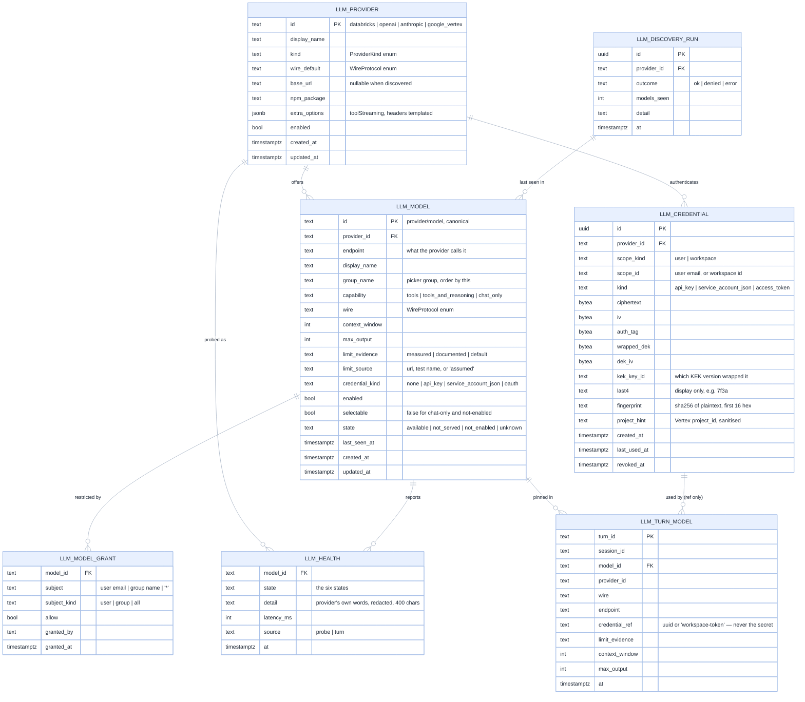
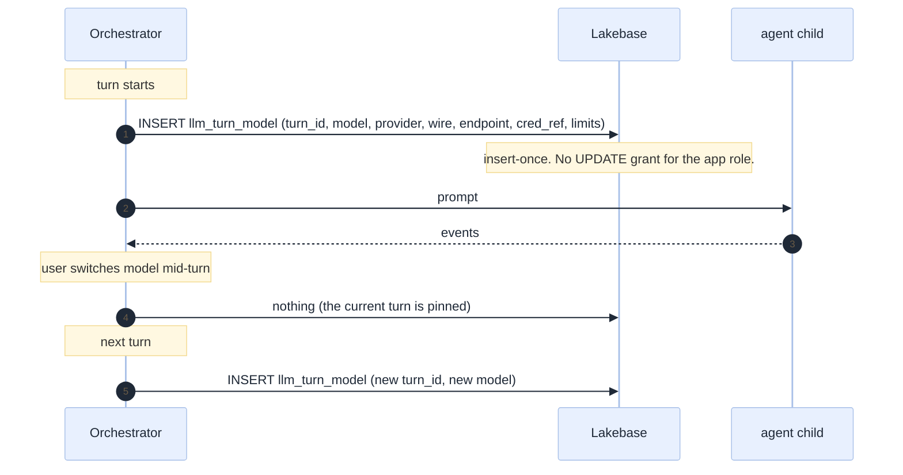
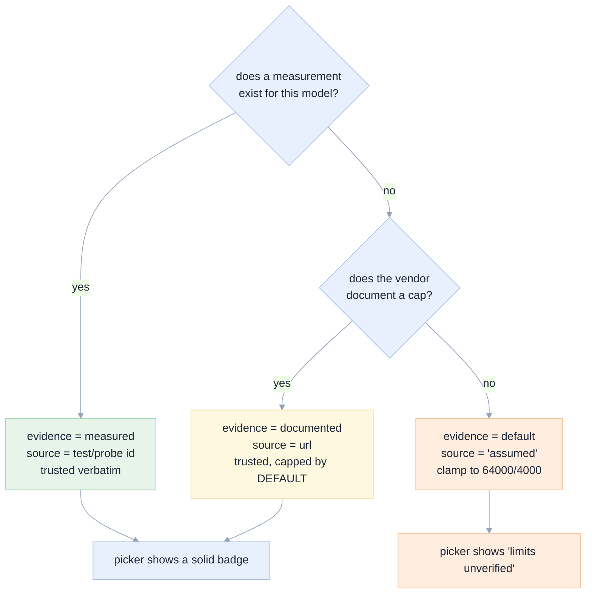
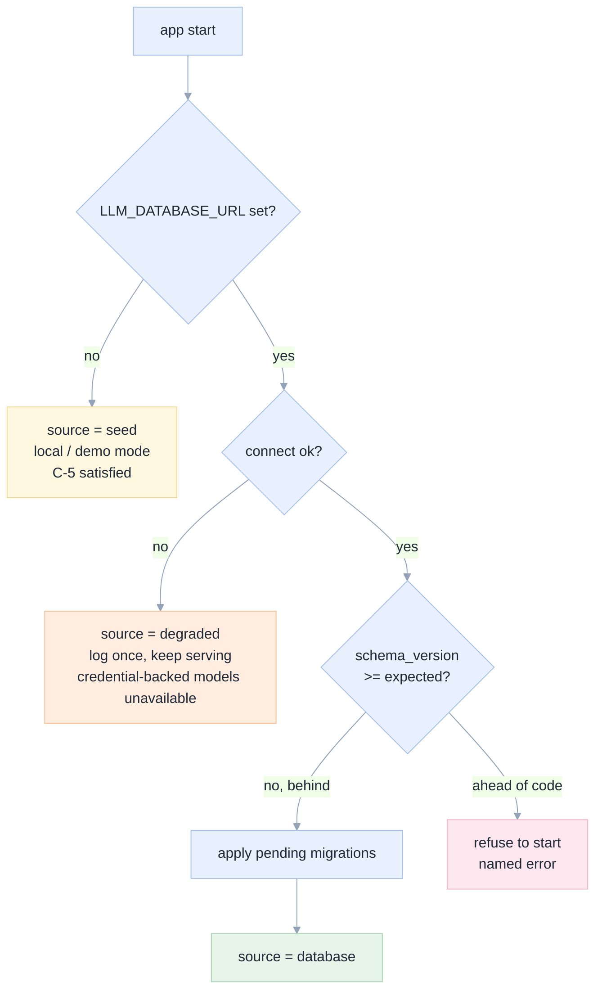

# 05 · Data model in Lakebase

[Index](README.md) · prev: [04 Providers](04-providers.md) · next: [06 Security](06-security-credentials.md)

Lakebase is Databricks' managed Postgres. This document defines the `llm` schema: six tables, their
invariants, the indexes that matter, and the migration path. It is written for the person who will
run the queries, not only for the person who writes the ORM.

> **Why a database at all.** Because two things cannot live in a process: a provider key must be the
> same on every replica and survive a deploy, and a turn's model pin must outlive the turn. The event
> store is in memory today ([`api/adapters/memory/store.py`](../../apps/coding-agent/api/adapters/memory/store.py)),
> so this schema is also the first durable persistence in the app. That is a cost, stated in
> [01 E9](01-current-state.md#e9-there-is-no-durable-store) and bounded by C-5 (the app boots without it).

---

## Entity relationships



---

## Tables

### `llm_provider` — one row per wire destination

The provider is the *place*, not the model. `base_url` is nullable because for Databricks it is
derived from `DATABRICKS_HOST` at runtime, and storing a host in the database would silently pin a
workspace that has moved.

| Column | Type | Invariant |
|---|---|---|
| `id` | `text` PK | matches `ProviderKind`'s value; a row whose id is not a known kind fails validation at load |
| `kind` | `text` | one of `databricks, openai, anthropic, google_vertex`; the adapter registry is keyed on it |
| `wire_default` | `text` | `serving \| openai \| anthropic \| vertex_openai \| vertex_native` |
| `base_url` | `text` null | `CHECK (base_url IS NULL OR base_url LIKE 'https://%')` — a plaintext `http://` provider is a finding, not a preference |
| `extra_options` | `jsonb` | templated values only: `{"toolStreaming": false}`. **Never** a secret: `CHECK (extra_options::text NOT LIKE '%sk-%')` is a cheap tripwire |

### `llm_model` — one row per selectable model

The primary key is the **canonical id** from [04 §Ids](04-providers.md#ids-and-the-alias-map). Aliases
are *not* rows; they are a static map in code
([`domain/llm/model.py`](03-architecture.md#the-resolution-pipeline)). Storing aliases as rows would
mean two rows could disagree about the same model — the exact ambiguity the alias map removes.

| Column | Invariant |
|---|---|
| `context_window`, `max_output` | `CHECK (context_window > 0 AND max_output > 0 AND max_output <= context_window)` |
| `limit_evidence` | `CHECK (limit_evidence IN ('measured','documented','default'))`; the resolver clamps to `DEFAULT_LIMITS` semantics when `default` |
| `limit_source` | non-empty when evidence is `measured` or `documented`: a test name, a probe id, or a URL. A claim without a source is the bug this column exists to prevent |
| `selectable` | false when `capability = chat_only` or `state = not_enabled`. The picker shows it, the API refuses it |
| `state` | written by discovery and by health, never by hand. `not_served` for Databricks means discovery stopped listing it |

```sql
-- The one query the picker needs. Small tables, so this is a scan; the index exists for the join.
SELECT m.id, m.display_name, m.group_name, m.capability, m.state, m.selectable,
       m.context_window, m.max_output, m.limit_evidence,
       p.display_name AS provider_name, p.kind,
       h.state AS health, h.detail AS health_detail, h.at AS health_at,
       c.last4 AS credential_last4, c.scope_kind AS credential_scope
FROM llm_model m
JOIN llm_provider p ON p.id = m.provider_id
LEFT JOIN LATERAL (
    SELECT state, detail, at FROM llm_health
    WHERE model_id = m.id ORDER BY at DESC LIMIT 1
) h ON TRUE
LEFT JOIN LATERAL (
    SELECT last4, scope_kind FROM llm_credential
    WHERE provider_id = m.provider_id AND revoked_at IS NULL
      AND (scope_kind = 'workspace' OR scope_id = $1)
    ORDER BY (scope_kind = 'user') DESC, created_at DESC LIMIT 1
) c ON TRUE
WHERE p.enabled AND m.enabled
ORDER BY m.group_name, m.display_name;
```

**The `LATERAL` joins are deliberate**: one round trip, no N+1, and the "most recent health" and
"most specific credential" rules live in SQL where they are visible to whoever debugs the picker.

### `llm_model_grant` — authorisation is not a build artefact

Grants **only** come from the database. A seed file that could grant access would put authorisation in
a repository, which is the same mistake as a hardcoded allow-list with worse consequences.

Semantics, in order of precedence:

1. An explicit `allow = false` for the exact subject wins over everything (an explicit deny).
2. An explicit `allow = true` for the exact user wins over a group grant.
3. A group grant applies if the user is in the group (group membership comes from the identity
   provider, not from this table).
4. `subject = '*'`, `subject_kind = 'all'` is the default-open grant for a model with no rows at all.
5. **No rows for a model means open to all users who can reach the app.** Stated explicitly because the
   opposite (default deny) is a defensible choice that would break the current product on day one.

| Rule tested | Case |
|---|---|
| deny beats allow | E-7 |
| a group grant does not leak to a non-member | E-7 |
| a revoked credential does not revoke a grant | E-5 |

### `llm_credential` — ciphertext only, and the shape is the security control

See [06](06-security-credentials.md) for the envelope scheme. The table enforces the *shape*:

- `CHECK (octet_length(ciphertext) > 0 AND octet_length(wrapped_dek) > 0)` — a row that is not
  encrypted cannot be written, so a "temporary plaintext" path cannot exist.
- `UNIQUE (provider_id, scope_kind, scope_id, kind) WHERE revoked_at IS NULL` — one live key per
  provider per scope. Rotation is an insert + revoke, never an update, so `last_used_at` history
  survives and an audit can say which key a turn used.
- `last4` and `fingerprint` are the **only** readable material. `last4` is shown in the UI;
  `fingerprint` is used to detect "the user pasted the same key again" without decrypting.
- `project_hint` is the Vertex `project_id`, sanitised to `[a-z0-9-]`, so the settings screen can say
  "project mobioos-506015" without touching the ciphertext.

### `llm_health` — append-only observations

A model's health is the newest row here, never a column on `llm_model`. Why: a flap is only diagnosable
from history, and a mutable column cannot say "it was fine for an hour, then broke". The probe itself
lives in the adapter ([04 §Health](04-providers.md#health-and-classification)); this table is where the
observation lands.

| Column | Invariant |
|---|---|
| `state` | one of the six in [04](04-providers.md#health-and-classification); anything else fails the insert |
| `detail` | at most 400 chars **after** redaction: a provider's 401 body can contain part of the key |
| `source` | `probe` or `turn` — so a turn failure is visible even between probes |
| `at` | insert-only; the retention job deletes older than 7 days |

Never updated, only inserted. Two consequences that matter: a health flap is visible as history (not
just a current value), and a bug in the classifier is diagnosable after the fact.

Retention: 7 days. A nightly `DELETE` bounded by `at < now() - interval '7 days'`; unbounded history is
a table that grows for no product reason.

### `llm_turn_model` — the audit record

`PRIMARY KEY (turn_id)` and insert-once. This is Axiom A5 made structural: there is no `UPDATE`
privilege on this table for the application role. A switch writes a row for the *next* turn; it cannot
rewrite this one.



The `credential_ref` column stores a UUID or the literal `workspace-token`. It is a *reference*, which
is what makes "which key did this turn use" answerable in an audit without the audit record becoming a
secret store.

### `llm_discovery_run` — why the list changed

One row per discovery pass. Without it, a model that vanishes from the picker is an unexplained event;
with it, the operations runbook can answer "did the workspace stop serving it, or did we stop reading?"
([12 §Diagnosis](12-operations-runbook.md#diagnosis-trees)).

---

## Limit evidence

Axiom A3 says a limit is a measurement with provenance or it is explicitly unknown. The schema makes
that impossible to fake:



The seeded values are the three measured in this workspace plus the documented ones:

| Model | context | output | evidence | source |
|---|---|---|---|---|
| `databricks/databricks-gpt-oss-120b` | 128 000 | 24 000 | measured | `docs/genie-code-replacement-spec.md` §3.2 |
| `databricks/databricks-gpt-oss-20b` | 128 000 | 24 000 | measured | same |
| `databricks/databricks-qwen3-next-80b-a3b-instruct` | 128 000 | 10 000 | measured | same |
| `databricks/databricks-llama-4-maverick` | 128 000 | 8 000 | measured | same |
| `databricks/databricks-meta-llama-3-3-70b-instruct` | 128 000 | 8 000 | measured | same |
| `google_vertex/google/gemini-3.8-flash` | 1 000 000 | 30 000 | documented | `templates/opencode.gemini.json` |
| `openai/*`, `anthropic/*` | per row | per row | documented | vendor docs, entered at seed time |

**A cap correction is an automatic write, and it must be attributable.** When a turn fails with the
`max_tokens (N) cannot exceed M` pattern, the classifier parses `M` and writes a new health row *and* a
`limit_source = "observed at <turn_id>"` correction — but only if the parsed `M` is lower than the
stored value. Raising a limit from an error message is never automatic; a number in an error could be a
proxy's cap, not the model's.

---

## Indexes that matter

| Index | Query it serves | Why not the obvious alternative |
|---|---|---|
| `llm_model (provider_id, enabled)` | the catalogue join | a partial index on `enabled` alone is smaller but does not help the join |
| `llm_health (model_id, at DESC)` | latest health per model | a single-row `llm_model.health` column would lose the history that makes a flap diagnosable |
| `llm_credential (provider_id, scope_kind, scope_id) WHERE revoked_at IS NULL` | credential resolution | partial, because revoked rows are dead weight on the hot path |
| `llm_turn_model (session_id, at DESC)` | "which models did this session use" | the PK is `turn_id`; this serves the other direction |
| `llm_model_grant (model_id, subject)` | permission check | the check is per model, not per user |

Nothing here needs a partition. The largest table is `llm_health` at roughly one row per model per
probe; at 200 models and a 5-minute probe interval that is 57 600 rows/day, and the 7-day retention
keeps it under half a million. Stated so nobody adds partitioning for a table that does not need it.

---

## Migrations

One directory, forward-only, numbered, idempotent:

```
apps/coding-agent/api/adapters/llm/store/migrations/
  001_llm_schema.sql          schema + tables + indexes
  002_seed_providers.sql      the four providers, disabled until configured
  003_grants_default.sql      the '*' open grant for pre-existing models
```

Rules:

1. **Forward only.** No down migrations: a rolled-back schema loses keys, and a lost key is not
   recoverable.
2. **Idempotent.** `CREATE TABLE IF NOT EXISTS`, `INSERT … ON CONFLICT DO NOTHING`. A deploy that runs
   migrations twice must be a no-op — Databricks Apps can restart a container mid-deploy.
3. **No data migration in code.** A migration never calls a provider, never discovers, never probes.
   Those are jobs with their own retry semantics ([12](12-operations-runbook.md)).
4. **Applied at boot, guarded.** On startup the app reads `schema_version`; if it is ahead of the code,
   the app **refuses to start** rather than running against a schema it does not understand. That is the
   one place fail-fast beats degrade.

### Boot-time behaviour



---

## Retention, deletion, and the right to remove a key

| Data | Retention | Deleted by |
|---|---|---|
| `llm_credential` (revoked) | 30 days, ciphertext retained for audit | purge job |
| `llm_health` | 7 days | nightly job |
| `llm_turn_model` | same as the turn record (001: 90 days) | the session deletion path |
| `llm_discovery_run` | 30 days | nightly job |
| `llm_model` / `llm_provider` | forever, soft-delete only | FR-13: never hard-deleted while a turn references it |

**A user deleting their key** sets `revoked_at`, leaves the row, and the ciphertext is zeroed by the
purge job after 30 days. Why not delete immediately: `llm_turn_model.credential_ref` would become a
dangling reference in an audit trail, and the audit trail is the reason the credential table exists.
The compromise is explicit — the *secret* is unusable immediately (revoked means never decrypted
again), while its fingerprint survives for 30 days to answer "was it this key?".

---

## What the schema deliberately does not store

| Not stored | Because |
|---|---|
| prompts or completions | unchanged from [001 08](../001-databricks-coding-agents/08-data-model.md): the app stores what happened, not the data |
| the plaintext of any key, ever | Axiom A4 |
| the KEK | [06](06-security-credentials.md): the KEK is not in the database, so a database dump is not a key dump |
| a model's *current* health on `llm_model` | an opinion with no timestamp is indistinguishable from a fact |
| the agent's internal id for a model | it is derivable from the canonical id; storing both invites disagreement (this is E5's bug) |
| group membership | it belongs to the identity provider; caching it here would authorise a stale member |
