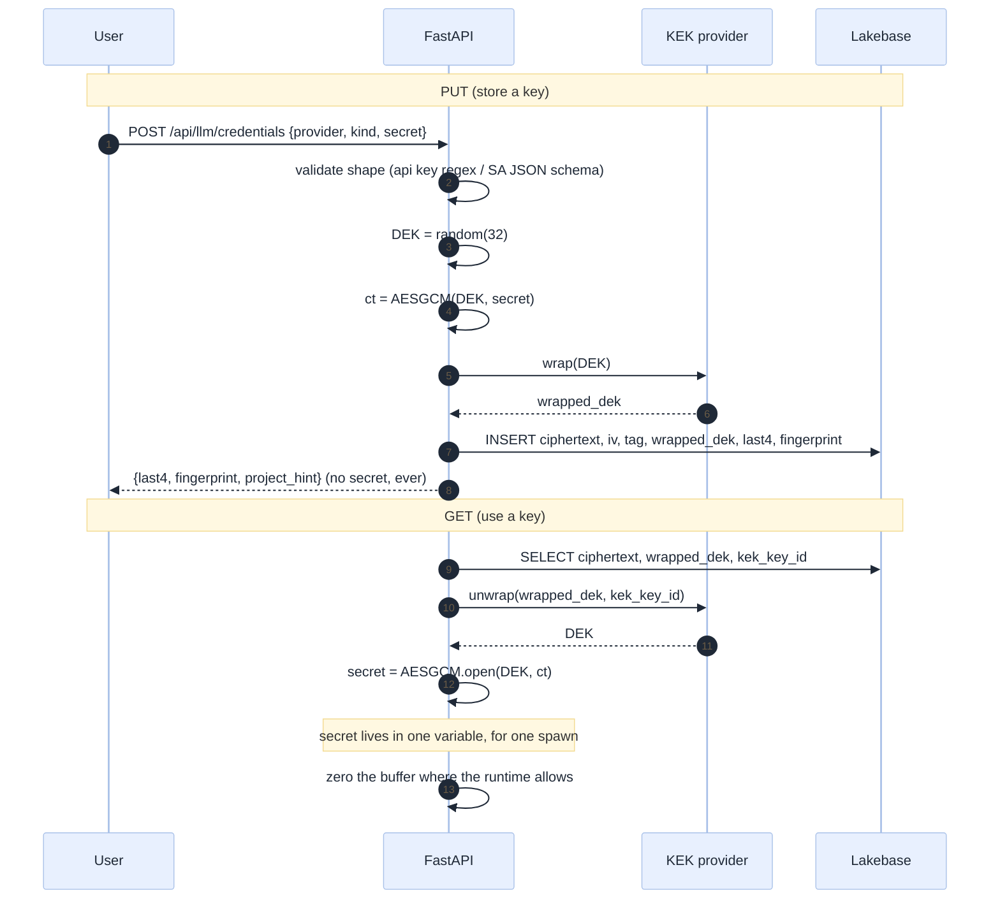
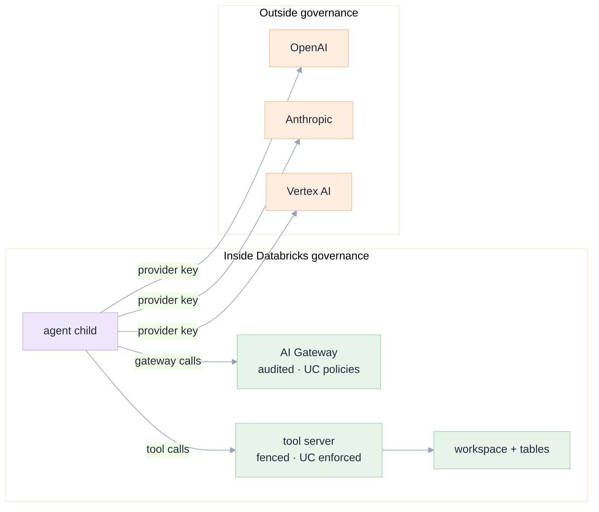

# 06 · Security and credentials

[Index](README.md) · prev: [05 Data model](05-data-model-lakebase.md) · next: [07 UX](07-ux-ui-wireframes.md)

A provider key is the strongest secret this app will ever hold. It is long-lived, unscoped, and — for
an external provider — it moves data outside Unity Catalog, where no grant, no audit table and no ACL
applies. This document says where the key lives, what can go wrong, and what the design refuses to do.

---

## What changes in the threat model

001's threat model ([001 09](../001-databricks-coding-agents/09-security-security.md)) has eight
entries. This spec adds two and changes the severity of one.

| # | Threat | Before | After |
|---|---|---|---|
| **TH-9 (new)** | **Key exfiltration through the app**: a bug, a log, an export, or an injected agent prints a provider key | n/a — no such key existed | Any turn that reaches a provider whose key is in memory can, in principle, print it. Mitigations below, and a hard limit: an injected key is a *spend* and *egress* incident, not a workspace-compromise one, which is why per-user keys with their own spend limits are the recommendation |
| **TH-10 (new)** | **Confused deputy across users' keys**: user A's key used by user B's session | n/a | The vault scope is `(scope_kind, scope_id)`; the resolver passes the session's user; a mismatch is a hard error. Test E-5 asserts a cross-user attempt is refused *and logged* |
| **TH-3 (re-scoped)** | Credential leak into logs, traces, exports or the browser | workspace token | now also four provider key formats: `sk-…`, `AIza…`, a JSON blob with `BEGIN PRIVATE KEY`, an OAuth access token (`ya29.…`). The redaction patterns at [001 08](../001-databricks-coding-agents/08-data-model.md) must be extended |
| **TH-2 (unchanged)** | Over-broad token | — | unaffected: the workspace token is unchanged and still scoped by `app.yaml` `user_api_scopes` |

---

## Where a key could live, and why we chose one place

| Option | Confidentiality | Rotation | Ops cost | Verdict |
|---|---|---|---|---|
| **A. Databricks secret scope, read by the app's service principal** | Strong: the platform's KMS; the app never sees a stored ciphertext | Redeploy or a secret update API | Low, but 001 R-09 says the app-provisioning flow is fragile and a secret scope resource must be attachable | **Rejected as the primary**, kept as the KEK source (below) |
| **B. Lakebase, envelope-encrypted by a KEK in the secret scope** | Strong: a DB dump is useless without the KEK | One row update; no redeploy | Medium: two systems must both be up | **Chosen** |
| **C. Lakebase, encrypted by a KEK in an environment variable** | Weak: a container dump yields the KEK | Redeploy | Lowest | **Rejected**: an env var is the same trust level as the ciphertext's container |
| **D. Lakebase, plaintext with column-level grants** | None against a DB read | — | Lowest | **Rejected**: violates Axiom A4 outright |
| **E. Never store; ask the user per session** | Strongest | n/a | Brutal: a key pasted every session | **Rejected as the default**, but *is* the degraded mode when no database exists (C-5) |

Option **B** is chosen because it is the only one where the two failure modes are independent: reading
the database does not yield keys, and reading the KEK does not yield keys. That independence is the
whole point of envelope encryption, and it is worth one extra system to get.

---

## The envelope scheme

<!-- GEN:envelope -->

```text
    ┌───────────────────────────────────────────────────────────────────────────┐
    │  KEK   AES-256, identified by kek_key_id                                  │
    │  lives in a Databricks secret scope                                       │
    │  or LLM_KEK (base64) in the environment                                   │
    │  NEVER in the database                                                    │
    └───────────────────────────────────────────────────────────────────────────┘
                                         │ wraps / unwraps
                                         ▼
    ┌───────────────────────────────────────────────────────────────────────────┐
    │  DEK   AES-256-GCM, generated per credential row                          │
    │  wrapped by the KEK, stored beside the ciphertext                         │
    └───────────────────────────────────────────────────────────────────────────┘
                                         │ encrypts
                                         ▼
    ┌───────────────────────────────────────────────────────────────────────────┐
    │  ciphertext = AES-256-GCM(DEK, plaintext)                                 │
    │  stored with its iv and auth_tag                                          │
    └───────────────────────────────────────────────────────────────────────────┘
                                         │ persisted as
                                         ▼
    ┌───────────────────────────────────────────────────────────────────────────┐
    │  one row: ciphertext · iv · auth_tag · wrapped_dek · dek_iv · kek_key_id  │
    │  a database dump without the KEK yields nothing                           │
    └───────────────────────────────────────────────────────────────────────────┘
```

<!-- /GEN:envelope -->



**Why AES-GCM and not AES-CBC + HMAC.** GCM authenticates the ciphertext, so a tampered row fails to
decrypt rather than yielding garbage that is sent to a provider. The `auth_tag` column is the
authentication. `cryptography`'s `AESGCM` is the standard library for this and is already a transitive
dependency of `httpx`'s ecosystem in many deployments; if not, it is one pinned line in
`requirements.txt` ([09 P1](09-implementation-plan.md#p1-the-registry-store-and-degradation)).

**Why a DEK per row.** Rotation of the KEK costs one `unwrap`/`wrap` per row, not a re-encrypt of every
secret. It also means a single row's compromise is bounded to that row.

**Key ids, not key versions.** `kek_key_id` is an opaque string (`kek-2026-11`, `scope:llm/kek/v3`).
The KEK provider resolves it. That is what makes rotation possible without a schema change:
new rows use the new id, old rows keep theirs, and a background job re-wraps.

---

## The KEK: two providers, one interface

```python
class KekProvider(Protocol):
    def wrap(self, dek: bytes) -> tuple[bytes, str]: ...      # (wrapped, key_id)
    def unwrap(self, wrapped: bytes, key_id: str) -> bytes: ...
```

| Implementation | When | Failure behaviour |
|---|---|---|
| `ScopeKek` | a Databricks secret scope is readable by the app's service principal | fail closed: no key, no external models |
| `EnvKek` | local development, demo mode, a pilot without a scope | fail closed, and the app logs once at boot that keys are protected by an env var — a visible downgrade, never a silent one |
| `NoneKek` | explicit `LLM_ALLOW_PLAINTEXT=0` default; if a developer sets it to 1, `put` refuses unless `APP_ENV=dev` | refuses in production |

**The downgrade must be visible.** If the app is running with `EnvKek`, the settings screen says
"keys are stored with a development key" and the boot log carries one `WARNING`. A security posture
that is silently weaker in production is the failure mode this avoids.

---

## Injection: one mechanism, widened

Axiom A4 says one mechanism. Today it is an env dict:

```227:229:apps/coding-agent/api/services/orchestrator.py
        token = live.extra.get("user_token") or os.environ.get("DATABRICKS_TOKEN", "")
        spec = SessionSpec(session_id=s.id, cwd=cwd, model=s.model, mcp_url=live.mcp_url,
                           env={"DATABRICKS_TOKEN": token} if token else {})
```

merged into the child's environment at
[`runtime.py:42-43`](../../apps/coding-agent/api/adapters/acp/runtime.py):

```python
env = {**os.environ, **self._extra_env, **spec.env}
```

The widened payload is the *same channel*, with a per-provider variable name so two providers cannot
collide, and with a rule that **only the selected provider's credential is present**:

```python
env = {"DATABRICKS_TOKEN": workspace_token} | ({} if kind is DBX else {"LLM_PROVIDER_KEY": secret})
```

| Rule | Why |
|---|---|
| Exactly one provider key in the environment | a child that can see two keys can leak two keys |
| A fixed variable name `LLM_PROVIDER_KEY`, not `OPENAI_API_KEY` | the config references one name; the adapter decides what the provider's SDK needs from `extra_options`. Fewer names, fewer leaks |
| The config file contains `{env:LLM_PROVIDER_KEY}`, never the value | the existing invariant at [`agent_config.py:55-56`](../../apps/coding-agent/api/adapters/acp/agent_config.py) generalised |
| The secret is not in `os.environ` of the app process | only in the child's env dict; `os.environ` of the app is visible to every subprocess including the tool server |

**Why not a file (like the tool server's token).** The tool server reads a `0600` file because it is
a long-lived process whose token changes per turn
([`orchestrator.py:250-262`](../../apps/coding-agent/api/services/orchestrator.py)). The agent child is
short-lived per model switch and reads its config once at startup, so an environment variable has
strictly fewer places to leak than a file. Two mechanisms, each justified by a different lifetime —
not two mechanisms for the same job.

---

## Redaction, at the source

The regex set must cover every format that will now exist. This table is the specification; the test
in [10 E-13](10-edge-cases-testing.md#secret-hygiene) is generated from it.

| Kind | Pattern (indicative) | Where it can appear |
|---|---|---|
| Databricks PAT | `dapi[a-f0-9]{32}` | already covered today |
| OpenAI | `sk-[A-Za-z0-9_\-]{20,}` | provider error messages, a pasted key in a prompt |
| Anthropic | `sk-ant-[A-Za-z0-9_\-]{20,}` | same |
| Google API key | `AIza[0-9A-Za-z_\-]{35}` | same |
| Google OAuth access token | `ya29\.[0-9A-Za-z_\-]{20,}` | a provider error body, a debug log |
| Service-account JSON | `-----BEGIN (RSA )?PRIVATE KEY-----` | a pasted key, an echo of the settings payload |
| Generic bearer | `Bearer [A-Za-z0-9._\-]{20,}` | any proxied request echoed back |

Rules:

1. **Redact on the way in to any sink** — event store, log, error detail, export — not on the way out.
   A sink that forgot to call the filter must not be able to leak.
2. **The classifier's `detail` column is a sink.** A provider's 401 body often contains the *first and
   last* characters of the key. `llm_health.detail` is capped at 400 chars **after** redaction.
3. **The settings API never echoes.** `POST /api/llm/credentials` returns `last4` and `fingerprint` and
   nothing derived from the plaintext.
4. **A key pasted into a prompt is a user error the app must survive.** The event stream shows
   `[redacted: openai key]` and the turn continues; a hard rejection would teach users to obfuscate
   keys before pasting them, which is worse.

---

## Authorisation

Two independent checks, both required. This is the "authorise twice" pattern the write fence already
uses ([003 §The write path](../003-improve-dev-ux-ui/03-architecture.md)).

| Check | Where | What it answers |
|---|---|---|
| **Model grant** | `domain/llm/policy.py`, at catalogue read and again at resolve | may this user use this model at all? |
| **Credential scope** | `CredentialService.open(ref, ctx)` | may this session use *this key*? |

The second is the one that stops TH-10. A user granted `openai/gpt-4.1` who has **no** key and for whom
no workspace key exists gets a precise refusal — `no_credential` — not a fallback to somebody else's
key. There is no "borrow the workspace key silently" path; a workspace key must exist explicitly as a
`scope_kind = 'workspace'` row, and its use is logged.

**Group membership comes from the identity provider, not from this app.** The middleware already reads
`x-forwarded-user` and `x-forwarded-email`
([`api/services/identity.py:18-37`](../../apps/coding-agent/api/services/identity.py)). Groups are
plumbed through a `Groups` port with a `NullGroups` implementation (returns empty) so the app runs
without SCIM; a model granted only to a group then appears to nobody, which is the safe default.

---

## Egress: what a provider key actually permits

This is the part a security review must weigh, and it is stated plainly rather than buried.



| Consequence | Reality |
|---|---|
| **Data egress** | A prompt containing a table sample goes to that provider. There is no Unity Catalog policy on it. The mitigation is product, not technical: the agent's working agreement already forbids printing credentials (Axiom in `agent_config.py:134-136`) and the tool server's results are the only data source — but a user must be told, per provider, that their prompts leave the workspace. |
| **Spend** | A leaked key bills the key's owner. Per-user keys with provider-side spend limits are the only real control; the app can cap turns but not spend. |
| **Audit** | Databricks records gateway usage; it records nothing about a direct provider call. `llm_turn_model` is therefore the *only* audit trail for external calls, which is why it is insert-once and why it records the endpoint. |
| **Retention by the provider** | Out of the app's control. The settings screen names the provider; a workspace policy decides whether external providers are enabled at all (`LLM_ALLOW_EXTERNAL=0` is a supported configuration that hides every external provider). |

**The honest summary for a reviewer:** enabling external providers trades governance for capability.
The design makes that trade **visible and switchable**, not silent. `LLM_ALLOW_EXTERNAL=0` restores
exactly today's behaviour.

---

## Secret hygiene checklist (used in review and in CI)

| # | Rule | Enforced by |
|---|---|---|
| S1 | No route returns a plaintext or ciphertext secret | response-scan test |
| S2 | No secret in a log line | redaction middleware + log scan test |
| S3 | No secret in an event payload | redaction at the event sink |
| S4 | No secret in the agent config file | golden-file test asserting `{env:` only |
| S5 | No secret in `os.environ` of the app process | code review + a test that the process env is unchanged after a session starts |
| S6 | Only one provider key in a child's environment | test on `SessionSpec.env` |
| S7 | A revoked credential is never decrypted | test with a revoked row |
| S8 | A cross-user credential request fails | E-5 |
| S9 | The KEK is not in the database | schema review: no `kek` column in any table |
| S10 | A database dump alone yields no keys | test that decrypting without a KEK raises |
| S11 | The `.gitignore` covers any local vault file | `.gitignore` review (`.env` and `*.tok` are already there) |
| S12 | A pasted key in a prompt is redacted, not rejected | E-13 |

---

## Residual risk that cannot be designed away

Stated as a list, because a security document that claims completeness is not credible.

1. **A key exists in a child process's memory** while a session runs. A memory dump of the container,
   or a code-execution bug in the agent, yields it. Bounded by: the child is short-lived, holds one
   key, and the key is revocable.
2. **A provider SDK may log its own request** including headers. Mitigated by `NODE_NO_WARNINGS` and
   the agent's log level, not eliminated. The provider key is therefore visible to the agent's own
   stderr *if* the SDK logs it — which is why the stderr tail heuristic
   ([`runtime.py:138-166`](../../apps/coding-agent/api/adapters/acp/runtime.py)) must be redacted before
   it reaches `llm_health.detail`.
3. **An injected prompt can ask the model to print its key.** The model does not have the key — the
   *process* does — so the realistic path is the model writing a shell command that reads its own
   environment. That is exactly why the built-in `bash` tool is denied by default
   ([`agent_config.py:16-17`](../../apps/coding-agent/api/adapters/acp/agent_config.py) and
   `DENIED_BUILTINS`), and why this spec does not relax that list for any provider.
4. **The KEK is in an environment variable** in the `EnvKek` mode. That mode is for development and is
   announced at boot.
5. **A proxy between the app and the provider** sees plaintext. TLS is not optional for every
   `base_url` (enforced by a `CHECK` in [05](05-data-model-lakebase.md#llmprovider-one-row-per-wire-destination)),
   and a certificate-pinning story is out of scope for v1 — named here so nobody assumes it exists.

Each residual risk has an owner and a review date in [11 §Risks](11-decisions-risks.md#risks).
