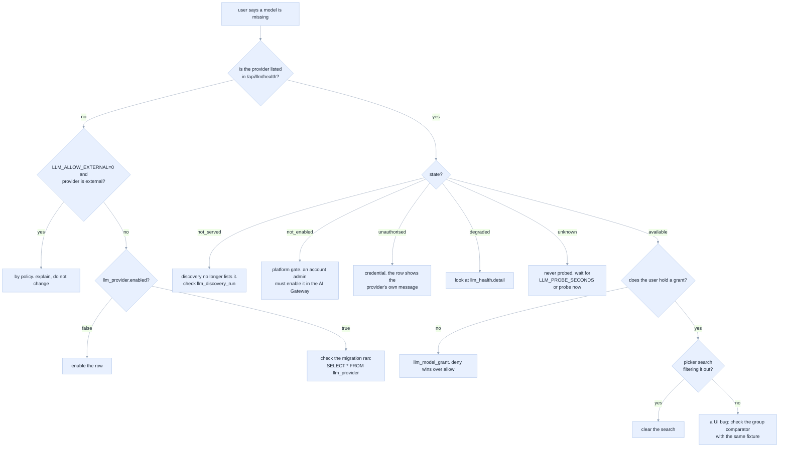
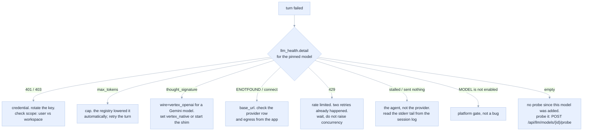

# 12 · Operations runbook

[Index](README.md) · prev: [11 Decisions](11-decisions-risks.md)

What to run, what to look at, and what to do at 3 a.m. Written for the person who did not build it.

---

## Configuration, in one place

All settings live in `Settings` ([`api/config.py`](../../apps/coding-agent/api/config.py)) with the
`APP_` prefix except where noted. Every one has a default that keeps the app working.

| Variable | Default | Meaning | Fails how |
|---|---|---|---|
| `LLM_DATABASE_URL` | unset | Lakebase Postgres DSN | unset → seed catalogue (C-5); unreachable → degraded |
| `LLM_KEK` | unset | base64 AES-256 KEK, development only | unset with no scope → key saving disabled, announced at boot |
| `LLM_KEK_SCOPE` / `LLM_KEK_KEY` | unset | Databricks secret scope and key name for the KEK | unreadable → falls back as above, with a `WARNING` |
| `LLM_ALLOW_EXTERNAL` | `0` | hide every external provider | `0` hides them; no error |
| `LLM_DISCOVERY_SECONDS` | `300` | discovery TTL | longer = staler list, fewer calls |
| `LLM_PROBE_SECONDS` | `900` | health probe interval per model | shorter = more tokens spent |
| `LLM_DEFAULT_MODEL` | `databricks/databricks-llama-4-maverick` | the preselected model | an id not in the catalogue → boot warning, first available model used |
| `APP_AGENT_MODE` | `fake` | `fake` / `stdio` / `http` | unchanged from today |
| `APP_TURN_IDLE_TIMEOUT` | `180` | the stall guard | unchanged from today |

**Secrets never go in `app.yaml`.** `valueFrom` may reference a scope, never a literal; the deployment
check ([`apps/coding-agent/scripts/deploy.sh`](../../apps/coding-agent/scripts/deploy.sh)) greps for
this.

---

## Where the configuration lives, and how to set it up (as deployed)

The catalogue, the default model and every stored key are rows in a **Lakebase** (managed Postgres)
database, schema `llm`. Nothing an administrator chooses is kept in the browser or in a file.

| Piece | Where | Notes |
|---|---|---|
| Database | Lakebase Autoscaling project `coding-agent-llm`, branch `production`, endpoint `primary` | `APP_LLM_PG_ENDPOINT` names the endpoint; the host is read from it |
| Who connects | the app's **service principal**, as a Postgres role of the same name | the password is a one-hour OAuth token, minted per connection (`adapters/llm/store/lakebase.py`) |
| Schema owner | the app's service principal | the app creates `llm.*` itself at boot; migrations `001`, `002` are forward-only |
| Key-encryption key | Databricks secret `coding-agent-llm/llm-kek`, attached as app resource `llm-kek`, delivered as `APP_LLM_KEK` | not in the database, so a dump of the database is not a dump of the keys |
| Vertex service-account key | secret `coding-agent-llm/vertex-sa`, resource `vertex-sa` | an operator-provided key, used when a user has none of their own |
| Who may change the catalogue | `APP_LLM_ADMINS` (e-mails, comma separated) | empty means nobody; everyone else sees the screen read-only |

One-off setup, in a workspace that has none of it:

```bash
databricks postgres create-project coding-agent-llm --json '{"spec":{"display_name":"coding-agent-llm"}}'
APP_SP=$(databricks apps get coding-agent -o json | jq -r .service_principal_client_id)
databricks postgres create-role projects/coding-agent-llm/branches/production --role-id coding-agent-sp \
  --json "{\"spec\":{\"postgres_role\":\"$APP_SP\",\"identity_type\":\"SERVICE_PRINCIPAL\",\"auth_method\":\"LAKEBASE_OAUTH_V1\"}}"
# as the project owner, once: let the role create its schema
#   GRANT CONNECT, CREATE ON DATABASE databricks_postgres TO "<APP_SP>";
python3 -c "import os,base64;print(base64.urlsafe_b64encode(os.urandom(32)).decode())" \
  | tr -d '\n' | databricks secrets put-secret coding-agent-llm llm-kek
# `apps update` REPLACES the resource list: send every resource and every scope together.
```

The app starts on the packaged seed catalogue and moves onto the database as soon as it is reachable
(`_database_loop`, retrying with back-off), so a suspended Lakebase compute delays the switch and never
the boot. `GET /api/llm/config` says which store is live (`source`: `database`, `degraded` or `seed`).
While it is not `database`, every write route answers 503 with that reason rather than saving
something that would vanish. The screens are described in `e2e/config-screens/`.

## Health endpoints

| Route | Answers | Must not |
|---|---|---|
| `GET /api/ready` | app up, agent mode, catalogue source, model count | touch a provider (a readiness probe that calls out fails the app for a remote reason) |
| `GET /api/llm/health` | per-provider: credential present, last probe state, last error | return any secret material |
| `GET /api/models` | the catalogue, with `source` and `updatedAt` | block on discovery (serve the cache) |

```json
{
  "source": "database",
  "updatedAt": "2026-11-07T08:41:12Z",
  "providers": [
    {"id": "databricks", "state": "ok", "models": 5, "lastProbe": "2026-11-07T08:40:02Z"},
    {"id": "google_vertex", "state": "ok", "models": 3, "credential": {"scope": "user", "last4": "7f3a"}},
    {"id": "openai", "state": "unauthorised", "models": 4, "credential": {"scope": "user", "last4": "9c41"},
     "detail": "401 Unauthorized: Incorrect API key provided."}
  ]
}
```

---

## Diagnosis trees

### "A model is missing from the picker"



### "A turn failed with a model error"



### "Keys cannot be saved"

| Symptom | Cause | Fix |
|---|---|---|
| `source: seed` in `/api/models` | `LLM_DATABASE_URL` unset or wrong | set it; restart |
| `source: degraded` | the DB is unreachable | check network and the instance state; the app keeps serving |
| `key store disabled` in settings | neither `LLM_KEK` nor a readable scope | attach a secret scope or set `LLM_KEK` (development only) |
| `Test connection` fails for a JSON key | a malformed or incomplete service account | the form names the failing field; the provider's message is in the response |
| `403` from Vertex with a project name in it | the Vertex API is not enabled for that project | enable it in the GCP project; nothing to change in the app |

---

## Routine operations

| Task | When | How |
|---|---|---|
| Refresh discovery | after enabling a model in the workspace | `POST /api/llm/discovery/refresh` (admin) or wait `LLM_DISCOVERY_SECONDS` |
| Probe one model | after adding a key | `POST /api/llm/models/{id}/probe` |
| Rotate the KEK | on a schedule, or after a suspected leak | add a new `kek_key_id`, re-wrap in a background job, keep the old key until the re-wrap finishes |
| Revoke a user's key | on offboarding | `DELETE /api/llm/credentials/{id}`; the ciphertext is purged after 30 days |
| Purge health history | nightly | `DELETE FROM llm_health WHERE at < now() - interval '7 days'` |
| Check a session's models | while debugging | `SELECT * FROM llm_turn_model WHERE session_id = $1 ORDER BY at` |
| Verify no secret in the DB | on a schedule | `SELECT * FROM llm_credential LIMIT 1` — every column is opaque except `last4`/`fingerprint` |

---

## Alerts worth having

| Alert | Condition | Why it matters |
|---|---|---|
| `llm_credential_decrypt_failed` | any `unwrap` failure | a tampered row or a wrong KEK — both are incidents |
| `llm_no_models_available` | `available` count is 0 for 5 min | the app is unusable even though it responds |
| `llm_discovery_denied` | 3 consecutive `outcome=denied` | a permission change upstream; the catalogue goes stale |
| `llm_probe_failures` | > 50 % of probes failing for a provider | an outage upstream, or an expired key |
| `llm_cap_corrections` | > 5 cap corrections in an hour | a seed value is wrong, or a proxy changed its limits |
| `llm_secret_scan_hit` | the redaction counter rises on a response path | a leak attempt or a bug in a sink |

Each is a counter with a name; none of them page on a single occurrence except the first two.

---

## What we have not verified

The honest list. Each item names what would settle it and where.

| # | Unverified | Settled by |
|---|---|---|
| U1 | What `/api/2.0/serving-endpoints` returns beyond `name`, `task`, `state.ready` | [09 P2](09-implementation-plan.md#p2-discovery-with-provenance) probe |
| U2 | Whether Lakebase can be attached to this app in this workspace | [09 P1](09-implementation-plan.md#p1-the-registry-store-and-degradation) |
| U3 | Whether a **user** token can reach the Anthropic-native gateway route | [09 P0-b](09-implementation-plan.md#p0-the-multi-provider-probe) |
| U4 | Whether a service-account JSON authenticates the Vertex OpenAI-compatible endpoint directly, or only via a minted token | [09 P0-d](09-implementation-plan.md#p0-the-multi-provider-probe) |
| U5 | Whether one `opencode` process can hold two provider blocks and switch across them over ACP | [09 P0-a/b](09-implementation-plan.md#p0-the-multi-provider-probe) |
| U6 | The measured cost of a cross-provider restart | [09 P5](09-implementation-plan.md#p5-cross-provider-switching-and-immutable-provenance) |
| U7 | Whether `@ai-sdk/google-vertex` accepts a minted access token as `apiKey` (vs ADC only) | [09 P0-e](09-implementation-plan.md#p0-the-multi-provider-probe) |
| U8 | The real per-model limits for the external providers | probed per model at onboarding; stored with `evidence: documented` until measured |

---

## Deployment checklist

1. `databricks apps update` with the new `app.yaml` env (`LLM_*`), no secrets in the file.
2. Attach the secret scope (KEK) before the first key is saved.
3. Run the migrations with the app's own boot path (they are idempotent); confirm `schema_version`.
4. `GET /api/ready` → catalogue `source: database`.
5. `GET /api/models` → the five Databricks models, states `available` or `not_enabled`.
6. Add one test key per external provider as **the deploying user**, run `Test connection`, then delete
   the key. This proves the vault, the egress and the classifier in one pass.
7. Run the five tests in [10](10-edge-cases-testing.md#the-five-tests-to-write-first) against the
   deployed app.
8. Check the six CI gates in [09](09-implementation-plan.md#enforcement-not-convention).

Step 6 is the one people skip, and it is the only step that exercises the whole path end to end with
a real provider.

## Model configuration in Lakebase (as deployed)

The model catalogue, the default model and users' encrypted keys live in a Lakebase Postgres project, not in the app's files.

| Piece | Where |
|---|---|
| Database | Lakebase project `coding-agent-llm`, branch `production`, database `databricks_postgres`, schema `llm` |
| App identity | the app's service principal has a Postgres role with the same name and `CONNECT, CREATE` on the database. It owns the `llm` schema, so its own migrations can alter it |
| Connection | `APP_LLM_PG_ENDPOINT=projects/coding-agent-llm/branches/production/endpoints/primary`. The app mints a short-lived OAuth password per connection (`api/adapters/llm/store/lakebase.py`), so there is no password to store or rotate |
| Key-encryption key | a Databricks secret (`coding-agent-llm/llm-kek`) attached as the app resource `llm-kek` and delivered as `APP_LLM_KEK`. It is not in the database, so a database dump is not a key dump |
| Who may change the catalogue | `APP_LLM_ADMINS` (comma-separated e-mails). Empty means nobody. Everyone else can read it |
| First boot | the seed catalogue is written once and `APP_DEFAULT_MODEL` becomes the stored default. After that the stored default wins, so a redeploy never undoes a choice made in the screen |

Screens: **Settings → Models** (add, switch off, remove, default, provider address) and **Settings → Keys**. Screenshots: `e2e/config-screens/`. Offline suite: `web/scripts/modelcfg-e2e.mjs`.

To recreate the database from nothing: create the project, create a role for the app's service principal (`databricks postgres create-role … --json '{"spec":{"postgres_role":"<client id>","identity_type":"SERVICE_PRINCIPAL","auth_method":"LAKEBASE_OAUTH_V1"}}'`), grant it `CONNECT, CREATE ON DATABASE databricks_postgres`, attach the KEK secret, and deploy. The app creates the schema itself.

If the database is unreachable the app serves the seed catalogue marked `degraded`, retries with backoff, and the Models screen says changes cannot be saved. It never pretends to save.
