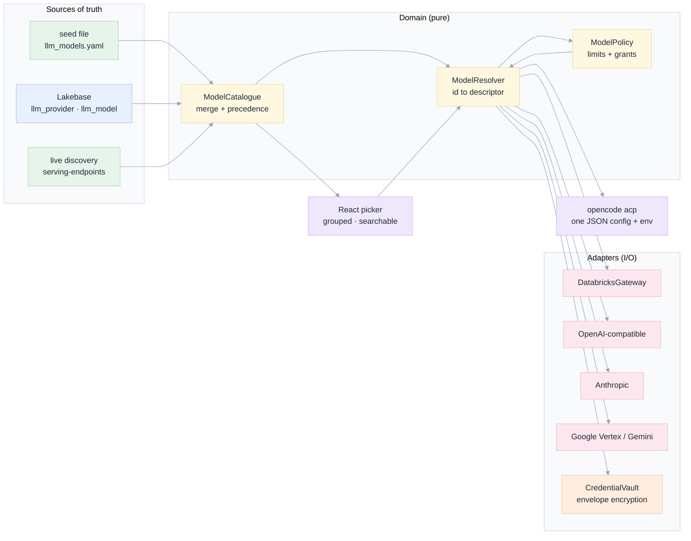

# 005 · Every model, one picker

**A specification and implementation plan for making the Coding Agent offer every model declared on
the Databricks AI Gateway, plus external providers (OpenAI, Anthropic, Google Gemini on Vertex AI)
whose keys live in Lakebase — without weakening the write fence, and without a code change per
model.**

> **Status:** specification · 7 November 2026
> **Scope:** `apps/coding-agent/api` (FastAPI: model catalogue, resolution, credentials),
> `apps/coding-agent/web` (React: picker, settings, health), and a new `llm_*` schema in Lakebase.
> **Relation to earlier specs:** builds on [001 · Databricks coding agents](../001-databricks-coding-agents/README.md)
> (ACP runtime, write fence, evidence), [001 · Perfect shell](../001-perfect-shell/README.md)
> (topbar, chips, CLS discipline) and [003 · Dev UX/UI](../003-improve-dev-ux-ui/README.md)
> (the editing surface whose model chip this spec replaces). Does **not** replace any of them.
> **Audience:** product, full-stack, database, UX/UI, front-end, AI engineering, platform security.

---

## The one-paragraph version

Today the app can talk to five models, and their names are a Python list. The list is compiled in at
[`api/config.py:32-41`](../../apps/coding-agent/api/config.py), turned into an endpoint by string
surgery at [`api/adapters/acp/agent_config.py:180-189`](../../apps/coding-agent/api/adapters/acp/agent_config.py),
and written into a single-provider `opencode.json` whose only credential is `DATABRICKS_TOKEN`
([`agent_config.py:37-66`](../../apps/coding-agent/api/adapters/acp/agent_config.py)). Adding a model
is therefore a code change and a deploy; an external provider is impossible, because the config
schema has one provider slot and the agent process receives exactly one secret. Meanwhile the
evidence in this repository says the model is the single largest lever on outcome — the same tools
and rules scored **39%** with the gateway model and **86%** with Gemini
([README finding #2](../../README.md)) — and the gateway roster is gated: Claude and Gemini return
`MODEL is not enabled` until an account admin flips a beta
([original spec §3.2](../../docs/genie-code-replacement-spec.md)). So the product is one
allow-list entry away from being unable to use the best model it has measured.

This spec replaces the list with a **registry**: a table of providers and models, seeded from a
file and refreshed from live discovery, plus a **resolver** that turns one canonical model id into
(provider block, credential, limits, capabilities) and a **credential vault** in Lakebase with
envelope encryption. Adding a gateway model becomes a discovery pass. Adding OpenAI, Anthropic or
Vertex Gemini becomes a row plus a key. The agent still receives its secret only as an environment
variable — the invariant at
[`agent_config.py:55-56`](../../apps/coding-agent/api/adapters/acp/agent_config.py) ("a config on
disk is a secret on disk") is kept and *generalised*, so one injection mechanism serves every
provider.

---

## What is wrong today, in one table

| # | Problem | Evidence |
|---|---|---|
| E1 | **The catalogue is source code.** Five ids, hardcoded. | `api/config.py:32-41` |
| E2 | **A model id is converted into an endpoint by string surgery**, so an id outside the convention resolves to nonsense instead of an error. | `agent_config.py:180-189` |
| E3 | **Exactly one provider is expressible.** `as_opencode_json()` emits a single `dbx` block; there is no second slot and no per-provider credential. | `agent_config.py:37-66` |
| E4 | **The agent process receives one secret.** `SessionSpec.env={"DATABRICKS_TOKEN": token}`. A second provider has nowhere to put its key. | `orchestrator.py:227-229` |
| E5 | **Two id dialects already coexist.** The app writes agent ids as `dbx/<endpoint>` but stores sessions as `databricks/<something>`, so the switch and the advertised list disagree. | `agent_config.py:40` vs `config.py:32-41`; `orchestrator.py:264-282` |
| E6 | **Model switching sends an id the agent does not know.** `set_model` passes the app id straight to ACP; the probe recorded exactly this failure class (`-32603` on an unresolvable provider). | `orchestrator.py:279-280`; [`docs/e2e/20_acp_config_probe.txt`](../../docs/e2e/20_acp_config_probe.txt) |
| E7 | **Output caps are a hardcoded dict**, and a wrong cap makes a model unusable ("max_tokens 24000 cannot exceed 8192"). | `agent_config.py:84-91`; test at `tests/test_genie_features.py:512-519` |
| E8 | **The picker is two `<select>` elements** with no grouping, search, capability or state. | `web/src/App.tsx:433-444`; `web/src/components/Chrome.tsx:184-188` |
| E9 | **There is no durable store at all.** The event store is in memory; a registry needs the database 001 planned but did not ship. | `api/adapters/memory/store.py:1-55` |
| E10 | **A rewritten config is not a model switch.** `set_model` writes `opencode.json` at runtime, where nothing re-reads it; the real switch is the ACP call beside it. | `orchestrator.py:271-282` |

The full audit, with line-level citations and the measured consequences, is
[01 · Current state](01-current-state.md).

---

## The design in one picture



Adding a gateway model = discovery writes a row. Adding a provider = one adapter class + one row.
Adding a user's own key = one row in the vault. **No path requires editing the resolver.**

---

## Scope

**In scope**

- A canonical model id grammar and a compatibility alias map for every id the app already stores.
- A model registry (providers, models, limit evidence, grants, health, audit) persisted in Lakebase.
- Catalogue assembly with explicit precedence: seed → database → live discovery.
- Adapters for the four wire protocols in use: Databricks serving endpoints, OpenAI-compatible,
  Anthropic messages, Google Vertex/Gemini.
- Per-user and per-app credentials, envelope-encrypted in Lakebase, injected into the agent process
  as environment variables.
- Capability-aware limits and clamping, so no offered model can be asked for more than it allows.
- A grouped, searchable, keyboard-operable model picker, a model inspector, and a settings surface.
- Health probes, last-error surfacing, and usage attribution.
- Deleting the hardcoded path (`KNOWN_ENDPOINTS`, `ENDPOINT_LIMITS` as authority, the duplicate
  `<select>`), so there is one way to answer "which models exist".

**Out of scope, and why**

| Not doing | Reason |
|---|---|
| A model router that picks a model per turn from cost/latency | Valuable, but it needs the registry first. The seam is the resolver's single entry point ([11 D7](11-decisions-risks.md)). |
| Fine-tuning, embeddings and image endpoints | The agent needs chat with tool calling. Embeddings are a different consumer with different limits. |
| Azure OpenAI / AWS Bedrock / on-prem gateways | The adapter shape supports them; each needs its own auth dance and a workspace we can test against. Named as a follow-on, not silently included. |
| Storing prompts or completions | Unchanged from [001 08](../001-databricks-coding-agents/08-data-model.md): the app stores what happened, not the data. |
| Letting the browser hold a provider key | The key never leaves the server; the browser sees `last4` and a fingerprint. [06](06-security-credentials.md) |
| Trusting a model's self-reported context window | Limits are measurements with provenance, or they are defaults marked unverified. [05](05-data-model-lakebase.md) |

---

## Reading map

Read in this order the first time. Every document is self-contained and cross-linked both ways.

| # | Document | The question it answers | Lead lens |
|---|---|---|---|
| 00 | [Why, from first principles](00-why-first-principles.md) | Why does this matter, and what is irreducibly true? | PO + AI engineer |
| 01 | [Current state audit](01-current-state.md) | What exactly exists today, measured, with line numbers? | Full-stack |
| 02 | [Requirements](02-requirements.md) | What must be true when we are done? | PO + UX |
| 03 | [Architecture](03-architecture.md) | How is it built, and where does each piece live? | Full-stack + compiler |
| 04 | [Provider integration](04-providers.md) | What is different about each wire protocol? | AI engineer |
| 05 | [Data model in Lakebase](05-data-model-lakebase.md) | What do we store, and how is it shaped? | Database |
| 06 | [Security and credentials](06-security-credentials.md) | Where do keys live, and what can go wrong? | Security + DB |
| 07 | [UX, wireframes, navigation](07-ux-ui-wireframes.md) | What does the user see, in ASCII, at every state? | UX + front-end |
| 08 | [Six lenses](08-lenses.md) | What does each discipline refuse to ship without? | all six |
| 09 | [Implementation plan](09-implementation-plan.md) | In what order, with what acceptance, DRY and SOLID? | Full-stack |
| 10 | [Edge cases and testing](10-edge-cases-testing.md) | What can go wrong, what stops it, and which test fails if it does? | compiler + AI |
| 11 | [Decisions and risks](11-decisions-risks.md) | What did we choose, reject, and fear? | PO |
| 12 | [Operations runbook](12-operations-runbook.md) | How is it run, rotated, and debugged at 3 a.m.? | platform |

Tooling in [`tools/`](tools/) generates the ASCII diagrams and repairs anchors. The four checks below
are what keep this spec set honest, and they run in CI:

```bash
cd apps/coding-agent/web
npm run verify:spec-005          # internal links + anchor slugs + ASCII box alignment
node scripts/verify-spec-mermaid.mjs ../../../specs/005-llm-models   # every diagram parses
python3 ../../../specs/005-llm-models/tools/diagrams.py --check      # markers well-formed
```

---

## Cross-reference matrix

Who depends on what. A change in a row means re-reading the columns marked ●. This matrix is the
contract that keeps fourteen documents from drifting apart.

| ↓ depends on → | 00 | 01 | 02 | 03 | 04 | 05 | 06 | 07 | 08 | 09 | 10 | 11 | 12 |
|---|---|---|---|---|---|---|---|---|---|---|---|---|---|
| **00 Why** | — | ● | ● | ● | | | ● | | | | | ● | |
| **01 Current state** | ● | — | ● | ● | ● | ● | ● | ● | | ● | ● | | |
| **02 Requirements** | ● | ● | — | ● | | ● | ● | ● | ● | ● | ● | ● | |
| **03 Architecture** | ● | ● | ● | — | ● | ● | ● | ● | ● | ● | ● | ● | ● |
| **04 Providers** | | ● | ● | ● | — | | ● | | ● | ● | ● | ● | ● |
| **05 Data model** | | ● | ● | ● | ● | — | ● | | ● | ● | ● | ● | ● |
| **06 Security** | ● | ● | ● | ● | ● | ● | — | ● | ● | ● | ● | ● | ● |
| **07 UX** | | ● | ● | ● | | | ● | — | ● | ● | ● | ● | |
| **08 Lenses** | ● | ● | ● | ● | ● | ● | ● | ● | — | ● | ● | ● | |
| **09 Plan** | ● | ● | ● | ● | ● | ● | ● | ● | ● | — | ● | ● | ● |
| **10 Edge cases** | | ● | ● | ● | ● | ● | ● | ● | ● | ● | — | ● | ● |
| **11 Decisions** | ● | ● | ● | ● | ● | ● | ● | ● | ● | ● | ● | — | ● |
| **12 Operations** | | | ● | ● | ● | ● | ● | | | ● | ● | ● | — |

---

## If you only read one section

Read [03 §The resolution pipeline](03-architecture.md#the-resolution-pipeline). It is seven steps
from a string a user clicked to an environment variable in a child process, and every other
document is either an input to one of those steps or a check on it.

---

## The five sentences this spec must satisfy

If any of these is false, the design is wrong and this document is amended before code.

1. **Every model the workspace can serve is selectable**, and the list is produced by discovery, not
   by editing Python.
2. **A user can add their own provider key and use it**, without that key ever being written to a
   file, returned by an API, or logged.
3. **No offered model can be asked for more than it allows** — the output cap is data with
   provenance, and a mismatch is refused before the request leaves the app, not after the endpoint
   rejects it.
4. **The model a turn used is the model that answered**, pinned, auditable, and shown — never a
   value silently rewritten under a running session.
5. **When a provider is broken, the user sees the provider's own words** and a next action, not
   "internal error" and a spinner.

---

## Provenance of the claims in this spec

Every factual statement is labelled:

| Label | Meaning |
|---|---|
| **[verified]** | Read in this repository's code, or reproduced in an evidence file under `docs/e2e/` |
| **[documented]** | Taken from vendor documentation, with a link |
| **[proposal]** | A design decision of this spec, not yet built or measured |
| **[unverified]** | Believed true, not checked; listed again in [12 §What we have not verified](12-operations-runbook.md#what-we-have-not-verified) |

The gateway's own discovery response shape is **[verified]** only for the fields the current code
reads (`name`, `task`, `state.ready` —
[`api/adapters/databricks/serving.py:29-31`](../../apps/coding-agent/api/adapters/databricks/serving.py)).
Any field beyond those is **[proposal]** and must be probed before it is depended on.
