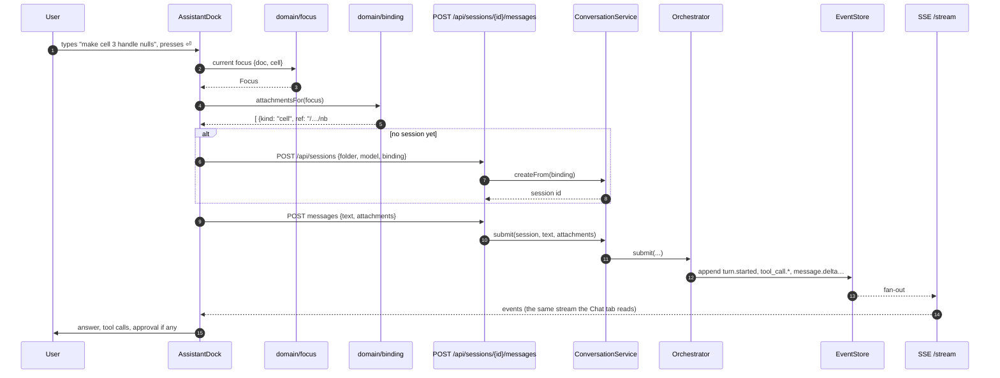
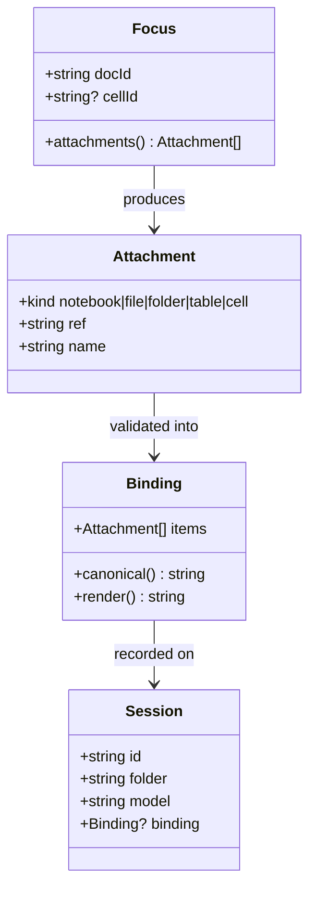

# 03 · Architecture

[Index](README.md) · prev: [02 Requirements](02-requirements.md) · next: [04 The assistant dock](04-assistant-dock.md)

The change is one new surface and four small extractions, not a rewrite. This document says where
each piece lives, what depends on what, and — because the existing code has two inert controls — how
the shape of the code prevents that recurring.

---

## The layers, and what changes in each

```text
apps/coding-agent/
├── web/src/
│   ├── domain/                  pure, no React, no DOM  ← most of the new logic lives here
│   │   ├── focus.ts             NEW  Focus { docId, cellId? } + binding to attachments
│   │   ├── dock.ts              NEW  dockState(), announce policy, dock labels
│   │   ├── searchroot.ts        NEW  which root an @ search uses
│   │   ├── files.ts             NEW  sort, filter, breadcrumb for the list view
│   │   ├── layout.ts            EDIT the assistant becomes a third zone
│   │   ├── docs.ts              EDIT a cell-bound attachment kind
│   │   └── …                    unchanged
│   ├── components/
│   │   ├── AssistantDock.tsx    NEW  the conversation surface
│   │   ├── DockComposer.tsx     NEW  composer bound to a focus
│   │   ├── FilesPane.tsx        NEW  tree ⇄ list, breadcrumb, drop target
│   │   ├── ModelChip.tsx        NEW  the one trigger, used in two places
│   │   ├── Composer.tsx         EDIT reuse in the dock; model slot
│   │   ├── NotebookEditor.tsx   EDIT `ask` is real; run removed
│   │   ├── App.tsx              EDIT compose three surfaces, not two
│   │   └── Chrome.tsx           EDIT Inspector keeps the facts; the dock takes the talking
│   └── hooks/
│       └── useSessionStream.ts  EDIT one stream, shared by dock and tab (no second SSE)
├── api/
│   ├── domain/
│   │   ├── binding.py           NEW  validate and canonicalise a focus binding
│   │   └── …                    unchanged
│   ├── services/
│   │   ├── conversation.py      NEW  create-or-continue from a binding
│   │   └── orchestrator.py      EDIT accept a binding, persist turns
│   ├── adapters/
│   │   ├── store/pg.py          NEW  durable event + session store
│   │   └── store/memory.py      KEPT as the fallback
│   └── routers/api.py           EDIT binding on create; session list with bindings
└── specs/006-databricks/        this set
```

The rule that decides every file above: **a decision goes in `domain/`, an I/O in `adapters/`, a
composition in `components/` or `services/`.** It is the rule [001](../001-perfect-shell/03-architecture.md)
and [005](../005-llm-models/03-architecture.md) already follow, so a reader of either can predict
where the new code is.

---

## The composition: three surfaces instead of two slots

Today `App` renders `rail | main`, where `main` is either the transcript *or* a document
([`App.tsx:509-593`](../../apps/coding-agent/web/src/App.tsx)). The target is `rail | document | dock`,
with the dock able to overlay in mid and narrow.

```mermaid
%%{init: {'theme':'base','themeVariables':{'primaryColor':'#E8F0FE','primaryTextColor':'#1F2937','primaryBorderColor':'#A8C0E8','lineColor':'#94A3B8'}}}%%
flowchart TB
    subgraph APP["App (composition only)"]
        LAYOUT["layout<br/>rail | centre | assistant"]
        RAIL["Rail<br/>Sessions · Files · Catalog"]:::purple
        CENTRE["Centre<br/>Chat tab + document tabs"]:::blue
        DOCK["AssistantDock<br/>conversation"]:::green
    end
    subgraph STATE["State, one owner each"]
        FOCUS["Focus (domain/focus.ts)"]:::yellow
        STREAM["useSessionStream<br/>ONE EventSource"]:::yellow
        DOCS["Doc[] + view"]:::yellow
    end
    subgraph SERVER["api"]
        CONV["ConversationService<br/>create-or-continue"]:::orange
        ORCH["Orchestrator"]:::orange
        STORE["EventStore<br/>pg | memory"]:::orange
    end

    RAIL --> DOCS
    CENTRE --> DOCS
    CENTRE --> FOCUS
    DOCS --> FOCUS
    FOCUS --> DOCK
    STREAM --> CENTRE
    STREAM --> DOCK
    DOCK --> CONV
    CENTRE --> CONV
    CONV --> ORCH
    ORCH --> STORE
    STORE --> STREAM

    classDef blue fill:#E8F0FE,stroke:#A8C0E8,color:#1F2937
    classDef yellow fill:#FFF8E1,stroke:#F2D98D,color:#1F2937
    classDef green fill:#E6F4EA,stroke:#A8D5B5,color:#1F2937
    classDef orange fill:#FFEDE0,stroke:#F5C29C,color:#1F2937
    classDef purple fill:#EFE7FB,stroke:#C9B6EC,color:#1F2937
```



**One stream, two views.** The single most tempting mistake is to give the dock its own `EventSource`.
Two clients on one session would double the server's fan-out and, worse, race on the replay cursor
(`useSessionStream` keeps `seq` in a ref and writes it to `localStorage`). The dock and the Chat tab
read **the same** `session` object; they differ only in what they render.

---

## The geometry: a third zone, one function

`domain/layout.ts` is already the only place that decides a column width, and it already refuses to
let a panel starve the centre ([`layout.ts:90-100`](../../apps/coding-agent/web/src/domain/layout.ts)).
The assistant becomes a third entry in that same model. This is the Open/Closed principle applied
literally: a new zone is a new entry in a table, not an edit to the separator, the hook or the CSS.

| | rail | centre | assistant |
|---|---|---|---|
| `min` | 200 | `CENTRE_MIN` 480 | 320 |
| `default` | 276 | flexible | 380 |
| `max` | `MAX_SHARE` … | — | 560 |

In `wide` (≥1180 px) all three may take a column. In `mid` (820–1180) the assistant takes no column
and is a drawer. In `narrow` (≤820) both side zones are drawers. This mirrors the existing rule
exactly ([`layout.ts:50-52`](../../apps/coding-agent/web/src/domain/layout.ts)), so `modeFor` does not
change and no new breakpoint is invented.

```text
wide    (≥1180)   rail | centre | assistant        three columns
mid     (820-1180) rail | centre        + drawer   two columns, dock over centre
narrow  (≤820)     centre               + drawers  one column, both over centre
```

**Why 320 min rather than the inspector's 260:** a conversation needs room for a code block and a
two-line composer. Below 320 the transcript reflows on every token, which is the jitter
[001 NFR-2](../001-perfect-shell/02-requirements.md) was written to prevent.

---

## The data flow: one prompt, end to end



Three properties of this flow are requirements, not implementation details:

1. **The binding is resolved before the request** (`B`), in the browser, so the server receives
   references and never guesses. This is the existing contract for attachments
   ([`api.py:245-272`](../../apps/coding-agent/api/routers/api.py)) reused, not extended.
2. **A session is created lazily**, on the first send, so opening the dock does not spawn an agent
   process. Today every prompt from a cold app already does this
   ([`App.tsx:168-180`](../../apps/coding-agent/web/src/App.tsx)); the dock reuses `start`.
3. **The stream is shared.** The dock subscribes to nothing; it reads the state the hook already
   owns.

---

## The server side: a binding is data

The server needs one new idea: a session remembers **what it was started about**, so a reload can
restore the dock's chip and so the audit trail says which object a conversation concerned.

`api/domain/binding.py` is pure and small: it validates a binding (an attachment from the client),
canonicalises it (a cell reference becomes `path#index`), and renders it into the prompt's context
prefix. The renderer already exists — `ctx.render` in
[`api/services/context.py`](../../apps/coding-agent/api/services/context.py) — so the new module
produces the *cell* case it currently lacks and delegates the rest.



---

## Why the inert controls cannot recur

Two independent mechanisms, because a comment does not prevent a regression:

1. **Type-level.** `EditorSurface` will require `onAskCell` to be present when the document is a
   notebook (a discriminated prop), so a caller that forgets it does not compile.
2. **Test-level.** `UX-1`'s dead-control e2e walks every visible button and asserts an effect. A
   future inert control fails CI, not a user's afternoon.

The run button is a third mechanism: it is **deleted**, and a grep test asserts `.cell-run` does not
exist, so re-adding one requires deleting the test deliberately
([10 §Dead controls](10-edge-cases-testing.md#dead-controls)).

---

## Alternatives considered and rejected

| Alternative | Why not |
|---|---|
| Keep the conversation a tab and add "split view" | Two tabs of the same session in one pane is still one slot; the user loses the file when scrolling. Also duplicates the stream. |
| Put a chat inside the inspector | The inspector is 260 px and holds facts a user reads occasionally; a conversation is a surface they live in. Mixing them makes both worse. It is also *suppressed* until a session exists, which is exactly when AD-5 needs it. |
| A floating chat bubble | Cannot hold a transcript with tool calls and an approval; overlaps code; no keyboard story. |
| Reuse `ApprovalSheet` as the dock's asking state | A modal over the code the approval is about is the current problem. The dock shows the same decision inline. |
| A second `EventSource` for the dock | Doubles fan-out and races the replay cursor. |

---

## What this architecture does not solve

- **Cell outputs.** The dock makes "ask about this cell" real; it does not make a cell *runnable*.
  NB-2 removes the affordance that implied otherwise.
- **Cost of a wide dock.** At 1600 px, rail 276 + dock 380 leaves 944 px of centre. Comfortable, and
  measured in [12](12-e2e-plan.md). At 1180 px exactly, three columns leave 524 px — which is why the
  `mid` breakpoint is where it is, and why [09](09-implementation-plan.md) measures it rather than
  assuming.
