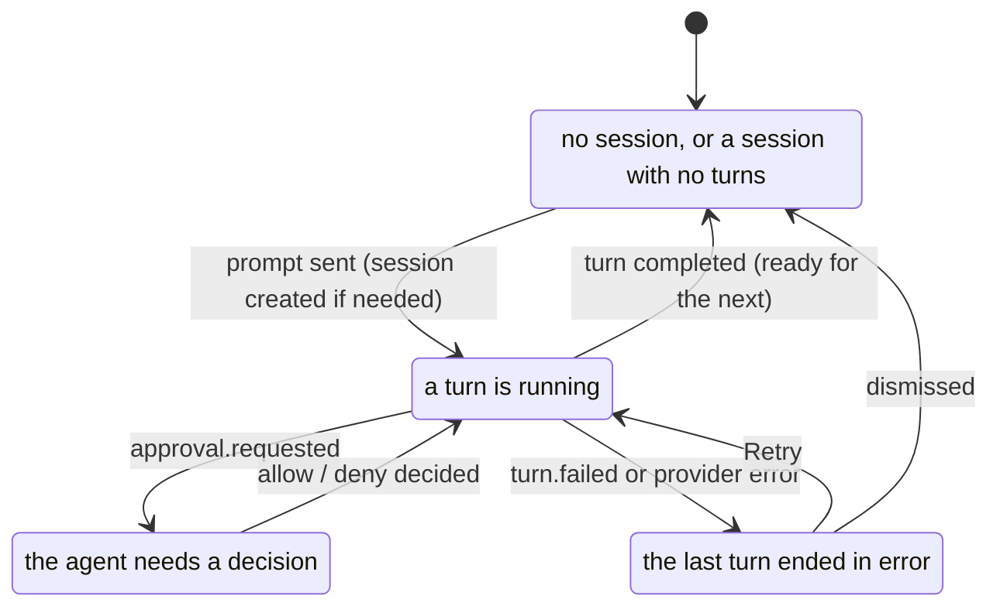
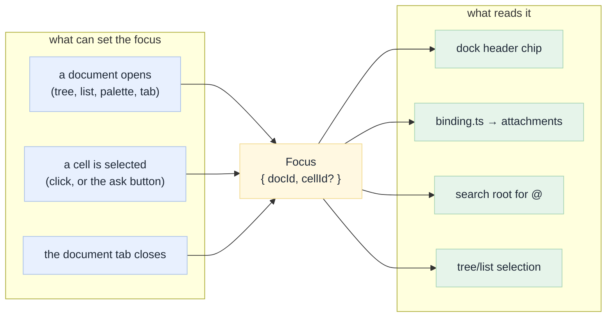
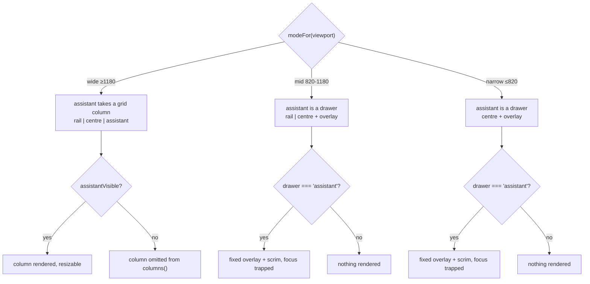

# 04 · The assistant dock

[Index](README.md) · prev: [03 Architecture](03-architecture.md) · next: [05 Data model](05-data-model-lakebase.md)

This is the document the request asked for: **how a conversation stays on the right of a file, in
context, and updates it.** Everything else in this spec exists to make this one thing possible
without breaking something else.

---

## The interaction, before and after

**Before.** Reading `agent_scratch/revenue.sql` and wanting a change:

```text
1  open Files, click the file           → the conversation is replaced by the file
2  type into the composer               → the answer will stream into a pane that is not rendered
3  press ⏎, then click the "Chat" tab    → the file is replaced by the conversation
4  read the answer                      → the file is no longer visible
5  click the file tab again              → the answer is no longer visible
```

Five steps, two navigations, and the prompt's subject is inferred from step 1 rather than stated.

**After.** The same intent:

```text
1  open Files, click the file           → the file opens; the conversation stays on the right
2  the dock says: in context: revenue.sql
3  type "add a null guard", press ⏎      → the answer streams into the dock
4  read it, then read the code            → both are on screen
5  approve the write inline               → the file reloads in place (rev bump)
```

The dock states the subject, the prompt carries it, the answer appears beside the code, and the write
is approved without covering the code.

---

## The three questions the dock answers

A docked chat is only *in context* if it can answer, visibly:

| Question | Where it is answered | Requirement |
|---|---|---|
| **What is this conversation about?** | The header chip: `in context: display_unity_catalog_tables`, plus `· cell 3` when a cell is chosen | AD-6, FX-1 |
| **What will the next message carry?** | The composer's chip row, which lists exactly what `binding.ts` will attach | FX-4 |
| **Did it change the file I am looking at?** | The file reloads on `tool_call.updated` for its path, keeping the scroll position | AD-1, existing `touched()` logic |

The third is already built: `touched()` maps a tool call to a `Doc` and bumps its `rev`
([`docs.ts:29-38`](../../apps/coding-agent/web/src/domain/docs.ts),
[`App.tsx:150-165`](../../apps/coding-agent/web/src/App.tsx)). Today it cannot be *seen* working,
because the file and the conversation are never on screen together. That is the whole argument for
the dock in one sentence.

---

## The state machine

Four states. Every other condition is a *detail* of one of them, not a fifth state — a fifth state
is how a dock ends up with an unreachable UI.



`dockState()` is a pure function, so the mapping is testable without a browser:

```text
state   = "failed"     if the last turn failed and no turn is running
        = "asking"     if any approval in the session has no outcome
        = "streaming"  if the session status is streaming, or the last turn is running/queued
        = "empty"      otherwise
```

The precedence matters and is asserted: **an approval outranks streaming**, because a run that is
waiting for a human is not making progress, and showing "streaming" would hide the thing the user
must do.

---

## What each state shows and offers

| State | Header | Body | Actions |
|---|---|---|---|
| **empty** | `New conversation` + `in context: <doc>` | three suggestions, generated from the focus ("explain this cell", "find the bug in cell N", "document this notebook") | a suggestion sends immediately; the composer is focused |
| **streaming** | `in context: <doc>` | the turns, newest last, with tool calls and the answer streaming | **Stop** (`Esc`), model chip |
| **asking** | `needs your decision` | the approval, inline: target, reason, blast radius | Allow once · Allow session · Deny |
| **failed** | `that turn failed` | the provider's own words, and the model that was pinned | Retry · Change model · Dismiss |

Every row above is a requirement in [02](02-requirements.md#assistant-dock-ad) (AD-7, AD-8).

**Why the approval is inline rather than the modal sheet:** the sheet
([`Chrome.tsx:8-48`](../../apps/coding-agent/web/src/components/Chrome.tsx)) is `position: fixed;
inset: 0` with a blurred scrim. Approving a write to the file you are reading therefore hides the
file. The sheet stays for approvals raised from the Chat tab; the dock renders the same decision in
place, with the same three outcomes calling the same endpoint.

---

## Focus: how "in context" stops being a guess

`Focus` is the missing concept from [00 §5](00-why-first-principles.md#the-five-whys).



### The rules, precisely

1. **Opening a document sets `{docId, cellId: undefined}`.** Selecting a cell sets `cellId`.
   Closing the document clears both.
2. **The Chat tab has no focus.** It is the general conversation; the dock is the situated one. Both
   render the same session, so switching between them never loses a turn.
3. **A closed document removes its focus**, and the dock falls back to `no document` with the session
   folder as its subject. It never keeps a focus on a document that is no longer open: an attachment
   to a closed file is a lie about what the prompt will contain.
4. **A table view can be the focus**, and bindings then use the table's three-part name — which is
   what `/api/catalog/table` and the agent's `describe_table` expect.
5. **The binding is a snapshot, not a live link.** The chips show what the *next* message carries. If
   the file changes after the prompt, the message still carried what the user saw.

### The attachment for a cell

A cell needs a reference the server can render. The format is the document path plus a fragment,
which is the same shape the workspace UI uses for a cell anchor:

```text
kind: "cell"
ref:  "/Users/me/agent_scratch/revenue_by_hour#3"
name: "cell 3 · revenue_by_hour"
```

`api/domain/binding.py` parses it, checks the cell index exists in the exported notebook, and renders
the cell — and only the cell — with its index, kind and language. Sending the whole notebook for a
question about one cell is both wasteful and, in a large notebook, the reason an answer misses the
point.

**Edge case that matters:** a cell index is positional and the file may have changed since the user
selected it. The binding therefore carries the **cell's text hash** in the rendered context
(`cell 3 (sha 4f2a)`), and the renderer refuses a binding whose current content does not match,
telling the agent the cell changed rather than silently answering about different code
([10 E-04](10-edge-cases-testing.md#e-04-a-cell-is-bound-then-the-notebook-is-edited-so-the-cell-index-moves)).

---

## Layout: docked, drawn over, and hidden



The `drawer` state already exists in `App` for the rail and the inspector
([`App.tsx:79`](../../apps/coding-agent/web/src/App.tsx)); the assistant joins it rather than adding a
second overlay mechanism. That is the DRY decision in this section: **one drawer mechanism, three
occupants.**

### Rules that are easy to get wrong

| Rule | Why | Requirement |
|---|---|---|
| The drawer never opens on resize | Crossing a breakpoint would hide the code the user was reading | AD-4 |
| `⌘J` works at every width, including wide (where it hides/shows the column) | One key, one meaning: "the assistant" | AD-3 |
| The top-bar toggle shows `aria-pressed` at every width | A drawer that starts closed must be discoverable | UX-3 |
| Closing the drawer returns focus to its toggle | Focus lost in an overlay is the classic drawer bug | AD-10 |
| `Esc` closes the drawer, but only if the composer does not own `Esc` (stop) | `Esc` already means "stop the turn" in the composer | AD-3, existing behaviour |

---

## Reusing the composer rather than writing a second one

`Composer` is 273 lines and does a lot: `@` search, `/` commands, history, chip management,
`Enter`/`Shift+Enter`, the stop button, auto-sizing. A second composer in the dock would be the
beginning of two divergent chat boxes.

The dock therefore **renders the same `Composer`**, with three new optional props:

| Prop | Effect in the dock | Effect in the centre |
|---|---|---|
| `focus` | chips are seeded from the binding and marked `in context` | unchanged (`auto` chip for the open doc) |
| `model` | renders the model control inline (MC-3) | unchanged |
| `variant="dock"` | narrower padding, no max-width, composer pinned to the bottom of the dock | unchanged |

One component, one behaviour, two placements. If a future requirement says "the dock composer should
behave differently", that is a signal to check whether the *centre* should change too.

**The `@` root (FX-6).** `api.search(query)` currently has no root
([`Composer.tsx:77`](../../apps/coding-agent/web/src/components/Composer.tsx)), so the server uses the
home folder. The dock passes the focused root; the centre passes the session folder, else home. One
pure function decides, so the two placements cannot disagree:

```text
searchRoot(focus, session, home) =
    folderOf(focus.doc)   if there is a focus
  = session.folder        else if there is a session
  = home                  otherwise
```

---

## Starting from nothing

AD-5 is the state Genie Code shows on a fresh notebook: a welcome with suggestions. Ours must not
show marketing; it must show **three things to do with what you are looking at**.

| Focus | Suggestions |
|---|---|
| a notebook, no cell | *Explain this notebook* · *Find the bug in this notebook* · *Document it in my folder* |
| a notebook cell | *Explain cell N* · *Fix cell N* · *Add a null guard to cell N* |
| a file | *Explain this file* · *Find a bug in this file* · *Rewrite it in my folder* |
| a table | *Profile this table* · *Suggest three queries* · *Document the columns* |
| nothing | *What can you do here?* · *Open something from Files* · *Start from a scratch notebook* |

The suggestion text is built by the same `ACTIONS` table the document bar's `Ask ▾` uses
([`docs.ts:44-58`](../../apps/coding-agent/web/src/domain/docs.ts)), so a quick action has one
definition.

---

## What the dock costs, and where it is measured

| Cost | Where it shows | Mitigation |
|---|---|---|
| 380 px of centre column at wide | 1600 → 944 px of code; 1180 → 524 px | the `mid` breakpoint moves the dock to an overlay, so three columns only exist when they fit |
| A second composer in the DOM | Focus, hotkeys, `Esc` semantics | one component, one `inputRef`, `Esc` scoped by the focused element |
| A second place turns render | Markdown re-parsing cost | the same `TurnView`, and the batching in `useSessionStream` (40 ms) is unchanged |
| A new key to learn | `⌘J` | printed in the dock header, the toggle tooltip, the shortcut sheet, and the palette |

Measured after implementation in [12](12-e2e-plan.md): `chromePx`, dock width, centre width at each
breakpoint, and the number of interactions for the five-step task above.

---

## Acceptance, as a sequence

The dock is done when this plays through, in the deployed app, with the e2e that asserts it:

```text
1  fresh load, no session           dock shows suggestions for "nothing", is not modal
2  click "Open something from Files" Files opens, no session is created
3  click revenue.sql                 file opens in centre; dock chip says in context: revenue.sql
                                       the Chat tab still exists and has the same (empty) session
4  click the dock composer, type ⏎   a session is created with model M and binding revenue.sql
                                       the answer streams into the dock, the file stays on screen
5  click cell 3, then its ask        chip becomes in context: revenue.sql · cell 3
6  ask "handle nulls"                the tool call writes; the file reloads in place (rev bump)
7  an approval appears               inline in the dock; press Deny; the agent is told and adapts
8  reload the page                   the session, its binding and its turns are all still there
```

[Back to the index](README.md)
