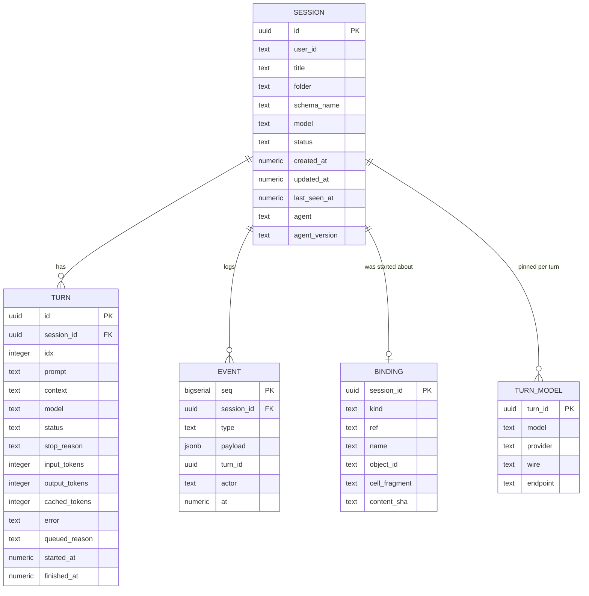
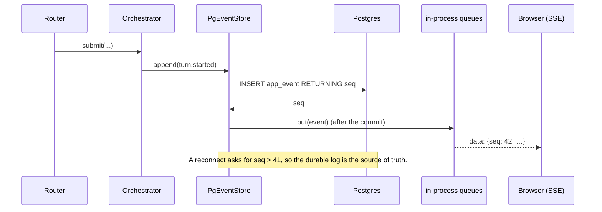

# 05 · Data model in Lakebase

[Index](README.md) · prev: [04 The assistant dock](04-assistant-dock.md) · next: [06 UX and wireframes](06-ux-wireframes.md)

The dock makes a conversation something a user keeps open for hours. Today a session lives only in a
Python dict, so a redeploy ends it ([`main.py:41`](../../apps/coding-agent/api/main.py),
[`store.py`](../../apps/coding-agent/api/adapters/memory/store.py)). This document defines what is
stored, why each column exists, and what is deliberately **not** stored.

It extends the schema [005](../005-llm-models/05-data-model-lakebase.md) already created. It does not
start a second database, a second migration runner, or a second connection pool.

---

## What exists already

**[verified]** Migration `001_llm_schema.sql` creates `llm.llm_provider`, `llm.llm_model`,
`llm.llm_model_grant`, `llm.llm_credential` and others, with a forward-only runner
([`migrate.py:1-14`](../../apps/coding-agent/api/adapters/llm/store/migrate.py)) that applies files
at boot and refuses a schema ahead of the code. The DSN is `APP_LLM_DATABASE_URL`
([`config.py:48-49`](../../apps/coding-agent/api/config.py)).

Three facts follow, and they are the constraints on this design:

1. **The runner exists once.** 005's own text says "Spec 004 must adopt it rather than add a second"
   ([`migrate.py:9`](../../apps/coding-agent/api/adapters/llm/store/migrate.py)). This spec adopts it:
   migration `002` lives in the same directory, same runner, same version gate.
2. **The DSN is already configured** for the vault and catalogue. Sessions use the same database, so
   one connection pool serves both and a workspace with no database degrades for both consistently.
3. **Degradation is already a designed state** (`E-15` in 005). With no DSN the app must still work:
   sessions in memory, and `/api/ready` says so ([PS-3](02-requirements.md#persistence-ps)).

---

## Schema



### Why these, and not the obvious alternatives

| Decision | Alternative | Why this one |
|---|---|---|
| `EVENT` is append-only, with a DB-assigned `seq` | Reconstruct turns from `TURN` only | The client resumes with `?after=<seq>` ([`useSessionStream.ts:80`](../../apps/coding-agent/web/src/hooks/useSessionStream.ts)). A monotonic per-session sequence is the only thing that makes replay correct across a restart. |
| `TURN` **and** `EVENT` | Only the event log | The session list (`GET /api/sessions`) must not fold thousands of deltas to show a title. The turn row is a projection, written on each terminal event. |
| `TURN_MODEL` is its own table | A `model` column on `TURN` | The pin must be queryable **with its resolution** (provider, wire, endpoint) because `model-facts` reports it ([005 FR-10](../005-llm-models/02-requirements.md)). A single text column cannot answer "which endpoint answered turn 7". |
| `BINDING` is one row per session | Many bindings per session | A session's subject is chosen at creation and does not change; a *turn* may add attachments, which live in the event payload. Two bindings would make "what is this session about" ambiguous. |
| `content_sha` on the binding | Nothing | A cell binding is positional; the hash is how a stale binding is detected rather than silently answering about different code ([04](04-assistant-dock.md#the-attachment-for-a-cell)). |

---

## Migration 002, in full intent

Forward-only and idempotent, like 001. The runner applies it at boot; a second boot is a no-op.

```sql
-- 002_sessions.sql — the conversation outlives the container.
CREATE TABLE IF NOT EXISTS app_session (
    id            uuid        PRIMARY KEY,
    user_id       text        NOT NULL,
    title         text        NOT NULL DEFAULT 'New session',
    folder        text        NOT NULL,
    schema_name   text,
    model         text        NOT NULL,
    status        text        NOT NULL,
    agent         text        NOT NULL DEFAULT '',
    agent_version text        NOT NULL DEFAULT '',
    created_at    timestamptz NOT NULL DEFAULT now(),
    updated_at    timestamptz NOT NULL DEFAULT now(),
    last_seen_at  timestamptz NOT NULL DEFAULT now(),
    CONSTRAINT session_status CHECK (status IN
        ('provisioning','ready','streaming','blocked','archived','failed'))
);

-- The session list is "mine, newest first". One index, for the one query.
CREATE INDEX IF NOT EXISTS app_session_user_recent
    ON app_session (user_id, created_at DESC);

CREATE TABLE IF NOT EXISTS app_turn (
    id             uuid        PRIMARY KEY,
    session_id     uuid        NOT NULL REFERENCES app_session(id) ON DELETE CASCADE,
    idx            integer     NOT NULL,
    prompt         text        NOT NULL,
    context        text        NOT NULL DEFAULT '',
    model          text        NOT NULL,
    status         text        NOT NULL,
    stop_reason    text        NOT NULL DEFAULT '',
    input_tokens   integer     NOT NULL DEFAULT 0,
    output_tokens  integer     NOT NULL DEFAULT 0,
    cached_tokens  integer     NOT NULL DEFAULT 0,
    error          text        NOT NULL DEFAULT '',
    queued_reason  text        NOT NULL DEFAULT '',
    started_at     timestamptz,
    finished_at    timestamptz,
    -- A turn index is a position in a conversation and must be unique within it.
    CONSTRAINT turn_index UNIQUE (session_id, idx)
);

CREATE TABLE IF NOT EXISTS app_event (
    seq        bigserial   PRIMARY KEY,
    session_id uuid        NOT NULL REFERENCES app_session(id) ON DELETE CASCADE,
    type       text        NOT NULL,
    payload    jsonb       NOT NULL DEFAULT '{}'::jsonb,
    turn_id    uuid,
    actor      text,
    at         timestamptz NOT NULL DEFAULT now()
);

-- Replay is `WHERE session_id = $1 AND seq > $2 ORDER BY seq`. Without this it is a scan per token.
CREATE INDEX IF NOT EXISTS app_event_replay ON app_event (session_id, seq);

CREATE TABLE IF NOT EXISTS app_binding (
    session_id    uuid    PRIMARY KEY REFERENCES app_session(id) ON DELETE CASCADE,
    kind          text    NOT NULL,
    ref           text    NOT NULL,
    name          text    NOT NULL,
    object_id     text    NOT NULL DEFAULT '',
    cell_fragment text    NOT NULL DEFAULT '',
    content_sha   text    NOT NULL DEFAULT '',
    CONSTRAINT binding_kind CHECK (kind IN ('notebook','file','folder','table','cell'))
);

CREATE TABLE IF NOT EXISTS app_turn_model (
    turn_id   uuid  PRIMARY KEY REFERENCES app_turn(id) ON DELETE CASCADE,
    model     text  NOT NULL,
    provider  text  NOT NULL,
    wire      text  NOT NULL,
    endpoint  text  NOT NULL
);

INSERT INTO llm.schema_version (version) VALUES (2) ON CONFLICT DO NOTHING;
```

**Why no `user_id` on `app_turn` or `app_event`:** they are reachable only through a session, which
carries the owner. Denormalising the owner onto every event doubles the bytes of the largest table to
avoid a join that is already an index lookup.

**Why `schema_name`, not `schema`:** `schema` is reserved in Postgres. The API field stays `schema`
([`api.py:34-37`](../../apps/coding-agent/api/routers/api.py)); the column does not.

---

## The two stores, one contract

`MemoryEventStore` already defines the shape
([`store.py:12-55`](../../apps/coding-agent/api/adapters/memory/store.py)). The Postgres store
implements the same interface, so nothing above it changes:

```text
class EventStore(Protocol):
    async def append(event) -> Event            # assigns seq
    async def since(session_id, seq) -> list    # for replay
    async def latest_seq(session_id) -> int
    def subscribe(session_id) -> asyncio.Queue  # live fan-out
    def unsubscribe(session_id, queue) -> None
```

The live fan-out stays **in-process** even with Postgres. Two app instances would each have their own
subscribers, which is correct for now: a Databricks App runs one container, and cross-instance fan-out
is 004's problem, named as a risk in [11 R-4](11-decisions-risks.md#r-4-two-app-instances-break-live-fan-out-medium-accepted).



**The ordering rule:** the queue is written **after** the commit succeeds. Publishing first and
committing second is how a client ends up with an event the database never stored, and a reload then
shows a conversation that loses its middle.

---

## Write volume, and why it is acceptable

A turn with 300 streamed deltas writes 300 rows. At a generous 20 turns an hour per user, that is
6 000 rows and roughly 1.5 MB per user-hour. Against a shared Lakebase this is small, but it is not
free, so:

| Measure | Decision |
|---|---|
| Batch the deltas | `message.delta` and `thought.delta` are coalesced into one row per 250 ms per turn. The client already batches at 40 ms for rendering ([`useSessionStream.ts:14`](../../apps/coding-agent/web/src/hooks/useSessionStream.ts)); the store batches at a coarser interval for storage. |
| Do not store the streamed *text* twice | The `app_turn` projection stores the final answer. The deltas are in `app_event` only as the replay log, and are pruned with their session. |
| Prune by age | `app_event` rows older than `APP_EVENT_RETENTION_DAYS` (default 30) are deleted by a scheduled statement. `app_session` and `app_turn` are kept: they are the user's history. |

**A number to be honest about:** we have not measured this against a real Lakebase instance. The
figures above are arithmetic from the event count, not a benchmark.
[11 §unverified](11-decisions-risks.md#what-we-have-not-verified) records it, and
[09 P6](09-implementation-plan.md#p6-persistence-l) includes the measurement.

---

## API surface, unchanged in shape

Only two additions, both additive, so no client breaks:

| Endpoint | Change | Why |
|---|---|---|
| `POST /api/sessions` | accepts an optional `binding` object | AD-5/FX-5: a conversation started from the dock records its subject |
| `GET /api/sessions` | returns `binding` (kind, ref, name) per session | restoring the dock chip after a reload |

`GET /api/sessions/{id}` gains `binding` in the same shape. Everything else — messages, stream,
cancel, approvals, model, model-facts — is untouched, which is the point: the dock is a **client** of
the existing API.

---

## Retention and privacy

| Rule | Reason |
|---|---|
| Prompts and answers are stored; **table rows and query results are not** | Unchanged from [001 08](../001-databricks-coding-agents/08-data-model.md): the app stores what happened, not the data. A tool result that contained customer rows is stored as the agent's *summary*, truncated to 2 000 characters. |
| `context` (the rendered attachments) is stored | It is what the model saw; without it an audit cannot explain an answer. It contains the *reference* and the cell text, which is code the user wrote. |
| Provider keys never appear in these tables | They live in `llm.llm_credential`, encrypted, and the dock path does not touch them. |
| A delete of a session cascades to its turns, events and binding | "Archive" today is a status; a real delete is `DELETE /api/sessions/{id}` guarded by the same owner check. |

---

## Fallback and failure

| Condition | Behaviour | Test |
|---|---|---|
| `APP_LLM_DATABASE_URL` unset | memory store; `/api/ready` reports `store: "memory"`; a banner explains that a reload loses the conversation | config test |
| DSN set, connection fails at boot | **start anyway**, log loudly, use memory, and report it in `/api/ready` | boot test with a bad DSN |
| DSN fails mid-turn | the turn continues; events queue in memory; a warning is surfaced once per session; retried on the next append | store test with an injected failure |
| Schema ahead of the code | refuse to start (existing `SchemaAhead`) | existing test, extended to version 2 |
| Clock skew | all timestamps are `timestamptz` set by the database, never by the app | review |

---

## What this document does not cover

- A second instance's fan-out (004).
- A read replica or partitioning (not needed at this volume).
- Storing the agent's *internal* reasoning beyond what it streams (it is already in `thought.delta`,
  redacted by `domain/redact.py`).
