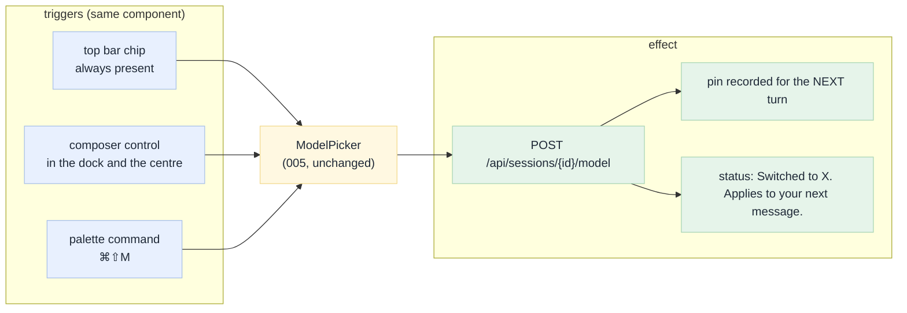
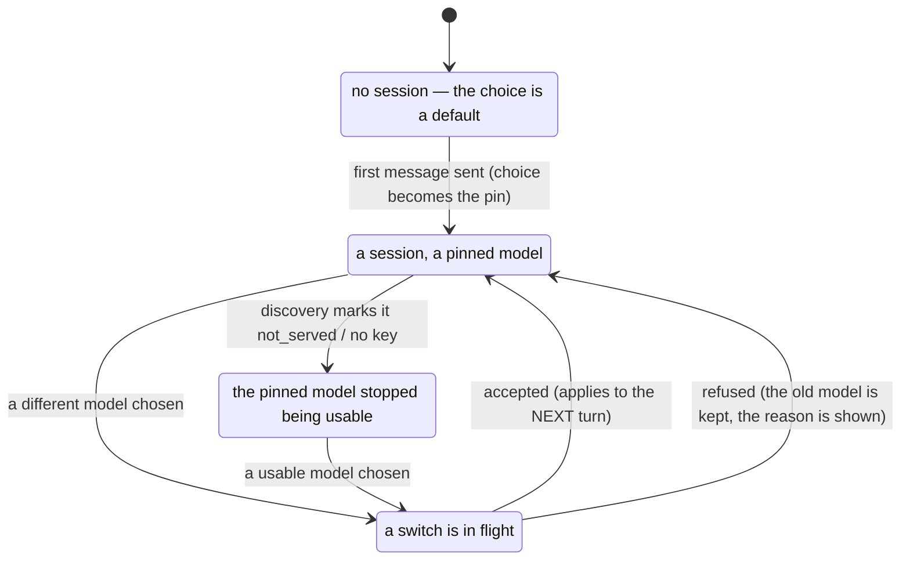

# 07 · Choosing the model

[Index](README.md) · prev: [06 UX](06-ux-wireframes.md) · next: [08 Six lenses](08-lenses.md)

The request was explicit: *"make sure also that is easy to choose the current AI Model."* The picker
built by [005](../005-llm-models/07-ux-ui-wireframes.md) is good — grouped, searchable, keyboard
operable, honest about limits and keys — and it is **unreachable** in exactly the situations where a
user wants it. This document fixes availability and discoverability without redesigning the list.

---

## What "easy" means, as four measurable claims

| Claim | Measure | Today |
|---|---|---|
| **I can see which model is current, wherever I am.** | the control is on screen at every width ≥ 760 px | **fails** below 1100 px ([01 N3](01-current-state-audit.md#n3-the-model-control-disappears-below-1100-px)) |
| **I can change it without leaving what I am doing.** | one click from the composer, zero navigation | **fails**: the trigger is in the top bar only |
| **I can choose before I start.** | a model control exists on a fresh load and after `⌘⇧N` | passes on the empty state only |
| **I am told what changed.** | after a switch: the model, and that it applies to the next message | passes (`ModelPicker` sets a status line) |

The first two are the work. The third is a rendering condition; the fourth already works and must be
preserved verbatim.

---

## The one control, three placements



**No second list.** `ModelPicker` already supports a controlled `open`/`onOpenChange` pair precisely
for this ([`ModelPicker.tsx:50-58`](../../apps/coding-agent/web/src/components/ModelPicker.tsx)), and
already has a `variant` prop for a chip or a button. The composer placement is a third variant, not a
third component. MC-2 asserts it.

---

## Why the chip disappears, and what replaces the rule

The rule is one CSS block:

```css
@media (max-width: 1100px) { .topbar .meta .chip { display: none; } }
```

Its comment says *the model is in the inspector*. That was true when the inspector was a column at
every width. It is not true now: the inspector is a column only above 1180 px and a closed drawer
below ([`layout.ts:50-52`](../../apps/coding-agent/web/src/domain/layout.ts)).

So the rule is not "hide the chip below 1100"; it is **"the model is on the most prominent surface
available at this width"**:

| Width | Primary surface | Secondary |
|---|---|---|
| ≥ 1440 | top bar chip (full label) | composer control, inspector block |
| 1100–1440 | top bar chip (label truncates, `title` has the id) | composer control |
| 820–1100 | composer control (the top bar is crowded) | inspector drawer when open |
| < 820 | composer control | inspector drawer |

The chip is never `display: none`; at the narrowest width it is *inside* the composer, which is
always on screen. MC-1 and MC-7.

---

## The composer control, concretely

A small, secondary button in the composer's action row, next to `@` and `/`:

```text
┌──────────────────────────────────────────────────────────────────────────┐
│ @ objects, / commands                    model ▾ flash-3.8   Send ▾      │
└──────────────────────────────────────────────────────────────────────────┘
```

| Property | Value | Why |
|---|---|---|
| Label | the model's short name (`flash-3.8`), not the id | MC-7: `gemini-3.8-flash` is readable, `google-vertex/gemini-3.8-flash` is not at 320 px |
| Fallback | if no model is resolvable yet, `model · choose` | the control must exist before a session |
| State glyph | the same dot/ring/warning vocabulary as the rows | one legend for the whole app |
| `title` / `aria-label` | `Model: <full label> — <provider>. Change with ⌘⇧M` | discoverability for mouse and AT |
| Weight | `btn ghost sm` — secondary, not competing with **Send** | Send is the primary action in a composer |
| Open behaviour | the same portalled popover, flipped above the composer | it must not cover the message box |

**Why not a `<select>`:** it cannot show a group, a state, a limit and a remedy in one row. That is
the argument 005 already made ([`07-ux-ui-wireframes.md`](../005-llm-models/07-ux-ui-wireframes.md)),
and it still holds at 320 px: the popover is sized to the viewport (`min(460, innerWidth - 24)`).

---

## The three states a user can be in, and what they see



| State | The control says | Choosing does |
|---|---|---|
| **no session** | `model ▾ <default>` | sets the default for the next session created by this client |
| **in session** | `model ▾ <label>` | `POST /model`; the pin moves for the next turn only |
| **switching** | `aria-busy`, label unchanged, rows disabled | nothing until the answer arrives |
| **unavailable** | `model ▾ <label> ⚠` | opens the list with the remedy on the current row |
| **refused** | the previous label, plus the provider's words | nothing; the pin is unchanged |

**The pin and the running turn.** A switch during a running turn does not retarget it
([`orchestrator.py:406-419`](../../apps/coding-agent/api/services/orchestrator.py)); the dock's
streaming state keeps showing the model that is answering, and the composer control shows the model
that will answer *next*. Two different things, labelled differently — that is the whole of MC-5.

---

## What a user must be able to find out, and where

| Question | Answer lives in | Reachable from |
|---|---|---|
| Which model is this? | composer control, top bar chip | both, always |
| What are its limits? | the popover row (`1M ctx · 64k out · measured`) | the control |
| Is the limit measured or assumed? | `measured` / `documented` / `default` on the row, and the inspector's `model-facts` block | popover, inspector |
| Can it call tools? | the inspector block says `tools: no` for `chat_only` | inspector |
| Which model answered turn 7? | `model-facts`, per-turn list, and "the switch was at turn N" | inspector, `⌘I` |
| Why can I not use this one? | the row's remedy (`add a key`, `ask an admin`) | popover |

Every row above exists today except the two placements. That is the point of this document: 005 built
the truth and put it behind a shortcut.

---

## Interaction budget

The number to beat is "one click, no navigation".

| Task | Today (≥1180 px) | Today (<1100 px) | After |
|---|---|---|---|
| See the current model | 0 actions | **open the inspector drawer** (1–2) or remember `⌘⇧M` | 0 |
| Change it, mid-conversation | 2 (click chip, click row) | 2 + opening a panel | 2 |
| Change it, mid-message | **leave the composer** | leave the composer, open a panel | 2, without leaving the box |
| Change it before the first message | 2 (empty-state control) | 2 | 2 |
| Find out which model answered turn 3 | 1 (`⌘I`) | 1 | 1 |

The third row is the one the request is about: choosing a model while composing should not require
abandoning the sentence you were writing. Today the top-bar chip steals focus and the composer keeps
its text — but on a narrow window the only control is a shortcut.
