# 09 · Implementation plan

[Index](README.md) · prev: [08 Six lenses](08-lenses.md) · next: [10 Edge cases and testing](10-edge-cases-testing.md)

Eight phases, ordered so that **the app is shippable after every one** and so that the riskiest
assumption is tested before the most expensive work depends on it. Each phase names its files, its
acceptance, and the test that would fail if it regressed.

Sizes are `S` (an afternoon), `M` (a day), `L` (two to three days).

---

## The order, and why

```mermaid
flowchart LR
    P1["P1 focus<br/>domain + tests<br/>S"]:::blue
    P2["P2 dock, wide only<br/>M"]:::green
    P3["P3 drawer + ⌘J<br/>M"]:::green
    P4["P4 model control<br/>S-M"]:::yellow
    P5["P5 dead controls gone<br/>S"]:::pink
    P6["P6 persistence<br/>L"]:::orange
    P7["P7 files list<br/>M"]:::purple
    P8["P8 measurement + e2e<br/>M"]:::blue

    P1 --> P2 --> P3 --> P4 --> P5 --> P6 --> P7 --> P8
    classDef blue fill:#E8F0FE,stroke:#A8C0E8,color:#1F2937
    classDef green fill:#E6F4EA,stroke:#A8D5B5,color:#1F2937
    classDef yellow fill:#FFF8E1,stroke:#F2D98D,color:#1F2937
    classDef pink fill:#FDE7EF,stroke:#F2B5CB,color:#1F2937
    classDef orange fill:#FFEDE0,stroke:#F5C29C,color:#1F2937
    classDef purple fill:#EFE7FB,stroke:#C9B6EC,color:#1F2937
```



**Why focus before the dock.** `Focus` is a domain value with no dependencies; it can be written and
tested in an afternoon, and it is the thing the dock is built *from*. Writing the dock first would put
"what is this about" back into a component, which is the exact mistake
[00 §5](00-why-first-principles.md#the-five-whys) diagnosed.

**Why the dock is wide-first and the drawer second.** At wide widths the dock is a grid column, which
is `layout.ts` — the most tested module in the front end. The drawer touches focus management, which
is where the bugs are. Ship the easy half, verify it in the deployed app, then add the overlay.

**Why persistence comes late.** It is the only phase that needs infrastructure (a Lakebase instance,
a secret, a migration) and it blocks nothing else. Doing it last means the UI can be reviewed and
deployed while the database work happens.

**Why the files list is last.** It is parity, not an advantage
([08 PO](08-lenses.md#1-product-owner)). If the schedule slips, this is the phase to cut.

---

## P1 · `Focus`, as a value — `S`

**Files**

| File | Change |
|---|---|
| `web/src/domain/focus.ts` | **new** — `Focus`, `focusFor(doc)`, `withCell(focus, cell)`, `withoutDoc(focus)` |
| `web/src/domain/binding.ts` | **new** — `attachmentsFor(focus, docs)`, deduped, one per binding |
| `web/src/domain/searchroot.ts` | **new** — `searchRoot(focus, session, home)` (FX-6) |
| `web/src/domain/focus.test.ts` | **new** — the state transitions and the binding |
| `api/domain/binding.py` | **new** — validate/canonicalise a cell reference, render its context |

**Acceptance**

```text
attachmentsFor({doc: revenue.sql}, …)        → [{kind:"notebook", ref:"…/revenue.sql"}]
attachmentsFor({doc, cell:"3"}, …)           → [{kind:"cell", ref:"…/revenue.sql#3"}]
attachmentsFor({doc: table}, …)              → [{kind:"table", ref:"main.s.t"}]
withoutDoc(focus)                            → {docId: null}
searchRoot(focus, session, home)             → the document's folder, else the session's, else home
```

**Tests:** 12 vitest cases (one per transition and per binding kind), 6 pytest cases on
`binding.py` including a malformed fragment and a cell index out of range.

**Do not:** put `useState` in `focus.ts`. It is a value and its transitions are pure.

---

## P2 · The dock, as a grid column — `M`

**Files**

| File | Change |
|---|---|
| `web/src/domain/layout.ts` | **edit** — `assistantWidth`, `assistantVisible`; `columns()` gains a third part; `modeFor` unchanged |
| `web/src/domain/layout.test.ts` | **edit** — new cases: three columns in `wide`, none in `mid`, centre never below `CENTRE_MIN` |
| `web/src/domain/dock.ts` | **new** — `dockState()`, `suggestionsFor(focus)`, `announce(after, before)` |
| `web/src/domain/dock.test.ts` | **new** — precedence of the four states |
| `web/src/components/AssistantDock.tsx` | **new** — the surface: header chip, body, four states |
| `web/src/components/Composer.tsx` | **edit** — a `variant` prop; no behaviour fork |
| `web/src/App.tsx` | **edit** — render the dock in `wide`; `viewDoc` no longer replaces the transcript |
| `web/src/styles.css` | **edit** — `.pane.assistant`, `.dock-*`, no new colour tokens |

**Acceptance**

- At 1600 px: `.pane.assistant` exists, width in `[320, 560]`, and `.turn` count ≥ 1 while a document
  is open (AD-1).
- At 1180 px: three columns still fit and the centre is ≥ 480 px, or the dock becomes an overlay —
  whichever `modeFor` says, asserted in a test.
- The Chat tab still works and shares the session (no second stream).
- Drag the dock's edge: the width persists across a reload (AD-9).

**Test that would catch a regression:** the existing `layout.test.ts` cases plus
`centre never starves when all three zones are wide`.

**Risk in this phase:** the centre column at exactly 1180 px. Measure it before writing the CSS
breakpoint ([03](03-architecture.md#what-this-architecture-does-not-solve)).

---

## P3 · The drawer and `⌘J` — `M`

**Files**

| File | Change |
|---|---|
| `web/src/App.tsx` | **edit** — `drawer` gains `"assistant"`; `⌘J` handler; top-bar toggle |
| `web/src/hooks/useHotkeys.ts` | **edit** — register `mod+j`; `⌘/` sheet data |
| `web/src/components/Icons.tsx` | **edit** — a panel/message glyph with `currentColor` |
| `web/src/components/ShortcutSheet.tsx` | **edit** — list `⌘J` |
| `web/src/components/Palette.tsx` | **edit** — "Show/Hide the assistant" |
| `web/src/styles.css` | **edit** — `.pane.assistant.is-drawer` |

**Acceptance**

- `⌘J` at 1600 toggles the column; at 760 it opens and closes the drawer (AD-3).
- The drawer never opens on resize (AD-4) or on load (AD-5's "never by itself").
- `Esc` closes the drawer only when the composer does not own `Esc` (stop).
- Closing returns focus to the toggle (AD-10).
- The toggle shows `aria-pressed` at every width (UX-3).

**Test:** `web/scripts/ux-e2e.mjs` gains a drawer scene; the a11y audit runs at 1600 and 760.

---

## P4 · The model control, in the composer — `S`

**Files**

| File | Change |
|---|---|
| `web/src/components/ModelChip.tsx` | **new** — a thin wrapper over `ModelPicker` with a `ref` so the palette can open it |
| `web/src/components/Composer.tsx` | **edit** — an optional `model` slot in the action row |
| `web/src/App.tsx` | **edit** — pass the picker into both placements; remove the palette's `querySelector` |
| `web/src/styles.css` | **edit** — replace the `display: none` rule with the "most prominent surface" rule |

**Acceptance**

- `modelChipVisible: true` at 1600/1180/1024/900/760 (MC-1).
- One `ModelPicker` import; no second list (MC-2).
- Choosing a model while composing leaves the composer's text intact (MC-3).
- Before a session exists, the choice becomes the new session's model (MC-4).
- The label at 320 px is recognisable and the `title` carries the id (MC-7).

**Test:** the model-picker e2e scene at 760 px; a vitest case on the label formatter.

**Note:** this phase is deliberately small and independently shippable. The request's third ask is
satisfied by it alone, so it can go first if the dock is de-scoped.

---

## P5 · No inert controls — `S`

**Files**

| File | Change |
|---|---|
| `web/src/components/NotebookEditor.tsx` | **edit** — delete the `.cell-run` button and `onRun`; make `ask` visible on focus |
| `web/src/components/EditorSurface.tsx` | **edit** — `onAskCell` required for notebooks (discriminated props) |
| `web/src/components/Viewer.tsx` | **edit** — pass `onAskCell` through |
| `web/src/App.tsx` | **edit** — `onAskCell` sets the focus to the cell and focuses the dock composer |
| `web/scripts/dead-controls.e2e.mjs` | **new** — walks every visible button and asserts an effect |
| `web/scripts/verify-no-run.mjs` | **new** — grep test: `.cell-run` must not exist |

**Acceptance**

- Clicking `ask` on cell 2 sets the dock's chip to `… · cell 2` and focuses the composer (NB-1).
- `.cell-run` does not exist (NB-2).
- The dead-control e2e passes with zero exceptions (UX-1).

**Why a grep test:** a comment or a lint rule will not stop someone re-adding a button in a hurry. A
failing test with a message that says *"a run button without an executor is a lie; see 11 D3"* will.

---

## P6 · Persistence — `L`

**Files**

| File | Change |
|---|---|
| `api/adapters/llm/store/migrations/002_sessions.sql` | **new** — [05 §migration](05-data-model-lakebase.md#migration-002-in-full-intent) |
| `api/adapters/store/pg.py` | **new** — `PgEventStore`, `PgSessionStore` |
| `api/ports/__init__.py` | **edit** — `EventStore` / `SessionStore` protocols |
| `api/main.py` | **edit** — choose the store from the DSN; degrade to memory with a log line |
| `api/services/orchestrator.py` | **edit** — write turns and the pin; read the session on start |
| `api/routers/api.py` | **edit** — `binding` on create and list |
| `tests/test_store_pg.py` | **new** — replay, batching, cascade, failure |

**Acceptance**

- Kill the process mid-session and restart: `GET /api/sessions/{id}` returns the turns (PS-1).
- `GET /stream?after=0` replays every event in order after the restart (PS-2).
- No DSN: memory store, `/api/ready` says so, a visible banner (PS-3).
- `DELETE` of a session removes its turns, events and binding (PS-4 cascade).

**Test that would catch a regression:** `test_store_pg.py::test_replay_after_restart`, and a boot test
with a bad DSN that asserts the app still starts.

**Ordering note:** do the batching *with* the store, not after. Retrofitting coalescing means changing
what clients see mid-stream.

---

## P7 · Files as a list — `M`

**Files**

| File | Change |
|---|---|
| `web/src/domain/files.ts` | **new** — sort (folders first, then name), filter, breadcrumb, columns |
| `web/src/domain/files.test.ts` | **new** |
| `web/src/components/FilesPane.tsx` | **new** — the tree ⇄ list switch, breadcrumb, drop target |
| `web/src/components/WorkspaceTree.tsx` | **edit** — extract the row into the pane; reuse `WorkspaceMenu` |
| `web/src/App.tsx` | **edit** — render `FilesPane` in the rail |
| `web/src/styles.css` | **edit** — `.file-list` |

**Acceptance**

- Toggle persists per browser (FL-1).
- The four columns are present and sorted folders-first (FL-2).
- Breadcrumb matches the current folder, with one "up" (FL-3).
- Right-click on a list row opens the same menu (FL-4).
- Favorites and Trash are anchored, not scrolling (FL-5).
- Dropping a file imports it (FL-6, reusing `/api/workspace/import`).

---

## P8 · Measurement and evidence — `M`

**Files**

| File | Change |
|---|---|
| `web/scripts/dock-audit.mjs` | already written; run it **after** and commit to `specs/006-databricks/e2e/after` |
| `web/scripts/dock-e2e.mjs` | **new** — the eleven scenes in [12](12-e2e-plan.md) |
| `web/package.json` | **edit** — `verify:spec-006`, `e2e:assistant` |
| `specs/006-databricks/e2e/*.png` | the eight state screenshots (four states × two themes) + the widths |

**Acceptance:** the before/after table in [12](12-e2e-plan.md) has a number in every "after" cell, and
every screenshot has been looked at.

---

## Status: what is built

| Phase | State | Evidence |
|---|---|---|
| P1 · `Focus` as a value | **built** | `domain/focus.ts`, `binding.ts`, `searchroot.ts` + 34 vitest cases; `api/domain/binding.py` + 16 pytest cases |
| P2 · The dock as a grid column | **built** | `AssistantDock.tsx`, `layout.ts` (third zone), 36 layout cases incl. "the centre never starves" |
| P3 · The drawer and `⌘J` | **built** | scenes 5 and 6 of `dock-e2e.mjs`, at 1600 and 760 |
| P4 · The model control in the composer | **built** | `ModelControl.tsx`; scene 7 at 1600/1180/1024/760 |
| P5 · No inert controls | **built** | `.cell-run` deleted (scene 4 asserts 0); `onAskCell` is a required prop; scene 8 walks every button |
| P6 · Persistence (Lakebase) | **specified, not built** | [05](05-data-model-lakebase.md) and migration `002` are ready to apply; the app still uses the in-memory store and reports it in `/api/ready` |
| P7 · Files as a list | **built** | `FilesPane.tsx`, `domain/files.ts` + 14 cases; `w*-06-files-list.png` |
| P8 · Measurement and evidence | **built** | 30/30 scenes, `e2e/scenes/report.json`, `e2e/screenshots/` |

**P6 is deliberately not claimed.** It is the one phase that needs infrastructure (a Lakebase instance
and a secret), it blocks nothing else, and calling it built when the store is still a dict would make
every other line of this table less believable.

## What each phase must not break

A change here touches the shell, so these existing guarantees are re-asserted after every phase, not
only at the end:

| Guarantee | Test |
|---|---|
| Centre column ≥ `CENTRE_MIN` | `layout.test.ts` |
| Layout persists and resets | `layout.test.ts`, `audit:shell` |
| Chrome ≤ 150 px | `dock-audit.mjs` |
| No horizontal overflow at any width | `audit:overflow` |
| Contrast in both themes | `audit:a11y` |
| No layout shift on load | `audit:cls` |
| The transcript still streams and replays | `test_api.py`, the SSE replay test |

---

## Definition of done, for the whole spec

1. The five sentences in [README](README.md#the-five-sentences-this-spec-must-satisfy) are true in the
   deployed app, each with an e2e that asserts it.
2. The before/after table in [12](12-e2e-plan.md) shows N1, N3 and N5 closed, and N2, N4 unregressed.
3. `npm run verify:spec-006`, `npm run audit`, `npm run e2e:assistant`, `pytest` and `vitest` pass.
4. Eight state screenshots exist, in both themes, and have been visually reviewed.
5. The four "not required" items in [02](02-requirements.md#what-is-explicitly-not-required) are still
   not required — nothing was quietly added.
