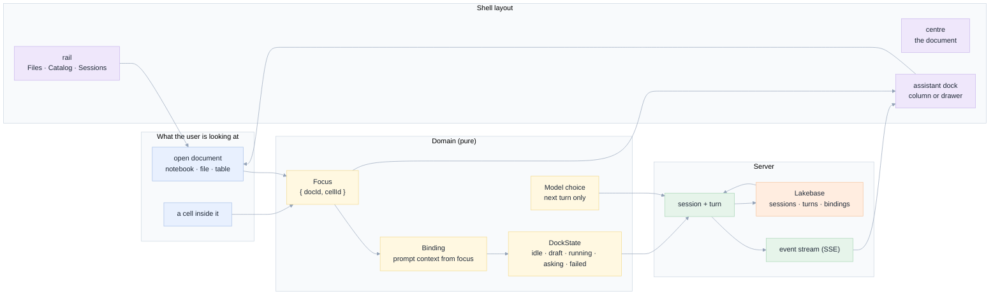

# 006 · On par with Genie Code

**A specification and implementation plan for making EdgeGenie's shell as usable as Databricks Genie
Code, and in three specific ways better: the conversation sits beside the document it is about, the
model is one control away at every width, and nothing the user does in the browser is lost on a
reload.**

> **Status:** **implemented** (phases P1–P5, P7 and P8; P6 persistence is specified, not built —
> see [09](09-implementation-plan.md#status-what-is-built)). 8 November 2026.
> The implementation corrected three claims in the first draft; they are listed in
> [11 §corrections](11-decisions-risks.md#corrections-the-implementation-forced).
> **Scope:** `apps/coding-agent/web` (shell, assistant dock, files list, model control) and
> `apps/coding-agent/api` (conversation-scoped bindings, cell scope, durable session store).
> **Relation to earlier specs:** builds on [001 · Perfect shell](../001-perfect-shell/README.md)
> (geometry, zones, persistence discipline), [003 · Dev UX/UI](../003-improve-dev-ux-ui/README.md)
> (the editing surface and its gap assessment) and [005 · Every model, one picker](../005-llm-models/README.md)
> (the catalogue, resolver and picker component). It **replaces** none of them; it finishes three
> things they each deferred.
> **Audience:** product, full-stack, database, UX/UI, front-end, Databricks platform.

---

## The one-paragraph version

Genie Code's defining interaction is not its model and not its answers: it is that **the assistant is
a pane, not a tab**. Open a notebook in Databricks and the conversation stays docked to the right of
it, already aware of the file you are looking at, and accepting input without you leaving the code.
EdgeGenie has the same parts and the wrong composition. The conversation is a *tab* in the centre
pane (`view === CHAT`), so opening a file to look at it *unmounts* the conversation; the right column
is an inspector that only reports session facts, with no composer; and the model control lives in the
top bar and is hidden by CSS below 1100 px
([`styles.css:210-213`](../../apps/coding-agent/web/src/styles.css)). The result is an app whose
best feature — an agent that reads, writes, runs and proves — is unavailable exactly when the user is
looking at the thing they want changed.

This spec re-composes the shell around a single new object, the **assistant dock**: a conversation
surface bound to a **focus** (`{ document, cell }`), docked in the right column at wide widths, a
drawer at narrow ones, reachable from the keyboard at every width, and able to start a session from
nothing. Around it: a Files pane that also lists (Databricks offers tree *and* list), a model control
that is identical in the composer and the top bar, and a durable store so the dock's contents survive
the reload that a deployed app performs on every redeploy.

---

## Why this document exists

Three requests, one theme:

| The request | What it actually exposes |
|---|---|
| "how genie code can open a conversation on the right side of a file to be in context to update" | The conversation and the document are in the *same* slot today. They must be two surfaces with one binding. [04](04-assistant-dock.md) |
| "make a deep assessment of the UI and specify how to improve EdgeGenie to be on par or superior" | No measured comparison exists. [01](01-current-state-audit.md) measures both, in numbers, with line cites. |
| "make sure also that is easy to choose the current AI Model" | The control exists, is well built, and *disappears* below 1100 px. Discoverability, not capability. [07](07-model-selection.md) |

---

## What is wrong today, in one table

Every row is verified against the code in this repository. The full audit with consequences is
[01](01-current-state-audit.md).

| # | Problem | Evidence |
|---|---|---|
| E1 | **The conversation is a tab.** Opening a file sets `view` to the file, so the transcript is not rendered at all. | [`App.tsx:40`](../../apps/coding-agent/web/src/App.tsx), [`App.tsx:523-535`](../../apps/coding-agent/web/src/App.tsx) |
| E2 | **The right column cannot talk.** `Inspector` has two tabs, `<Context>` and `<Audit>`, and no composer. | [`Chrome.tsx:51-128`](../../apps/coding-agent/web/src/components/Chrome.tsx) |
| E3 | **No assistant before a session exists.** The inspector column is suppressed until a session is loaded. | [`App.tsx:276`](../../apps/coding-agent/web/src/App.tsx) |
| E4 | **The model control vanishes below 1100 px.** The picker is only rendered when a session exists, and the chip is `display: none` below 1100 px. | [`App.tsx:447`](../../apps/coding-agent/web/src/App.tsx), [`styles.css:210-213`](../../apps/coding-agent/web/src/styles.css) |
| E5 | **A per-cell run button that does nothing.** `NotebookEditor` renders it and calls `onRunCell`, which `EditorSurface` never passes. | [`NotebookEditor.tsx:141-144`](../../apps/coding-agent/web/src/components/NotebookEditor.tsx), [`EditorSurface.tsx:378-407`](../../apps/coding-agent/web/src/components/EditorSurface.tsx) |
| E6 | **An in-cell "ask" that does nothing.** `EditorSurface` accepts `onAskCell` and forwards it; `Viewer` never receives it and `App` never sets it. | [`EditorSurface.tsx:51`](../../apps/coding-agent/web/src/components/EditorSurface.tsx), [`App.tsx:352-359`](../../apps/coding-agent/web/src/App.tsx) |
| E7 | **`@` searches only the user's home.** The composer calls `api.search(query)` with no root, so the server defaults to the home folder. | [`Composer.tsx:77`](../../apps/coding-agent/web/src/components/Composer.tsx) |
| E8 | **Nothing survives a restart.** The event store is in memory; a redeploy ends every session. | [`main.py:41`](../../apps/coding-agent/api/main.py), [`store.py`](../../apps/coding-agent/api/adapters/memory/store.py) |
| E9 | **Files is tree-only.** Databricks offers tree *and* list with type, owner and updated columns; ours has neither. | [`WorkspaceTree.tsx:410-420`](../../apps/coding-agent/web/src/components/WorkspaceTree.tsx) |
| E10 | **No `⌘J`.** There is no key that brings the assistant forward, and no key is taken. | [`App.tsx:284-322`](../../apps/coding-agent/web/src/App.tsx) |

---

## The design in one picture



Three sentences carry the whole design:

1. **The document and the conversation are two surfaces of one binding.** Changing focus changes
   what the next prompt is about, and never closes the conversation.
2. **The dock is a zone, not a tab.** Wide: a column beside the document. Narrow: a drawer over it,
   opened by `⌘J`, never by itself.
3. **A control either works or is not shown.** No dead buttons: a run affordance that cannot run is
   removed until it can, and a model chip that is hidden at a width is a bug.

---

## Scope

**In scope**

- The assistant dock: focus binding, four states, docked/drawer behaviour, `⌘J`, start-from-nothing.
- Cell scope: "ask about this cell" and "use this cell in the conversation", end to end.
- Files as tree **and** list, with breadcrumbs, the columns that decide what to open, and a Create
  affordance — parity with the Databricks workspace browser.
- Exactly one model control, present at every width, in two places, with a visible next-turn pin.
- Durable conversation state in Lakebase, so a reload (and a redeploy) does not erase a session.
- The measured comparison against Genie Code, with before/after numbers.

**Out of scope, and why**

| Not doing | Reason |
|---|---|
| Notebook cell **execution** with outputs in the page | This is the largest remaining gap from [003 G2](../003-improve-dev-ux-ui/08-databricks-gap-assessment.md), and it needs a real executor path (`NB-6`: no second executor). The dock makes it *reachable*; shipping it needs its own spec. The run button is removed until then ([11 D3](11-decisions-risks.md)). |
| Multi-user presence and cursors | [004 · CRDT collaboration](../004-crdt-collaboration/README.md) owns it. The dock has one author per session. |
| A model router that picks per turn | [005 D7](../005-llm-models/11-decisions-risks.md) deferred it; the resolver seam is unchanged here. |
| Copying Databricks' navigation rail (Jobs, Compute, Catalog, Marketplace) | We are not a workspace. We are the assistant that works *in* one. The rail keeps three tabs. |
| A second design language | The shell stays as [001](../001-perfect-shell/README.md) set it: warm neutrals, one accent, tokens only. |

---

## Reading map

| # | Document | The question it answers | Lead lens |
|---|---|---|---|
| 00 | [Why, from first principles](00-why-first-principles.md) | Why does this matter, and what is irreducibly true? | PO |
| 01 | [Current-state audit](01-current-state-audit.md) | What exists, measured, with line numbers — and what Genie Code does instead? | full-stack + UX |
| 02 | [Requirements](02-requirements.md) | What must be true when we are done? | PO + UX |
| 03 | [Architecture](03-architecture.md) | How is it built, and where does each piece live? | full-stack |
| 04 | [The assistant dock](04-assistant-dock.md) | How does a conversation stay in context of a file, and update it? | UX + full-stack |
| 05 | [Data model in Lakebase](05-data-model-lakebase.md) | What do we store, and how is it shaped? | database |
| 06 | [UX, wireframes, navigation](06-ux-wireframes.md) | What does the user see, in ASCII, at every state? | UX + front-end |
| 07 | [Choosing the model](07-model-selection.md) | How is the current model always one control away? | front-end + AI |
| 08 | [Six lenses](08-lenses.md) | What does each discipline refuse to ship without? | all six |
| 09 | [Implementation plan](09-implementation-plan.md) | In what order, with what acceptance, DRY and SOLID? | full-stack |
| 10 | [Edge cases and testing](10-edge-cases-testing.md) | What can go wrong, what stops it, which test fails if it does? | compiler + UX |
| 11 | [Decisions and risks](11-decisions-risks.md) | What did we choose, reject, and fear? | PO |
| 12 | [E2E and screenshots](12-e2e-plan.md) | How is "on par" demonstrated rather than asserted? | front-end + QA |
| 13 | [The UX assessment, graded](13-ux-assessment.md) | What exactly is still behind Databricks, how much, and what closed it? | UX + PO |
| 14 | [Genie Code gap analysis](14-genie-code-gap-analysis.md) | What does Genie Code do that we do not, what is it worth, and what closed it? | UX + PO |

---

## Cross-reference matrix

A change in a row means re-reading the columns marked ●. This matrix is what keeps thirteen
documents from drifting apart.

| ↓ depends on → | 00 | 01 | 02 | 03 | 04 | 05 | 06 | 07 | 08 | 09 | 10 | 11 | 12 |
|---|---|---|---|---|---|---|---|---|---|---|---|---|---|
| **00 Why** | — | ● | ● | | ● | | | ● | | | | ● | |
| **01 Audit** | ● | — | ● | ● | ● | ● | ● | ● | | ● | ● | ● | ● |
| **02 Requirements** | ● | ● | — | ● | ● | ● | ● | ● | ● | ● | ● | ● | ● |
| **03 Architecture** | ● | ● | ● | — | ● | ● | ● | ● | ● | ● | ● | ● | ● |
| **04 Dock** | ● | ● | ● | ● | — | ● | ● | ● | ● | ● | ● | ● | ● |
| **05 Data model** | | ● | ● | ● | ● | — | | ● | ● | ● | ● | ● | ● |
| **06 UX** | | ● | ● | ● | ● | | — | ● | ● | ● | ● | ● | ● |
| **07 Model** | | ● | ● | ● | ● | ● | ● | — | ● | ● | ● | ● | ● |
| **08 Lenses** | ● | ● | ● | ● | ● | ● | ● | ● | — | ● | ● | ● | |
| **09 Plan** | ● | ● | ● | ● | ● | ● | ● | ● | ● | — | ● | ● | ● |
| **10 Edge cases** | | ● | ● | ● | ● | ● | ● | ● | ● | ● | — | ● | ● |
| **11 Decisions** | ● | ● | ● | ● | ● | ● | ● | ● | ● | ● | ● | — | ● |
| **12 E2E** | | ● | ● | ● | ● | ● | ● | ● | | ● | ● | ● | — |
| **13 UX assessment** | ● | ● | ● | ● | ● | | ● | ● | ● | ● | ● | ● | ● |

---

## The five sentences this spec must satisfy

If any of these is false in the deployed app, the design failed and this document is amended before
more code is written.

1. **Opening a document never hides the conversation**, at any width, in either direction.
2. **The dock states what it is about** — the document, and the cell if one is chosen — and the
   prompt sent carries that, so the agent updates the right object.
3. **The current model is visible and changeable at every width**, from the composer and the top bar,
   with the same control, and a switch applies to the next turn only.
4. **No control in the shell is inert.** Every button either does what it says or is not rendered.
5. **A reload keeps the conversation.** Closing the tab and coming back shows the turns, the
   bindings and the model the session is pinned to.

---

## Verification

Four checks keep this spec set honest. The first three run in CI; the fourth is the evidence.

```bash
cd apps/coding-agent/web
npm run verify:spec-006     # links + anchors, ASCII box alignment, wireframe generator check
npm run verify:spec-mermaid # every mermaid block parses (needs a scratch mermaid install)
npm run e2e:assistant       # the eleven scenes in 12-e2e-plan.md, screenshots to specs/006-databricks/e2e
```

---

## Provenance of the claims in this spec

| Label | Meaning |
|---|---|
| **[verified]** | Read in this repository's code, or reproduced in an evidence file |
| **[observed]** | Seen in the Databricks UI screenshots this spec was written from |
| **[documented]** | Taken from vendor documentation, with a link |
| **[proposal]** | A design decision of this spec, not yet built |
| **[unverified]** | Believed true, not checked; listed in [11 §What we have not verified](11-decisions-risks.md#what-we-have-not-verified) |

The Databricks behaviours in [01](01-current-state-audit.md) are **[observed]** from the Genie Code
screens under `specs/001-perfect-shell/e2e` and the screenshots attached to the request. Their
implementation details (DOM, routes) are not claimed.
