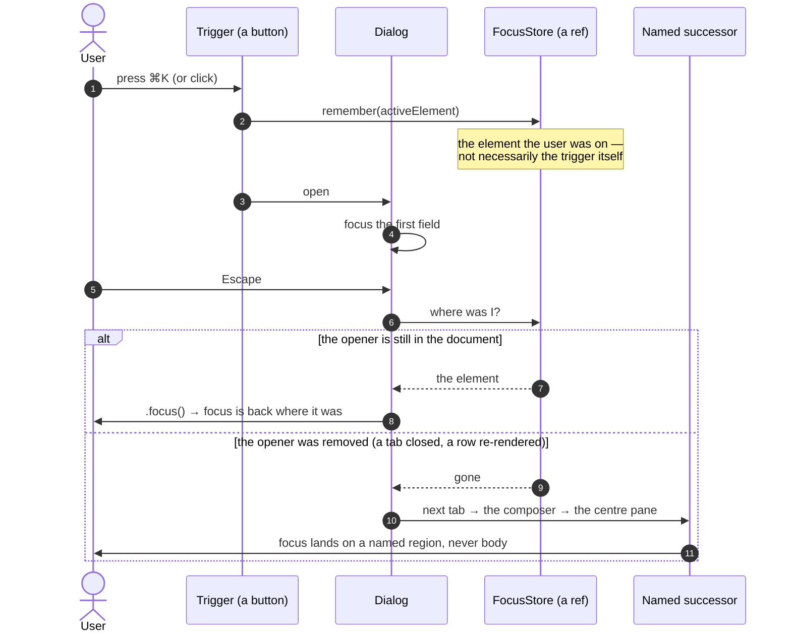
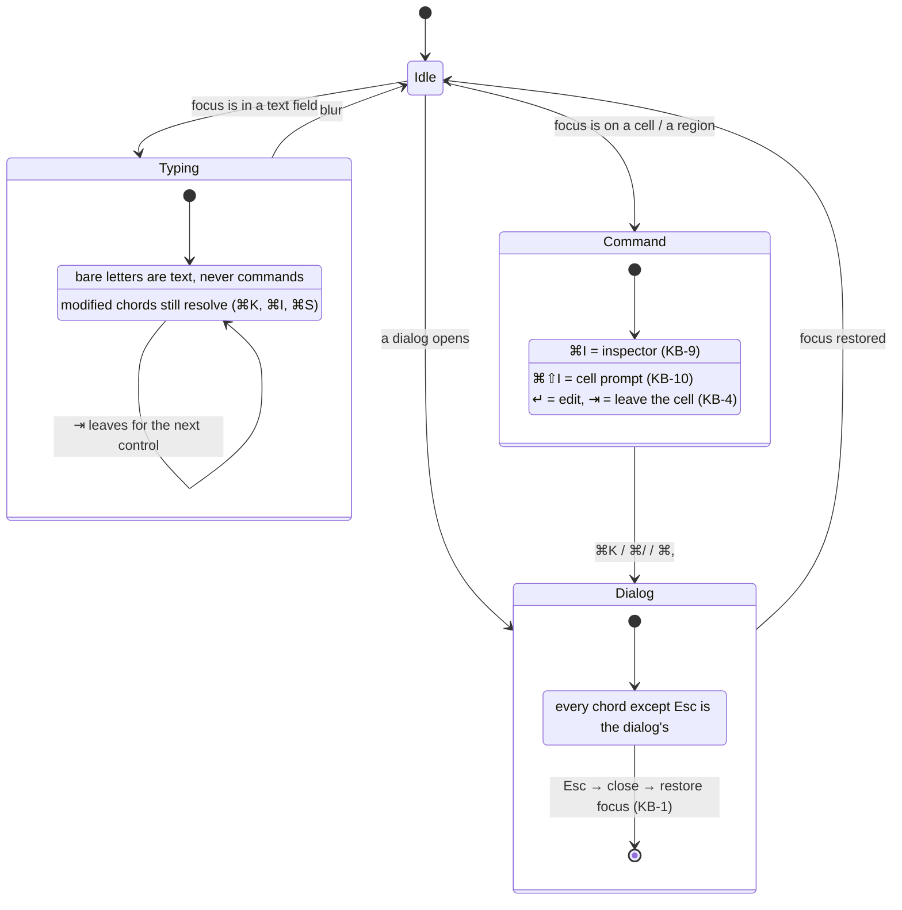
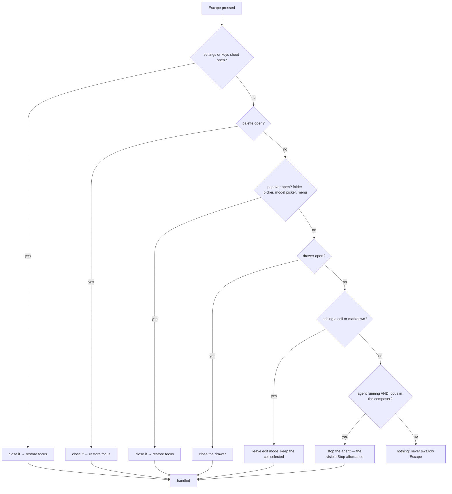
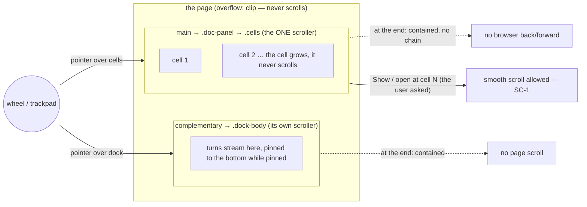
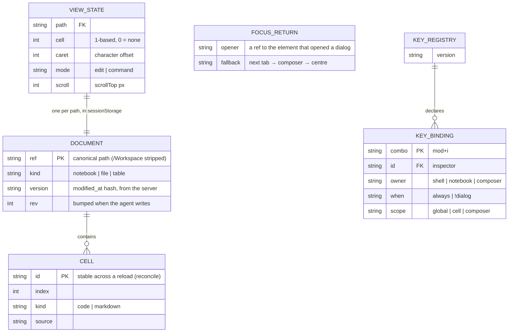
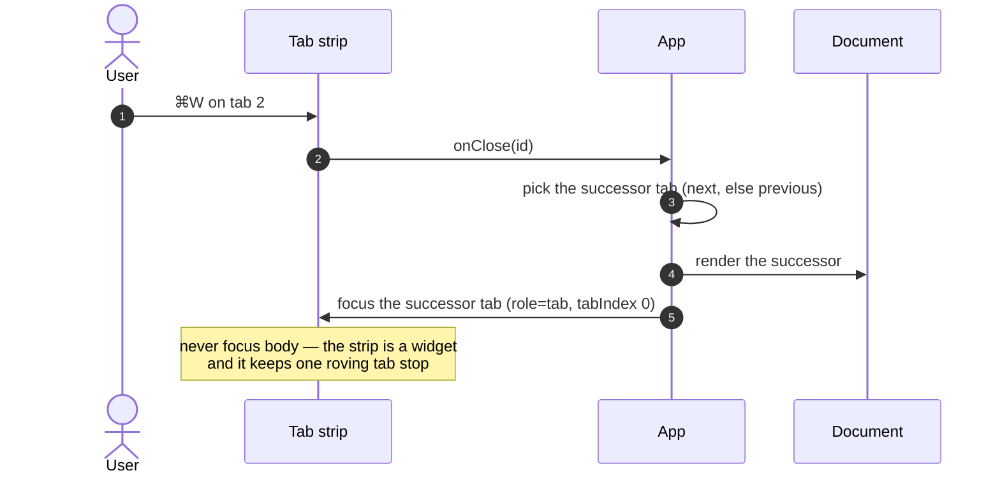

# 05 — Diagrams (Mermaid)

Part of [007](README.md). Requirements: [03](03-requirements.md). Wireframes: [04](04-wireframes.md).

---

## 1. A focus-returning dialog, as a sequence

The behaviour `KB-1` requires, drawn once. Every dialog in the app (`Palette`, `ShortcutSheet`,
`ProviderSettings`, `ApprovalSheet`, `FolderPicker`) must follow the same shape — which is why the
implementation is one hook, not five effects.

## 2. Chord arbitration — one owner, decided by context

`KB-2` + `[D3]`. The registry is data; the resolver is pure; the hook only dispatches.

## 3. Escape: one ordered meaning (`KB-8`)

The last branch is the important one: Escape is how a user leaves a full-screen mode, so the app
must not consume it when it has nothing to close. Today `Composer.tsx:241` stops the agent on
Escape from anywhere in the field; `KB-8` keeps that (it is the documented affordance next to the
Stop button) but makes the order explicit and testable.

## 4. Scrolling: who owns the wheel

`SC-2`, `SC-3`. One scroller per region; `overscroll-behavior: contain` stops the chain at the
region boundary so a trackpad flick cannot navigate the browser.

## 5. A view's state, and where it is remembered

The data model behind "never lose my place" — `KB-1`, plus the view state from round 3.

`FOCUS_RETURN` is not persisted — it is a ref for the life of an open dialog. `KEY_REGISTRY` is a
module constant; putting it here is the point of `KB-5`: the set is *a thing*, and a test can read it.

## 6. Opening and closing a document, with focus

How `KB-1` and `KB-4` interact with the tab strip (already implemented; drawn to show the seam).

