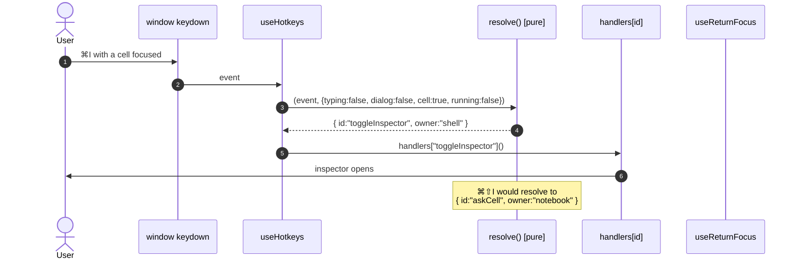

# 07 — Architecture

Part of [007](README.md). Requirements: [03](03-requirements.md). Plan: [08](08-implementation-plan.md).
Edge cases: [09](09-edge-cases.md).

---

## The shape, before and after

```
BEFORE                                    AFTER
──────────────────────────────────────    ──────────────────────────────────────────────
App.tsx (940 lines)                       App.tsx
 ├ handlers = useMemo({...20 closures })   ├ handlers (stateful actions only)
 ├ <header>                               ├ <SkipLinks />            ← new, 12 lines
 ├ <nav>  <main>  <aside>                 ├ <header> <nav> <main> <aside>
 └ dialogs                                └ dialogs
                                            ▲
useHotkeys (a lookup table)                useHotkeys (delegates to resolve())
                                            ▲
domain/keys.ts                             domain/keys.ts
 SHORTCUTS[]  (19 rows)                     SHORTCUTS[]  (21 rows, +owner +when +scope)
 comboOf / display / caps                   resolve(combo, {typing, dialog, cell, running})
                                            ▲
                                           hooks/useReturnFocus.ts   ← new, 30 lines
```

Nothing is moved that does not have to move. `layout.ts`, `viewstate.ts`, `reconcile.ts`,
`cellkeys.ts` are untouched — they already satisfy their rules and have tests.

---

## 1. `domain/keys.ts` — the registry becomes a contract

Three additive fields on `Shortcut`, one new pure function. No behavioural change to `comboOf`,
`display`, `caps`, `grouped`, `isTyping` — every existing call site keeps working.

```ts
export type Owner = "shell" | "notebook" | "composer";
export type When = "always" | "no-dialog";

export interface Shortcut {
  id: string;
  combo: Combo;
  label: string;
  group: "General" | "Navigate" | "Session" | "Compose" | "Panes" | "Appearance";
  /** Who answers this chord. Exactly one owner per combo. */
  owner: Owner;
  /** When the owner answers. A dialog takes every chord except Escape. */
  when?: When;
}

/** The chord(s) that actually apply right now, most specific first. Pure: no DOM, no React. */
export function resolve(
  e: KeyLike,
  ctx: { typing: boolean; dialog: boolean; cell: boolean; running: boolean },
): Resolved | null;
```

`resolve` is where `KB-2` lives. It returns `{ id, owner, combo }` or `null`. The app's `handlers`
object stays keyed by `id` — so a handler never has to know which chord reached it, which is what
makes the sheet and the binding agree by construction.

**Why a function and not more branches in `useHotkeys`:** the arbitration is the hard part, and it is
the part that must be tested. A pure function over a context object can be tested in 12 lines; a
listener cannot be tested without a DOM and a rendered app.

## 2. `hooks/useReturnFocus.ts` — the only place focus is restored

```ts
export function useReturnFocus(open: boolean, opts?: { fallback?: () => HTMLElement | null }): void;
```

On `open: true` it records `document.activeElement`. On `open: false` it restores: the recorded
element if `el.isConnected`, else `opts.fallback()` (the next tab, the composer, the centre pane),
else `document.querySelector("main")`. It never leaves focus on `body`.

**Why a hook and not a component prop:** focus is an *effect of open/close*, and each dialog is
already its own component. A hook means the contract is one file, and a new dialog gets it by
construction.

**Call sites (5):** `Palette`, `ShortcutSheet`, `ProviderSettings`, `ApprovalSheet`, `FolderPicker`.
`ModelPicker` keeps its own (it already returns focus to its trigger, and it is a popover whose
trigger is stable — verified).

## 3. `components/SkipLinks.tsx` — reachability (P5)

```tsx
<div className="skip-links">
  <a href="#doc-panel" onClick={focusTarget} className="skip-link">Skip to the work</a>
  <a href="#dock" onClick={focusTarget} className="skip-link">Skip to the conversation</a>
</div>
```

`onClick` calls `preventDefault()` and `target.focus()` after `tabIndex={-1}` is present on the
target, so the browser does not just scroll to it — the next Tab continues inside the region.

Targets: `#doc-panel` (already exists, `role="tabpanel"`) and a new `id="dock"` on the `<aside>`.
Both get `tabIndex={-1}`, which makes them programmatically focusable without entering the Tab ring.

**Rendered inside `header.topbar`** so it inherits the bar's stacking and cannot be clipped, and
`position: absolute` so it does not add a row.

## 4. `KB-4` — a cell as one Tab stop

The cell `<section>` already has `tabIndex={0|-1}` and command mode. What changes is that its six
action buttons become `tabIndex={-1}` and the section handles arrows between them:

```
section (Tab stop)  ──Tab──▶ next cell
   ←/→  move focus between [collapse, →code, Ask, link, Run, +, ✕]
   ↵     edit the source
```

Implementation: a small pure helper `nextInRing(index, len, step)` (tested) + `onKeyDown` on the
section's action bar. The buttons keep their names and click handlers; only their Tab entry changes.
This is the only change that touches the notebook editor, and it is local to `CellBlock`.

## 5. `SC-1` — the scroll rules, in CSS

| Selector | Today | After |
|---|---|---|
| `.transcript` | `scroll-behavior: smooth` | removed |
| `.dock-body` | `scroll-behavior: smooth` | removed |
| `.cells` | `overscroll-behavior: auto` | `contain` |
| `.dock-body` | — | `overscroll-behavior: contain` |
| `.transcript` | — | `overscroll-behavior: contain` |

The "Show" jump (round 3) passes `behavior: "smooth"` explicitly in JS, so the user-requested jump
stays smooth while nothing else does. That is the distinction `SC-1` draws.

## 6. `KB-3` — a focus style that is the field's own

```css
.composer textarea:focus-visible {
  outline: 2px solid var(--blue-600);
  outline-offset: -2px;       /* inside the field, so the wrapper's ring and this one nest */
  border-radius: var(--radius-sm);
}
```

`outline` (not border) so nothing reflows. `-2px` so it reads as the field's ring inside the box's
ring, not a third box.

---

## Data flow: one keypress



The point of the diagram: **the editor no longer participates**. `NotebookEditor` keeps a keydown
handler for its own command-mode letters (they are single keys, not chords, and they belong to the
cell), but every *chord* resolves in one place.

## Decisions

| id | Decision | Alternative rejected, and why |
|---|---|---|
| **D1** | `⌘I` = inspector, `⌘⇧I` = cell prompt | Swapping them (prompt keeps `⌘I`) leaves the sheet wrong for the commoner surface; and the inspector is the "more info" act, which `⌘I` conventionally means |
| **D2** | Focus return is a hook, not a context | A context would make every dialog subscribe to app state to know if it is open — the hook already knows |
| **D3** | `resolve()` is pure and ordered, not event-based | Event order is invisible in review; a table is reviewable |
| **D4** | Skip links, not a landmark shortcut | Browsers do not expose landmark navigation reliably; a skip link works everywhere and is one element |
| **D5** | Cell actions become `tabIndex={-1}` | Removing the buttons entirely would break discoverability for pointer users; a roving ring keeps both |
| **D6** | `contain`, not `none` on overscroll | `none` also disables the visual "bounce", which reads as frozen; `contain` stops chaining and keeps the feel |
| **D7** | Keep Stop-on-Escape in the composer | It is documented next to the button; removing it would be a regression. `KB-8` only fixes the *order* |
| **D8** | No new dependency | Everything here is a hook, a pure function, and three CSS rules |
